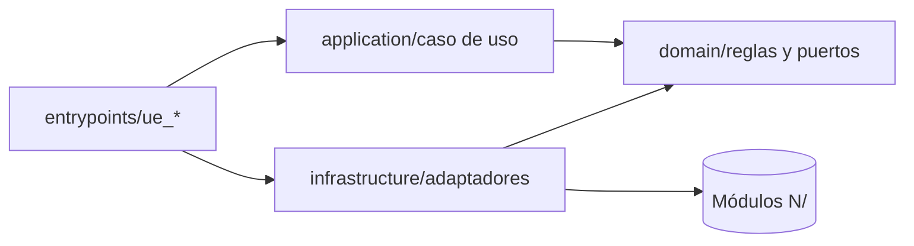

# Plantillas de salida por modo

Usar la plantilla del modo activo. Omitir una sección solo si no aplica y declararlo con "No aplica: motivo".

## Contenido

1. Diseño
2. Revisión
3. Refactorización (incluye la secuencia de pasos)
4. Consulta

## 1. Diseño

```
# Diseño de arquitectura: <solución>

## Nivel de arquitectura
Nivel <0-3>. Justificación en una o dos oraciones con las señales que lo determinan.

## Actores y adaptadores primarios
| Actor | Tipo de script | Archivo propuesto | Contexto de ejecución permitido |

## Casos de uso
| Caso de uso | Intención de negocio | Entrada (objeto plano) | Salida | Reglas RN-xx |

## Puertos secundarios
| Puerto | Operaciones (firma) | Lote | Adaptador propuesto | Módulo N/ | Operaciones N/ por llamada |

## Reglas de dominio
| Regla | Módulo | Pura (sin N/) | Reutilizada en |

## Patrones aplicados
| Patrón | Dónde | Variación que resuelve | Alternativa descartada |

## Estructura de archivos
Árbol de carpetas por capa.

## Diagrama de dependencias
Mermaid: flechas siempre hacia adentro.

## Estrategia de pruebas
| Capa | Qué se prueba | Tipo |

## Derivaciones a otras skills
| Puerto | Qué se debe validar | Skill |

## Supuestos
```

Diagrama de dependencias de referencia:



## 2. Revisión

```
# Revisión de arquitectura: <archivo o proyecto>

## Resumen
| Concepto | Valor |
|---|---|
| Archivos revisados | |
| Nivel actual | |
| Nivel recomendado | |
| Hallazgos Alta / Media / Baja | |

## Hallazgos
| # | ID regla | Severidad | Archivo:línea | Evidencia | Consecuencia | Corrección |

## Fortalezas
Una o dos oraciones; solo si son concretas.

## Derivaciones
Hallazgos de seguridad, gobernanza, campos o permisos que corresponden a otras skills.
| Hallazgo | Puerto | Skill |

## Siguiente paso recomendado
Refactorización por pasos, o "sin cambios" si el nivel actual es el adecuado.
```

La evidencia cita el fragmento mínimo necesario. No copiar archivos completos.

## 3. Refactorización

### Secuencia de pasos

Cada paso conserva el comportamiento, se puede desplegar solo y termina con las pruebas en verde.

| Paso | Nombre | Acción | Se detiene aquí si |
|---|---|---|---|
| R0 | Inventario | Entry points, deployments, `scriptfile`, scripts y workflows sobre el mismo registro, contextos de ejecución | Nivel objetivo 0 |
| R1 | Versión | Si es SuiteScript 1.0, migrar a 2.1 por el puerto P-05 y estabilizar en sandbox | — |
| R2 | Caracterización | Pruebas que fijan el comportamiento actual | — |
| R3 | Nombres y constantes | Renombrar variables y funciones internas; IDs a constantes (CC-01, CC-03) | — |
| R4 | Extraer reglas puras | Mover cálculos y validaciones a `domain/` sin cambiar su lógica | Nivel objetivo 1 |
| R5 | Entry point humilde | Dejar en el entry point solo filtro, mapeo, invocación y escritura (CA-10) | — |
| R6 | Puertos | Declarar contratos para cada acceso a `N/` que use la lógica | — |
| R7 | Adaptadores | Mover el acceso a `N/` a `infrastructure/`; operaciones por lote donde haya bucles (HX-05) | — |
| R8 | Composition root | Inyectar adaptadores desde el entry point (HX-06) | Nivel objetivo 2 |
| R9 | Validación de plataforma | Gobernanza, seguridad y permisos por los puertos P-01, P-02 y P-04 | — |

### Plantilla

```
# Plan de refactorización: <archivo>

## Estado inicial
Nivel actual, hallazgos principales (IDs), riesgos de tocar este archivo.

## Nivel objetivo
Nivel y justificación.

## Restricciones
- Ruta de entry point: se conserva / se cambia con actualización de Object XML (requiere confirmación).
- Scripts o workflows dependientes.
- Contextos de ejecución que deben seguir funcionando.

## Pasos
| Paso | Cambio concreto | Archivos | Prueba que lo protege | Riesgo |

## Defectos encontrados (fuera de alcance del refactor)
| Defecto | Evidencia | Propuesta de corrección como cambio aparte |

## Verificación final
Pruebas en verde, comparación de gobernanza antes/después, despliegue en sandbox.
```

Cuando el usuario pida el código refactorizado, entregarlo paso por paso, no todo junto, salvo petición explícita.

## 4. Consulta

```
Concepto: <nombre> (<obra, autor>)

Idea: una o dos oraciones con palabras propias.

En SuiteScript: traducción concreta.

Ejemplo mínimo: solo si aporta.

Cuándo no aplicarlo: condición concreta.

Relacionado: IDs del catálogo o archivo de referencia.
```
