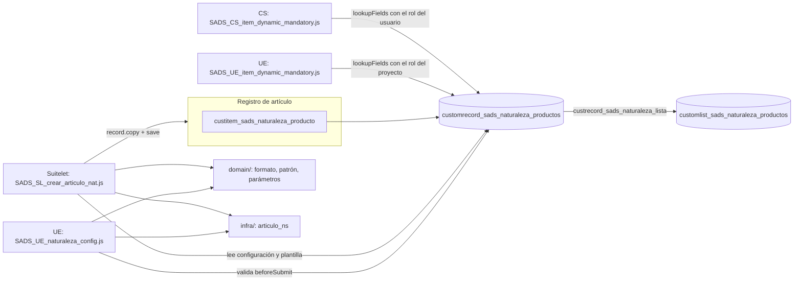

# Naturaleza-de-Productos
Control de artículos por naturaleza de producto en NetSuite.
Cada naturaleza tiene un registro de configuración con la lista de campos de artículo que la describen (parámetros).
Esos campos son obligatorios en la interfaz y en el servidor.
Un Suitelet crea artículos nuevos de una naturaleza a partir de sus parámetros, copiando un artículo plantilla.

| Dato | Valor |
|---|---|
| Fecha de actualización | 2026-11-14 |
| Tipo de proyecto | SuiteCloud SDF, Account Customization (`src/manifest.xml`) |
| Nombre del proyecto | Naturaleza de Productos |
| Plataforma | SuiteScript 2.1 |
| Ambiente de desarrollo | Sandbox `Almetal_SB` (`project.json`) |
| Pruebas | Jest 30 con `@oracle/suitecloud-unit-testing` |
| Iteración vigente | A: creación de artículos sin cálculo de precios; artículos inactivos |

## 1. Resumen
El campo de artículo `custitem_sads_naturaleza_producto` apunta a un registro de `customrecord_sads_naturaleza_productos`.
Ese registro guarda en `custrecord_sads_naturaleza_config` un arreglo JSON de IDs de campo de artículo.
Un Client Script marca esos campos como obligatorios en pantalla y un User Event bloquea el guardado si alguno viene vacío.
El mismo registro guarda el ID interno de un artículo plantilla y los patrones de nombre y código.
El Suitelet de creación pide los parámetros y el peso, copia la plantilla y genera nombre y código con los patrones.
Un User Event valida la captura manual del registro de configuración.

| Componente | Archivo | Tipo | Entry points | Función |
|---|---|---|---|---|
| CS | `SADS_CS_item_dynamic_mandatory.js` | ClientScript 2.1 | `pageInit`, `fieldChanged`, `saveRecord` | Lee la configuración con `search.lookupFields`, marca obligatorios y bloquea el guardado en la UI. |
| UE de artículo | `SADS_UE_item_dynamic_mandatory.js` | UserEventScript 2.1 | `beforeSubmit` (CREATE y EDIT) | Valida en servidor y lanza `MISSING_DYNAMIC_MANDATORY_FIELDS` si falta un campo. |
| Suitelet | `SADS_SL_crear_articulo_nat.js` | Suitelet 2.1 | `onRequest` | Crea artículos de una naturaleza en dos pasos más confirmación. |
| UE de configuración | `SADS_UE_naturaleza_config.js` | UserEventScript 2.1 | `beforeSubmit` (CREATE, EDIT y XEDIT) | Rechaza configuraciones con JSON, plantilla o patrones inválidos. |
| Dominio | `domain/SADS_naturaleza_config_formato.js` | Módulo AMD sin `N/` | — | Contrato del JSON y errores de dominio. |
| Dominio | `domain/SADS_naturaleza_patron.js` | Módulo AMD sin `N/` | — | Marcadores `{id}` de los patrones de nombre y código. |
| Dominio | `domain/SADS_naturaleza_parametros.js` | Módulo AMD sin `N/` | — | IDs seguros, valores capturados y criterios de duplicado. |
| Adaptador | `infra/SADS_naturaleza_articulo_ns.js` | Módulo AMD con `N/search` | — | Tipo de registro de un artículo por ID interno. |

## 2. Arquitectura



```
 Usuario edita artículo         Usuario crea artículo          Usuario técnico configura
          │                               │                               │
          ▼                               ▼                               ▼
 ┌──────────────────┐          ┌──────────────────────┐        ┌──────────────────────┐
 │ CS (UI) y        │          │ Suitelet de creación │        │ UE de configuración  │
 │ UE de artículo   │          │ + domain/ + infra/   │        │ + domain/ + infra/   │
 └────────┬─────────┘          └──────────┬───────────┘        └──────────┬───────────┘
          │ lee                           │ lee y copia plantilla         │ valida
          ▼                               ▼                               ▼
 ┌───────────────────────────────────────────────────────────────────────────────────────────────────────────────────────────────────────┐
 │ customrecord_sads_naturaleza_productos                                                                                                │
 │ custrecord_sads_naturaleza_config     = ["custitem_pl_ancho","custitem_pl_espesor","custitem_pl_largo"]                               │
 │ custrecord_sads_naturaleza_plantilla  = ID interno del artículo plantilla                                                             │
 │ custrecord_sads_naturaleza_patron_cod = PLA36{custitem_pl_espesor:centesimas3}{custitem_pl_ancho}{custitem_pl_largo}                  │
 │ custrecord_sads_naturaleza_patron_nom = Placa Acero TA36 {custitem_pl_espesor:fraccion16}'' {custitem_pl_ancho}'x{custitem_pl_largo}' │
 └───────────────────────────────────────────────────────────────────────────────────────────────────────────────────────────────────────┘
```

Los IDs de ejemplo son ficticios. Con espesor 0.5, ancho 6 y largo 20 el código es `PLA36050620` y el nombre `Placa Acero TA36 1/2'' 6'x20'`.
La sintaxis de los patrones y sus formatos está en la sección 4 de la documentación del Suitelet.

## 3. Objetos SDF
| Objeto | Tipo | Archivo en src/Objects |
|---|---|---|
| Campo gatillo de artículo | `itemcustomfield` | custitem_sads_naturaleza_producto.xml |
| Lista de naturalezas | `customlist` | customlist_sads_naturaleza_productos.xml |
| Registro de configuración (lista, JSON, plantilla y patrones) | `customrecordtype` | customrecord_sads_naturaleza_productos.xml |
| Rol del proyecto (`runasrole` del UE de artículo; `LIST_CUSTRECORDENTRY` VIEW) | `role` | customrole_sads_naturaleza_config_exec.xml |
| Client Script con 6 deployments | `clientscript` | customscript_sads_cs_item_dynamic_mandat.xml |
| User Event de artículo con 6 deployments | `usereventscript` | customscript_sads_ue_item_dynamic_mandat.xml |
| Suitelet de creación, deployment y parámetro `custscript_sads_sl_art_activo` | `suitelet` | customscript_sads_sl_crear_articulo_nat.xml |
| User Event de configuración y deployment | `usereventscript` | customscript_sads_ue_naturaleza_config.xml |

Deployments del CS y del UE de artículo:
| Tipo de artículo | Deployment CS | Deployment UE | Estado |
|---|---|---|---|
| Inventariable | `customdeploy_item_invprt_mandatory_flds` | `customdeploy_ue_item_invprt_mndry_flds` | RELEASED |
| No inventariable | `customdeploy_cs_item_noninv_mndry_flds` | `customdeploy_ue_item_noninv_mndry_flds` | TESTING |
| Otro cargo | `customdeploy_cs_item_othchg_mndry_flds` | `customdeploy_ue_item_othchg_mndry_flds` | TESTING |
| Servicio | `customdeploy_cs_item_serv_mndry_flds` | `customdeploy_ue_item_serv_mndry_flds` | TESTING |
| Kit | `customdeploy_cs_item_kit_mndry_flds` | `customdeploy_ue_item_kit_mndry_flds` | TESTING |
| Grupo de artículos | `customdeploy_cs_item_group_mndry_flds` | `customdeploy_ue_item_group_mndry_flds` | TESTING |

Los 6 deployments del UE de artículo corren con `customrole_sads_naturaleza_config_exec`.
El Suitelet (`customdeploy_sads_sl_crear_articulo_nat`) y el UE de configuración (`customdeploy_sads_ue_naturaleza_config`) corren con el rol del usuario.

Manifiesto: CUSTOMRECORDS, SUBSIDIARIES y SERVERSIDESCRIPTING son obligatorias; CRM y las demás funciones son opcionales.

## 4. Estructura de archivos
```
.
├── README.md
├── __tests__/
│   ├── SADS_SL_crear_articulo_nat.test.js
│   ├── SADS_UE_naturaleza_config.test.js
│   ├── SADS_naturaleza_articulo_ns.test.js
│   ├── SADS_naturaleza_config_formato.test.js
│   ├── SADS_naturaleza_parametros.test.js
│   ├── SADS_naturaleza_patron.test.js
│   └── sample-test.js                      # Plantilla de SuiteCloud
├── planes/                                 # Planes y prompts de diseño
├── jest.config.js
├── package.json
├── project.json                            # authId de sandbox
├── suitecloud.config.js                    # Ejecuta Jest antes de project:deploy
└── src/
    ├── deploy.xml                          # ~/FileCabinet/* y ~/Objects/*
    ├── manifest.xml
    ├── FileCabinet/SuiteScripts/SADS_Naturaleza_Productos/
    │   ├── SADS_CS_item_dynamic_mandatory.js
    │   ├── SADS_UE_item_dynamic_mandatory.js
    │   ├── SADS_SL_crear_articulo_nat.js
    │   ├── SADS_SL_crear_articulo_nat.md    # Documentación del creador de artículos
    │   ├── SADS_UE_naturaleza_config.js
    │   ├── SADS_item_dynamic_mandatory.md   # Notas originales del CS y del UE de artículo
    │   ├── testt.js                         # Plantilla de Client Script 2.x sin Object XML
    │   ├── infra/
    │   │   └── SADS_naturaleza_articulo_ns.js
    │   └── domain/
    │       ├── SADS_naturaleza_config_formato.js
    │       ├── SADS_naturaleza_patron.js
    │       └── SADS_naturaleza_parametros.js
    └── Objects/                             # 8 Object XML (sección 3)
```

`SADS_item_dynamic_mandatory.md` cita nombres de archivo que no coinciden con los actuales.
`testt.js` se sube al File Cabinet por `~/FileCabinet/*`, pero no tiene registro de script en el proyecto.

## 5. Pruebas
Comando: `npm test` o `npx jest`; no requiere cuenta NetSuite.

| Suite | Pruebas | Alcance |
|---|---|---|
| `SADS_SL_crear_articulo_nat.test.js` | 69 | Entry point del Suitelet con `jest.mock` de `N/`. |
| `SADS_UE_naturaleza_config.test.js` | 38 | Entry point del UE de configuración, incluido XEDIT. |
| `SADS_naturaleza_articulo_ns.test.js` | 7 | Adaptador de tipo de registro. |
| `SADS_naturaleza_config_formato.test.js` | 109 | Contrato del JSON y compatibilidad con la lectura del CS y del UE. |
| `SADS_naturaleza_parametros.test.js` | 59 | IDs, valores capturados y criterios de duplicado. |
| `SADS_naturaleza_patron.test.js` | 115 | Marcadores, formatos `centesimas3` y `fraccion16`, y sustitución. |
| `sample-test.js` | 2 | Plantilla de SuiteCloud. |

Resultado del 2026-11-14: 7 suites aprobadas de 7; 399 pruebas aprobadas de 399.
`suitecloud project:validate` no se ejecutó para esta versión (sin cuenta en el entorno de desarrollo).
El CS y el UE de artículo no tienen pruebas Jest.

## 6. Despliegue
1. `npm test` en verde; el hook de `suitecloud.config.js` lo repite antes de `project:deploy`.
2. `project:deploy` envía todo `~/Objects/*`, incluidos los deployments del CS y del UE de artículo.
3. Después del primer despliegue: inactivar en la cuenta el Suitelet retirado `customscript_sads_sl_naturaleza_config`, y borrar o inactivar el campo `custrecord_sads_naturaleza_tipo_art` y la lista `customlist_sads_tipos_articulo`; SDF no los borra.
4. Usuarios técnicos: crear los `custitem` de parámetros y capturar JSON, plantilla y patrones en cada configuración.
5. Después de cada despliegue, re-aplicar en la UI la audiencia del Suitelet; el XML la deja vacía.
6. Iteración A: `custscript_sads_sl_art_activo` = F; los artículos se crean inactivos y conservan los precios de la plantilla.
7. Iteración B: cálculo de precios (plan v3) y parámetro en T; solo entonces se libera a producción.

El procedimiento completo, los supuestos por validar en sandbox, los riesgos y el troubleshooting están en la documentación del Suitelet.

## 7. Documentación
| Documento | Contenido |
|---|---|
| [SADS_SL_crear_articulo_nat.md](src/FileCabinet/SuiteScripts/SADS_Naturaleza_Productos/SADS_SL_crear_articulo_nat.md) | Suitelet y UE de configuración: arquitectura, flujo, guía técnica, SuiteQL, reglas, permisos, despliegue, supuestos, riesgos y troubleshooting. |
| [SADS_item_dynamic_mandatory.md](src/FileCabinet/SuiteScripts/SADS_Naturaleza_Productos/SADS_item_dynamic_mandatory.md) | Notas originales del CS y del UE de artículo. |
| [Plan v2](planes/2026-11-12_creador-articulos-naturaleza_plan_v2.md) | Diseño aprobado del creador de artículos. |
| [Prompt v2](planes/2026-11-12_creador-articulos-naturaleza_prompt_v2.md) | Especificación de implementación de la iteración A. |

## 8. Licencia
Ver [LICENSE](LICENSE).
