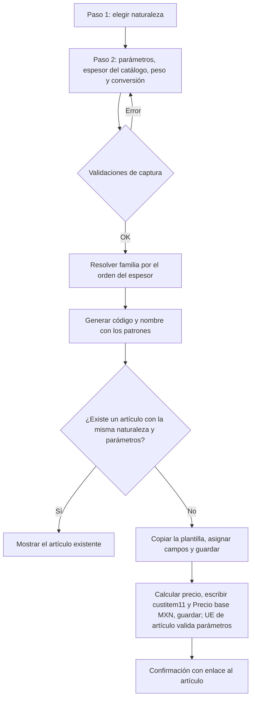
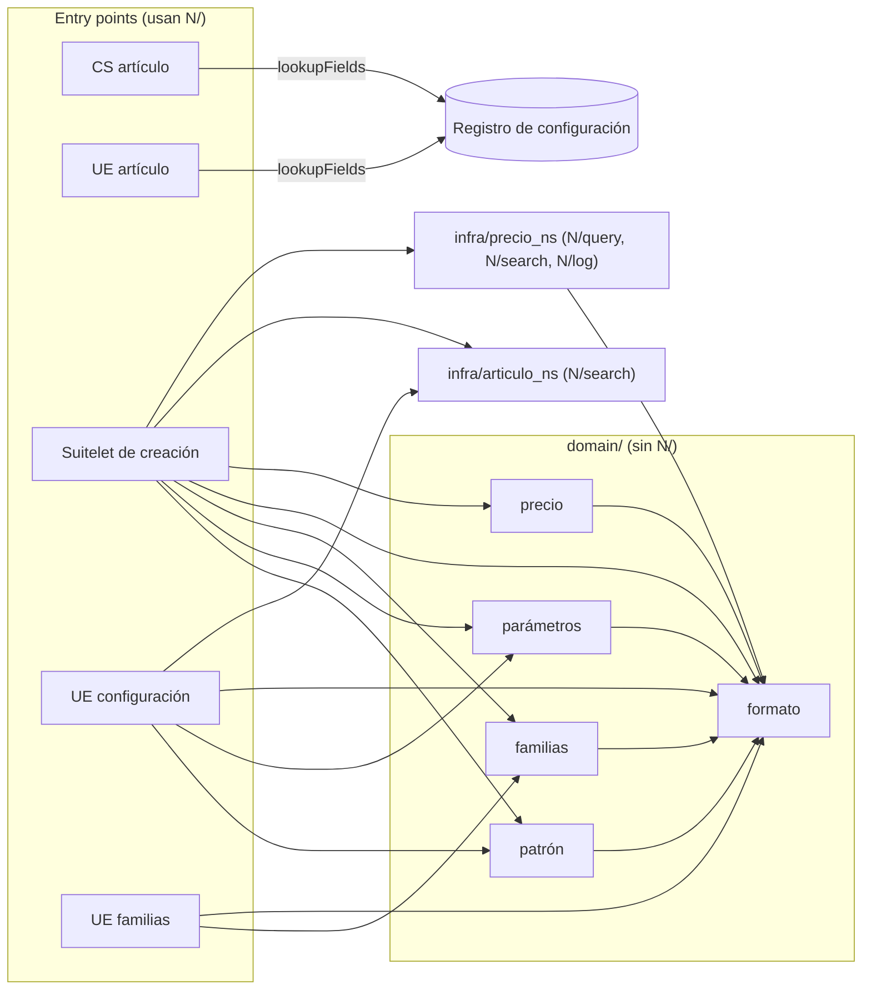

# Naturaleza de Productos
Personalización de NetSuite para Almetal que controla los artículos por naturaleza de producto.
Cada naturaleza define en un registro de configuración los campos de artículo que la describen (parámetros), un artículo plantilla y los patrones de código y nombre.
Los parámetros son obligatorios al editar un artículo, en pantalla y en servidor.
Un Suitelet crea artículos nuevos de una naturaleza con solo capturar sus parámetros: copia la plantilla, genera código y nombre, asigna familias de precio y de margen según el espesor y calcula el precio base.

| Dato | Valor |
|---|---|
| Tipo de proyecto | SuiteCloud SDF, Account Customization (`src/manifest.xml`) |
| Plataforma | SuiteScript 2.1 |
| Ambiente de desarrollo | Sandbox `Almetal_SB` (authId en `project.json`, excluido del control de versiones) |
| Pruebas | Jest 30 con `@oracle/suitecloud-unit-testing`: 13 suites, 619 pruebas aprobadas (2026-11-19) |
| Estado | Iteración B y cálculo de precio implementados; los artículos se crean inactivos hasta validar el precio en sandbox (P4-01 a P4-04) |
| Diseño vigente | [Plan v5](planes/2026-11-17_creador-articulos-naturaleza_plan_v5.md), [prompt v3](planes/2026-11-17_creador-articulos-naturaleza_prompt_v3.md) y [plan de cálculo de precio](planes/2026-11-18_calculo-precio-articulo_plan_v1.md) |
| Actualización | 2026-11-19 |

## 1. Alcance
| Capacidad | Componente | Quién lo usa |
|---|---|---|
| Marcar como obligatorios los parámetros de la naturaleza al editar un artículo | Client Script `SADS_CS_item_dynamic_mandatory.js` | Usuario que edita artículos |
| Bloquear en servidor el guardado de un artículo con parámetros vacíos | User Event `SADS_UE_item_dynamic_mandatory.js` | Toda vía de alta: UI, CSV, scripts |
| Crear un artículo a partir de parámetros, espesor, peso y conversión | Suitelet `SADS_SL_crear_articulo_nat.js` | Usuario con permiso para crear artículos |
| Validar la configuración capturada a mano | User Event `SADS_UE_naturaleza_config.js` | Usuario técnico |
| Validar las familias de precio y margen por rango de espesor | User Event `SADS_UE_nat_familia.js` | Usuario técnico |

| Fuera de alcance | Estado |
|---|---|
| Cálculo automático de la conversión de unidad desde la familia de precios | Pendiente (DA3-06); hoy se captura |
| Cálculo automático del peso | Pendiente; hoy se captura |
| Cambios a los campos fórmula de precio de la cuenta | No incluido; el Suitelet replica sus fórmulas (R4-01) |
| Formularios nativos por naturaleza | Descartado (D-01) |
| Migración de artículos existentes al catálogo de espesores | No incluido |

## 2. Funcionamiento
### 2.1 Configuración (usuarios técnicos)
| Registro | Qué guarda |
|---|---|
| `customrecord_sads_naturaleza_productos` | Por naturaleza: arreglo JSON con los IDs de los parámetros, ID interno del artículo plantilla, patrón de código, patrón de nombre y tipo de espesor. |
| `customrecord_sads_nat_familia` | Sublista de la configuración: rangos de espesor con su familia de precio y su familia de margen. Una línea sin rango es familia única. |
| `customrecord_sads_espesor` | Catálogo de espesores por tipo (fracción de pulgada, calibre, milímetros, cédula): texto para el nombre, segmento para el código y orden de grosor. |

### 2.2 Creación de un artículo


El Suitelet escribe solo estos campos sobre la copia; el resto se hereda de la plantilla.
| Campo | Valor |
|---|---|
| `custitem_sads_naturaleza_producto` | Configuración elegida |
| Parámetros del JSON (lados, espesor) | Valores capturados |
| `weight` y `custitem_drt_ci_precio_teorico` | Peso capturado |
| `custitem_alm_articulo_conversionunidad` | Conversión capturada |
| `custitem_pfp_famprecios_` y `custitem_pfp_fammargenes_` | Familias de la línea cuyo rango contiene el espesor |
| `itemid`, `purchasedescription` y `salesdescription` | Nombre generado (D-19) |
| `displayname` y `vendorname` | Código generado (D-19) |
| `upccode` y `mpn` | Vacíos |
| `custitemalm_articulo_preciocotizacion` y `custitem_drt_ci_margen_para_venta` | Precio de cotización y margen de las familias asignadas |
| `custitem11` y nivel Precio base MXN | Precio de venta sin IVA calculado con la cadena de campos fórmula; los demás niveles quedan vacíos |
| `isinactive` | Según el parámetro `custscript_sads_sl_art_activo`; hoy F, el artículo se crea inactivo |

### 2.3 Patrones de código y nombre
Un marcador es `{id}` o `{id:formato}`; el `id` debe estar en el JSON de la configuración.
| Formato | Resultado | Ejemplo |
|---|---|---|
| Sin formato | Número sin ceros a la derecha | 6 → `6` |
| `centesimas3` | Centésimas truncadas, 3 dígitos | 0.375 → `037` |
| `fraccion16` | Fracción reducida, hasta 1/16 | 1.25 → `1 1/4` |
| `entero1` | Entero de 1 a 9 | 7 → `7` |
| `entero2` | Entero de 1 a 99, con cero a la izquierda | 7 → `07` |
| `decimal2` | Número mayor que 0 con 2 decimales | 6 → `6.00` |
| `codigo` | Segmento de código del espesor elegido | 1/2" → `050` |
| `texto` | Texto del espesor elegido | 1/2" → `1/2"` |

`codigo` y `texto` solo aplican al campo de espesor; los demás formatos solo a campos numéricos.
La sintaxis completa está en la [documentación del Suitelet](src/FileCabinet/SuiteScripts/SADS_Naturaleza_Productos/SADS_SL_crear_articulo_nat.md) y en el [prompt de patrones](planes/prompt_patrones_codigo_nombre.md).

Configuración desplegada de Placas de Acero:
| Campo | Valor |
|---|---|
| Parámetros | `["custitem_sads_nat_pla_lado_a","custitem_sads_nat_pla_lado_b","custitem_sads_nat_espesor"]` |
| Patrón de código | `PLA36{custitem_sads_nat_espesor:codigo}{custitem_sads_nat_pla_lado_a:entero1}{custitem_sads_nat_pla_lado_b:entero2}` |
| Patrón de nombre | `Placa Acero TA36 {custitem_sads_nat_espesor:texto} {custitem_sads_nat_pla_lado_a}'x{custitem_sads_nat_pla_lado_b}'` |
| Resultado con espesor 1/2", lado A 6 y lado B 20 | Código `PLA36050620` en `displayname`; nombre `Placa Acero TA36 1/2" 6'x20'` en `itemid` |

Con lados 7 y 7 los últimos 3 dígitos del código son `707`.
El Suitelet rechaza un lado A mayor que el lado B (D-18).

La documentación del Suitelet describe además la configuración de PTR cuadrado y PTR media pieza; no viaja como dato en los XML.
Con lado 1", pared Cal.14 y largo 6 m produce el código `PTRC100C14` y el nombre `PTR 1" x 1" Cal.14 a 6.00m`.

## 3. Arquitectura de Software
### 3.1 Componentes y dependencias


| Módulo | Capa | Responsabilidad |
|---|---|---|
| `SADS_SL_crear_articulo_nat.js` | Entry point | Flujo de captura, consultas SuiteQL, copia de la plantilla y guardado. |
| `SADS_UE_naturaleza_config.js` | Entry point | Valida JSON, plantilla, patrones y tipo de espesor al guardar la configuración. |
| `SADS_UE_nat_familia.js` | Entry point | Valida cada línea de familia contra las demás líneas de su configuración. |
| `SADS_CS_item_dynamic_mandatory.js`, `SADS_UE_item_dynamic_mandatory.js` | Entry point | Obligatoriedad de parámetros en UI y servidor; código original, sin capa de dominio. |
| `domain/SADS_naturaleza_config_formato.js` | Dominio | Contrato del JSON de parámetros y errores de dominio. |
| `domain/SADS_naturaleza_patron.js` | Dominio | Analiza, valida y aplica los patrones. |
| `domain/SADS_naturaleza_parametros.js` | Dominio | IDs seguros, valores capturados, catálogo, orden de lados y criterios de duplicado. |
| `domain/SADS_naturaleza_familias.js` | Dominio | Validación de rangos y resolución de la familia de un espesor. |
| `domain/SADS_naturaleza_precio.js` | Dominio | Cadena de fórmulas del precio, redondeo a 0.25 y comparación con el campo fórmula. |
| `infra/SADS_naturaleza_articulo_ns.js` | Adaptador | Tipo de registro de un artículo a partir de su ID interno. |
| `infra/SADS_naturaleza_precio_ns.js` | Adaptador | Cargos de la plantilla, monedas, campos y matriz de precios, lectura del campo fórmula. |

### 3.2 Nivel de arquitectura
Nivel 1: reglas de negocio puras en `domain/` y entry points con acceso directo a los módulos `N/`.
Lo justifican reglas verificables con Jest y compartidas entre el Suitelet y los User Events.
Puertos y adaptadores formales (nivel 2) serían excesivos: hay una sola fuente de datos y ninguna integración externa.
Regla de dependencia: ningún módulo de `domain/` importa `N/`; cada suite de dominio lo comprueba leyendo el archivo.
Hacia el dominio solo cruzan objetos planos, nunca registros, resultados de búsqueda ni el `context` de NetSuite.

### 3.3 Decisiones implementadas
| ID | Decisión | Motivo | Consecuencia | Referencia |
|---|---|---|---|---|
| AD-01 | Un Suitelet copia un artículo plantilla; no hay formularios nativos por naturaleza. | El usuario captura solo parámetros; cuentas, impuestos, claves SAT, subsidiarias y unidades se heredan sin listarlas en código. | La plantilla es la fuente de verdad, incluida la fiscal. | D-01, D-02, RN-09 |
| AD-02 | La naturaleza es configuración, no código. | Una naturaleza nueva se agrega con campos y registros, sin desarrollo. | La captura manual exige validación en servidor (AD-04). | DA3-04 |
| AD-03 | Un solo contrato para el JSON de parámetros: arreglo de IDs de campo. | Lo leen el CS, el UE de artículo, el Suitelet y el UE de configuración sin traducción. | Cambiar el formato afecta a 4 componentes; su dueño único es `formato`. | RN-12 |
| AD-04 | La captura manual se valida en User Events. | Un JSON o patrón inválido desactivaría validaciones o haría fallar la creación. | Las familias tienen su propio UE: el UE de la configuración no ve las líneas del registro hijo. | RN-12 a RN-17, RN3-05 a RN3-09 |
| AD-05 | Patrones con lista cerrada de formatos y analizador propio. | Código y nombre siguen la convención comercial sin programar cada naturaleza. | Sin `eval` ni expresiones regulares construidas con el patrón; un formato nuevo requiere cambio de código. | D-13 a D-18 |
| AD-06 | Espesor como registro con texto, código y orden; familias por rango de orden. | Cubre fracciones, calibres, milímetros y cédulas; el orden permite rangos aunque el calibre sea inverso al grosor. | La familia se resuelve por rango inclusivo; un espesor sin rango es error de configuración. | RN3-01 a RN3-07 |
| AD-07 | Una sola copia de la plantilla por solicitud, en modo estándar. | Ahorra gobernanza; el modo dinámico dispararía sourcing que alteraría valores copiados. | La misma copia describe los parámetros, se valida y se guarda. | PT-02 |
| AD-08 | El tipo de registro de la plantilla se obtiene con `search.create` y `result.recordType`, en un adaptador único. | `record.copy` y `url.resolveRecord` exigen el tipo; la configuración solo guarda el ID. | El Suitelet y el UE de configuración comparten el adaptador. | PT-01, PT-10 |
| AD-09 | Entrada no confiable mínima. | Del formulario solo se toman el ID de configuración, revalidado en cada envío, y las capturas. | Números por expresión regular, espesor contra catálogo, columnas SQL por lista blanca doble, valores como parámetros, y avisos, etiquetas y enlaces escapados. | RN-11, RN-13 |
| AD-10 | Detección de duplicados por naturaleza y parámetros, incluidos inactivos. | Evita dos artículos de la misma medida; un doble envío no duplica. | Respaldo: NetSuite rechaza un `itemid` repetido; el nombre incluye los parámetros. | RN-08 |
| AD-11 | El Suitelet calcula el precio (sustituye la escritura mínima de iteración B). | Replica en `domain/SADS_naturaleza_precio.js` la cadena de campos fórmula y escribe `custitem11` y el Precio base MXN en el mismo `save`. | La fórmula vive en dos lugares (R4-01); el Suitelet compara contra el campo fórmula después de guardar. | RN4-01 a RN4-08 |
| AD-12 | Bandera de despliegue para crear artículos activos. | Los artículos quedan inactivos hasta validar el precio en sandbox. | Activarlos no requiere código: parámetro `custscript_sads_sl_art_activo` = T. | DA3-05 |
| AD-13 | Errores de dominio separados de errores técnicos. | El usuario ve mensajes de negocio en español, nunca el error crudo de NetSuite. | `log.error` guarda el detalle; los errores técnicos muestran un mensaje genérico. | PT-03 |
| AD-14 | El Suitelet y los UEs de configuración y familias corren con el rol del usuario; el UE de artículo con `customrole_sads_naturaleza_config_exec`. | Las system notes registran al usuario real; el UE de artículo lee la configuración sin dar permisos a cada rol. | La audiencia del Suitelet define quién crea artículos. | — |
| AD-15 | El nombre generado va a `itemid` y a las descripciones; el código a `displayname` y `vendorname`. | Convención de la empresa: `itemid` guarda el nombre largo y el código se muestra aparte. | El límite de 60 caracteres de `itemid` aplica al nombre. | D-19 |

### 3.4 Compromisos y deuda técnica
| ID | Hallazgo | Consecuencia |
|---|---|---|
| H3-01 | Lados de placa FLOAT sin `minvalue`; el mínimo comercial de 2 pies no se impone. | Se aceptan medidas de 1 pie. |
| H3-02 | Audiencia del CS y del UE de artículo limitada a las subsidiarias 3 y 4. | Sin validación en otras subsidiarias. |
| H3-03 | El rol tiene `LIST_ITEM`, `ADMI_CUSTITEMFIELD` y `LIST_OTHER_ADDRESS` FULL sin uso. | Privilegio mayor al necesario. |
| RN3-03 | La unicidad de código y orden de espesor por tipo no se valida en código. | Pueden capturarse espesores duplicados. |
| H-08 | El UE de artículo recorre el arreglo dos veces, registra un log por campo y deja guardar si el JSON es inválido. | Faltantes repetidos en el mensaje; validación desactivada ante un JSON inválido. |
| H-07 | `formato` conserva dos nombres de error sin uso. | Menor. |
| Duplicación | IDs de la configuración repetidos en el Suitelet y en el UE de configuración; utilidades repetidas en los dos UEs. | Un cambio de ID exige editar dos archivos. |
| CS y UE de artículo | Sin pruebas Jest ni capa de dominio. | Las regresiones solo se detectan en sandbox. |

## 4. Objetos SDF
`src/Objects` contiene 63 Object XML: 17 del proyecto, 4 de otras personalizaciones que se despliegan (en `Config`) y 42 de referencia que no se despliegan (`Calculo de Precio` y `Terceros`).

| Objeto del proyecto | Tipo | Relación |
|---|---|---|
| `custitem_sads_naturaleza_producto` | Campo de artículo SELECT, obligatorio | Apunta a la configuración; aplica a 6 tipos de artículo. |
| `custitem_sads_nat_pla_lado_a`, `custitem_sads_nat_pla_lado_b` | Campos de artículo FLOAT | Lados de placa en pies. |
| `custitem_sads_nat_ptr_lado`, `custitem_sads_nat_ptr_largo` | Campos de artículo FLOAT | Lado de PTR en pulgadas y largo en metros. |
| `custitem_sads_nat_espesor` | Campo de artículo SELECT | Apunta al catálogo de espesores. |
| `customrecord_sads_naturaleza_productos` | Registro de configuración | Apunta a la lista de naturalezas y al tipo de espesor. |
| `customrecord_sads_nat_familia` | Registro hijo, sublista de la configuración | Apunta a espesores desde y hasta, y a las familias de precio y margen. |
| `customrecord_sads_espesor` | Catálogo de espesores | Apunta al tipo de espesor. |
| `customlist_sads_naturaleza_productos` | Lista | Placas de Acero, Perfiles Tubulares Cuadrados, Perfiles Tubulares Redondos. |
| `customlist_sads_tipo_espesor` | Lista | Fracción de pulgada, Calibre, Milímetros, Cédula, Pared de PTR. |
| `customrole_sads_naturaleza_config_exec` | Rol | `runasrole` del UE de artículo. |
| `customscript_sads_cs_item_dynamic_mandat` | Client Script | 6 deployments, uno por tipo de artículo. |
| `customscript_sads_ue_item_dynamic_mandat` | User Event | 6 deployments, uno por tipo de artículo. |
| `customscript_sads_sl_crear_articulo_nat` | Suitelet | Parámetro `custscript_sads_sl_art_activo` = F; audiencia vacía en el XML. |
| `customscript_sads_ue_naturaleza_config` | User Event | Sobre el registro de configuración. |
| `customscript_sads_ue_nat_familia` | User Event | Sobre el registro de familias. |

| Objeto de otra personalización | Uso en el proyecto |
|---|---|
| `custitem_pfp_famprecios_`, `custitem_pfp_fammargenes_` | El Suitelet escribe la familia de precio y la de margen. |
| `customrecord_pfp_famprecios`, `customrecord_pfp_fammargenes_` | Destino de las familias por rango. |
| Carpeta `src/Objects/Calculo de Precio/` (41 campos de artículo) | Referencia de la cadena de precios; no se despliega. El Suitelet replica sus fórmulas y escribe `custitemalm_articulo_preciocotizacion`, `custitem_drt_ci_margen_para_venta`, `custitem11` y `custitem_alm_articulo_conversionunidad`. |

Campo que el Suitelet escribe y no está en el repositorio: `custitem_drt_ci_precio_teorico`; debe existir en la cuenta.
| `src/Objects/Terceros/customscript_drt_item_ue.xml` y `src/FileCabinet/SuiteScripts/drt_item_ue.js` | Script DRT descargado para cambiar su contexto de ejecución; no se despliega. |
El manifiesto exige CUSTOMRECORDS, SUBSIDIARIES y SERVERSIDESCRIPTING, y declara como dependencias `customlist_alm_lista_unidadcotizacion` y `custitem_alm_art_preciofinal`.

| Deployments del CS y del UE de artículo | Estado |
|---|---|
| Inventariable | RELEASED |
| No inventariable, otro cargo, servicio, kit y grupo de artículos | TESTING |

Los XML incluyen datos: la configuración de Placas de Acero, con la plantilla del sandbox, y 27 espesores: 14 de fracción de pulgada para placas (3/16" a 2") y 13 de pared de PTR (Cal.18 a Cal.07 y 3/16" a 1/2").

## 5. Estructura del repositorio
```
.
├── README.md
├── __tests__/                         # 13 suites Jest
├── planes/                            # Planes y prompts de diseño
├── jest.config.js
├── package.json
├── suitecloud.config.js               # Ejecuta Jest antes de project:deploy
└── src/
    ├── deploy.xml
    ├── manifest.xml
    ├── Objects/                       # Config, Naturalezas, Scripts (se despliegan); Calculo de Precio, Terceros (referencia)
    └── FileCabinet/SuiteScripts/SADS_Naturaleza_Productos/
        ├── SADS_CS_item_dynamic_mandatory.js
        ├── SADS_UE_item_dynamic_mandatory.js
        ├── SADS_SL_crear_articulo_nat.js
        ├── SADS_SL_crear_articulo_nat.md
        ├── SADS_UE_naturaleza_config.js
        ├── SADS_UE_nat_familia.js
        ├── SADS_item_dynamic_mandatory.md
        ├── infra/SADS_naturaleza_articulo_ns.js
        ├── infra/SADS_naturaleza_precio_ns.js
        └── domain/
            ├── SADS_naturaleza_config_formato.js
            ├── SADS_naturaleza_familias.js
            ├── SADS_naturaleza_parametros.js
            ├── SADS_naturaleza_patron.js
            └── SADS_naturaleza_precio.js
```

## 6. Pruebas
Comando: `npm test`; no requiere cuenta NetSuite.
| Suite | Pruebas | Alcance |
|---|---|---|
| `SADS_SL_crear_articulo_nat.test.js` | 109 | Entry point del Suitelet con `jest.mock` de `N/`, incluido el cálculo y la escritura del precio. |
| `SADS_UE_naturaleza_config.test.js` | 46 | Entry point del UE de configuración, incluido XEDIT. |
| `SADS_UE_nat_familia.test.js` | 14 | Entry point del UE de familias, incluido XEDIT. |
| `SADS_naturaleza_patron.test.js` | 158 | Marcadores, formatos (incluido `decimal2`), patrones de PTR y sustitución. |
| `SADS_naturaleza_config_formato.test.js` | 109 | Contrato del JSON y compatibilidad con el CS y el UE de artículo. |
| `SADS_naturaleza_parametros.test.js` | 83 | IDs, valores, catálogo, conversión, orden de lados y duplicados. |
| `SADS_naturaleza_familias.test.js` | 36 | Rangos de familias por espesor y medida, y resolución. |
| `SADS_naturaleza_familias_ptr.test.js` | 6 | Rangos de familias de PTR contra los artículos existentes. |
| `SADS_naturaleza_articulo_ns.test.js` | 7 | Adaptador de tipo de registro. |
| `SADS_naturaleza_precio.test.js` | 29 | Cadena de fórmulas del precio, datos faltantes, margen y redondeo a 0.25. |
| `SADS_naturaleza_precio_ns.test.js` | 16 | Adaptador de precio: cargos, monedas, matriz de precios y campo fórmula. |
| `SADS_objetos_portables.test.js` | 4 | Alcance de `deploy.xml` y ausencia de IDs generados por la cuenta en los objetos desplegados. |
| `sample-test.js` | 2 | Plantilla de SuiteCloud. |

Resultado del 2026-11-19: 13 de 13 suites y 619 de 619 pruebas aprobadas.
`suitecloud project:validate` no se ejecutó en esta versión: el entorno de desarrollo no tiene cuenta.

## 7. Despliegue y operación
1. `npm test` en verde; el hook de `suitecloud.config.js` lo repite antes de `project:deploy`.
2. `project:deploy` envía `~/FileCabinet/SuiteScripts/SADS_Naturaleza_Productos/*` y `~/Objects/Config/*`, `~/Objects/Naturalezas/*`, `~/Objects/Scripts/*`; no envía `Calculo de Precio`, `Terceros` ni `drt_item_ue.js`. Antes de producción, verificar los IDs de la sección 4E de la documentación del Suitelet.
3. Re-aplicar en la UI la audiencia del Suitelet después de cada despliegue; el XML la deja vacía.
4. Usuarios técnicos: capturar espesores, configuración y familias de cada naturaleza, según la guía de la documentación del Suitelet.
5. Validar en sandbox el precio de los artículos creados (P4-01 a P4-04); después, `custscript_sads_sl_art_activo` = T.
6. Limpieza manual en la cuenta, porque SDF no borra objetos: script `customscript_sads_sl_naturaleza_config`, campo `custrecord_sads_naturaleza_tipo_art`, lista `customlist_sads_tipos_articulo`, campo `custitem_sads_nat_pla_espesor` y los archivos `testt.js`, `SADS_SL_naturaleza_config.js`, `SADS_SL_naturaleza_config.md` y `domain/SADS_naturaleza_alta_reglas.js`.

En producción, la plantilla, las familias y las subsidiarias tienen IDs distintos a los del sandbox.

## 8. Riesgos vigentes
| Enunciado | Fundamento | Consecuencia |
|---|---|---|
| El despliegue incluye 4 objetos de otras personalizaciones (familias de precio y margen). | `deploy.xml` envía `~/Objects/Config/*`. | Sobrescribe en la cuenta su definición con la versión del repositorio. |
| La configuración y los espesores viajan como datos en los XML. | Elementos `instances` en los XML de los registros. | Un despliegue puede revertir cambios hechos en la UI. |
| Hay IDs internos dependientes de la cuenta. | Plantillas 10928, 11249 y 25481 en las configuraciones; subsidiarias 3 y 4 en los deployments. | En producción apuntarían a registros distintos si los IDs no coinciden. |
| La fórmula del precio vive en los campos fórmula de la cuenta y en el dominio. | AD-11; R4-01. | Si cambia una fórmula en la cuenta, el Suitelet guarda otro precio; la confirmación lo avisa. |
| Las líneas de familia apuntan a 10 registros de familias DRT por scriptid generado en la cuenta. | Sección 4E de la documentación del Suitelet. | Si en producción el scriptid es otro, el deploy falla por referencia inexistente. |
| El artículo hereda la configuración fiscal de la plantilla. | AD-01; Anexo 20 de CFDI 4.0, atributos `ClaveProdServ` y `ClaveUnidad`. | Una clave errónea en la plantilla se replica en cada artículo y en los CFDI que lo facturen. |
| Peso y conversión se capturan a mano. | DA3-06. | Un error se propaga a la cadena de precios y, si la localización usa el peso, a `PesoEnKg` de Carta Porte. |
| La plantilla se captura como ID interno. | D-12. | Un ID de otro artículo existente copia el artículo equivocado. |

## 9. Documentación
| Documento | Contenido |
|---|---|
| [SADS_SL_crear_articulo_nat.md](src/FileCabinet/SuiteScripts/SADS_Naturaleza_Productos/SADS_SL_crear_articulo_nat.md) | Suitelet y UEs de configuración y familias: flujo, guía técnica, consultas, reglas, permisos, supuestos, riesgos y troubleshooting. |
| [Plan de cálculo de precio](planes/2026-11-18_calculo-precio-articulo_plan_v1.md) | Mapa de la cadena de precios, hallazgos y diseño del cálculo en el Suitelet. |
| [Plan v5](planes/2026-11-17_creador-articulos-naturaleza_plan_v5.md) y [prompt v3](planes/2026-11-17_creador-articulos-naturaleza_prompt_v3.md) | Diseño e implementación de la iteración B. |
| [Plan v2](planes/2026-11-12_creador-articulos-naturaleza_plan_v2.md) y [prompt v2](planes/2026-11-12_creador-articulos-naturaleza_prompt_v2.md) | Diseño e implementación de la iteración A. |
| [Prompt de patrones](planes/prompt_patrones_codigo_nombre.md) | Guía para redactar patrones de código y nombre. |
| [SADS_item_dynamic_mandatory.md](src/FileCabinet/SuiteScripts/SADS_Naturaleza_Productos/SADS_item_dynamic_mandatory.md) | Notas originales del CS y del UE de artículo; los nombres de archivo que cita están desactualizados. |

## 10. Licencia
Ver [LICENSE](LICENSE).
