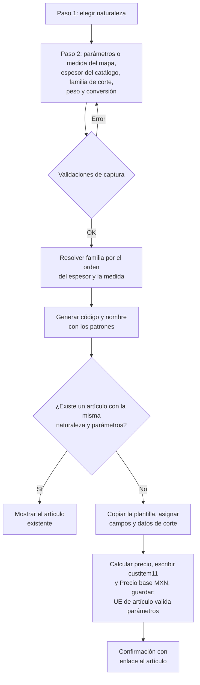
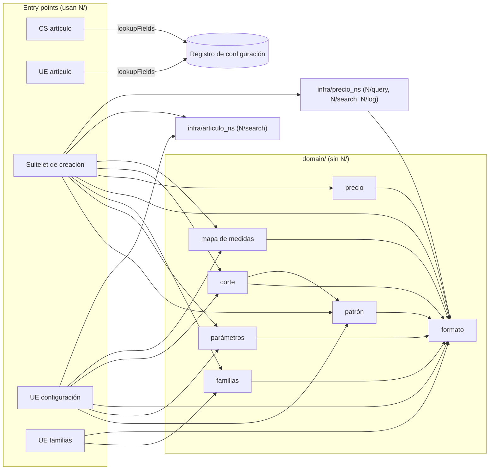

# Naturaleza de Productos
Personalización de NetSuite para Almetal que controla los artículos por naturaleza de producto.
Cada naturaleza define en un registro de configuración los campos de artículo que la describen (parámetros), un artículo plantilla y los patrones de código y nombre.
Los parámetros son obligatorios al editar un artículo, en pantalla y en servidor.
Un Suitelet crea artículos nuevos de seis naturalezas con solo capturar sus parámetros: copia la plantilla, genera código y nombre, asigna familias de precio y de margen, calcula el precio base y deja el artículo listo para el Sistema de Cortes.

| Dato | Valor |
|---|---|
| Tipo de proyecto | SuiteCloud SDF, Account Customization (`src/manifest.xml`) |
| Plataforma | SuiteScript 2.1 |
| Ambientes | Sandbox `Almetal_SB` (desarrollo y validación; authId en `project.json`, excluido del control de versiones) y producción |
| Pruebas | Jest 30 con `@oracle/suitecloud-unit-testing`: 16 suites, 675 pruebas aprobadas (ejecutadas el 2026-11-24) |
| Estado | Desplegado en producción con resultado exitoso, según el responsable del proyecto; el repositorio no registra la fecha ni el commit desplegado. Pendiente: Pull Request a `main` (sección 7.3) |
| Versión documentada | Commit `373872a` de la rama `claude/pensive-goldberg-r9d1tl`; 42 commits por delante de `main` |
| Diseño vigente | [Plan v5](planes/2026-11-17_creador-articulos-naturaleza_plan_v5.md), [prompt v3](planes/2026-11-17_creador-articulos-naturaleza_prompt_v3.md), [plan de cálculo de precio](planes/2026-11-18_calculo-precio-articulo_plan_v1.md) y planes de [PTR rectangular](planes/2026-11-19_ptr-rectangular-mapa-medidas_plan_v1.md), [Lámina Negra](planes/2026-11-19_lamina-negra_plan_v1.md) y [Sistema de Cortes](planes/2026-11-19_sistema-cortes_plan_v1.md) |
| Actualización | 2026-11-24 |

## 1. Alcance
| Capacidad | Componente | Quién lo usa |
|---|---|---|
| Marcar como obligatorios los parámetros de la naturaleza al editar un artículo | Client Script `SADS_CS_item_dynamic_mandatory.js` | Usuario que edita artículos |
| Bloquear en servidor el guardado de un artículo con parámetros vacíos | User Event `SADS_UE_item_dynamic_mandatory.js` | Toda vía de alta: UI, CSV, scripts |
| Crear un artículo a partir de parámetros (o medida del mapa), espesor, familia de corte, peso y conversión | Suitelet `SADS_SL_crear_articulo_nat.js` | Usuario con permiso para crear artículos |
| Validar la configuración capturada a mano | User Event `SADS_UE_naturaleza_config.js` | Usuario técnico |
| Validar las familias de precio y margen por rango de espesor y medida | User Event `SADS_UE_nat_familia.js` | Usuario técnico |

### 1.1 Naturalezas incluidas
El XML del proyecto trae seis configuraciones.
| Naturaleza | Plantilla (ID interno) | Parámetros | Líneas de familia | Familias de corte en el XML |
|---|---|---|---|---|
| Placas de Acero | 10928 | Lado A, lado B, espesor (fracción de pulgada) | 2 | 10 |
| Perfiles Tubulares Cuadrados (PTRC) | 11249 | Lado, largo, espesor (pared de PTR) | 9 | 0 |
| Perfiles Tubulares Cuadrados Media Pieza (MPPTRC) | 25481 | Lado, largo, espesor (pared de PTR) | 4 | 0 |
| Perfiles Tubulares Rectangulares (PTRR) | 11560 | Medida del mapa, largo, espesor (pared de PTR) | 5 | 0 |
| Perfiles Tubulares Rectangulares Media Pieza (MPPTRR) | 12679 | Medida del mapa, largo, espesor (pared de PTR) | 5 | 0 |
| Lámina Negra (LNE) | 10780 | Lado A, lado B, espesor (calibre) | 8 | 0 |

Ejemplos generados con los patrones y el catálogo del repositorio.
| Naturaleza | Captura | Código (`displayname`) | Nombre (`itemid`) |
|---|---|---|---|
| Placas de Acero | 1/2", lado A 6, lado B 20 | `PLA36050620` | `Placa Acero TA36 1/2" 6'x20'` |
| PTRC | Lado 1", Cal.14, largo 6 m | `PTRC100C14` | `PTR 1" x 1" Cal.14 a 6.00m` |
| MPPTRC | Lado 1", Cal.14, largo 3 m | `MPPTRC100C14` | `PTR Media Pieza 1" x 1" Cal.14 a 3.00m` |
| PTRR | Medida `3" x 2" (R-302)`, Cal.14, largo 6 m | `PTRR302C14` | `PTR 3" x 2" Cal.14 a 6.00m` |
| Lámina Negra | 3'x6', Cal.10 | `LNE306C10` | `Lamina Negra 3'x6' Cal.10` |

| Fuera de alcance | Estado |
|---|---|
| Cálculo automático de la conversión de unidad desde la familia de precios | Pendiente (DA3-06); hoy se captura |
| Cálculo automático del peso | Pendiente; hoy se captura |
| Cambios a los campos fórmula de precio de la cuenta | No incluido; el Suitelet replica sus fórmulas (R4-01) |
| Alta de valores en `customlist_familias_de_corte` | Lista del Sistema de Cortes; fuera del deploy (D-28) |
| Formularios nativos por naturaleza | Descartado (D-01) |
| Migración de artículos existentes al catálogo de espesores | No incluido |

## 2. Funcionamiento
### 2.1 Configuración (usuarios técnicos)
| Registro | Qué guarda |
|---|---|
| `customrecord_sads_naturaleza_productos` | Por naturaleza: arreglo JSON con los IDs de los parámetros, ID interno del artículo plantilla, patrón de código, patrón de nombre, tipo de espesor, campo de medida para familias, casilla de mapa de medidas, familias de corte y parámetros para el valor de unidades. |
| `customrecord_sads_nat_familia` | Sublista de la configuración: rangos de espesor y de medida con su familia de precio y su familia de margen. Una línea sin rango es familia única. |
| `customrecord_sads_espesor` | Catálogo de espesores por tipo: texto para el nombre, segmento para el código y orden de grosor. |
| `customrecord_sads_mapa_medidas_ptrr` | Mapa de medidas de PTR rectangular: lado mayor, lado menor y código del proveedor. |

Datos que viajan en los XML del proyecto.
| Dato | Cantidad |
|---|---|
| Configuraciones de naturaleza | 6 |
| Espesores | 45: 14 de fracción de pulgada (placas), 16 de calibre (LNE) y 15 de pared de PTR |
| Líneas de familia | 33: placas 2, PTRC 9, MPPTRC 4, PTRR 5, MPPTRR 5, LNE 8 |
| Medidas del mapa de PTR rectangular | 24 |

### 2.2 Creación de un artículo


El Suitelet escribe solo estos campos sobre la copia; el resto se hereda de la plantilla.
| Campo | Valor |
|---|---|
| `custitem_sads_naturaleza_producto` | Configuración elegida |
| Parámetros del JSON (lados, largo, espesor) | Valores capturados; en PTRR y MPPTRR, los lados salen de la medida elegida |
| `weight` y `custitem_drt_ci_precio_teorico` | Peso capturado |
| `custitem_alm_articulo_conversionunidad` | Conversión capturada |
| `custitem_pfp_famprecios_` y `custitem_pfp_fammargenes_` | Familias de la línea cuyo rango contiene el espesor (y la medida) |
| `itemid`, `purchasedescription` y `salesdescription` | Nombre generado (D-19) |
| `displayname` y `vendorname` | Código generado (D-19) |
| `upccode` y `mpn` | Vacíos |
| `custitemalm_articulo_preciocotizacion` y `custitem_drt_ci_margen_para_venta` | Precio de cotización y margen de las familias asignadas |
| `custitem11` y nivel Precio base MXN | Precio de venta sin IVA calculado con la cadena de campos fórmula; los demás niveles quedan vacíos |
| `custitem_alm_corte` y `usebins` | T (RN6-01) |
| `custitem_famili_de_corte_item` | Familia de corte elegida en el paso 2 (RN6-02) |
| `custitem_value_per_units` | Producto de los parámetros de la configuración (RN6-03) |
| `custitemalm_articulo_espesor` | Orden del espesor elegido; no se escribe si la naturaleza no usa espesor (RN6-04) |
| `isinactive` | Según el parámetro `custscript_sads_sl_art_activo`; el XML lo trae en F y el artículo se crea inactivo |

### 2.3 Patrones de código y nombre
Un marcador es `{id}` o `{id:formato}`; el `id` debe estar en el JSON de la configuración.
| Formato | Resultado | Ejemplo |
|---|---|---|
| Sin formato | Número sin ceros a la derecha | 6 → `6` |
| `centesimas3` | Centésimas truncadas, 3 dígitos | 0.375 → `037` |
| `fraccion16` | Fracción reducida, hasta 1/16 | 1.25 → `1 1/4` |
| `entero1` | Entero de 1 a 9 | 7 → `7` |
| `entero2` | Entero de 1 a 99, con cero a la izquierda | 7 → `07` |
| `decimal2` | Número mayor que 0 con 2 decimales | 6 → `6.00` |
| `codigo` | Segmento de código del espesor elegido | 1/2" → `050` |
| `texto` | Texto del espesor elegido | 1/2" → `1/2"` |
| `{mapa:codigo}` | Código del proveedor de la medida elegida (solo con mapa activo) | `3" x 2" (R-302)` → `302` |
| `{mapa:texto}` | Nombre de la medida elegida (solo con mapa activo) | `3" x 2" (R-302)` |

`codigo` y `texto` solo aplican al campo de espesor; los demás formatos solo a campos numéricos.
La sintaxis completa está en la [documentación del Suitelet](src/FileCabinet/SuiteScripts/SADS_Naturaleza_Productos/SADS_SL_crear_articulo_nat.md) y en el [prompt de patrones](planes/prompt_patrones_codigo_nombre.md).

Patrones desplegados.
| Naturaleza | Patrón de código | Patrón de nombre |
|---|---|---|
| Placas de Acero | `PLA36{custitem_sads_nat_espesor:codigo}{custitem_sads_nat_pla_lado_a:entero1}{custitem_sads_nat_pla_lado_b:entero2}` | `Placa Acero TA36 {custitem_sads_nat_espesor:texto} {custitem_sads_nat_pla_lado_a}'x{custitem_sads_nat_pla_lado_b}'` |
| PTRC | `PTRC{custitem_sads_nat_ptr_lado:centesimas3}{custitem_sads_nat_espesor:codigo}` | `PTR {custitem_sads_nat_ptr_lado:fraccion16}" x {custitem_sads_nat_ptr_lado:fraccion16}" {custitem_sads_nat_espesor:texto} a {custitem_sads_nat_ptr_largo:decimal2}m` |
| MPPTRC | `MPPTRC{custitem_sads_nat_ptr_lado:centesimas3}{custitem_sads_nat_espesor:codigo}` | `PTR Media Pieza …` con la misma estructura del PTRC |
| PTRR | `PTRR{mapa:codigo}{custitem_sads_nat_espesor:codigo}` | `PTR {…ptr_lado:fraccion16}" x {…ptr_lado_b:fraccion16}" {espesor:texto} a {…ptr_largo:decimal2}m` |
| MPPTRR | `MPPTRR{mapa:codigo}{custitem_sads_nat_espesor:codigo}` | `PTR Media Pieza …` con la misma estructura del PTRR |
| Lámina Negra | `LNE{custitem_sads_nat_lne_lado_a:entero1}{custitem_sads_nat_lne_lado_b:entero2}{custitem_sads_nat_espesor:codigo}` | `Lamina Negra {custitem_sads_nat_lne_lado_a}'x{custitem_sads_nat_lne_lado_b}' {custitem_sads_nat_espesor:texto}` |

El Suitelet rechaza un lado A mayor que el lado B en placas (D-18).
En PTRR y MPPTRR el orden de lados no se valida: lo fija el mapa.

### 2.4 Medida de PTR rectangular
El código usa el número del catálogo del proveedor, que no sigue una fórmula (1.5x0.5 = 155, 1.5x0.75 = 150, 2x1 = 200, 3x2 = 302, 3x0.75 = 375).
Con la casilla "Usar Mapa de Medidas PTRR" activa, el paso 2 muestra un SELECT "Medida" con las medidas activas del mapa en lugar de los dos lados.
La medida elegida se revalida contra la consulta C-8, llena `custitem_sads_nat_ptr_lado` (lado mayor) y `custitem_sads_nat_ptr_lado_b` (lado menor) y aporta el código.
Las familias se resuelven por el lado mayor.

### 2.5 Datos para el Sistema de Cortes
Todo artículo creado sale listo para el Sistema de Cortes (otro proyecto: solicitudes de corte que generan ajustes de inventario).
| Elemento | Regla |
|---|---|
| Familia de corte | SELECT obligatorio en el paso 2, con solo las familias que el usuario técnico marcó en la naturaleza. Sin familias marcadas, el Suitelet no permite crear (RN6-02). |
| Valor de unidades | Producto de los parámetros de "Parámetros para Valor de Unidades", redondeado a 6 decimales (RN6-03). Placas y LNE: lado A por lado B. PTR: largo en metros. |
| Espesor de corte | Orden del espesor elegido, con cero a la izquierda y sin ceros finales (RN6-04). |

Casos verificados en `SADS_naturaleza_corte.test.js`: LNE 4'x10' Cal.18 → valor 40 y espesor 0.0478; placa 6'x20' de 1" → 120 y 1; PTR a 6.00 m → 6; media pieza a 3.00 m → 3.

## 3. Arquitectura de Software
### 3.1 Componentes y dependencias


| Módulo | Capa | Responsabilidad |
|---|---|---|
| `SADS_SL_crear_articulo_nat.js` | Entry point | Flujo de captura, consultas SuiteQL, copia de la plantilla, datos de corte y guardado. |
| `SADS_UE_naturaleza_config.js` | Entry point | Valida JSON, plantilla, patrones, tipo de espesor, campo de medida, mapa y datos de corte al guardar la configuración. |
| `SADS_UE_nat_familia.js` | Entry point | Valida cada línea de familia contra las demás líneas de su configuración. |
| `SADS_CS_item_dynamic_mandatory.js`, `SADS_UE_item_dynamic_mandatory.js` | Entry point | Obligatoriedad de parámetros en UI y servidor; código original, sin capa de dominio. |
| `domain/SADS_naturaleza_config_formato.js` | Dominio | Contrato del JSON de parámetros y errores de dominio. |
| `domain/SADS_naturaleza_patron.js` | Dominio | Analiza, valida y aplica los patrones. |
| `domain/SADS_naturaleza_parametros.js` | Dominio | IDs seguros, valores capturados, catálogo, orden de lados y criterios de duplicado. |
| `domain/SADS_naturaleza_familias.js` | Dominio | Validación de rangos y resolución de la familia de un espesor y una medida. |
| `domain/SADS_naturaleza_corte.js` | Dominio | Valor de unidades y espesor para el Sistema de Cortes. |
| `domain/SADS_naturaleza_mapa_medidas.js` | Dominio | Mapa de medidas de PTR rectangular: validación, medida elegida y marcador `{mapa:codigo}`. |
| `domain/SADS_naturaleza_precio.js` | Dominio | Cadena de fórmulas del precio, redondeo a 0.25 y comparación con el campo fórmula. |
| `infra/SADS_naturaleza_articulo_ns.js` | Adaptador | Tipo de registro de un artículo a partir de su ID interno. |
| `infra/SADS_naturaleza_precio_ns.js` | Adaptador | Cargos de la plantilla, monedas, campos y matriz de precios, lectura del campo fórmula. |

### 3.2 Nivel de arquitectura
Nivel 1: reglas de negocio puras en `domain/` y entry points con acceso directo a los módulos `N/`.
Lo justifican reglas verificables con Jest y compartidas entre el Suitelet y los User Events.
Puertos y adaptadores formales (nivel 2) serían excesivos: hay una sola fuente de datos y ninguna integración externa.
Regla de dependencia: ningún módulo de `domain/` importa `N/`; cada suite de dominio lo comprueba leyendo el archivo.
Hacia el dominio solo cruzan objetos planos, nunca registros, resultados de búsqueda ni el `context` de NetSuite.

### 3.3 Decisiones implementadas
| ID | Decisión | Motivo | Consecuencia | Referencia |
|---|---|---|---|---|
| AD-01 | Un Suitelet copia un artículo plantilla; no hay formularios nativos por naturaleza. | El usuario captura solo parámetros; cuentas, impuestos, claves SAT, subsidiarias y unidades se heredan sin listarlas en código. | La plantilla es la fuente de verdad, incluida la fiscal. | D-01, D-02, RN-09 |
| AD-02 | La naturaleza es configuración, no código. | Una naturaleza nueva se agrega con campos y registros, sin desarrollo. | La captura manual exige validación en servidor (AD-04). | DA3-04 |
| AD-03 | Un solo contrato para el JSON de parámetros: arreglo de IDs de campo. | Lo leen el CS, el UE de artículo, el Suitelet y el UE de configuración sin traducción. | Cambiar el formato afecta a 4 componentes; su dueño único es `formato`. | RN-12 |
| AD-04 | La captura manual se valida en User Events. | Un JSON o patrón inválido desactivaría validaciones o haría fallar la creación. | Las familias tienen su propio UE: el UE de la configuración no ve las líneas del registro hijo. | RN-12 a RN-17, RN3-05 a RN3-09 |
| AD-05 | Patrones con lista cerrada de formatos y analizador propio. | Código y nombre siguen la convención comercial sin programar cada naturaleza. | Sin `eval` ni expresiones regulares construidas con el patrón; un formato nuevo requiere cambio de código. | D-13 a D-18 |
| AD-06 | Espesor como registro con texto, código y orden; familias por rango de orden. | Cubre fracciones, calibres, milímetros y cédulas; el orden permite rangos aunque el calibre sea inverso al grosor. | La familia se resuelve por rango inclusivo; un espesor sin rango es error de configuración. | RN3-01 a RN3-07 |
| AD-07 | Una sola copia de la plantilla por solicitud, en modo estándar. | Ahorra gobernanza; el modo dinámico dispararía sourcing que alteraría valores copiados. | La misma copia describe los parámetros, se valida y se guarda. | PT-02 |
| AD-08 | El tipo de registro de la plantilla se obtiene con `search.create` y `result.recordType`, en un adaptador único. | `record.copy` y `url.resolveRecord` exigen el tipo; la configuración solo guarda el ID. | El Suitelet y el UE de configuración comparten el adaptador. | PT-01, PT-10 |
| AD-09 | Entrada no confiable mínima. | Del formulario solo se toman el ID de configuración, revalidado en cada envío, y las capturas. | Números por expresión regular, espesor y medida contra catálogo, columnas SQL por lista blanca doble, valores como parámetros, y avisos, etiquetas y enlaces escapados. | RN-11, RN-13 |
| AD-10 | Detección de duplicados por naturaleza y parámetros, incluidos inactivos. | Evita dos artículos de la misma medida; un doble envío no duplica. | Respaldo: NetSuite rechaza un `itemid` repetido; el nombre incluye los parámetros. | RN-08 |
| AD-11 | El Suitelet calcula el precio (sustituye la escritura mínima de iteración B). | Replica en `domain/SADS_naturaleza_precio.js` la cadena de campos fórmula y escribe `custitem11` y el Precio base MXN en el mismo `save`. | La fórmula vive en dos lugares (R4-01); el Suitelet compara contra el campo fórmula después de guardar. | RN4-01 a RN4-08 |
| AD-12 | Bandera de despliegue para crear artículos activos. | Los artículos quedan inactivos hasta validar el precio. | Activarlos no requiere código: parámetro `custscript_sads_sl_art_activo` = T; el XML lo trae en F. | DA3-05 |
| AD-13 | Errores de dominio separados de errores técnicos. | El usuario ve mensajes de negocio en español, nunca el error crudo de NetSuite. | `log.error` guarda el detalle; los errores técnicos muestran un mensaje genérico. | PT-03 |
| AD-14 | El Suitelet y los UEs de configuración y familias corren con el rol del usuario; el UE de artículo con `customrole_sads_naturaleza_config_exec`. | Las system notes registran al usuario real; el UE de artículo lee la configuración sin dar permisos a cada rol. | La audiencia del Suitelet define quién crea artículos. | — |
| AD-15 | El nombre generado va a `itemid` y a las descripciones; el código a `displayname` y `vendorname`. | Convención de la empresa: `itemid` guarda el nombre largo y el código se muestra aparte. | El límite de 60 caracteres de `itemid` aplica al nombre. | D-19 |
| AD-16 | En PTR rectangular la medida se elige de un mapa del proveedor; no se captura. | El código del proveedor no sigue una fórmula (R-302 para 3" x 2"). | El marcador `{mapa:codigo}` depende del mapa; una medida nueva exige alta en el registro. | RN5-01 a RN5-05 |
| AD-17 | Cada artículo creado lleva los datos del Sistema de Cortes. | Sin ellos el artículo no se puede cortar. | La naturaleza exige familias de corte y parámetros de valor de unidades; sin familias, el Suitelet no crea. | RN6-01 a RN6-05 |
| AD-18 | IDs portables y `deploy.xml` acotado. | Los scriptid generados por cuenta (`val_<n>_<cuenta>`) y los objetos de terceros fallarían o se sobrescribirían en producción. | `deploy.xml` envía solo Config, Naturalezas, Scripts y la carpeta del Suitelet; `SADS_objetos_portables.test.js` lo verifica. | D-28, sección 4E de la documentación del Suitelet |

### 3.4 Compromisos y deuda técnica
| ID | Hallazgo | Consecuencia |
|---|---|---|
| H3-01 | Lados de placa FLOAT sin `minvalue`; el mínimo comercial de 2 pies no se impone. | Se aceptan medidas de 1 pie. |
| H3-02 | Audiencia del CS y del UE de artículo limitada a las subsidiarias 3 y 4. | Sin validación en otras subsidiarias. |
| H3-03 | `customrole_sads_naturaleza_config_exec` conserva `LIST_OTHER_ADDRESS` en FULL, además de `LIST_ITEM` y `ADMI_CUSTITEMFIELD` en VIEW y `LIST_CUSTRECORDENTRY` en VIEW. | Privilegio mayor al necesario. |
| H3-04 | La sección 9 de la documentación del Suitelet dice que se quitaron `LIST_ITEM` y `ADMI_CUSTITEMFIELD`; el XML los conserva en VIEW. | La documentación y el XML no coinciden. |
| RN3-03 | La unicidad de código y orden de espesor por tipo no se valida en código. | Pueden capturarse espesores duplicados. |
| H-08 | El UE de artículo recorre el arreglo dos veces, registra un log por campo y deja guardar si el JSON es inválido. | Faltantes repetidos en el mensaje; validación desactivada ante un JSON inválido. |
| H-07 | `formato` conserva dos nombres de error sin uso. | Menor. |
| H5-01 | El valor `val_sads_natlist_ptrr` de la lista de naturalezas se llama "Perfiles Tubulares Redondos"; su configuración se llama "Perfiles Tubulares Rectangulares". | Nombre inconsistente en la lista. |
| H5-02 | `custitem_sads_disp_ventas` y `custitem_sads_disp_compras` no tienen referencias en código, pruebas ni planes; aplican solo a artículos de inventario. | El filtrado de catálogos de venta y compra depende de configuración fuera del repositorio; el Suitelet no los escribe y el artículo copia el valor de la plantilla. |
| H5-03 | LNE no tiene familia para Cal.15 y Cal.28 (ambos anchos) ni para Cal.07 en 4'. | El Suitelet no crea esos calibres. |
| H5-04 | MPPTRR usa las familias de precio de PTRR por supuesto (S5-01); no hay CSV de media pieza rectangular. | Una familia distinta en la realidad produciría un precio distinto. |
| H5-05 | El Suitelet no replica las excepciones de margen de LNE (artículos 12702 y 12820). El artículo existente 11222 (`PTRR201C12`) se corrige a mano a `PTRR302C12` (DR-3). | El margen de esos artículos y el código de 11222 se ajustan a mano. |
| Duplicación | IDs de la configuración repetidos en el Suitelet y en el UE de configuración; utilidades repetidas en los dos UEs. | Un cambio de ID exige editar dos archivos. |
| CS y UE de artículo | Sin pruebas Jest ni capa de dominio. | Las regresiones solo se detectan en sandbox. |

## 4. Objetos SDF
`src/Objects` contiene 70 Object XML: 23 del proyecto, 4 de otras personalizaciones que se despliegan (en `Config`) y 43 de referencia que no se despliegan (`Calculo de Precio` y `Terceros`).

| Carpeta | Archivos | Se despliega |
|---|---|---|
| `Config` | 15 (11 del proyecto y 4 de otras personalizaciones) | Sí |
| `Naturalezas` | 7 | Sí |
| `Scripts` | 5 | Sí |
| `Calculo de Precio` | 41 | No |
| `Terceros` | 2 | No |

| Objeto del proyecto | Tipo | Relación |
|---|---|---|
| `custitem_sads_naturaleza_producto` | Campo de artículo SELECT, obligatorio | Apunta a la configuración; aplica a 6 tipos de artículo. |
| `custitem_sads_nat_pla_lado_a`, `custitem_sads_nat_pla_lado_b` | Campos de artículo FLOAT | Lados de placa en pies. |
| `custitem_sads_nat_lne_lado_a`, `custitem_sads_nat_lne_lado_b` | Campos de artículo | Lados de Lámina Negra en pies. |
| `custitem_sads_nat_ptr_lado`, `custitem_sads_nat_ptr_lado_b`, `custitem_sads_nat_ptr_largo` | Campos de artículo FLOAT | Lado (mayor) y lado menor de PTR en pulgadas; largo en metros. |
| `custitem_sads_nat_espesor` | Campo de artículo SELECT | Apunta al catálogo de espesores. |
| `custitem_sads_disp_ventas`, `custitem_sads_disp_compras` | Campos de artículo CHECKBOX | "PARA VENTAS" y "PARA COMPRAS"; filtrado de catálogos de venta y compra; aplican a artículos de inventario (H5-02). |
| `customrecord_sads_mapa_medidas_ptrr` | Registro con 24 instancias | Mapa de medidas de PTR rectangular con el código del proveedor. |
| `customrecord_sads_naturaleza_productos` | Registro de configuración | Apunta a la lista de naturalezas, al tipo de espesor y a `customlist_familias_de_corte`. |
| `customrecord_sads_nat_familia` | Registro hijo, sublista de la configuración | Apunta a espesores desde y hasta, y a las familias de precio y margen. |
| `customrecord_sads_espesor` | Catálogo de espesores | Apunta al tipo de espesor. |
| `customlist_sads_naturaleza_productos` | Lista | Placas de Acero, Perfiles Tubulares Cuadrados, Perfiles Tubulares Redondos (ver H5-01), Perfiles Tubulares Cuadrados Media Pieza, Perfiles Tubulares Rectangulares Media Pieza y Lamina Negra. |
| `customlist_sads_tipo_espesor` | Lista | Fracción de pulgada, Calibre, Milímetros, Cédula, Pared de PTR. |
| `customrole_sads_naturaleza_config_exec` | Rol | `runasrole` del UE de artículo. |
| `customscript_sads_cs_item_dynamic_mandat` | Client Script | 6 deployments, uno por tipo de artículo. |
| `customscript_sads_ue_item_dynamic_mandat` | User Event | 6 deployments, uno por tipo de artículo. |
| `customscript_sads_sl_crear_articulo_nat` | Suitelet | Parámetro `custscript_sads_sl_art_activo` = F; audiencia vacía en el XML. |
| `customscript_sads_ue_naturaleza_config` | User Event | Sobre el registro de configuración. |
| `customscript_sads_ue_nat_familia` | User Event | Sobre el registro de familias. |

| Objeto de otra personalización | Uso en el proyecto |
|---|---|
| `custitem_pfp_famprecios_`, `custitem_pfp_fammargenes_` | El Suitelet escribe la familia de precio y la de margen. |
| `customrecord_pfp_famprecios`, `customrecord_pfp_fammargenes_` | Destino de las familias por rango. |
| Carpeta `src/Objects/Calculo de Precio/` (41 campos de artículo) | Referencia de la cadena de precios; no se despliega. El Suitelet replica sus fórmulas y escribe `custitemalm_articulo_preciocotizacion`, `custitem_drt_ci_margen_para_venta`, `custitem11` y `custitem_alm_articulo_conversionunidad`. |
| `src/Objects/Terceros/customlist_familias_de_corte.xml` | Lista del Sistema de Cortes; referencia, no se despliega. El manifiesto declara la lista y los 10 valores que usan las placas. |
| `src/Objects/Terceros/customscript_drt_item_ue.xml` y `src/FileCabinet/SuiteScripts/drt_item_ue.js` | Script DRT descargado para cambiar su contexto de ejecución; no se despliega. |

Campos que el Suitelet escribe y no están en el repositorio: `custitem_drt_ci_precio_teorico`, `custitem_alm_corte`, `custitem_famili_de_corte_item`, `custitem_value_per_units` y `custitemalm_articulo_espesor`; deben existir en la cuenta.
El manifiesto exige CUSTOMRECORDS, SUBSIDIARIES y SERVERSIDESCRIPTING, y declara 31 objetos como dependencias: 14 familias de precio y 4 de margen DRT, la lista `customlist_alm_lista_unidadcotizacion`, el campo `custitem_alm_art_preciofinal`, la lista `customlist_familias_de_corte` y 10 de sus valores, declarados uno por uno.

| Deployments del CS y del UE de artículo | Estado |
|---|---|
| Los 12 (inventariable, no inventariable, otro cargo, servicio, kit y grupo de artículos; CS y UE) | RELEASED (commit `f3c22c9`); el XML anterior dejaba 10 en TESTING |
| Suitelet, UE de configuración y UE de familias | RELEASED |

Los XML incluyen datos: las seis configuraciones con sus plantillas, 45 espesores, 33 líneas de familia y 24 medidas del mapa (sección 2.1).

## 5. Estructura del repositorio
```
.
├── README.md
├── README.pdf                         # Versión PDF de este documento
├── __tests__/                         # 16 suites Jest
├── planes/                            # Planes y prompts de diseño
├── jest.config.js
├── package.json
├── suitecloud.config.js               # Ejecuta Jest antes de project:deploy
└── src/
    ├── deploy.xml
    ├── manifest.xml
    ├── Objects/                       # Config, Naturalezas, Scripts (se despliegan); Calculo de Precio, Terceros (referencia)
    └── FileCabinet/SuiteScripts/SADS_Naturaleza_Productos/
        ├── SADS_CS_item_dynamic_mandatory.js
        ├── SADS_UE_item_dynamic_mandatory.js
        ├── SADS_SL_crear_articulo_nat.js
        ├── SADS_SL_crear_articulo_nat.md
        ├── SADS_UE_naturaleza_config.js
        ├── SADS_UE_nat_familia.js
        ├── SADS_item_dynamic_mandatory.md
        ├── infra/SADS_naturaleza_articulo_ns.js
        ├── infra/SADS_naturaleza_precio_ns.js
        └── domain/
            ├── SADS_naturaleza_config_formato.js
            ├── SADS_naturaleza_corte.js
            ├── SADS_naturaleza_familias.js
            ├── SADS_naturaleza_mapa_medidas.js
            ├── SADS_naturaleza_parametros.js
            ├── SADS_naturaleza_patron.js
            └── SADS_naturaleza_precio.js
```

## 6. Pruebas
Comando: `npm ci` y después `npm test`; no requiere cuenta NetSuite.
| Suite | Pruebas | Alcance |
|---|---|---|
| `SADS_SL_crear_articulo_nat.test.js` | 122 | Entry point del Suitelet con `jest.mock` de `N/`, incluido el cálculo y la escritura del precio, el mapa de medidas y los datos de corte. |
| `SADS_UE_naturaleza_config.test.js` | 54 | Entry point del UE de configuración, incluido XEDIT. |
| `SADS_UE_nat_familia.test.js` | 14 | Entry point del UE de familias, incluido XEDIT. |
| `SADS_naturaleza_patron.test.js` | 158 | Marcadores, formatos (incluido `decimal2`), patrones de PTR y sustitución. |
| `SADS_naturaleza_config_formato.test.js` | 109 | Contrato del JSON y compatibilidad con el CS y el UE de artículo. |
| `SADS_naturaleza_parametros.test.js` | 85 | IDs, valores, catálogo, conversión, orden de lados y duplicados. |
| `SADS_naturaleza_familias.test.js` | 36 | Rangos de familias por espesor y medida, y resolución. |
| `SADS_naturaleza_familias_ptr.test.js` | 6 | Rangos de familias de PTR contra los artículos existentes. |
| `SADS_naturaleza_articulo_ns.test.js` | 7 | Adaptador de tipo de registro. |
| `SADS_naturaleza_precio.test.js` | 29 | Cadena de fórmulas del precio, datos faltantes, margen y redondeo a 0.25. |
| `SADS_naturaleza_precio_ns.test.js` | 16 | Adaptador de precio: cargos, monedas, matriz de precios y campo fórmula. |
| `SADS_naturaleza_mapa_medidas.test.js` | 12 | Mapa de medidas de PTR rectangular contra el catálogo del proveedor y los artículos existentes. |
| `SADS_naturaleza_lne.test.js` | 7 | Lámina Negra contra los artículos existentes. |
| `SADS_naturaleza_corte.test.js` | 13 | Datos para el Sistema de Cortes (valor de unidades y espesor). |
| `SADS_objetos_portables.test.js` | 5 | Alcance de `deploy.xml`, ausencia de IDs generados por la cuenta y referencias existentes en los objetos desplegados. |
| `sample-test.js` | 2 | Plantilla de SuiteCloud. |
| Total | 675 | 16 suites |

Resultado del 2026-11-24: 16 de 16 suites y 675 de 675 pruebas aprobadas.
`suitecloud project:validate` no se ejecutó en esta versión: el entorno de documentación no tiene cuenta.

## 7. Despliegue y operación
### 7.1 Procedimiento de despliegue
1. `npm ci` y `npm test` en verde; el hook de `suitecloud.config.js` repite las pruebas antes de `project:deploy`.
2. Descargar `customrecord_sads_naturaleza_productos.xml` desde la cuenta de origen para incluir las Familias de Corte marcadas en cada naturaleza; sin esto, el deploy las deja vacías y el Suitelet no permite crear.
3. Verificar que los valores de `customlist_familias_de_corte` tengan el mismo ID interno en la cuenta de destino: el MULTISELECT guarda IDs, y un valor creado en sandbox después del último refresh no existe en producción.
4. `project:deploy` envía `~/FileCabinet/SuiteScripts/SADS_Naturaleza_Productos/*` y `~/Objects/Config/*`, `~/Objects/Naturalezas/*`, `~/Objects/Scripts/*`; no envía `Calculo de Precio`, `Terceros` ni `drt_item_ue.js`.
5. Re-aplicar en la UI la audiencia del deployment del Suitelet (R-10); el XML la deja vacía.
6. Crear un artículo por naturaleza (placa, PTRC, MPPTRC, PTRR, MPPTRR, LNE) y revisar código, nombre, familia, precio base y datos de corte.
7. Con lo anterior correcto, `custscript_sads_sl_art_activo` = T en el deployment (sin código).

En producción, las plantillas, las familias y las subsidiarias tienen IDs distintos a los del sandbox salvo los verificados en la sección 4E de la documentación del Suitelet.

### 7.2 Estado del despliegue a producción
El responsable del proyecto informó que el despliegue a producción se realizó con resultado exitoso. El repositorio no registra la fecha ni el commit desplegado.
| Paso | Estado | Evidencia |
|---|---|---|
| 1 y 4. Pruebas y `project:deploy` | Realizado, según el responsable | `npm test` en verde el 2026-11-24 sobre el commit `373872a` |
| 2. XML con Familias de Corte | Parcial en el XML | Solo Placas de Acero trae familias de corte (10); las otras cinco configuraciones las traen vacías (commit `c687e7a`) |
| 3. IDs de `customlist_familias_de_corte` | No verificable desde el repositorio | Los 10 valores de placas están en el manifiesto sin sufijo `sb1`; la documentación pide verificarlos en producción |
| 5. Audiencia del Suitelet | No verificable desde el repositorio | El XML la trae vacía |
| 6. Un artículo por naturaleza | No verificable desde el repositorio | — |
| 7. `custscript_sads_sl_art_activo` = T | No verificable desde el repositorio | El XML lo trae en F |
| Limpieza manual de objetos antiguos | No verificable desde el repositorio | Ver lista abajo |

Limpieza manual en la cuenta, porque SDF no borra objetos: script `customscript_sads_sl_naturaleza_config`, campo `custrecord_sads_naturaleza_tipo_art`, lista `customlist_sads_tipos_articulo`, campo `custitem_sads_nat_pla_espesor` y los archivos `testt.js`, `SADS_SL_naturaleza_config.js`, `SADS_SL_naturaleza_config.md` y `domain/SADS_naturaleza_alta_reglas.js`.

### 7.3 Integración a `main`
El Pull Request a `main` está pendiente.
| Dato | Valor |
|---|---|
| Rama de desarrollo | `claude/pensive-goldberg-r9d1tl`, commit `373872a` |
| `main` | Commit `a86c38f` del 2026-10-15 |
| Diferencia | 42 commits por delante, 0 por detrás; 124 archivos, 18,193 inserciones y 3,815 eliminaciones |
| Archivos de despliegue modificados | `src/deploy.xml` y `src/manifest.xml` |

Hasta el merge, `main` no refleja lo desplegado en producción.

## 8. Riesgos vigentes
| Enunciado | Fundamento | Consecuencia |
|---|---|---|
| Cinco de las seis naturalezas se despliegan sin Familias de Corte. | `custrecord_sads_naturaleza_fam_corte` vacío en PTRC, MPPTRC, PTRR, MPPTRR y LNE del XML (commit `c687e7a`); RN6-02. | El Suitelet no permite crear artículos de esas naturalezas hasta que se marquen en la cuenta. |
| Las familias de corte capturadas en la UI no están en el XML. | RN6-05; `customrecord_sads_naturaleza_productos.xml`. | Un redeploy sin descargar antes el XML las borra. |
| Las plantillas 11560 (PTRR), 12679 (MPPTRR) y 10780 (LNE) no figuran como verificadas en producción. | La sección 4E de la documentación solo verifica 10928, 11249 y 25481. | Un ID inexistente o de otro artículo en producción copia el artículo equivocado o falla la creación. |
| `main` no contiene lo desplegado. | 42 commits por delante (sección 7.3). | Un despliegue desde `main` omitiría o revertiría objetos y scripts de producción. |
| El despliegue incluye 4 objetos de otras personalizaciones (familias de precio y margen). | `deploy.xml` envía `~/Objects/Config/*`. | Sobrescribe en la cuenta su definición con la versión del repositorio. |
| La configuración, los espesores, las líneas de familia y el mapa viajan como datos en los XML. | Elementos `instances` en los XML de los registros. | Un despliegue puede revertir cambios hechos en la UI. |
| El XML del deployment del Suitelet trae `custscript_sads_sl_art_activo` = F y la audiencia vacía. | `customscript_sads_sl_crear_articulo_nat.xml`. Inferencia: un redeploy restablece ambos valores. | Los artículos nuevos quedan inactivos y los usuarios pierden acceso hasta re-aplicarlos. |
| Hay IDs internos dependientes de la cuenta. | Plantillas 10928, 11249 y 25481; subsidiarias 3 y 4. Verificados iguales en producción (último refresh). | Una plantilla creada en sandbox después del refresh tendría otro ID en producción. |
| La fórmula del precio vive en los campos fórmula de la cuenta y en el dominio. | AD-11; R4-01. | Si cambia una fórmula en la cuenta, el Suitelet guarda otro precio; la confirmación lo avisa. |
| Las líneas de familia dependen del scriptid de las familias DRT del manifiesto (14 de precio y 4 de margen). | Verificados iguales en sandbox y producción (2026-11-19); sección 4E. | Una familia nueva creada solo en sandbox tendría otro scriptid en producción y el deploy fallaría. |
| El artículo hereda la configuración fiscal de la plantilla. | AD-01; Anexo 20 de CFDI 4.0, atributos `ClaveProdServ` y `ClaveUnidad`. | Una clave errónea en la plantilla se replica en cada artículo y en los CFDI que lo facturen. |
| Peso y conversión se capturan a mano. | DA3-06; Guía de llenado del Complemento Carta Porte, nodo Mercancias, atributo `PesoEnKg`. | Un error se propaga a la cadena de precios y, si la localización usa el peso, a `PesoEnKg` de Carta Porte. |
| La plantilla se captura como ID interno. | D-12. | Un ID de otro artículo existente copia el artículo equivocado. |

## 9. Documentación
| Documento | Contenido |
|---|---|
| [SADS_SL_crear_articulo_nat.md](src/FileCabinet/SuiteScripts/SADS_Naturaleza_Productos/SADS_SL_crear_articulo_nat.md) | Suitelet y UEs de configuración y familias: flujo, guía técnica, consultas, reglas, permisos, supuestos, riesgos y troubleshooting. Secciones 4C a 4H: PTR, precio, IDs portables, PTR rectangular, Lámina Negra y Sistema de Cortes. |
| [Plan de Sistema de Cortes](planes/2026-11-19_sistema-cortes_plan_v1.md) | Campos de corte, objetos y comportamiento del paso 2. |
| [Plan de Lámina Negra](planes/2026-11-19_lamina-negra_plan_v1.md) | Corrección de la configuración de LNE y hallazgos de familias. |
| [Plan de PTR rectangular](planes/2026-11-19_ptr-rectangular-mapa-medidas_plan_v1.md) | Mapa de medidas, configuraciones y familias de PTRR y MPPTRR. |
| [Plan de cálculo de precio](planes/2026-11-18_calculo-precio-articulo_plan_v1.md) | Mapa de la cadena de precios, hallazgos y diseño del cálculo en el Suitelet. |
| [Plan v5](planes/2026-11-17_creador-articulos-naturaleza_plan_v5.md) y [prompt v3](planes/2026-11-17_creador-articulos-naturaleza_prompt_v3.md) | Diseño e implementación de la iteración B. |
| [Plan v2](planes/2026-11-12_creador-articulos-naturaleza_plan_v2.md) y [prompt v2](planes/2026-11-12_creador-articulos-naturaleza_prompt_v2.md) | Diseño e implementación de la iteración A. |
| [Prompt de patrones](planes/prompt_patrones_codigo_nombre.md) | Guía para redactar patrones de código y nombre. |
| [SADS_item_dynamic_mandatory.md](src/FileCabinet/SuiteScripts/SADS_Naturaleza_Productos/SADS_item_dynamic_mandatory.md) | Notas originales del CS y del UE de artículo; los nombres de archivo que cita están desactualizados. |

## 10. Supuestos y fuentes
| ID | Supuesto | Cómo se confirma |
|---|---|---|
| SU-01 | El despliegue a producción fue exitoso. | Lo informó el responsable del proyecto; no hay evidencia en el repositorio. |
| SU-02 | El commit `373872a` es la versión desplegada. | El repositorio no registra el commit desplegado; confirmar con el responsable. |
| SU-03 | Las plantillas 11560, 12679 y 10780, y los 10 valores de familias de corte, existen en producción con los mismos IDs. | Consultar los artículos y la lista en producción. |
| SU-04 | La audiencia del Suitelet y el valor de `custscript_sads_sl_art_activo` en producción son los esperados. | Revisar el deployment en producción. |
| SU-05 | Las cinco naturalezas sin familias de corte en el XML las tienen capturadas en producción. | Abrir cada configuración en producción. |

| Fuente | Uso |
|---|---|
| `src/Objects/**` y `src/manifest.xml`, `src/deploy.xml` | Conteos de objetos, instancias, deployments, permisos y dependencias |
| `src/FileCabinet/SuiteScripts/SADS_Naturaleza_Productos/` | Módulos, dependencias entre módulos y documentación del Suitelet |
| `planes/` | Decisiones y reglas de PTR rectangular, LNE y Sistema de Cortes |
| `git log`, `git diff --stat origin/main..HEAD` | Historial, commit documentado y diferencia contra `main` |
| `npm ci` y `npx jest` del 2026-11-24 | Resultado de pruebas y pruebas por suite |
| Anexo 20 de CFDI 4.0 y Guía de llenado del Complemento Carta Porte | Fundamento de los riesgos fiscales; citados por la documentación del Suitelet, no revisados de nuevo |

## 11. Verificación
| Comprobación | Resultado |
|---|---|
| Pruebas Jest | 16 de 16 suites, 675 de 675 pruebas; la suma por suite de la sección 6 da 675 |
| Objetos por carpeta | 15 + 7 + 5 + 41 + 2 = 70; 23 + 4 + 43 = 70 |
| Instancias en XML | 6 configuraciones, 45 espesores (14 + 16 + 15), 33 líneas de familia (2 + 9 + 4 + 5 + 5 + 8), 24 medidas |
| Manifiesto | 31 objetos: 14 + 4 + 1 + 1 + 1 + 10 |
| Ejemplos de código y nombre | Generados con `SADS_naturaleza_patron.aplicar` sobre los patrones y el catálogo de los XML |
| Deployments | 12 de artículo, Suitelet, UE de configuración y UE de familias en RELEASED según los XML |

Límites: no se accedió a producción ni a sandbox; no se ejecutó `project:validate`; el estado de producción proviene del responsable del proyecto y de lo que declaran los XML.

## 12. Licencia
Ver [LICENSE](LICENSE).
