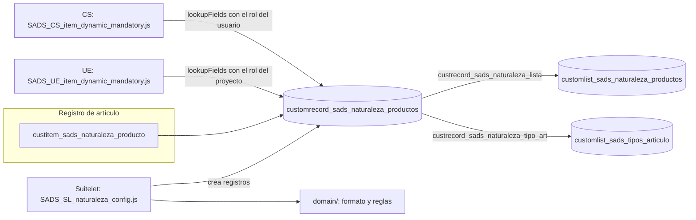

# Naturaleza-de-Productos
El objetivo de este desarrollo es controlar qué campos son obligatorios en un Item dependiendo de la selección que se haga en un campo de clasificación específico.   Para lograr esto, la lógica lee un JSON (un arreglo de IDs de campos) guardado en un Custom Record y aplica la restricción tanto en la interfaz de usuario como en el servidor. 

| Dato | Valor |
|---|---|
| Fecha de generación | 2026-10-12 |
| Tipo de proyecto | SuiteCloud SDF, Account Customization (`src/manifest.xml`) |
| Nombre del proyecto | Naturaleza de Productos |
| Plataforma | SuiteScript 2.1 |
| Ambiente de desarrollo | Sandbox `Almetal_SB` (`project.json`) |
| Pruebas | Jest 30 con `@oracle/suitecloud-unit-testing` |

## 1. Resumen
El campo de artículo `custitem_sads_naturaleza_producto` apunta a un registro de `customrecord_sads_naturaleza_productos`.
Ese registro guarda en `custrecord_sads_naturaleza_config` un arreglo JSON de IDs de campo de artículo.
Un Client Script marca esos campos como obligatorios en pantalla.
Un User Event bloquea el guardado en servidor si alguno viene vacío.
Un Suitelet crea los registros de configuración sin captura manual de JSON y filtra los campos por tipo de artículo.

| Componente | Archivo | Tipo | Entry points | Función |
|---|---|---|---|---|
| CS | `SADS_CS_item_dynamic_mandatory.js` | ClientScript 2.1 | `pageInit`, `fieldChanged`, `saveRecord` | Lee la configuración con `search.lookupFields`, marca obligatorios y bloquea el guardado en la UI. |
| UE | `SADS_UE_item_dynamic_mandatory.js` | UserEventScript 2.1 | `beforeSubmit` (CREATE y EDIT) | Valida en servidor y lanza `MISSING_DYNAMIC_MANDATORY_FIELDS` si falta un campo. |
| Suitelet | `SADS_SL_naturaleza_config.js` | Suitelet 2.1 | `onRequest` | Alta de registros de configuración en dos pasos más confirmación. |
| Dominio | `domain/SADS_naturaleza_config_formato.js` | Módulo AMD sin `N/` | — | Contrato del JSON y errores de dominio. |
| Dominio | `domain/SADS_naturaleza_alta_reglas.js` | Módulo AMD sin `N/` | — | Tipos de artículo, catálogo, validaciones y nombre del registro. |

## 2. Arquitectura



```
 Usuario edita artículo                     Usuario configura naturalezas
          │                                               │
          ▼                                               ▼
 ┌──────────────────┐   ┌──────────────────┐   ┌──────────────────────┐
 │ CS (UI)          │   │ UE (servidor)    │   │ Suitelet de alta     │
 │ pageInit,        │   │ beforeSubmit     │   │ onRequest            │
 │ fieldChanged,    │   │ CREATE y EDIT    │   │ + domain/            │
 │ saveRecord       │   │                  │   │                      │
 └────────┬─────────┘   └────────┬─────────┘   └──────────┬───────────┘
          │ lee                  │ lee                    │ crea
          ▼                      ▼                        ▼
 ┌────────────────────────────────────────────────────────────────────┐
 │ customrecord_sads_naturaleza_productos                             │
 │ custrecord_sads_naturaleza_config = ["custitem_a","custitem_b"]    │
 └────────────────────────────────────────────────────────────────────┘
```

Los IDs del arreglo de ejemplo son ficticios.

## 3. Objetos SDF
| Objeto | Tipo | Archivo en src/Objects |
|---|---|---|
| Campo gatillo de artículo | `itemcustomfield` | custitem_sads_naturaleza_producto.xml |
| Lista de naturalezas | `customlist` | customlist_sads_naturaleza_productos.xml |
| Lista de 6 tipos base de artículo | `customlist` | customlist_sads_tipos_articulo.xml |
| Registro de configuración | `customrecordtype` | customrecord_sads_naturaleza_productos.xml |
| Rol del proyecto (`runasrole` del Suitelet y del UE) | `role` | customrole_sads_naturaleza_config_exec.xml |
| Client Script con 6 deployments | `clientscript` | customscript_sads_cs_item_dynamic_mandat.xml |
| User Event con 6 deployments | `usereventscript` | customscript_sads_ue_item_dynamic_mandat.xml |
| Suitelet, deployment y parámetro | `suitelet` | customscript_sads_sl_naturaleza_config.xml |

Deployments del CS y del UE:
| Tipo de artículo | Deployment CS | Deployment UE | Estado |
|---|---|---|---|
| Inventariable | `customdeploy_item_invprt_mandatory_flds` | `customdeploy_ue_item_invprt_mndry_flds` | RELEASED |
| No inventariable | `customdeploy_cs_item_noninv_mndry_flds` | `customdeploy_ue_item_noninv_mndry_flds` | TESTING |
| Otro cargo | `customdeploy_cs_item_othchg_mndry_flds` | `customdeploy_ue_item_othchg_mndry_flds` | TESTING |
| Servicio | `customdeploy_cs_item_serv_mndry_flds` | `customdeploy_ue_item_serv_mndry_flds` | TESTING |
| Kit | `customdeploy_cs_item_kit_mndry_flds` | `customdeploy_ue_item_kit_mndry_flds` | TESTING |
| Grupo de artículos | `customdeploy_cs_item_group_mndry_flds` | `customdeploy_ue_item_group_mndry_flds` | TESTING |

Los deployments en TESTING se liberan tipo por tipo cuando las naturalezas de ese tipo tengan configuración propia.
Los 6 deployments del UE corren con `customrole_sads_naturaleza_config_exec`.
El Suitelet usa el deployment `customdeploy_sads_sl_naturaleza_config` con el mismo rol.

Manifiesto: CUSTOMRECORDS, SUBSIDIARIES y SERVERSIDESCRIPTING son obligatorias; CRM y las demás funciones son opcionales.

## 4. Estructura de archivos
```
.
├── README.md
├── __tests__/
│   ├── SADS_SL_naturaleza_config.test.js
│   ├── SADS_naturaleza_alta_reglas.test.js
│   ├── SADS_naturaleza_config_formato.test.js
│   └── sample-test.js                      # Plantilla de SuiteCloud
├── planes/                                 # Plan v4 y prompt v3 del Suitelet
├── jest.config.js
├── package.json
├── project.json                            # authId de sandbox
├── suitecloud.config.js                    # Ejecuta Jest antes de project:deploy
└── src/
    ├── deploy.xml                          # ~/FileCabinet/* y ~/Objects/*
    ├── manifest.xml
    ├── FileCabinet/SuiteScripts/SADS_Naturaleza_Productos/
    │   ├── SADS_CS_item_dynamic_mandatory.js
    │   ├── SADS_UE_item_dynamic_mandatory.js
    │   ├── SADS_SL_naturaleza_config.js
    │   ├── SADS_SL_naturaleza_config.md     # Documentación del Suitelet
    │   ├── SADS_item_dynamic_mandatory.md   # Notas originales del CS y del UE
    │   ├── testt.js                         # Plantilla de Client Script 2.x sin Object XML
    │   └── domain/
    │       ├── SADS_naturaleza_config_formato.js
    │       └── SADS_naturaleza_alta_reglas.js
    └── Objects/                             # 8 Object XML (sección 3)
```

`SADS_item_dynamic_mandatory.md` cita nombres de archivo que no coinciden con los actuales.
`testt.js` se sube al File Cabinet por `~/FileCabinet/*`, pero no tiene registro de script en el proyecto.

## 5. Pruebas
Comando: `npm test` o `npx jest`; no requiere cuenta NetSuite.

| Suite | Pruebas | Alcance |
|---|---|---|
| `SADS_naturaleza_alta_reglas.test.js` | 153 | Reglas de alta, orden alfabético español y sincronía de la documentación del Suitelet con el mapa y los XML. |
| `SADS_naturaleza_config_formato.test.js` | 109 | Contrato del JSON y compatibilidad con la lectura del CS y del UE. |
| `SADS_SL_naturaleza_config.test.js` | 36 | Entry point del Suitelet con `jest.mock` de `N/`. |
| `sample-test.js` | 2 | Plantilla de SuiteCloud. |

Resultado del 2026-10-12: 4 suites aprobadas de 4; 300 pruebas aprobadas de 300.
`suitecloud project:validate` contra `Almetal_SB` del mismo día: SUCCESS, 0 errores y 2 advertencias de `allroles` = T en el CS y el UE.
El CS y el UE no tienen pruebas Jest.

## 6. Despliegue
1. `npm test` en verde; el hook de `suitecloud.config.js` lo repite antes de `project:deploy`.
2. `project:deploy` envía todo `~/Objects/*`, incluidos los deployments del CS y del UE.
3. Después de cada despliegue, re-aplicar en la UI la audiencia del Suitelet; el XML la deja vacía.
4. Iteración A: Suitelet en vista previa (`custscript_sads_sl_permitir_alta` = F) y pruebas de catálogo por tipo.
5. Iteración B: parámetro en T, captura manual de Nombre y Tipo de Artículo en registros existentes y liberación por tipo de los deployments en TESTING.

El procedimiento completo, los supuestos por validar en sandbox y el troubleshooting están en la documentación del Suitelet.

## 7. Documentación
| Documento | Contenido |
|---|---|
| [SADS_SL_naturaleza_config.md](src/FileCabinet/SuiteScripts/SADS_Naturaleza_Productos/SADS_SL_naturaleza_config.md) | Suitelet: arquitectura, flujo, SuiteQL, contrato JSON, rol, despliegue, supuestos y troubleshooting. |
| [SADS_item_dynamic_mandatory.md](src/FileCabinet/SuiteScripts/SADS_Naturaleza_Productos/SADS_item_dynamic_mandatory.md) | Notas originales del CS y del UE. |
| [Plan v4](planes/2026-10-12_sl-naturaleza-config_plan_v4.md) | Diseño aprobado del Suitelet. |
| [Prompt v3](planes/2026-10-12_sl-naturaleza-config_prompt_v3.md) | Especificación de implementación. |

## 8. Licencia
Ver [LICENSE](LICENSE).
