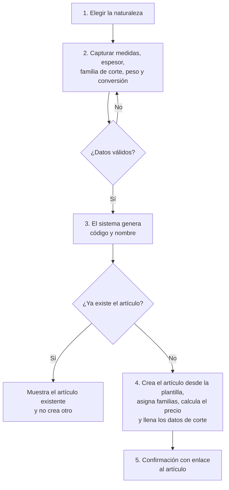

# Naturaleza de Productos
Guía funcional y técnica básica

| Dato | Valor |
|---|---|
| Plataforma | NetSuite, SuiteScript 2.1 |
| Versión del documento | 1.0 |
| Fecha | 2026-11-24 |
| Audiencia | Usuarios clave, usuarios técnicos de NetSuite y administradores |

## 1. Resumen
Naturaleza de Productos controla cómo se dan de alta los artículos de acero.
Cada naturaleza (placa, perfil tubular, lámina negra) tiene una configuración que define qué datos describen al artículo y cómo se forman su código y su nombre.
Un formulario de NetSuite crea el artículo nuevo con solo capturar esos datos.
El sistema genera código y nombre, asigna las familias de precio y de margen, calcula el precio base y llena los datos que necesita el Sistema de Cortes.
La funcionalidad descrita en este documento se validó en ambiente de pruebas y está liberada en producción.

| Problema | Cómo lo resuelve |
|---|---|
| Códigos y nombres capturados a mano, con formatos distintos | Los genera con un patrón fijo por naturaleza. |
| Artículos duplicados | Antes de crear, busca un artículo con la misma naturaleza y los mismos datos. |
| Familias de precio y de margen asignadas por criterio personal | Las asigna por rango de espesor y de medida. |
| Precio base calculado fuera del alta | Lo calcula al crear el artículo. |
| Artículos sin los datos del Sistema de Cortes | Los llena en cada alta. |
| Artículos guardados con datos de la naturaleza vacíos | Bloquea el guardado en pantalla y en servidor. |

## 2. Qué incluye
| Capacidad | Qué hace | Quién la usa |
|---|---|---|
| Parámetros obligatorios | Marca como obligatorios, al editar un artículo, los datos que la naturaleza exige. | Usuario que edita artículos |
| Bloqueo en servidor | Impide guardar un artículo con esos datos vacíos, sin importar la vía de alta (pantalla, importación CSV o script). | Todo usuario y proceso |
| Creación de artículos | Formulario de dos pasos que crea el artículo desde un artículo plantilla. | Usuario con permiso para crear artículos |
| Validación de la configuración | Revisa la configuración de cada naturaleza al guardarla. | Usuario técnico |
| Validación de familias | Revisa que los rangos de espesor y de medida no se traslapen. | Usuario técnico |

## 3. Naturalezas cubiertas
| Naturaleza | Qué captura el usuario | Espesores disponibles |
|---|---|---|
| Placas de Acero | Lado A, lado B (pies) y espesor | 14 fracciones de pulgada, de 3/16" a 2" |
| Perfiles Tubulares Cuadrados (PTRC) | Lado (pulgadas), largo (metros) y espesor de pared | 15 espesores de pared |
| Perfiles Tubulares Cuadrados Media Pieza (MPPTRC) | Lado, largo y espesor de pared | 15 espesores de pared |
| Perfiles Tubulares Rectangulares (PTRR) | Medida elegida de una lista, largo y espesor de pared | 15 espesores de pared |
| Perfiles Tubulares Rectangulares Media Pieza (MPPTRR) | Medida elegida de una lista, largo y espesor de pared | 15 espesores de pared |
| Lámina Negra (LNE) | Lado A, lado B (pies) y calibre | 16 calibres, de Cal.07 a Cal.28 |

Espesores de pared de PTR: Cal.20, 18, 16, 14, 12, 11, 10, 09 y 07, y las fracciones 1/8", 3/16", 1/4", 5/16", 3/8" y 1/2".

Ejemplos de lo que genera el sistema.
| Naturaleza | Captura | Código | Nombre |
|---|---|---|---|
| Placas de Acero | 1/2", lado A 6, lado B 20 | `PLA36050620` | `Placa Acero TA36 1/2" 6'x20'` |
| PTRC | Lado 1", Cal.14, largo 6 m | `PTRC100C14` | `PTR 1" x 1" Cal.14 a 6.00m` |
| MPPTRC | Lado 1", Cal.14, largo 3 m | `MPPTRC100C14` | `PTR Media Pieza 1" x 1" Cal.14 a 3.00m` |
| PTRR | Medida `3" x 2" (R-302)`, Cal.14, largo 6 m | `PTRR302C14` | `PTR 3" x 2" Cal.14 a 6.00m` |
| Lámina Negra | 3'x6', Cal.10 | `LNE306C10` | `Lamina Negra 3'x6' Cal.10` |

## 4. Cómo se crea un artículo

| Paso | Qué ve y qué hace el usuario |
|---|---|
| 1 | Elige la naturaleza de una lista. Solo aparecen las naturalezas configuradas por el usuario técnico. |
| 2 | Captura los datos de la naturaleza, el espesor del catálogo, la familia de corte, el peso y la conversión de unidad. Si hay un error, el formulario regresa con el mensaje y conserva lo capturado. |
| 3 | El sistema arma el código y el nombre. Si ya existe un artículo igual, lo muestra con un enlace y no crea otro. |
| 4 | El sistema copia el artículo plantilla, llena los campos, calcula el precio y guarda. |
| 5 | La confirmación muestra código, nombre, precio base, familia de corte y valor de unidades, con enlace al artículo. |

El artículo plantilla es un artículo existente con la configuración contable, fiscal, de subsidiarias y de unidades correcta para la naturaleza.
El artículo nuevo hereda de la plantilla todo lo que el formulario no captura.

## 5. Qué escribe el sistema en el artículo
| Dato del artículo | Valor |
|---|---|
| Naturaleza de producto | La elegida |
| Datos de la naturaleza (lados, largo, espesor) | Los capturados; en PTR rectangular salen de la medida elegida |
| Peso | El capturado |
| Conversión de unidad | La capturada |
| Familia de precios y familia de márgenes | Las de la línea cuyo rango contiene el espesor y la medida |
| Nombre del artículo y descripciones de compra y venta | Nombre generado |
| Nombre para mostrar y nombre del proveedor | Código generado |
| UPC y MPN | Vacíos |
| Precio de cotización y margen para venta | Los de las familias asignadas |
| Precio de venta sin IVA y nivel de precio Precio base MXN | Calculados (sección 8); los demás niveles de precio quedan vacíos |
| Disponible para corte y Utilizar depósitos | Sí |
| Familia de corte | La elegida en el paso 2 |
| Valor de unidades | Producto de los datos que define la naturaleza |
| Espesor de corte | Orden del espesor elegido |
| Todo lo demás (cuentas, impuestos, claves SAT, subsidiarias, unidades) | Se hereda de la plantilla |

Un parámetro del formulario (Crear artículos activos) define si el artículo nuevo queda activo o inactivo.

## 6. Código y nombre
Cada naturaleza guarda un patrón de código y un patrón de nombre.
Un patrón mezcla texto fijo con marcadores entre llaves: `{campo}` o `{campo:formato}`.
El texto fuera de llaves se copia tal cual.

| Formato | Resultado | Ejemplo |
|---|---|---|
| Sin formato | Número sin ceros a la derecha | 6 → `6` |
| `centesimas3` | Centésimas truncadas, 3 dígitos | 0.375 → `037` |
| `fraccion16` | Fracción reducida, hasta 1/16 | 1.25 → `1 1/4` |
| `entero1` | Entero de 1 a 9 | 7 → `7` |
| `entero2` | Entero de 1 a 99, con cero a la izquierda | 7 → `07` |
| `decimal2` | Número mayor que 0 con 2 decimales | 6 → `6.00` |
| `codigo` | Segmento de código del espesor elegido | 1/2" → `050` |
| `texto` | Texto del espesor elegido | 1/2" → `1/2"` |
| `{mapa:codigo}` | Código del proveedor de la medida elegida (solo PTR rectangular) | `3" x 2" (R-302)` → `302` |

Patrones por naturaleza.
| Naturaleza | Código | Nombre |
|---|---|---|
| Placas de Acero | `PLA36` + espesor (código) + lado A (1 dígito) + lado B (2 dígitos) | `Placa Acero TA36` + espesor + `lado A'x lado B'` |
| PTRC | `PTRC` + lado en centésimas + espesor (código) | `PTR` + lado + `x` + lado + espesor + `a` + largo con 2 decimales + `m` |
| MPPTRC | `MPPTRC` + lado en centésimas + espesor (código) | `PTR Media Pieza` + misma estructura del PTRC |
| PTRR | `PTRR` + código de la medida + espesor (código) | `PTR` + lado mayor + `x` + lado menor + espesor + largo |
| MPPTRR | `MPPTRR` + código de la medida + espesor (código) | `PTR Media Pieza` + misma estructura del PTRR |
| Lámina Negra | `LNE` + lado A (1 dígito) + lado B (2 dígitos) + espesor (código) | `Lamina Negra` + `lado A'x lado B'` + calibre |

En placas y LNE los últimos dígitos del código son las medidas: lados 7 y 7 dan `707`; lados 6 y 20 dan `620`.
En PTR el largo no va en el código: piezas de 1 m y de 6 m comparten código y se distinguen por el nombre.
El nombre y el código tienen un límite de 60 caracteres; si se excede, el formulario lo avisa.

## 7. Espesores y familias de precio y margen
### 7.1 Catálogo de espesores
Cada espesor es un registro con tres datos.
| Dato | Uso | Ejemplo |
|---|---|---|
| Texto | Va en el nombre del artículo | `1/2"` |
| Código | Va en el código del artículo | `050` |
| Orden | Número de grosor; ordena los espesores y define los rangos de familia | 0.5 |

El catálogo trae 45 espesores: 14 de fracción de pulgada (placas), 16 de calibre (Lámina Negra) y 15 de pared de PTR.
El orden permite definir rangos aunque el número de calibre sea inverso al grosor.

### 7.2 Cómo se asigna la familia
Cada naturaleza tiene líneas de familia.
Una línea indica un rango de espesor, en PTR y LNE también un rango de medida, y la familia de precio y la de margen que le corresponden.
El sistema toma la línea cuyo rango contiene el espesor (y la medida) capturados.
Si ninguna línea aplica, el sistema no crea el artículo y lo avisa.
Los rangos reproducen la familia que tenían los artículos existentes al momento de la configuración.

Placas de Acero: 2 líneas, 3/16" a 5/8" y 3/4" a 2"; margen "Margen de placas".

PTRC (margen "PTR"):
| Espesor | Lado (pulgadas) | Familia de precio |
|---|---|---|
| Cal.20 a Cal.18 | 0.5 a 0.625 | FAM 020 |
| Cal.20 a Cal.18 | 0.75 a 6 | FAM 022 |
| Cal.16 | 0.5 a 6 | FAM 098 |
| Cal.14 | 0.5 a 3.5 | FAM 023 |
| Cal.14 | 4 a 6 | FAM 024 |
| Cal.12 a Cal.10 | 0.5 a 3 | FAM 023 |
| Cal.12 a Cal.10 | 3.5 a 6 | FAM 024 |
| Cal.09 | 0.5 a 1.75 | FAM 023 |
| Cal.09 a 1/2" | 2 a 6 | FAM 024 |

MPPTRC (margen "PTR Media Pieza"):
| Espesor | Lado (pulgadas) | Familia de precio |
|---|---|---|
| Cal.14 | 0.5 a 6 | FAM 023 |
| Cal.12 a Cal.09 | 0.5 a 3 | FAM 023 |
| Cal.12 a Cal.09 | 3.5 a 6 | FAM 024 |
| Cal.07 a 1/2" | 0.5 a 6 | FAM 024 |

PTRR (margen "PTR"):
| Espesor | Lado mayor (pulgadas) | Familia de precio |
|---|---|---|
| Cal.20 a Cal.18 | Todos | FAM 022 |
| Cal.16 | Todos | FAM 098 |
| Cal.14 a Cal.09 | 0.5 a 3 | FAM 023 |
| Cal.14 a Cal.09 | 3.5 a 8 | FAM 024 |
| 3/16" a 1/2" | Todos | FAM 024 |

MPPTRR usa las mismas familias de precio que PTRR, con margen "PTR Media Pieza".

Lámina Negra (margen "Lamina Negra"; la medida es el ancho, lado A):
| Ancho | Calibres | Familia de precio |
|---|---|---|
| 3' | Cal.13 a Cal.07 | FAM 017 |
| 3' | Cal.14 | FAM 089 |
| 3' | Cal.24 a Cal.16 | FAM 018 |
| 3' y 4' | Cal.26 | FAM 092 |
| 4' | Cal.13 a Cal.08 | FAM 088 |
| 4' | Cal.14 | FAM 090 |
| 4' | Cal.24 a Cal.16 | FAM 091 |

## 8. Cálculo del precio
El sistema calcula el precio de venta sin IVA con la misma cadena de campos fórmula que ya existe en los artículos.
Escribe el resultado en el campo de precio de venta y en el nivel Precio base MXN, en el mismo guardado.

| Paso | Cálculo |
|---|---|
| 1. Precio base por unidad | Precio de cotización de la familia × tipo de cambio × conversión de unidad |
| 2. Cargos | Flete y maniobras: cargo fijo por kg × peso, más el porcentaje sobre el precio de cotización; los valores vienen de la plantilla |
| 3. Seguro | Porcentaje de seguro sobre el precio base más cargos |
| 4. Utilidad | Precio sin margen × (100 / (100 − margen) − 1) |
| 5. Precio final | Suma de los pasos anteriores, más el cargo compensatorio de la plantilla (vacío = 0), redondeada hacia arriba a múltiplos de 0.25 |

Ejemplo.
| Dato | Valor |
|---|---|
| Precio de cotización | 25.00 |
| Tipo de cambio | 1 |
| Conversión de unidad | 6.1 |
| Peso (kg) | 6.1 |
| Cargo fijo de flete / de maniobras (por kg) | 0.35 / 0.20 |
| Porcentajes de flete, maniobras y seguro | 0 |
| Margen | 20 % |
| Precio base por unidad | 152.50 |
| Cargos | 3.355 |
| Precio sin margen | 155.855 |
| Utilidad | 38.96375 |
| Precio final | 195.00 |

Después de guardar, el sistema compara su precio con el campo fórmula de la cuenta.
Si difieren en más de 0.005, la confirmación muestra el aviso "Revise el precio".
Si falta un dato necesario para el precio (por ejemplo la familia o un cargo de la plantilla), el artículo no se crea.
El tipo de cambio es el predeterminado de la moneda de cotización.

## 9. PTR rectangular: mapa de medidas
El código de PTR rectangular usa el número del catálogo del proveedor, que no sigue una fórmula.
Ejemplos: 1.5" x 0.5" es 155; 1.5" x 0.75" es 150; 2" x 1" es 200; 3" x 2" es 302.
Por eso, en PTRR y MPPTRR el usuario no captura los lados: elige una medida de una lista.

| Dato de cada medida | Ejemplo |
|---|---|
| Lado mayor (pulgadas) | 3 |
| Lado menor (pulgadas) | 2 |
| Código del proveedor | 302 |
| Nombre que ve el usuario | `3" x 2" (R-302)` |

El mapa trae 24 medidas.
La medida elegida llena los dos lados del artículo y aporta el código.
La familia se resuelve por el lado mayor.
Una medida nueva exige darla de alta en el mapa.

## 10. Sistema de Cortes
El Sistema de Cortes es otro proyecto: solicitudes de corte que generan ajustes de inventario.
Cada artículo creado sale listo para usarlo.

| Dato | Regla |
|---|---|
| Disponible para corte y Utilizar depósitos | Siempre Sí. |
| Familia de corte | El usuario la elige en el paso 2, entre las familias que el usuario técnico marcó para la naturaleza. Sin familias marcadas, el formulario no permite crear. |
| Valor de unidades | Producto de los datos que define la naturaleza. Placas y LNE: lado A por lado B. PTR: largo en metros. |
| Espesor de corte | Orden del espesor elegido, con cero a la izquierda y sin ceros finales. |

Ejemplos.
| Artículo | Valor de unidades | Espesor de corte |
|---|---|---|
| LNE 4'x10' Cal.18 | 40 | 0.0478 |
| Placa 6'x20' de 1" | 120 | 1 |
| PTR a 6.00 m | 6 | según el espesor |
| PTR media pieza a 3.00 m | 3 | según el espesor |

La lista de familias de corte pertenece al Sistema de Cortes.
Una familia nueva se da de alta en esa lista y después se marca en la naturaleza.

## 11. Validaciones y controles
| Control | Qué hace |
|---|---|
| Parámetros obligatorios | Pantalla: marca los campos como obligatorios. Servidor: bloquea el guardado con campos vacíos, también en importaciones y scripts. Aplica a inventario, no inventariable, otro cargo, servicio, kit y grupo de artículos, en las subsidiarias configuradas. |
| Captura | Valida números y rangos según el formato del patrón. En placas, el lado A no puede ser mayor que el lado B. |
| Duplicados | Busca un artículo con la misma naturaleza y los mismos datos, incluidos los inactivos; si existe, lo muestra y no crea otro. |
| Familia | Si ninguna línea de familia cubre el espesor y la medida, no crea el artículo. |
| Precio | Si falta un dato del cálculo, no crea el artículo; después de guardar, compara contra el campo fórmula. |
| Límite de longitud | El nombre y el código no pueden pasar de 60 caracteres. |
| Mensajes | Los errores de negocio se muestran en español; un error técnico muestra un mensaje general y el detalle queda en el registro de la cuenta. |
| Acceso | Requiere sesión de NetSuite y permiso para crear artículos; las notas del sistema registran al usuario que creó el artículo. |
| Entrada | Solo se aceptan valores de las listas del sistema y números válidos; todo se revalida en el servidor en cada envío. |
| Configuración | Al guardar una naturaleza, el sistema valida su formato, su plantilla, sus patrones, el tipo de espesor, el campo de medida y los datos de corte; al guardar una línea de familia, valida que no se traslape con las demás. |

## 12. Administración de naturalezas
Los usuarios técnicos preparan cada naturaleza en NetSuite; el formulario no crea campos ni configuraciones.

| Paso | Qué hacer |
|---|---|
| 1 | Crear los campos de artículo de los parámetros (tipo Decimal o Entero) y aplicarlos al tipo de artículo de la plantilla. |
| 2 | Elegir el artículo plantilla. |
| 3 | Capturar la configuración en el registro "SADS - Naturaleza de Productos" (tabla siguiente). |
| 4 | Capturar los espesores en "SADS - Espesor": texto, código y orden. |
| 5 | Capturar las líneas de familia de la configuración: rango de espesor, rango de medida (si aplica), familia de precio y familia de margen. |
| 6 | Marcar las familias de corte de la naturaleza. |

| Campo de la configuración | Contenido |
|---|---|
| Naturaleza (lista) | Valor de la lista de naturalezas |
| Configuración de Campos Obligatorios | Lista de los campos de parámetros, en formato JSON, por ejemplo `["campo_a","campo_b"]`; solo minúsculas, dígitos y guion bajo |
| Artículo Plantilla (ID interno) | ID numérico del artículo plantilla |
| Patrón de Código y Patrón de Nombre | Texto con marcadores (sección 6) |
| Tipo de Espesor | Fracción de pulgada, Calibre, Pared de PTR, Milímetros o Cédula; vacío si la naturaleza no usa espesor |
| Campo de Medida para Familias | Parámetro numérico que define el rango de medida de las líneas de familia; no puede ser el espesor |
| Usar Mapa de Medidas PTRR | Casilla; solo para PTR rectangular |
| Familias de Corte | Familias que el usuario puede elegir en el paso 2 |
| Parámetros para Valor de Unidades | Lista JSON de los campos que se multiplican |

Una naturaleza sin espesor no lleva espesor en la configuración y tiene una sola línea de familia sin rango.
Un formato de patrón nuevo requiere cambio de código; los 8 formatos de la sección 6 cubren las naturalezas actuales.

## 13. Alcance y límites
| Límite | Efecto |
|---|---|
| El peso y la conversión de unidad se capturan; el sistema no los calcula. | Un error de captura pasa al cálculo del precio. |
| La cadena de precio está en los campos fórmula de la cuenta y se replica en el sistema. | Si cambia una fórmula en la cuenta, hay que ajustar el sistema; mientras tanto, el aviso "Revise el precio" lo detecta. |
| No migra artículos existentes. | Los artículos anteriores conservan su código, nombre y familia. |
| El mínimo comercial de 2 pies en placas no se impone. | Se aceptan lados menores. |
| LNE no tiene familia para Cal.15, Cal.28 ni Cal.07 en ancho de 4'. | No se pueden crear esos calibres con el formulario. |
| PTRC y MPPTRC no tienen familia para algunos lados entre rangos (por ejemplo 3 1/4" en Cal.10 a Cal.12), y PTRC tampoco para Cal.07 ni fracciones con lado menor que 2". | No se pueden crear esas combinaciones hasta agregar una línea de familia. |
| MPPTRR usa las familias de precio de PTRR por supuesto; no había datos propios de media pieza rectangular. | Si la familia real es otra, el precio será distinto. |
| Hay excepciones de margen en artículos existentes (por ejemplo piezas de pedacería). | El sistema asigna el margen de la naturaleza; las excepciones se ajustan a mano. |
| Algunos artículos existentes de PTR tienen nombre con otro formato (por ejemplo "a 1 Metro"). | Los nuevos usan un formato uniforme (`a 1.00m`). |
| Los campos "PARA VENTAS" y "PARA COMPRAS" del artículo no los usa la creación. | Sirven para filtrar catálogos; el artículo copia el valor de la plantilla. |

## 14. Consideraciones fiscales
| Obligación | Fundamento | Efecto en el diseño |
|---|---|---|
| Cada concepto del CFDI lleva `ClaveProdServ` y `ClaveUnidad` de los catálogos del SAT. | Anexo 20 y Guía de llenado del CFDI 4.0, nodo Concepto. | El artículo nuevo hereda esas claves de la plantilla. Una clave errónea en la plantilla se replica en cada artículo y en los CFDI que lo facturen. |
| Cada mercancía del Complemento Carta Porte lleva `PesoEnKg`. | Guía de llenado del Complemento Carta Porte, nodo Mercancia. | Si la localización toma el peso del artículo, un peso erróneo pasa al complemento. |

El sistema no afirma cumplimiento fiscal; copia la configuración fiscal de la plantilla.

## 15. Componentes en NetSuite
| Componente | Tipo | Función |
|---|---|---|
| SADS - Crear Artículo por Naturaleza (`customscript_sads_sl_crear_articulo_nat`) | Suitelet | Formulario de creación de artículos |
| `customscript_sads_cs_item_dynamic_mandat` | Client Script | Parámetros obligatorios en pantalla |
| `customscript_sads_ue_item_dynamic_mandat` | User Event | Parámetros obligatorios en servidor |
| `customscript_sads_ue_naturaleza_config` | User Event | Validación de la configuración de cada naturaleza |
| `customscript_sads_ue_nat_familia` | User Event | Validación de las líneas de familia |
| SADS - Naturaleza de Productos | Registro personalizado | Configuración de cada naturaleza |
| SADS - Espesor | Registro personalizado | Catálogo de espesores |
| Familias por naturaleza | Registro personalizado | Líneas de familia de precio y margen por rango |
| SADS - Mapa de Medidas PTRR | Registro personalizado | Medidas y códigos del proveedor de PTR rectangular |
| Lista de naturalezas y lista de tipos de espesor | Listas personalizadas | Valores de selección |
| Naturaleza de Producto, espesor y lados, largo (placas, PTR, LNE) | Campos de artículo | Datos que describen el artículo |
| PARA VENTAS y PARA COMPRAS | Campos de artículo | Filtrado de catálogos de venta y compra |
| Rol de ejecución del User Event de artículo | Rol | Permite leer la configuración sin dar permisos a cada rol |

## 16. Supuestos y fuentes
| ID | Supuesto |
|---|---|
| SU-01 | La funcionalidad descrita está liberada en producción, según el responsable del proyecto; este documento no la verificó en la cuenta. |
| SU-02 | Las tablas de familias reproducen la familia de los artículos existentes según las búsquedas que el responsable proporcionó en noviembre de 2026. |
| SU-03 | Los nombres de familia (FAM 017, FAM 022 y similares) son los del catálogo de familias de la cuenta. |
| SU-04 | Los ejemplos de precio usan datos ilustrativos, no de un artículo real. |

| Fuente | Uso |
|---|---|
| Objetos y datos del proyecto SDF (registros, listas, campos, scripts) | Naturalezas, espesores, líneas de familia, mapa de medidas y permisos |
| Documentación técnica del Suitelet y planes de diseño del proyecto | Reglas de negocio, flujo y cálculo de precio |
| Anexo 20 y Guía de llenado del CFDI 4.0; Guía de llenado del Complemento Carta Porte | Fundamento fiscal; citados por la documentación del proyecto, no revisados de nuevo |

## 17. Verificación
| Comprobación | Resultado |
|---|---|
| Pruebas automatizadas del proyecto | 675 aprobadas de 675 (16 suites), ejecutadas el 2026-11-24 |
| Ejemplos de código y nombre | Generados con el módulo de patrones del proyecto sobre la configuración real |
| Ejemplo de precio | Recalculado de forma independiente: 195.00 |
| Conteos (6 naturalezas, 45 espesores, 24 medidas, 15 espesores de PTR, 16 calibres de LNE, 14 fracciones de placa) | Contados en los datos del proyecto |

Límites: el documento describe el diseño y la configuración del proyecto; no se consultó la cuenta de producción.
