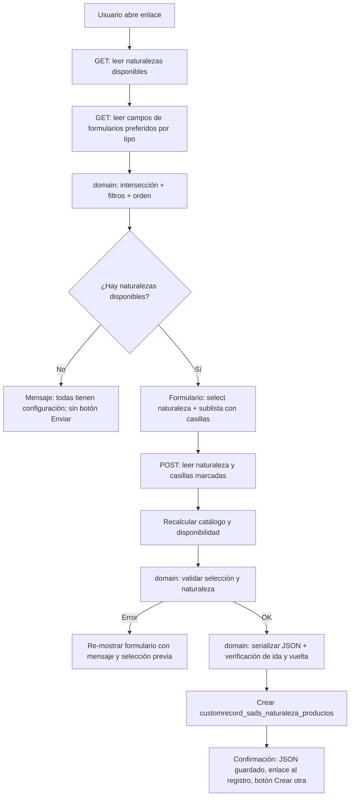
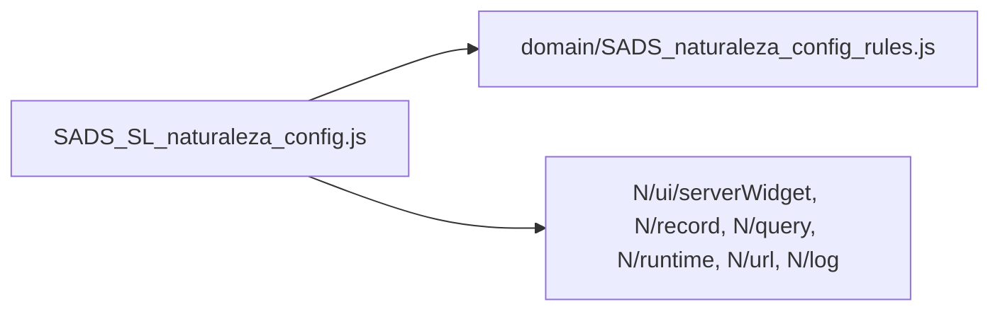

# Plan: Suitelet de alta de configuración de Naturaleza de Productos — v1

Contexto: hoy la configuración de campos obligatorios por naturaleza se captura a mano como texto JSON en un campo CLOBTEXT del formulario nativo.
Un error de sintaxis no se detecta al guardar y desactiva en silencio la validación de artículos (el `catch` del UE solo registra en log).
Se requiere un formulario para usuario final que cree estos registros sin teclear JSON y sin duplicar naturalezas.
Al aprobar este plan se pasa a Fase 4 y se genera `planes/2026-10-12_sl-naturaleza-config_prompt_v1.md` para el agente coder. No se escribe código en esta etapa.

## 0. Control
| Campo | Valor |
|---|---|
| Fecha | 2026-10-12 |
| Versión | v1 |
| Estado | En revisión |
| Solicitante | Desarrollo SADS (para cliente final) |
| Entidades afectadas | Todas las subsidiarias; el registro de configuración no es por subsidiaria |

Historial de cambios:
- v1 (2026-10-12): versión inicial con decisiones de Fase 1 (intersección de formularios, campos estándar + personalizados, sin UE de barrera, sublista con casillas).

## 1. Objetivo
Problema: captura manual del arreglo JSON en `custrecord_sads_naturaleza_config`, propensa a errores de formato y a duplicados por naturaleza.
Resultado: un Suitelet donde el usuario elige una naturaleza disponible y marca campos de artículo; el script genera el JSON y crea el registro.
Métrica de éxito: 100% de los registros creados por el Suitelet pasan `JSON.parse` y `Array.isArray` en el CS y UE existentes; 0 duplicados creados desde el Suitelet.

## 2. Alcance
Incluye:
- Suitelet nuevo (GET formulario, POST creación).
- Módulo de reglas puras en `domain/` con pruebas Jest.
- Object XML del script y su deployment (SDF).

No incluye:
- Edición de registros existentes (decisión de Fase 1).
- Cambios a `SADS_CS_item_dynamic_mandatory.js` ni `SADS_UE_item_dynamic_mandatory.js`.
- User Event de barrera sobre el registro de configuración (decisión de Fase 1: la regla de no duplicar solo se aplica desde el Suitelet).
- Asignación de roles: el cliente define audiencia y acceso al enlace.

## 3. Situación actual
| Objeto | Hecho verificado (archivos del repo) |
|---|---|
| `customrecord_sads_naturaleza_productos` | Campos `custrecord_sads_naturaleza_lista` (SELECT a `customlist_sads_naturaleza_productos`, obligatorio) y `custrecord_sads_naturaleza_config` (CLOBTEXT, obligatorio). `includename` = F. `accesstype` = CUSTRECORDENTRYPERM. System notes activas. |
| `custitem_sads_naturaleza_producto` | SELECT al custom record (no a la lista). Aplica a inventario, no inventario, servicio, kit, grupo y otro cargo. |
| `customlist_sads_naturaleza_productos` | Un valor cargado: "Placas de Acero". |
| `SADS_CS_item_dynamic_mandatory.js` | `lookupFields` del custom record por el valor del campo gatillo; `JSON.parse`; `getField(id).isMandatory = true` con try/catch por campo. |
| `SADS_UE_item_dynamic_mandatory.js` | `beforeSubmit` CREATE/EDIT; `JSON.parse`; si un ID del arreglo está vacío en el artículo, lanza `MISSING_DYNAMIC_MANDATORY_FIELDS`. Un campo inexistente en el tipo de artículo se lee vacío y bloquea el guardado. |
| Object XML de scripts | No existen `customscript_*` en `src/Objects`; supuesto: CS y UE se desplegaron manualmente. |
| Pruebas | Jest con `@oracle/suitecloud-unit-testing` configurado; solo `__tests__/sample-test.js`. |
| Ambiente | `project.json` → authId `Almetal_SB` (sandbox). |

Contrato de formato que se debe preservar (derivado del código consumidor): texto JSON que al parsear da un arreglo de cadenas; cada cadena es un ID interno de campo del artículo usable en `getValue`/`getField`.

Observaciones fuera de alcance (no se corrigen aquí):
- UE: el arreglo se parsea dos veces y se recorre dos veces; un campo faltante se reporta duplicado en el mensaje.
- `help` del campo config muestra un ejemplo con IDs no reales (`"_sads_naturaleza_config"`).
- `testt.js` es una plantilla vacía con referencia a una variable no definida; no está desplegada (supuesto).

## 4. Arquitectura de la solución
| Componente | Tipo | ID propuesto (scriptid) | Disparador | Responsabilidad |
|---|---|---|---|---|
| SL alta de configuración | Suitelet 2.1 | `customscript_sads_sl_naturaleza_config` / `customdeploy_sads_sl_naturaleza_config` | Usuario abre el enlace (GET) y envía (POST) | Construir formulario, leer metadatos, validar, crear registro |
| Reglas de configuración | Módulo AMD sin `N/` | — (archivo en `domain/`) | Llamado por el Suitelet | Catálogo elegible, validación, serialización JSON |

Justificación del tipo:
- Suitelet frente a formulario nativo + Client Script en "Custom Code": la pestaña Custom Code de un formulario personalizado permite adjuntar un Client Script a nivel formulario (supuesto: acepta 2.x; verificar en sandbox). Un Client Script no puede agregar campos ni construir el catálogo de campos de artículo; requeriría además un UE `beforeLoad` con `serverWidget`. Son dos o tres archivos sobre el formulario nativo contra uno aislado. Se descarta por la preferencia de interfaz independiente y por no tocar el formulario nativo.
- Suitelet frente a CSV import o workflow: ninguno de los dos puede ofrecer el catálogo de campos del formulario preferido.



### 4.1 Nivel de arquitectura
Nivel 1.
Señales que lo suben: reglas verificables (formato JSON, intersección, filtros) que conviene probar con Jest sin cuenta; contrato de formato compartido con CS y UE.
Señales que lo bajan: un solo entry point, sin integraciones externas, volumen mínimo.
Nivel 2 sería excesivo: un caso de uso, sin variación de fuentes de datos.

### 4.2 Capas, casos de uso y puertos
| Caso de uso | Intención de negocio | Entrada | Salida | Reglas |
|---|---|---|---|---|
| Crear configuración de naturaleza | Registrar qué campos de artículo son obligatorios para una naturaleza | `naturalezaId`, `idsSeleccionados[]` | ID del registro creado y JSON guardado, o lista de errores | RN-01 a RN-10 |

Nivel 1: sin puertos formales. El entry point conserva el acceso a `N/` en funciones locales; las reglas viven en `domain/`.

### 4.3 Patrones de diseño
No aplica: no hay variación de comportamiento que lo justifique.

### 4.4 Estructura de archivos
Se respeta la convención plana existente (`SADS_<tipo>_...js`) para no mover entry points ya desplegados.
```
src/FileCabinet/SuiteScripts/SADS_Naturaleza_Productos/
├── SADS_CS_item_dynamic_mandatory.js        (existente, sin cambios)
├── SADS_UE_item_dynamic_mandatory.js        (existente, sin cambios)
├── SADS_SL_naturaleza_config.js             (nuevo, entry point)
└── domain/
    └── SADS_naturaleza_config_rules.js      (nuevo, sin imports N/)
src/Objects/
└── customscript_sads_sl_naturaleza_config.xml (nuevo)
__tests__/
└── SADS_naturaleza_config_rules.test.js     (nuevo)
```


## 5. Modelo de datos
### 5.1 Registros y campos existentes
| Registro | Campo | ID interno | Tipo | Uso | Verificado/Supuesto |
|---|---|---|---|---|---|
| Config naturaleza | Naturaleza | `custrecord_sads_naturaleza_lista` | SELECT (lista) | Valor elegido | Verificado (XML) |
| Config naturaleza | Configuración | `custrecord_sads_naturaleza_config` | CLOBTEXT | JSON generado | Verificado (XML) |
| Config naturaleza | Inactivo | `isinactive` | Checkbox | Cuenta para duplicados | Supuesto (estándar de custom record) |
| Lista naturalezas | Valor / inactivo | `id`, `name`, `isinactive` | — | Opciones disponibles | Supuesto (columnas SuiteQL de custom list) |
| Campo personalizado | Script ID / inactivo / tipo | tabla `customfield`: `scriptid`, `isinactive`, `fieldtype` | — | Excluir custitem inactivos | Supuesto; puede no requerirse (ver D-02) |
| Artículo | Campo gatillo | `custitem_sads_naturaleza_producto` | SELECT | Se excluye del catálogo | Verificado (XML) |

### 5.2 Objetos nuevos
| Objeto | ID propuesto | Tipo | Aplica a | Obligatorio | Default | Regla |
|---|---|---|---|---|---|---|
| Script | `customscript_sads_sl_naturaleza_config` | Suitelet 2.1 | — | — | — | — |
| Deployment | `customdeploy_sads_sl_naturaleza_config` | Script deployment | — | — | Status Released; sin login = F | Audiencia la define el cliente |
| Parámetro | `custscript_sads_sl_tipos_articulo` | Free-form text | Script | Sí | `inventoryitem,noninventoryitem,serviceitem,kititem,itemgroup,otherchargeitem` (supuesto: IDs de `record.Type`) | RN-03 |
| Campo de formulario | `custpage_naturaleza` | SELECT (sin fuente) | Suitelet | Sí | — | RN-01 |
| Sublista | `custpage_campos` | LIST | Suitelet | — | — | Botones marcar/desmarcar todo |
| Columna | `custpage_sel` | CHECKBOX (ENTRY) | Sublista | — | F | RN-06 |
| Columnas | `custpage_etiqueta`, `custpage_id`, `custpage_tipo` | TEXT (INLINE) | Sublista | — | — | Solo lectura |

## 6. Lógica por componente
### 6.1 Suitelet `SADS_SL_naturaleza_config.js`
Punto de entrada: `onRequest`. Contexto: UI. Rama por `request.method`.

GET:
1. Leer parámetro de tipos de artículo y convertirlo en lista.
2. Obtener naturalezas disponibles (consulta Q-1).
3. Por cada tipo, crear el artículo en memoria en modo dinámico sin guardar y leer sus campos (ID, etiqueta, tipo).
4. Obtener IDs de personalizados inactivos (consulta Q-2), salvo que D-02 lo elimine.
5. Llamar a `construirCatalogo` del dominio.
6. Construir formulario; si no hay naturalezas disponibles, mostrar mensaje y omitir botón Enviar.

POST:
1. Leer `custpage_naturaleza` y recorrer `custpage_campos`; tomar `custpage_id` de líneas con `custpage_sel` = T.
2. Recalcular naturalezas disponibles y catálogo (pasos GET 2 a 5). No se confía en datos ocultos del formulario.
3. `validarAlta` del dominio. Si hay errores: re-mostrar formulario con mensaje y casillas previas marcadas.
4. `serializarConfiguracion` y `esConfiguracionValida` (ida y vuelta).
5. Crear `customrecord_sads_naturaleza_productos`, asignar lista y config, guardar sin ignorar obligatorios.
6. Página de confirmación: naturaleza, JSON guardado, enlace al registro, botón "Crear otra".

Funciones del entry point (acceso a `N/`):
| Función | Entradas | Salida | Responsabilidad |
|---|---|---|---|
| `onRequest` | `context` | — | Despachar GET/POST; try/catch global |
| `leerTiposArticulo` | — | `string[]` | Parámetro de script a lista |
| `leerCamposDeFormularioPreferido` | `tipoRegistro` | `{id, etiqueta, tipoCampo}[]` | `record.create` dinámico sin guardar; `getFields` + `getField` |
| `obtenerNaturalezasDisponibles` | — | `{id, nombre}[]` | Q-1 |
| `obtenerIdsPersonalizadosInactivos` | — | `string[]` | Q-2 |
| `crearConfiguracion` | `{naturalezaId, json}` | `number` | `record.create` + `save` del custom record |
| `construirFormulario` | `{naturalezas, catalogo, seleccion, mensaje}` | `Form` | `serverWidget` |
| `construirConfirmacion` | `{registroId, naturaleza, json}` | `Form` | `serverWidget` + `url.resolveRecord` |

Consultas:
| ID | Tabla | Campos | Filtros | Orden | Volumen |
|---|---|---|---|---|---|
| Q-1 | `customlist_sads_naturaleza_productos` con anti-join a `customrecord_sads_naturaleza_productos` por `custrecord_sads_naturaleza_lista` | id, name | lista `isinactive = 'F'`; sin registro de config (activo o inactivo) | name | Decenas |
| Q-2 | `customfield` | scriptid | `fieldtype = 'ITEM'`, `isinactive = 'T'` | — | Decenas |

### 6.2 Dominio `domain/SADS_naturaleza_config_rules.js`
| Función | Entradas | Salida | Responsabilidad |
|---|---|---|---|
| `esCampoDeSistema` | `id` | `boolean` | Patrón de exclusión de IDs internos |
| `construirCatalogo` | `camposPorTipo[]`, `idsInactivos[]`, `idsExcluidos[]` | `{id, etiqueta, tipoCampo}[]` | Intersección, filtros, orden por etiqueta |
| `validarAlta` | `{naturalezaId, naturalezasDisponibles, idsSeleccionados, catalogo}` | `{valido, errores[]}` | RN-02, RN-06, RN-07, RN-10 |
| `serializarConfiguracion` | `ids[]` | `string` | RN-08 |
| `esConfiguracionValida` | `texto` | `boolean` | Contrato de formato del CS/UE |

### 6.3 Reglas de negocio
| ID | Regla |
|---|---|
| RN-01 | Solo se ofrecen valores activos de `customlist_sads_naturaleza_productos` sin registro de configuración existente, activo o inactivo. |
| RN-02 | Si al enviar ya existe un registro para la naturaleza, se rechaza y no se crea nada. |
| RN-03 | Catálogo = intersección por ID de los campos de los formularios preferidos de cada tipo del parámetro. |
| RN-04 | Un campo es elegible si tiene etiqueta no vacía y su ID no es de sistema (prefijos `_`, `sys`, `nsapi`, `nlloc`, `wfinstances`; lista final según D-01). |
| RN-05 | Se excluyen campos `custitem_*` inactivos y el campo gatillo `custitem_sads_naturaleza_producto`. |
| RN-06 | Debe marcarse al menos un campo. |
| RN-07 | Todo ID enviado debe existir en el catálogo recalculado en el POST. |
| RN-08 | JSON = arreglo de cadenas, sin duplicados, orden ascendente por ID, sin espacios. Ejemplo de forma: `["custitem_a","upccode"]`. |
| RN-09 | El Suitelet solo crea; no recibe ni carga IDs de registros existentes. |
| RN-10 | La naturaleza enviada debe ser un entero y pertenecer a las disponibles (RN-01). |
| RN-11 | Si falla la lectura de algún tipo de artículo, se aborta el GET/POST con mensaje; no se construye catálogo parcial. |

## 7. Gobernanza y rendimiento
Costos marcados como supuesto salvo los tomados de la skill `netsuite-sdf-safe-guide`.
| Componente | Operación | Unidades por operación | Operaciones por ejecución | Total estimado | Límite |
|---|---|---|---|---|---|
| SL GET | `record.create` artículo (sin guardar) | 5 (supuesto) | 6 | 30 | 1,000 |
| SL GET | `query.runSuiteQL` | ~10 (skill) | 2 | 20 | |
| SL GET | Total | | | ~50 | 1,000 |
| SL POST | Recalcular GET | | | ~50 | |
| SL POST | `record.create` + `save` custom record | 2 + 4 (supuesto) | 1 | 6 | |
| SL POST | Total | | | ~56 | 1,000 |

Margen amplio; no se requiere caché.
Tiempo de respuesta: seis `record.create` dinámicos pueden tardar varios segundos (supuesto). Si resulta lento en sandbox, evaluar `N/cache` del catálogo con TTL corto como v2.

## 8. Manejo de errores y bitácora
| Situación | Acción |
|---|---|
| Validación de dominio falla | Re-mostrar formulario con mensaje en español y selección previa; sin log de error |
| Falla lectura de un tipo de artículo | `log.error` con tipo y mensaje; página de error amigable (RN-11) |
| Falla `save` del custom record | `log.error`; mensaje con el error de NetSuite; no se reintenta |
| Alta exitosa | `log.audit` con ID de registro, ID de naturaleza y número de campos |
Auditoría adicional: system notes del custom record (activas, verificado).
Sin notificaciones por correo.

## 9. Seguridad y permisos
- Deployment con "Disponible sin iniciar sesión" = F. Obligatorio.
- Audiencia del deployment: la configura el cliente después del despliegue (decisión de Fase 1). El XML se publica con audiencia vacía o solo Administrador; ver D-04.
- El Suitelet se ejecuta con el rol del usuario (supuesto). Permisos mínimos supuestos: Crear en el custom record "SADS - Naturaleza de Productos"; Ver/Crear en Artículos para `record.create` en memoria; acceso a `customfield` vía SuiteQL. Verificar en sandbox con un rol no administrador.
- Entrada no confiable: naturaleza validada como entero y contra lista permitida; IDs de campo validados contra el catálogo (lista blanca). No se usa INLINEHTML con datos del usuario.
- Sin datos confidenciales.

## 10. Consideraciones fiscales
No aplica: configuración interna de interfaz; no toca CFDI, Carta Porte, retenciones ni nómina.

## 11. Riesgos
| ID | Enunciado | Fundamento | Consecuencia | Mitigación |
|---|---|---|---|---|
| R-01 | No se puede leer con certeza qué campos están visibles en el formulario preferido desde servidor | `getFields` devuelve campos del registro, no del layout (supuesto); `Field.isDisplay` en servidor no verificado | El catálogo incluye campos ocultos o internos | Spike en sandbox (D-01); filtro por etiqueta y exclusiones RN-04 |
| R-02 | El formulario preferido depende del rol del usuario | NetSuite resuelve el formulario por rol al crear el registro (supuesto) | Usuarios distintos ven catálogos distintos | Documentar; si se confirma, parámetro opcional de formulario por tipo en v2 |
| R-03 | Duplicados por otras vías | Sin UE de barrera (decisión de Fase 1); formulario nativo y CSV siguen abiertos | Dos configuraciones para una naturaleza; el ítem apunta a una de ellas | El cliente restringe permisos del custom record; riesgo aceptado |
| R-04 | Condición de carrera en el Suitelet | Dos envíos simultáneos para la misma naturaleza pasan la validación | Duplicado | Volumen muy bajo; riesgo aceptado |
| R-05 | Subtipos de artículo (venta/reventa/compra, lote, serie) con formularios propios | Existen como tipos de registro separados (skill records-reference) | Intersección incompleta | Parámetro de tipos editable (D-03) |
| R-06 | El custom record no tiene campo Nombre | `includename` = F (verificado) | Supuesto: el selector del artículo muestra un identificador poco legible | Fuera de alcance; ver D-05 |

## 12. Plan de pruebas
| Caso | RN | Capa | Datos de entrada | Resultado esperado | Tipo |
|---|---|---|---|---|---|
| P-01 | RN-08 | Dominio | `["upccode","custitem_b","custitem_b"]` | `["custitem_b","upccode"]` | Feliz |
| P-02 | RN-08 | Dominio | Resultado de P-01 | `esConfiguracionValida` = true; `JSON.parse` da arreglo de cadenas | Feliz |
| P-03 | — | Dominio | `"[a,b]"`, `"{}"`, `"[1]"`, `""` | `esConfiguracionValida` = false | Error |
| P-04 | RN-03 | Dominio | Tipo A {x,y,z}, tipo B {y,z} | Catálogo {y,z} | Feliz |
| P-05 | RN-04 | Dominio | IDs `_eml`, `sys_id`, `nsapiCT`, etiqueta vacía | Excluidos | Borde |
| P-06 | RN-05 | Dominio | `custitem_x` en inactivos; `custitem_sads_naturaleza_producto` | Excluidos | Borde |
| P-07 | RN-06 | Dominio | Selección vacía | Error "Marque al menos un campo" | Error |
| P-08 | RN-07 | Dominio | ID no presente en catálogo | Error | Error |
| P-09 | RN-10/RN-02 | Dominio | Naturaleza no disponible o no entera | Error | Error |
| P-10 | RN-01 | Sandbox | Naturaleza con config existente | No aparece en el select | Borde |
| P-11 | — | Sandbox | Alta completa | Registro creado; artículo con esa naturaleza exige los campos en CS y UE | Feliz |
| P-12 | RN-11 | Sandbox | Tipo inválido en parámetro | Mensaje de error, sin alta | Error |
| P-13 | Seguridad | Sandbox | Rol no administrador con permisos mínimos | Funciona o error de permisos documentado | Borde |
Pruebas de dominio con Jest (`npm test`) sin cuenta NetSuite.

## 13. Despliegue
1. Spike en sandbox `Almetal_SB` (D-01): confirmar R-01, R-02, R-05 y lista de exclusiones.
2. `npm test` en verde.
3. `suitecloud project:deploy` a sandbox (el hook ya ejecuta Jest antes de desplegar).
4. Configurar audiencia del deployment (cliente).
5. Ejecutar P-10 a P-13.
6. Producción: mismo orden; sin datos iniciales.
Reversión: poner el deployment en "Not Scheduled"/inactivo; los registros creados son registros normales y se eliminan manualmente si es necesario.

## 14. Decisiones abiertas
| ID | Pregunta | Opciones | Bloqueante |
|---|---|---|---|
| D-01 | Criterio final de "campo visible en el formulario" | (a) etiqueta no vacía + exclusiones RN-04 (default); (b) `isDisplay` si funciona en servidor | No |
| D-02 | ¿Los custitem inactivos aparecen en `record.create`? | Si no aparecen, se elimina Q-2 y el permiso sobre `customfield` | No |
| D-03 | Lista de tipos de artículo del parámetro | Default de 6 tipos base; agregar subtipos según spike | No |
| D-04 | Audiencia del deployment en el XML | (a) vacía y la configura el cliente (default); (b) todos los roles | No |
| D-05 | Legibilidad del selector en el artículo por `includename` = F | Fuera de alcance; posible requerimiento aparte | No |

## 15. Supuestos y fuentes
Supuestos:
1. `record.create` de artículos en modo dinámico sin guardar usa el formulario preferido del rol y no consume más de 5 unidades.
2. IDs de `record.Type` del parámetro default son válidos en la cuenta.
3. Columnas SuiteQL de la lista personalizada y de `customfield` según 5.1.
4. El Suitelet se ejecuta con el rol del usuario.
5. La pestaña Custom Code admite Client Scripts 2.x.
6. CS y UE existentes están desplegados manualmente.
Conector "Netsuite Dev" no disponible: ningún dato de la cuenta se verificó por SuiteQL.

Fuentes: `src/Objects/customrecord_sads_naturaleza_productos.xml`, `src/Objects/custitem_sads_naturaleza_producto.xml`, `src/Objects/customlist_sads_naturaleza_productos.xml`, `SADS_CS_item_dynamic_mandatory.js`, `SADS_UE_item_dynamic_mandatory.js`, `SADS_item_dynamic_mandatory.md`, `project.json`, `jest.config.js`, skills `netsuite-sdf-safe-guide` (costos de `runSuiteQL`, `lookupFields`) y `netsuite-suitescript-records-reference` (tipos de registro de artículo).
