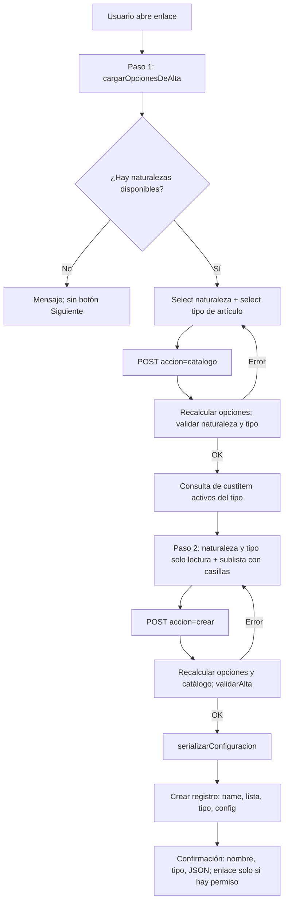
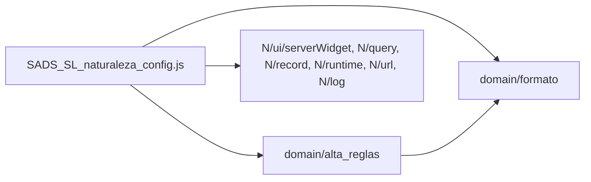

# Plan: Suitelet de alta de configuración de Naturaleza de Productos — v3

Contexto: la configuración de campos obligatorios por naturaleza se captura a mano como texto JSON en un campo CLOBTEXT.
Un error de sintaxis desactiva en silencio la validación de artículos (el `catch` del CS y del UE solo registra en log).
Se requiere un Suitelet para usuario final que cree estos registros sin teclear JSON, filtrando campos por tipo de artículo y sin duplicar naturalezas.
Prompt para el agente coder: `planes/2026-10-12_sl-naturaleza-config_prompt_v2.md`.

## 0. Control
| Campo | Valor |
|---|---|
| Fecha | 2026-10-12 |
| Versión | v3 |
| Estado | Aprobado (2026-10-12) |
| Solicitante | Desarrollo SADS (para cliente final) |
| Entidades afectadas | Todas las subsidiarias; el registro de configuración no es por subsidiaria |

Historial de cambios:
- v1 (2026-10-12): versión inicial.
- v2 (2026-10-12): catálogo por consulta de `custitem` activos filtrado por tipo de artículo (se elimina formulario preferido y campos estándar); campo Nombre y campo Tipo de artículo en el registro; lista nueva de tipos; rol de ejecución dedicado; flujo en dos pasos; entrega en dos iteraciones; hallazgos de arquitectura 1 a 5 y derivación P-04 integrados.
- v3 (2026-10-12): D-07 cerrada en E2 (`record.create` + `getFields`), `LIST_ITEM` VIEW fijo en el rol; D-08 cerrada: Inventariable solo Normal (`inventoryitem`), lista de 12 valores; parámetro `custscript_sads_sl_permitir_alta` para iteraciones A/B; `.md` de despliegue; R-17 (Otro cargo no programable desde servidor según la referencia de Oracle) con prueba prioritaria en iteración A; R-13 y R-14 cerrados.

## 1. Objetivo
Problema: captura manual del arreglo JSON, propensa a errores de formato, a duplicados y a campos que no aplican al tipo de artículo.
Resultado: Suitelet donde el usuario elige naturaleza y tipo de artículo, marca campos personalizados aplicables y el script crea el registro con JSON válido y nombre legible.
Métricas: 100% de registros creados por el Suitelet pasan `JSON.parse` + `Array.isArray` del CS y UE; 0 duplicados creados desde el Suitelet; 0 campos fuera del tipo de artículo elegido.

## 2. Alcance
Incluye:
- Suitelet nuevo en dos pasos más confirmación.
- Dos módulos de dominio sin `N/` con pruebas Jest.
- Pruebas del entry point con stubs de `@oracle/suitecloud-unit-testing`.
- Object XML: Suitelet + deployment, rol de ejecución, lista de tipos de artículo, cambios al custom record (Nombre y Tipo).
- Entrega en dos iteraciones: A (vista previa de solo lectura, pasos 1 y 2) y B (creación), controladas por el parámetro `custscript_sads_sl_permitir_alta`.
- Notas de implementación y despliegue `SADS_SL_naturaleza_config.md`.

No incluye:
- Edición de registros existentes.
- Evitar duplicados creados por formulario nativo, CSV u otros scripts.
- Cambios a `SADS_CS_item_dynamic_mandatory.js` y `SADS_UE_item_dynamic_mandatory.js`.
- Campos estándar del artículo (solo `custitem_*` activos).
- Optimización de gobernanza.
- Llenado automático de Nombre y Tipo en registros existentes (paso manual de despliegue).
- Uso del conector "Netsuite Dev".

## 3. Situación actual
| Objeto | Hecho verificado (archivos del repo) |
|---|---|
| `customrecord_sads_naturaleza_productos` | `includename` = F; `accesstype` = CUSTRECORDENTRYPERM; campos `custrecord_sads_naturaleza_lista` (SELECT a lista, obligatorio) y `custrecord_sads_naturaleza_config` (CLOBTEXT, obligatorio). System notes activas. |
| `custitem_sads_naturaleza_producto` | SELECT al custom record. Aplica a inventario, no inventario, servicio, kit, grupo y otro cargo; `itemsubtype` = BOTH. |
| `customlist_sads_naturaleza_productos` | Un valor: "Placas de Acero" (`scriptid="1"`). |
| CS existente | `lookupFields` del custom record con el rol del usuario; `JSON.parse`; `getField(id).isMandatory = true`. |
| UE existente | `beforeSubmit` CREATE/EDIT; un ID del arreglo con valor vacío lanza `MISSING_DYNAMIC_MANDATORY_FIELDS` (`SADS_UE_item_dynamic_mandatory.js:57-68`). Un campo que no aplica al tipo se lee vacío y bloquea. |
| Object XML de scripts | No existen `customscript_*` en `src/Objects`; supuesto: CS y UE desplegados manualmente. |
| Pruebas | Jest con `@oracle/suitecloud-unit-testing`; `suitecloud.config.js` ejecuta Jest antes de `project:deploy`. |
| Ambiente | `project.json` → authId `Almetal_SB`. |

Contrato de formato a preservar: texto JSON que al parsear da un arreglo de cadenas; cada cadena es un ID de campo del artículo.

Fuera de alcance, documentado: el UE parsea y recorre el arreglo dos veces (faltantes duplicados en el mensaje); el `help` del campo config tiene un ejemplo con IDs no reales; `testt.js` es plantilla vacía.

## 4. Arquitectura de la solución
| Componente | Tipo | ID propuesto | Disparador | Responsabilidad |
|---|---|---|---|---|
| SL alta de configuración | Suitelet 2.1 | `customscript_sads_sl_naturaleza_config` / `customdeploy_sads_sl_naturaleza_config` | Usuario abre el enlace | Pasos 1-2, creación, confirmación |
| Formato de configuración | Módulo AMD sin `N/` | `domain/SADS_naturaleza_config_formato.js` | Suitelet (futuro: CS y UE) | Dueño único del contrato JSON |
| Reglas de alta | Módulo AMD sin `N/` | `domain/SADS_naturaleza_alta_reglas.js` | Suitelet | Mapa de tipos, filtro de catálogo, validación de alta, nombre |
| Rol de ejecución | Custom role | `customrole_sads_naturaleza_config_exec` | `runasrole` del deployment | Permisos mínimos; no se asigna a usuarios |
| Lista de tipos | Custom list | `customlist_sads_tipos_articulo` | — | 12 opciones de tipo/subtipo |

Justificación:
- Suitelet frente a formulario nativo + Client Script en Custom Code: un Client Script no puede agregar campos ni construir el catálogo; requeriría además un UE `beforeLoad`. Se prefiere interfaz independiente.
- Flujo en dos pasos sin Client Script: el catálogo depende del tipo elegido; un segundo envío es nativo y evita un archivo adicional.
- Rol dedicado con `runasrole`: Suitelet admite `<runasrole>` (`netsuite-sdf-safe-guide/quick-reference.md:144`). Ningún usuario final necesita permisos sobre registros; no se usa Administrador.



### 4.1 Nivel de arquitectura
Nivel 1.
Suben el nivel: reglas verificables con Jest; contrato de formato compartido con CS y UE.
Lo bajan: un solo entry point, sin integraciones externas, volumen mínimo.
Nivel 2 sería excesivo: un caso de uso, sin variación de fuentes de datos.

### 4.2 Casos de uso
| Caso de uso | Intención | Entrada | Salida | Reglas |
|---|---|---|---|---|
| Crear configuración de naturaleza | Registrar campos obligatorios para una naturaleza y su tipo de artículo | `naturalezaId`, `tipoArticuloId`, `idsSeleccionados[]` | ID de registro, nombre, JSON; o errores | RN-01 a RN-14 |
Nivel 1: sin puertos formales; el entry point conserva el acceso a `N/`.

### 4.3 Patrones de diseño
No aplica: el mapa de tipos es una tabla de datos, no una variación de comportamiento.

### 4.4 Estructura de archivos
Se respeta la convención plana existente para no mover entry points desplegados.
```
src/FileCabinet/SuiteScripts/SADS_Naturaleza_Productos/
├── SADS_CS_item_dynamic_mandatory.js         (sin cambios)
├── SADS_UE_item_dynamic_mandatory.js         (sin cambios)
├── SADS_SL_naturaleza_config.js              (nuevo, entry point)
└── domain/
    ├── SADS_naturaleza_config_formato.js     (nuevo)
    └── SADS_naturaleza_alta_reglas.js        (nuevo)
src/Objects/
├── customrecord_sads_naturaleza_productos.xml (modificado)
├── customlist_sads_tipos_articulo.xml         (nuevo)
├── customrole_sads_naturaleza_config_exec.xml (nuevo)
└── customscript_sads_sl_naturaleza_config.xml (nuevo)
__tests__/
├── SADS_naturaleza_config_formato.test.js
├── SADS_naturaleza_alta_reglas.test.js
└── SADS_SL_naturaleza_config.test.js
```


## 5. Modelo de datos
### 5.1 Registros y campos existentes
| Registro | Campo | ID | Tipo | Uso | Verificado/Supuesto |
|---|---|---|---|---|---|
| Config naturaleza | Naturaleza | `custrecord_sads_naturaleza_lista` | SELECT | Valor elegido | Verificado (XML) |
| Config naturaleza | Configuración | `custrecord_sads_naturaleza_config` | CLOBTEXT | JSON generado | Verificado (XML) |
| Config naturaleza | Inactivo | `isinactive` | Checkbox | Cuenta para duplicados | Supuesto |
| Lista naturalezas | Valor | `id`, `name`, `isinactive` | — | Opciones y texto del Nombre | Supuesto (columnas SuiteQL) |
| Campo personalizado | Definición | tabla `customfield`: `scriptid`, `name`, `isinactive`, `fieldtype` | — | Catálogo | Supuesto |
| Artículo | Campo gatillo | `custitem_sads_naturaleza_producto` | SELECT | Se excluye del catálogo | Verificado (XML) |

### 5.2 Objetos nuevos o modificados
| Objeto | ID | Tipo | Detalle | Regla |
|---|---|---|---|---|
| Custom record (mod.) | `customrecord_sads_naturaleza_productos` | — | `includename` = T | RN-12 |
| Campo nuevo | `custrecord_sads_naturaleza_tipo_art` | SELECT a `customlist_sads_tipos_articulo` | Obligatorio; acceso igual que los otros campos | RN-11 |
| Lista nueva | `customlist_sads_tipos_articulo` | Custom list | 12 valores con `scriptid` estable (tabla 5.3) | RN-10 |
| Rol nuevo | `customrole_sads_naturaleza_config_exec` | Custom role | Sección 9 | — |
| Script | `customscript_sads_sl_naturaleza_config` | Suitelet 2.1 | — | — |
| Deployment | `customdeploy_sads_sl_naturaleza_config` | Deployment | `isonline` F; `runasrole` = rol nuevo; audiencia vacía; status Released | — |
| Parámetro | `custscript_sads_sl_permitir_alta` | Checkbox | Default F. F = iteración A (sin botón Crear y sin creación); T = iteración B | — |
| Campos de formulario | `custpage_naturaleza`, `custpage_tipo_art` | SELECT sin fuente | Paso 1 editables; paso 2 solo lectura | — |
| Campo oculto | `custpage_accion` | HIDDEN | `catalogo` / `crear` | — |
| Sublista | `custpage_campos` | LIST | Columnas `custpage_sel` (CHECKBOX), `custpage_etiqueta`, `custpage_id` (TEXT); botones marcar/desmarcar todo | RN-06 |
Longitudes de ID verificadas contra 40 caracteres: script 38, deployment 38, rol 38, lista 30, campo 35, parámetro 32.

### 5.3 Valores de `customlist_sads_tipos_articulo`
| scriptid propuesto | Texto | Tipo de registro | Estado |
|---|---|---|---|
| `val_sads_ta_inv` | Inventariable | `inventoryitem` (InvtPart) | Supuesto; la referencia Oracle no lo incluye (limitación documentada) |
| `val_sads_ta_noinv_venta` | No inventariable - Venta | `noninventorysaleitem` | En referencia Oracle |
| `val_sads_ta_noinv_reventa` | No inventariable - Reventa | `noninventoryresaleitem` | En referencia Oracle |
| `val_sads_ta_noinv_compra` | No inventariable - Compra | `noninventorypurchaseitem` | Supuesto |
| `val_sads_ta_otro_venta` | Otro cargo - Venta | `otherchargesaleitem` | Supuesto; ver R-17 |
| `val_sads_ta_otro_reventa` | Otro cargo - Reventa | `otherchargeresaleitem` | Supuesto; ver R-17 |
| `val_sads_ta_otro_compra` | Otro cargo - Compra | `otherchargepurchaseitem` | Supuesto; ver R-17 |
| `val_sads_ta_serv_venta` | Servicio - Venta | `servicesaleitem` | En referencia Oracle |
| `val_sads_ta_serv_reventa` | Servicio - Reventa | `serviceresaleitem` | En referencia Oracle |
| `val_sads_ta_serv_compra` | Servicio - Compra | `servicepurchaseitem` | Supuesto |
| `val_sads_ta_kit` | Kit | `kititem` | En referencia Oracle |
| `val_sads_ta_grupo` | Grupo de artículos | `itemgroup` | En referencia Oracle |
El mapa `scriptid → {tipoRegistro}` vive en `domain/SADS_naturaleza_alta_reglas.js`. Se mapea por `scriptid`, no por ID interno, para que sea estable entre sandbox y producción.

## 6. Lógica por componente
### 6.1 Suitelet `SADS_SL_naturaleza_config.js`
Contexto: UI. Despacho por método y `custpage_accion`.

GET (paso 1):
1. `cargarOpcionesDeAlta()` → `{naturalezas, tipos}`.
2. Sin naturalezas: mensaje, sin botón Siguiente.
3. Formulario con dos SELECT y botón Siguiente (`accion=catalogo`).

POST `accion=catalogo` (paso 2):
1. `cargarOpcionesDeAlta()`; `validarEleccion` (RN-08, RN-09).
2. Error: re-mostrar paso 1 con mensaje y valores previos.
3. `obtenerCamposAplicables(tipo)`; `filtrarCatalogo`.
4. Formulario con naturaleza y tipo solo lectura (más ocultos), sublista con casillas, botones Crear y Regresar.
Con `custscript_sads_sl_permitir_alta` = F (iteración A) el flujo termina aquí: sin botón Crear, y un POST `accion=crear` no crea registro.

POST `accion=crear`:
1. Leer naturaleza, tipo y casillas marcadas.
2. `cargarOpcionesDeAlta()` y catálogo recalculados; no se confía en datos del formulario.
3. `validarAlta`. Error: re-mostrar paso 2 con mensaje y casillas previas.
4. `serializarConfiguracion` (lanza error de dominio si viola el contrato).
5. `crearConfiguracion`: `name` = texto de la naturaleza recalculada; lista; tipo; config. Guardar sin ignorar obligatorios.
6. Confirmación: nombre, tipo, JSON; enlace al registro solo si el usuario tiene permiso; botón Crear otra.

Funciones del entry point:
| Función | Entradas | Salida | Responsabilidad |
|---|---|---|---|
| `onRequest` | `context` | — | Despacho; traduce errores a mensaje en español; detalle a `log.error` |
| `cargarOpcionesDeAlta` | — | `{naturalezas[], tipos[]}` | Q-1 y Q-2; única fuente para GET y POST |
| `obtenerCamposAplicables` | `tipoRegistro` | `{id, etiqueta}[]` | Q-3 ∩ `getFields()` de `record.create` en memoria (E2) |
| `leerPermitirAlta` | — | `boolean` | Parámetro `custscript_sads_sl_permitir_alta` |
| `crearConfiguracion` | `{nombre, naturalezaId, tipoArticuloId, json}` | `number` | `record.create` + `save` |
| `usuarioPuedeVerRegistro` | — | `boolean` | Decide si se muestra el enlace (R-07) |
| `construirPaso1` / `construirPaso2` / `construirConfirmacion` | objetos planos | `Form` | `serverWidget` |

Consultas:
| ID | Tabla | Campos | Filtros | Orden |
|---|---|---|---|---|
| Q-1 | `customlist_sads_naturaleza_productos` con anti-join a `customrecord_sads_naturaleza_productos` | id, name | lista `isinactive = 'F'`; sin registro de config activo o inactivo | name |
| Q-2 | `customlist_sads_tipos_articulo` | id, name, scriptid | `isinactive = 'F'` | name |
| Q-3 | `customfield` | scriptid, name | `fieldtype` de artículo; `isinactive = 'F'`; `scriptid` inicia con `custitem` | name |
Aplicabilidad por tipo (E2, decisión v3): `record.create` en memoria del `tipoRegistro`, sin guardar; conservar solo IDs de Q-3 presentes en `getFields()`. Todo `scriptid` se normaliza a minúsculas antes de comparar.

### 6.2 Dominio `domain/SADS_naturaleza_config_formato.js`
| Función | Entradas | Salida | Responsabilidad |
|---|---|---|---|
| `serializarConfiguracion` | `ids[]` | `string` | RN-07; lanza error de dominio si el resultado viola el contrato |
| `parsearConfiguracion` | `texto` | `string[]` | Lanza error de dominio si no cumple el contrato |
| `esConfiguracionValida` | `texto` | `boolean` | Contrato del CS/UE |
Dueño único del contrato. Reutilización futura en CS y UE fuera de alcance.

### 6.3 Dominio `domain/SADS_naturaleza_alta_reglas.js`
| Función | Entradas | Salida | Responsabilidad |
|---|---|---|---|
| `resolverTipoArticulo` | `scriptidValor` | `{tipoRegistro}` o error | RN-10 |
| `filtrarCatalogo` | `{campos[], idsExcluidos[]}` | `{id, etiqueta}[]` | RN-04, RN-05; orden por etiqueta |
| `validarEleccion` | `{naturalezaId, tipoId, naturalezas[], tipos[]}` | `{valido, errores[]}` | RN-08, RN-09 |
| `validarAlta` | `{...eleccion, idsSeleccionados[], catalogo[]}` | `{valido, errores[]}` | RN-02, RN-06, RN-08, RN-09, RN-13 |
| `resolverNombre` | `{naturalezaId, naturalezas[]}` | `string` | RN-12 |

### 6.4 Reglas de negocio
| ID | Regla |
|---|---|
| RN-01 | Solo se ofrecen naturalezas activas sin registro de configuración, activo o inactivo. |
| RN-02 | Si al crear ya existe registro para la naturaleza, se rechaza. |
| RN-03 | El catálogo contiene solo campos personalizados de artículo activos (`isinactive = 'F'`). |
| RN-04 | El catálogo contiene solo campos aplicables al tipo de registro elegido. |
| RN-05 | Se excluye `custitem_sads_naturaleza_producto`. |
| RN-06 | Debe marcarse al menos un campo. |
| RN-07 | JSON = arreglo de cadenas, sin duplicados, orden ascendente por ID, sin espacios. |
| RN-08 | La naturaleza enviada es entera y pertenece a las disponibles recalculadas. |
| RN-09 | El tipo enviado es entero, está activo y su `scriptid` existe en el mapa de tipos. |
| RN-10 | Cada valor de la lista de tipos se resuelve a un tipo de registro por `scriptid`. |
| RN-11 | El tipo de artículo se guarda en `custrecord_sads_naturaleza_tipo_art`. |
| RN-12 | `name` = texto del valor de la naturaleza tomado de Q-1 recalculada, no del formulario. |
| RN-13 | Todo ID enviado existe en el catálogo recalculado del tipo. |
| RN-14 | Solo creación; el Suitelet no recibe ni carga IDs de registros de configuración. |

## 7. Gobernanza
No se optimiza en v1 (decisión del usuario). Referencia: Suitelet 1,000 unidades.
| Paso | Operaciones | Total estimado |
|---|---|---|
| Paso 1 | 2 `runSuiteQL` (~10 c/u, skill) | ~20 |
| Paso 2 | 3 `runSuiteQL` + `record.create` del artículo (5, supuesto) | ~35 |
| Crear | Paso 2 + `record.create` y `save` del custom record (2 + 4, supuesto) | ~41 |

## 8. Manejo de errores y bitácora
| Situación | Acción |
|---|---|
| Validación de dominio | Re-mostrar el paso con mensaje en español y valores previos |
| Error de consulta o de `record.create` del tipo | `log.error` con detalle; página de error genérica en español; sin catálogo parcial |
| Error de dominio en serialización | `log.error`; mensaje genérico; no se crea registro |
| Falla `save` | `log.error` con detalle; al usuario solo mensaje genérico, nunca el error crudo de NetSuite |
| Alta exitosa | `log.audit` con ID, nombre, tipo y número de campos |
Auditoría adicional: system notes del custom record.

## 9. Seguridad y permisos
Rol `customrole_sads_naturaleza_config_exec`, usado solo como `runasrole`, sin asignarse a usuarios:
| permkey | permlevel | Motivo | Estado |
|---|---|---|---|
| `LIST_CUSTRECORDENTRY` | CREATE | Crear y leer el registro (`accesstype` CUSTRECORDENTRYPERM) | ID confirmado en `permissions.json` |
| `ADMI_CUSTITEMFIELD` | VIEW | Q-3 sobre `customfield` | ID confirmado; necesidad supuesta |
| `LIST_ITEM` | VIEW | `record.create` del artículo en memoria (E2). Si VIEW no basta en sandbox, subir a CREATE y registrarlo | ID confirmado; nivel supuesto |
No requeridos: `ADMI_CUSTOMSCRIPT`, `ADMI_CUSTRECORD`, `ADMI_CUSTLIST` (supuesto para lectura), `REPO_ANALYTICS` (agregar solo si `N/query` da error de permisos). Administrador prohibido como rol de ejecución.
Deployment: `isonline` = F; audiencia vacía; el cliente la configura y la re-aplica después de cada despliegue (R-10).
Entrada no confiable: IDs enteros y validados contra listas permitidas recalculadas; sin INLINEHTML con datos del usuario.

## 10. Consideraciones fiscales
No aplica: configuración interna de interfaz.

## 11. Riesgos
| ID | Enunciado | Fundamento | Consecuencia | Mitigación |
|---|---|---|---|---|
| R-03 | Duplicados por formulario nativo, CSV u otros scripts | Fuera de alcance (decisión) | Dos configuraciones por naturaleza | Aceptado |
| R-04 | Dos envíos simultáneos para la misma naturaleza | Sin bloqueo transaccional | Duplicado | Volumen bajo; aceptado |
| R-07 | Enlace de confirmación falla sin permisos propios | `runasrole` no aplica a la navegación del usuario | Error de permisos al dar clic | Enlace solo si `usuarioPuedeVerRegistro` |
| R-09 | Usuarios que editan artículos requieren VIEW sobre el registro | CS corre con rol del usuario y no admite `runasrole` (`quick-reference.md:146`) | Validación desactivada en silencio | Existente; fuera de alcance; verificar en sandbox |
| R-10 | `project:deploy` sobrescribe la audiencia configurada en UI | SDF aplica el XML del deployment | Suitelet sin acceso tras desplegar | Re-aplicar audiencia (documentado en sección 13) |
| R-11 | Registros existentes sin Nombre ni Tipo | Campos nuevos; Tipo obligatorio | La UI exige capturarlos al editar | Llenado manual en despliegue |
| R-12 | Artículo de otro tipo usa una naturaleza configurada para un tipo | CS/UE no validan el tipo | El UE puede bloquear su guardado | Residual; el campo Tipo deja base para validarlo en un cambio futuro |
| R-13 | Cerrado en v3: se usa E2; no se depende de columnas de aplicabilidad en SuiteQL | — | — | — |
| R-14 | Cerrado en v3: Inventariable solo Normal (`inventoryitem`) | — | — | — |
| R-15 | `scriptid` de valores de lista podría no estar en SuiteQL | Supuesto de columnas | No se resuelve el tipo | Validar en iteración A; alternativa: clave en `abbreviation` del valor |
| R-16 | Renombrar un valor de la lista no actualiza `name` | `name` es copia al crear | Nombre desactualizado | Baja; aceptado |
| R-17 | Otro cargo podría no ser programable desde servidor | Referencia Oracle: `otherchargeitem` con `serverScriptable` = false; variantes con subtipo ausentes | `record.create` (E2) falla y no se arma el catálogo de Otro cargo | Probar primero los 3 tipos de Otro cargo en iteración A (P-14); si fallan, inactivar sus 3 valores en la lista y documentarlo |
| R-18 | Artículos con lote o serie no tienen opción propia | Decisión v3: Inventariable solo Normal | Una naturaleza para esos artículos no tiene catálogo propio | Aceptado; se agrega un valor a la lista y al mapa si se requiere |

## 12. Plan de pruebas
| Caso | RN | Capa | Entrada | Resultado esperado | Tipo |
|---|---|---|---|---|---|
| P-01 | RN-07 | Dominio formato | `["upccode","custitem_b","custitem_b"]` | `["custitem_b","upccode"]` | Feliz |
| P-02 | RN-07 | Dominio formato | `"[a,b]"`, `"{}"`, `"[1]"`, `""` | `esConfiguracionValida` = false; `parsearConfiguracion` lanza error | Error |
| P-03 | RN-07 | Dominio formato | Lista vacía a `serializarConfiguracion` | Error de dominio | Borde |
| P-04 | RN-10 | Dominio reglas | Cada `scriptid` de 5.3; uno inexistente | Tipo resuelto; error en inexistente | Feliz/Error |
| P-05 | RN-05 | Dominio reglas | Catálogo con `custitem_sads_naturaleza_producto` | Excluido | Borde |
| P-06 | RN-06 | Dominio reglas | Selección vacía | Error | Error |
| P-07 | RN-13 | Dominio reglas | ID fuera del catálogo | Error | Error |
| P-08 | RN-08/RN-02 | Dominio reglas | Naturaleza no disponible o no entera | Error | Error |
| P-09 | RN-09 | Dominio reglas | Tipo inactivo o no entero | Error | Error |
| P-10 | RN-12 | Dominio reglas | Naturaleza id 1 en lista recalculada | Texto de la lista | Feliz |
| P-11 | — | Entry point (stubs) | Falla `runSuiteQL` | Página de error genérica; `log.error` | Error |
| P-12 | — | Entry point (stubs) | `accion=crear` con validación fallida | Paso 2 con casillas previas marcadas | Borde |
| P-13 | — | Entry point (stubs) | `save` lanza error | Mensaje genérico; sin texto crudo | Error |
| P-14 | RN-03/04 | Sandbox iter. A | Primero los 3 tipos de Otro cargo; luego el resto de 5.3 | Catálogo coherente; validar R-15 y R-17 | Feliz |
| P-19 | — | Entry point (stubs) | Parámetro `custscript_sads_sl_permitir_alta` = F | Paso 2 sin botón Crear; `accion=crear` no crea registro | Borde |
| P-15 | RN-01 | Sandbox | Naturaleza con config existente | No aparece | Borde |
| P-16 | — | Sandbox iter. B | Alta completa; artículo del tipo con esa naturaleza | CS y UE exigen los campos | Feliz |
| P-17 | Seguridad | Sandbox | Usuario en audiencia sin permisos sobre registros | Crea correctamente; sin enlace al registro | Borde |
| P-18 | R-10 | Sandbox | Re-despliegue | Audiencia vacía; se re-aplica | Borde |

## 13. Despliegue
Iteración A (sandbox `Almetal_SB`):
1. `npm test` en verde.
2. Desplegar en orden: `customlist_sads_tipos_articulo` → custom record modificado → rol → script y deployment, con `custscript_sads_sl_permitir_alta` = F.
3. Configurar audiencia.
4. Ejecutar P-14; cerrar R-15 y R-17; confirmar nivel de `LIST_ITEM` y necesidad de `ADMI_CUSTITEMFIELD`.
Iteración B:
5. `custscript_sads_sl_permitir_alta` = T; re-aplicar audiencia si hubo despliegue.
6. Llenar a mano Nombre y Tipo de registros existentes (R-11).
7. Ejecutar P-15 a P-18.
Producción: mismo orden; re-aplicar audiencia después de cada despliegue.
Reversión: deployment a inactivo; los campos nuevos del custom record se pueden dejar sin impacto en CS/UE.

## 14. Decisiones abiertas
| ID | Pregunta | Opciones | Bloqueante |
|---|---|---|---|
Sin decisiones abiertas.
Cerradas en v3: D-07 = E2 (`record.create` + `getFields`); D-08 = Inventariable solo Normal (`inventoryitem`).

## 15. Supuestos y fuentes
Supuestos:
1. Columnas SuiteQL de `customfield`, de las listas personalizadas (incluido `scriptid`) y del custom record.
2. Tipos de registro marcados como supuesto en 5.3.
3. Costos de `record.create` y `save` del custom record.
4. `ADMI_CUSTITEMFIELD` es necesario para consultar `customfield`.
5. `runasrole` no requiere asignar el rol a usuarios.
6. Con `includename` = T, la UI exige Nombre al editar.
7. CS y UE existentes se desplegaron manualmente.
8. `getFields()` de un artículo creado en memoria incluye los `custitem` aplicables a su tipo y excluye los no aplicables.
9. `otherchargeitem` sí es programable desde servidor pese a la referencia (R-17).
Conector "Netsuite Dev" deshabilitado por decisión: ningún dato de la cuenta se verificó.

Fuentes: Object XML del custom record, campo de artículo y lista; CS, UE y `.md` existentes; `project.json`; `jest.config.js`; `suitecloud.config.js`; skills `netsuite-sdf-safe-guide` (runasrole, isonline, costos), `netsuite-sdf-roles-and-permissions` (`permissions.json`), `netsuite-suitescript-records-reference` (tipos de registro), `netsuite-arquitectura-limpia` (revisión de v1).
