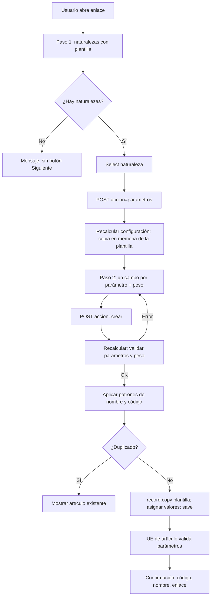
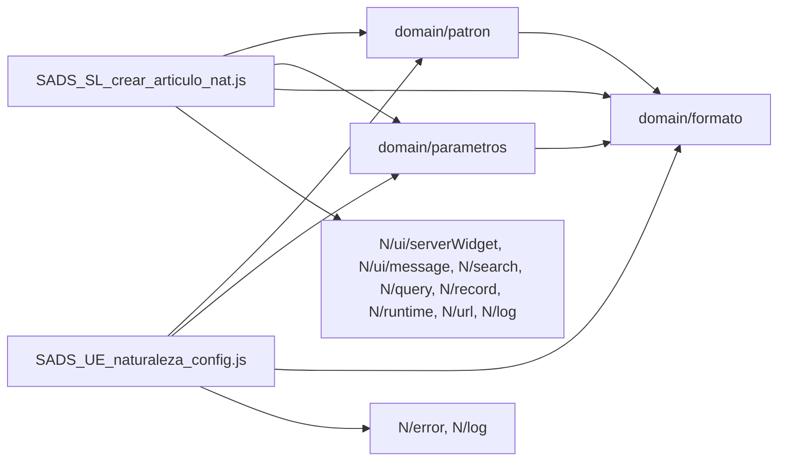

# Plan: Creador de artículos por naturaleza de producto — v1

Contexto: el cliente cambió el alcance del proyecto Naturaleza de Productos.
Antes se buscaba marcar obligatorios los campos de la naturaleza (CS/UE) y crear los registros de configuración con un Suitelet de alta.
Ahora se requiere una herramienta para crear artículos nuevos de una naturaleza a partir de pocos parámetros, copiando lo demás de un artículo plantilla.
Plan anterior: `planes/2026-10-12_sl-naturaleza-config_plan_v4.md` (Suitelet de alta, se retira con este plan).

## 0. Control
| Campo | Valor |
|---|---|
| Fecha | 2026-11-12 |
| Versión | v1 |
| Estado | Borrador |
| Solicitante | Desarrollo SADS (para cliente final Almetal) |
| Entidades afectadas | Las subsidiarias de la plantilla de cada naturaleza; el registro de configuración no es por subsidiaria |

Historial de cambios:
- v1 (2026-11-12): versión inicial por cambio de alcance; retira el Suitelet de alta (plan v4) y su consulta Q-3.

## 1. Objetivo
Problema: un cliente pide una medida de placa que no existe como artículo; darla de alta a mano exige capturar todo el formulario de artículo, aunque solo cambian medidas, nombre, código, precio y peso.
Resultado: Suitelet donde un usuario con permiso elige la naturaleza, captura sus parámetros y el peso, y el script crea el artículo copiando la plantilla de la naturaleza.
Métricas:
- 100% de artículos creados con todos los parámetros de la naturaleza llenos (pasan el UE existente).
- 0 artículos duplicados por misma naturaleza y mismos parámetros creados desde el Suitelet.
- 100% de nombres y códigos generados por el patrón de la configuración, sin captura manual.
- Iteración B: precios iguales a los que produce la cadena de campos fórmula del artículo.

## 2. Alcance
Incluye:
- Suitelet nuevo de creación de artículos en dos pasos más confirmación.
- User Event nuevo sobre `customrecord_sads_naturaleza_productos` que valida la captura manual de la configuración.
- Tres campos nuevos en el registro de configuración: plantilla, patrón de nombre y patrón de código.
- Módulos de dominio sin `N/` con pruebas Jest: patrones y parámetros; se conserva el módulo de formato JSON.
- Retiro del Suitelet de alta (script, deployment, `.md`, módulo de reglas de alta y pruebas).
- Retiro de `custrecord_sads_naturaleza_tipo_art` y `customlist_sads_tipos_articulo` (DA-03, default).
- Reducción de permisos de `customrole_sads_naturaleza_config_exec`.
- Documentación del Suitelet nuevo y actualización del `README.md`.
- Entrega en dos iteraciones: A (creación sin cálculo de precios, artículos inactivos) y B (cálculo de precios).

No incluye:
- Formularios nativos de artículo por naturaleza (D-01).
- Cálculo automático del peso (D-06; cambio posterior).
- Especificación de la cadena de precios; entra en el plan v2 tras importar los campos fórmula (DA-01).
- Edición de artículos existentes desde el Suitelet.
- Creación de los campos `custitem` de parámetros y especificaciones; la hacen usuarios técnicos en la cuenta.
- Cambios a `SADS_CS_item_dynamic_mandatory.js` y `SADS_UE_item_dynamic_mandatory.js`.
- Movimientos de inventario por el corte de la placa (transferencias, ensambles u órdenes de trabajo).
- Uso del conector "Netsuite Dev".

## 3. Situación actual
| Objeto | Hecho verificado (archivos del repo, commit a86c38f) |
|---|---|
| `customrecord_sads_naturaleza_productos` | `includename` = T; `accesstype` = CUSTRECORDENTRYPERM; campos `custrecord_sads_naturaleza_lista` (SELECT a lista, obligatorio), `custrecord_sads_naturaleza_config` (CLOBTEXT, obligatorio), `custrecord_sads_naturaleza_tipo_art` (SELECT a lista de tipos, obligatorio). |
| `custitem_sads_naturaleza_producto` | SELECT al registro de configuración; obligatorio; aplica a inventario, no inventario, servicio, kit, grupo y otro cargo. |
| `customlist_sads_naturaleza_productos` | En XML un valor ("Placas de Acero"); en sandbox ya hay más valores (doc del Suitelet, sección 19). |
| CS `SADS_CS_item_dynamic_mandatory.js` | Lee el JSON con `search.lookupFields` y marca obligatorios en pantalla. Sin pruebas Jest. |
| UE `SADS_UE_item_dynamic_mandatory.js` | `beforeSubmit` CREATE/EDIT; bloquea con `MISSING_DYNAMIC_MANDATORY_FIELDS` si un ID del JSON viene vacío. Recorre el arreglo dos veces (faltantes repetidos en el mensaje). Corre con `customrole_sads_naturaleza_config_exec`; `executioncontext` incluye SUITELET. |
| Deployments CS/UE | INVENTORYITEM RELEASED; NONINVENTORYITEM, OTHERCHARGEITEM, SERVICEITEM, KITITEM, ITEMGROUP en TESTING. |
| Suitelet de alta `SADS_SL_naturaleza_config.js` | Desplegado en `Almetal_SB` con creación deshabilitada. Q-1 y Q-2 funcionan. Q-3 falla: `SSS_SEARCH_ERROR_OCCURRED: Record 'customfield' was not found` (log del 13/10/2026). Método descartado por el usuario. |
| Dominio | `domain/SADS_naturaleza_config_formato.js` (contrato JSON y errores de dominio, 109 pruebas); `domain/SADS_naturaleza_alta_reglas.js` (solo lo usa el Suitelet de alta). |
| Rol `customrole_sads_naturaleza_config_exec` | `LIST_CUSTRECORDENTRY` CREATE, `ADMI_CUSTITEMFIELD` VIEW, `LIST_ITEM` VIEW. Los dos últimos solo los usaba el Suitelet de alta (Q-3 y `record.create` en memoria). |
| Pruebas | Jest 30 con `@oracle/suitecloud-unit-testing`; `suitecloud.config.js` corre Jest antes de `project:deploy`. Último resultado documentado: 300/300 (2026-10-12). |
| Ambiente | `project.json` → authId `Almetal_SB`. |

Contrato de formato a preservar: texto JSON que al parsear da un arreglo no vacío de cadenas; cada cadena es un ID de campo del artículo. Lo leen el CS y el UE existentes.

Nivel de arquitectura actual: CS y UE en nivel 0 (un archivo, sin dominio); Suitelet de alta en nivel 1.

## 4. Arquitectura de la solución
| Componente | Tipo | ID propuesto (scriptid) | Disparador | Responsabilidad |
|---|---|---|---|---|
| SL creador de artículos | Suitelet 2.1 | `customscript_sads_sl_crear_articulo_nat` / `customdeploy_sads_sl_crear_articulo_nat` | Usuario abre el enlace | Paso 1 naturaleza; paso 2 parámetros y peso; creación; confirmación |
| UE de configuración | UserEvent 2.1 | `customscript_sads_ue_naturaleza_config` / `customdeploy_sads_ue_naturaleza_config` | `beforeSubmit` CREATE/EDIT/XEDIT del registro de configuración | Rechaza configuraciones que violen RN-12 a RN-15 |
| Formato de configuración | Módulo AMD sin `N/` | `domain/SADS_naturaleza_config_formato.js` (existente) | SL y UE de configuración | Dueño del contrato JSON y de los errores de dominio |
| Patrones | Módulo AMD sin `N/` | `domain/SADS_naturaleza_patron.js` | SL y UE de configuración | Extraer, validar y aplicar marcadores de nombre y código |
| Parámetros | Módulo AMD sin `N/` | `domain/SADS_naturaleza_parametros.js` | SL y UE de configuración | Validar IDs y valores capturados; criterios de duplicado |
| Precios | Módulo AMD sin `N/` | `domain/SADS_naturaleza_calculo_precios.js` | SL | Iteración B; se especifica en plan v2 |
| CS/UE de artículo | Existentes | Sin cambios | — | Obligatoriedad de los parámetros en UI y servidor |

Justificación:
- Suitelet frente a formulario nativo por naturaleza: decisión D-01 del usuario; el usuario final ve solo los parámetros; el resto se copia de la plantilla sin mostrarse.
- `record.copy` de la plantilla frente a `record.create` y llenar campo por campo: conserva cuentas, impuestos, claves SAT, subsidiarias, unidades y demás configuración sin listarlos en código.
- UE sobre el registro de configuración frente a confiar en la captura manual: un JSON mal formado desactiva en silencio la validación del CS y del UE de artículo (su `catch` solo registra en log); el UE lo impide al guardar.
- Dos pasos sin Client Script: los parámetros dependen de la naturaleza elegida; un segundo envío es nativo y evita un archivo adicional.



### 4.1 Nivel de arquitectura
Nivel 1.
Suben el nivel: reglas verificables con Jest (patrones, valores, duplicados); reglas compartidas entre el Suitelet y el UE de configuración.
Lo bajan: sin integraciones externas; una sola fuente de datos (NetSuite); volumen bajo.
Nivel 2 sería excesivo: no hay variación de fuentes ni adaptadores intercambiables.

### 4.2 Capas, casos de uso y puertos
| Caso de uso | Intención de negocio | Entrada | Salida | Reglas |
|---|---|---|---|---|
| Crear artículo de naturaleza | Dar de alta una medida nueva sin capturar el formulario completo | `configuracionId`, valores de parámetros, peso | ID y código del artículo; o errores; o artículo duplicado | RN-01 a RN-11 |
| Validar configuración | Impedir configuraciones que rompan CS, UE o el Suitelet | Registro de configuración en `beforeSubmit` | Guardado o error | RN-12 a RN-15 |
Nivel 1: sin puertos formales; los entry points conservan el acceso a `N/`.

### 4.3 Patrones de diseño
No aplica en iteración A: los patrones de nombre son datos, no variación de comportamiento.
Iteración B: evaluar Strategy por naturaleza para la cadena de precios si difiere entre naturalezas (plan v2).

### 4.4 Estructura de archivos por capa
Se respeta la convención plana existente para no mover entry points desplegados.
```
src/FileCabinet/SuiteScripts/SADS_Naturaleza_Productos/
├── SADS_CS_item_dynamic_mandatory.js          (sin cambios)
├── SADS_UE_item_dynamic_mandatory.js          (sin cambios)
├── SADS_SL_crear_articulo_nat.js              (nuevo, entry point)
├── SADS_SL_crear_articulo_nat.md              (nuevo, documentación)
├── SADS_UE_naturaleza_config.js               (nuevo, entry point)
├── SADS_SL_naturaleza_config.js               (se elimina)
├── SADS_SL_naturaleza_config.md               (se elimina)
└── domain/
    ├── SADS_naturaleza_config_formato.js      (sin cambios)
    ├── SADS_naturaleza_patron.js              (nuevo)
    ├── SADS_naturaleza_parametros.js          (nuevo)
    └── SADS_naturaleza_alta_reglas.js         (se elimina)
src/Objects/
├── customrecord_sads_naturaleza_productos.xml       (modificado)
├── customrole_sads_naturaleza_config_exec.xml       (modificado)
├── customscript_sads_sl_crear_articulo_nat.xml      (nuevo)
├── customscript_sads_ue_naturaleza_config.xml       (nuevo)
├── customscript_sads_sl_naturaleza_config.xml       (se elimina)
└── customlist_sads_tipos_articulo.xml               (se elimina, DA-03)
__tests__/
├── SADS_naturaleza_config_formato.test.js     (sin cambios)
├── SADS_naturaleza_patron.test.js             (nuevo)
├── SADS_naturaleza_parametros.test.js         (nuevo)
├── SADS_SL_crear_articulo_nat.test.js         (nuevo)
├── SADS_UE_naturaleza_config.test.js          (nuevo)
├── SADS_SL_naturaleza_config.test.js          (se elimina)
└── SADS_naturaleza_alta_reglas.test.js        (se elimina)
```


## 5. Modelo de datos
### 5.1 Registros y campos existentes
| Registro | Campo | ID interno | Tipo | Uso | Verificado/Supuesto |
|---|---|---|---|---|---|
| Config naturaleza | Nombre | `name` | Texto | Texto de la opción en el paso 1 | Verificado (`includename` = T) |
| Config naturaleza | Naturaleza | `custrecord_sads_naturaleza_lista` | SELECT | Informativo | Verificado (XML) |
| Config naturaleza | Configuración | `custrecord_sads_naturaleza_config` | CLOBTEXT | Lista de parámetros (contrato actual) | Verificado (XML) |
| Config naturaleza | Inactivo | `isinactive` | Checkbox | Excluye del paso 1 | Supuesto (columna SuiteQL) |
| Artículo | Naturaleza | `custitem_sads_naturaleza_producto` | SELECT al registro de configuración | Se asigna al artículo nuevo; filtro de duplicados | Verificado (XML) |
| Artículo | Código | `itemid` | Texto, obligatorio | Patrón de código | Verificado (referencia Oracle, `lotnumberedinventoryitem`); supuesto para `inventoryitem` |
| Artículo | Nombre para mostrar | `displayname` | Texto | Patrón de nombre (DA-02) | Igual que `itemid` |
| Artículo | Peso | `weight` | Float | Peso manual (D-06) | Igual que `itemid` |
| Artículo | Unidad de peso | `weightunit` | SELECT | Se copia de la plantilla | Igual que `itemid` |
| Artículo | Inactivo | `isinactive` | Checkbox | T en iteración A (RN-10) | Igual que `itemid` |
| Artículo | Precios | sublistas `price1` a `price4` | Sublista por moneda | Iteración B (DA-01) | Verificado en referencia Oracle (`lotnumberedinventoryitem`, `kititem`) |
| Artículo | Parámetros de placa (largo, ancho, espesor) | `custitem_*` por definir | Decimal | Parámetros de la naturaleza | Supuesto: los crean usuarios técnicos |

### 5.2 Objetos nuevos o modificados
| Objeto | ID propuesto | Tipo | Aplica a | Obligatorio | Default | Regla |
|---|---|---|---|---|---|---|
| Campo nuevo | `custrecord_sads_naturaleza_plantilla` | SELECT a artículo (`selectrecordtype` de artículo: supuesto) | Registro de configuración | No (lo exige RN-14 solo para crear artículos) | Vacío | RN-01, RN-09 |
| Campo nuevo | `custrecord_sads_naturaleza_patron_nom` | TEXT | Registro de configuración | No | Vacío | RN-06, RN-14 |
| Campo nuevo | `custrecord_sads_naturaleza_patron_cod` | TEXT | Registro de configuración | No | Vacío | RN-06, RN-14 |
| Campo modificado | `custrecord_sads_naturaleza_config` | `help` con ejemplo real del contrato | — | Sin cambio | — | — |
| Campo retirado | `custrecord_sads_naturaleza_tipo_art` | — | — | — | — | DA-03 |
| Lista retirada | `customlist_sads_tipos_articulo` | — | — | — | — | DA-03 |
| Rol modificado | `customrole_sads_naturaleza_config_exec` | Custom role | `runasrole` de los 6 deployments del UE de artículo | — | — | Sección 9 |
| Script | `customscript_sads_sl_crear_articulo_nat` | Suitelet 2.1 | — | — | — | — |
| Deployment | `customdeploy_sads_sl_crear_articulo_nat` | Deployment | `isonline` F; sin `runasrole`; audiencia vacía en XML; Released | — | — | Sección 9 |
| Parámetro | `custscript_sads_sl_art_activo` | Checkbox | Deployment del SL | No | F | RN-10 |
| Script | `customscript_sads_ue_naturaleza_config` | UserEvent 2.1 | — | — | — | — |
| Deployment | `customdeploy_sads_ue_naturaleza_config` | Deployment sobre `customrecord_sads_naturaleza_productos` | Released; todos los roles; contextos UI, CSV y web services como mínimo | — | — | RN-12 a RN-15 |
| Campos de formulario | `custpage_configuracion`, `custpage_accion`, `custpage_par_<n>`, `custpage_peso` | SELECT, HIDDEN, FLOAT | Suitelet | Sí, salvo HIDDEN | — | RN-03 a RN-05 |

Longitudes verificadas contra 40 caracteres: script SL 39, deployment SL 39, script UE 38, deployment UE 38, plantilla 36, patrón nombre 37, patrón código 37, parámetro 29.
Los campos de parámetro del formulario usan índice (`custpage_par_0`, `custpage_par_1`, …) y no el ID del `custitem`, para no superar longitudes ni exponer IDs; el índice corresponde al orden del JSON recalculado.

Ejemplo de configuración (IDs ficticios):
| Campo | Valor |
|---|---|
| `custrecord_sads_naturaleza_config` | `["custitem_pl_ancho","custitem_pl_espesor","custitem_pl_largo"]` |
| `custrecord_sads_naturaleza_patron_cod` | `PL-{custitem_pl_espesor}-{custitem_pl_largo}X{custitem_pl_ancho}` |
| `custrecord_sads_naturaleza_patron_nom` | `PLACA A36 {custitem_pl_espesor} IN {custitem_pl_largo} X {custitem_pl_ancho} FT` |
| Resultado con 0.25, 4, 2 | Código `PL-0.25-4X2`; nombre `PLACA A36 0.25 IN 4 X 2 FT` |

## 6. Lógica por componente
### 6.1 Suitelet `SADS_SL_crear_articulo_nat.js`
Contexto: UI. Despacho por método y `custpage_accion`.

GET (paso 1):
1. `cargarConfiguraciones()`: registros de configuración activos con plantilla asignada.
2. Sin configuraciones: mensaje, sin botón Siguiente.
3. Formulario con SELECT de naturaleza (texto = `name`) y botón Siguiente (`accion=parametros`).

POST `accion=parametros` (paso 2):
1. Recalcular configuraciones; validar que `custpage_configuracion` sea entero y esté en la lista (RN-11).
2. `leerConfiguracion(id)`: JSON, plantilla y patrones con `search.lookupFields`; `formato.parsearConfiguracion`.
3. `describirParametros(plantillaId, ids)`: `record.copy` de la plantilla en memoria, sin guardar; por cada ID, etiqueta y tipo del campo.
4. Tipo no soportado (distinto de decimal o entero): error de dominio con el ID del campo (RN-03).
5. Formulario: naturaleza de solo lectura; un campo por parámetro con la etiqueta del campo; campo Peso con la unidad de peso de la plantilla como texto de ayuda; ocultos de configuración y acción; botón Crear artículo; enlace Regresar.

POST `accion=crear`:
1. Repetir pasos 1 a 3 del paso 2; no se confía en el formulario.
2. Leer valores `custpage_par_<n>` y `custpage_peso`; `parametros.validarValores` (RN-03 a RN-05). Error: re-mostrar paso 2 con valores previos.
3. `patron.aplicar` para código y nombre (RN-06, RN-07). Error: página de error de configuración.
4. `buscarDuplicado(configuracionId, criterios)` (RN-08). Si existe: página informativa con código, estado activo/inactivo y enlace; no se crea.
5. `crearArticulo`: `record.copy` de la plantilla; asignar `custitem_sads_naturaleza_producto` = ID de la configuración, parámetros, `weight`, `itemid`, `displayname`, `isinactive` según `custscript_sads_sl_art_activo`; iteración B: precios. `save` sin ignorar obligatorios.
6. El UE de artículo existente valida los parámetros al guardar.
7. Confirmación: código, nombre, estado activo/inactivo, enlace al artículo, enlace Crear otro.

Funciones del entry point:
| Función | Entradas | Salida | Responsabilidad |
|---|---|---|---|
| `onRequest` | `context` | — | Despacho; errores de dominio con su mensaje; otros con mensaje genérico; detalle a `log.error` |
| `cargarConfiguraciones` | — | `{id, nombre}[]` | Consulta C-1 |
| `leerConfiguracion` | `configuracionId` | `{ids[], plantillaId, patronNombre, patronCodigo}` | `lookupFields` + `parsearConfiguracion` |
| `describirParametros` | `plantillaId`, `ids[]` | `{id, etiqueta, tipo}[]` | `record.copy` en memoria + `getField` |
| `buscarDuplicado` | `configuracionId`, `criterios[]` | `{id, itemid, inactivo}` o null | Consulta C-2 |
| `crearArticulo` | `{plantillaId, configuracionId, valores, peso, codigo, nombre, activo}` | `number` | `record.copy` + `save` |
| `leerCrearActivo` | — | `boolean` | Parámetro `custscript_sads_sl_art_activo` |
| `construirPaso1` / `construirPaso2` / `construirConfirmacion` / `construirDuplicado` / `construirPaginaDeError` | objetos planos | `Form` | `serverWidget` |

Consultas:
| ID | Tabla | Campos | Filtros | Orden | Volumen |
|---|---|---|---|---|---|
| C-1 | `customrecord_sads_naturaleza_productos` | id, name | `isinactive = 'F'`; `custrecord_sads_naturaleza_plantilla` no nulo | name | Decenas |
| C-2 | `item` | id, itemid, isinactive | `custitem_sads_naturaleza_producto` = configuración; cada ID del JSON = valor capturado (valores como parámetros `?`); sin filtro de inactivos | id | 0 a 1 fila |
En C-2 los nombres de columna salen del JSON; solo se usan si pasan `parametros.esIdentificadorSeguro` y pertenecen al JSON recalculado (RN-13, R-04).
Supuesto: las columnas `custitem_*` existen en la tabla `item` de SuiteQL.

### 6.2 User Event `SADS_UE_naturaleza_config.js`
Contexto: `beforeSubmit` CREATE, EDIT y XEDIT del registro de configuración. Corre con el rol del usuario técnico.
1. En XEDIT, leer los campos no enviados desde el registro anterior para validar el estado final.
2. `formato.parsearConfiguracion` del JSON (RN-12).
3. `parametros.validarIds` (RN-13).
4. Si hay plantilla: ambos patrones obligatorios y `patron.validar` contra los IDs del JSON (RN-14, RN-15).
5. Si hay patrones sin plantilla: se permiten (no se usan) — sin error.
6. Cualquier violación: `error.create` con nombre `CONFIGURACION_NATURALEZA_INVALIDA`, mensaje en español y `notifyOff` true.

### 6.3 Dominio `domain/SADS_naturaleza_patron.js`
| Función | Entradas | Salida | Responsabilidad |
|---|---|---|---|
| `extraerMarcadores` | `patron` | `string[]` | Marcadores `{id}` en orden, sin duplicados; error de dominio si hay llaves sin cerrar o vacías |
| `validar` | `{patron, idsPermitidos[]}` | `{valido, errores[]}` | RN-14, RN-15 |
| `aplicar` | `{patron, valores: {id: número}}` | `string` | RN-06, RN-07; sustitución literal, sin evaluación |
| `formatearNumero` | `número` | `string` | RN-07 |

### 6.4 Dominio `domain/SADS_naturaleza_parametros.js`
| Función | Entradas | Salida | Responsabilidad |
|---|---|---|---|
| `esIdentificadorSeguro` | `id` | `boolean` | `^[a-z0-9_]+$` |
| `validarIds` | `ids[]` | `{valido, errores[]}` | RN-13 |
| `validarValores` | `{parametros[{id, etiqueta}], valoresCrudos[], pesoCrudo}` | `{valido, errores[], valores: {id: número}, peso}` | RN-03 a RN-05 |
| `armarCriteriosDuplicado` | `{ids[], valores}` | `{columna, valor}[]` | RN-08; orden del JSON |

### 6.5 Reglas de negocio
| ID | Regla |
|---|---|
| RN-01 | El paso 1 ofrece solo registros de configuración activos con plantilla asignada. |
| RN-02 | Los parámetros de una naturaleza son los IDs del JSON de su configuración, en el orden del JSON. |
| RN-03 | Cada parámetro es obligatorio y su campo debe ser decimal o entero; otro tipo es error de configuración. |
| RN-04 | Cada valor de parámetro es un número finito mayor que 0, con punto decimal; no se aceptan comas ni texto. El mínimo de 2 pies de largo y ancho lo impone el `minvalue` del `custitem` (supuesto S-08). |
| RN-05 | El peso es obligatorio, numérico y mayor que 0; la unidad de peso se copia de la plantilla. |
| RN-06 | Código = patrón de código con cada `{id}` sustituido por el valor del parámetro; nombre = patrón de nombre igual. Se recorta el resultado; vacío es error. |
| RN-07 | Formato numérico en patrones: sin ceros a la derecha ni punto final (2.50 → 2.5; 4.0 → 4); punto decimal. |
| RN-08 | Si existe un artículo, activo o inactivo, con la misma naturaleza y valores iguales en todos los parámetros, no se crea y se muestra el existente. |
| RN-09 | El artículo nuevo es copia de la plantilla; el script solo escribe naturaleza, parámetros, peso, código, nombre, estado inactivo y (iteración B) precios. |
| RN-10 | Con `custscript_sads_sl_art_activo` = F el artículo se crea inactivo; con T, activo. |
| RN-11 | Naturaleza, configuración, parámetros y plantilla se recalculan en cada POST; del formulario solo se toman el ID de configuración (entero validado contra C-1) y los valores capturados. |
| RN-12 | El JSON de configuración cumple el contrato de `formato.parsearConfiguracion`. |
| RN-13 | Cada ID del JSON cumple `^[a-z0-9_]+$`. |
| RN-14 | Si la configuración tiene plantilla, los dos patrones son obligatorios. |
| RN-15 | Cada marcador de un patrón es un ID del JSON; llaves sin cerrar o vacías son error. |

Unidades y redondeo:
- Largo y ancho en pies; espesor en pulgadas (D-08); el script no convierte unidades.
- Los valores se guardan como se capturan; el redondeo de precios se define en el plan v2.
- Moneda: las sublistas `price1` a `price4` sugieren precios por moneda; se define en DA-01.

## 7. Gobernanza y rendimiento
Referencia: Suitelet y User Event, 1,000 unidades por ejecución (`netsuite-sdf-safe-guide`, sección 2).
| Componente | Operación | Unidades por operación | Operaciones por ejecución | Total estimado | Límite |
|---|---|---|---|---|---|
| SL paso 1 | `runSuiteQL` C-1 | 10 (supuesto) | 1 | 10 | 1,000 |
| SL paso 2 | `lookupFields` + `record.copy` | 1 + 10 (copy como create/load: supuesto) | 1 + 1 | 11 | 1,000 |
| SL crear | C-1 + `lookupFields` + `record.copy` (descripción) + C-2 + `record.copy` + `save` | 10 + 1 + 10 + 10 + 10 + 20 | 6 | 61 | 1,000 |
| UE de configuración | Sin llamadas a `N/` de costo | 0 | — | 0 | 1,000 |
El UE de artículo existente consume 1 unidad por `lookupFields` en su propia ejecución.
No se requiere estrategia de exceso.

## 8. Manejo de errores y bitácora
| Situación | Acción |
|---|---|
| Validación de valores capturados | Re-mostrar paso 2 con mensajes en español y valores previos |
| Configuración inválida (JSON, patrón, tipo de campo) | Página de error con el mensaje de dominio; `log.error` con el ID de configuración |
| Duplicado | Página informativa con código y enlace; `log.audit` con el ID existente |
| Error de consulta, `record.copy` o `save` | `log.error` con detalle; al usuario solo mensaje genérico, nunca el error crudo |
| Error del UE de artículo al guardar (`MISSING_DYNAMIC_MANDATORY_FIELDS`) | Mensaje genérico; `log.error` con el detalle |
| Alta exitosa | `log.audit` con ID, código, ID de configuración y estado activo/inactivo |
| UE de configuración | `error.create` visible al usuario técnico; sin `log.error` (es validación esperada) |
Auditoría adicional: system notes del artículo con el usuario real (el Suitelet no usa `runasrole`).

## 9. Seguridad y permisos
| Rol | Uso | Permisos mínimos | Estado |
|---|---|---|---|
| Roles operativos con permiso (audiencia del SL) | Ejecutan el Suitelet con su propio rol | `LIST_ITEM` CREATE; `LIST_CUSTRECORDENTRY` VIEW | IDs confirmados en `permissions.json` del proyecto; niveles supuestos |
| Usuarios técnicos | Crean registros de configuración y campos `custitem` | `LIST_CUSTRECORDENTRY` CREATE o superior; personalización de campos | Supuesto |
| `customrole_sads_naturaleza_config_exec` | `runasrole` de los 6 deployments del UE de artículo | `LIST_CUSTRECORDENTRY` VIEW | Reducción desde CREATE; se quitan `ADMI_CUSTITEMFIELD` y `LIST_ITEM` |
Sin `runasrole` en el Suitelet: un usuario sin permiso de crear artículos no puede crear aunque esté en la audiencia.
`REPO_ANALYTICS` solo si `N/query` da error de permisos en sandbox.
Deployment del SL: `isonline` = F; audiencia vacía en XML; se re-aplica en la UI después de cada `project:deploy`.
Entrada no confiable: ID de configuración entero validado contra C-1; valores numéricos validados; identificadores de C-2 validados; etiquetas escapadas antes de pintarse; sin INLINEHTML con datos del usuario.
Datos confidenciales: no aplica; no se manejan RFC, cuentas bancarias ni datos de nómina.

## 10. Consideraciones fiscales
| Obligación | Fundamento | Efecto en el diseño |
|---|---|---|
| Cada concepto del CFDI lleva `ClaveProdServ` y `ClaveUnidad` de los catálogos del SAT | Anexo 20, Guía de llenado del CFDI 4.0, nodo Concepto | El artículo nuevo hereda esas claves de la plantilla (R-01). |
| Cada mercancía del Complemento Carta Porte lleva `PesoEnKg` | Guía de llenado del Complemento Carta Porte, nodo Mercancia | Si la localización toma el peso del artículo, un peso manual erróneo pasa al complemento (R-06). Supuesto a validar con fiscal: que la cuenta use `weight` del artículo. |
El diseño no afirma cumplimiento; solo copia la configuración fiscal de la plantilla.

## 11. Riesgos
| ID | Enunciado | Fundamento | Consecuencia | Mitigación |
|---|---|---|---|---|
| R-01 | Una clave SAT errónea en la plantilla se replica en todo artículo creado. | RN-09; Anexo 20 CFDI 4.0. | CFDI con clave incorrecta; riesgo de rechazo o discrepancia ante el SAT. | Revisión fiscal de cada plantilla antes de asignarla; P-14. |
| R-02 | En iteración A el artículo conserva los precios de la plantilla. | D-03 bloqueado hasta DA-01. | Venta a precio de otra medida. | RN-10: crear inactivo; no liberar a producción antes de iteración B. |
| R-03 | Dos usuarios crean la misma medida a la vez. | Sin bloqueo transaccional entre C-2 y `save`. | Duplicado si el código difiere. | Patrón de código con todos los parámetros; la unicidad de `itemid` la impone NetSuite (supuesto S-09). |
| R-04 | Los nombres de columna de C-2 vienen del JSON capturado a mano. | AN-07; SuiteQL no admite identificadores como parámetro. | Inyección SuiteQL. | RN-13 en el UE de configuración y validación repetida en el Suitelet antes de armar C-2. |
| R-05 | El espesor aparece como decimal en el nombre (0.25 y no 1/4"). | RN-07. | Nombre poco familiar para ventas. | DA-05; cambio de formato aislado en `patron.formatearNumero`. |
| R-06 | Peso capturado a mano. | D-06. | Peso erróneo en el artículo y, si aplica, en Carta Porte. | Validación > 0; cálculo automático en cambio posterior. |
| R-07 | El mínimo de 2 pies depende de `minvalue` del `custitem`. | Supuesto S-08. | Si `save` desde script no lo aplica, se crean medidas menores a 2 pies. | P-15; si falla, agregar mínimos a la configuración en plan v2. |
| R-08 | El campo retirado `custrecord_sads_naturaleza_tipo_art` sigue en la cuenta como obligatorio. | SDF no borra objetos al desplegar (supuesto S-10). | Usuarios técnicos obligados a capturarlo. | Paso manual de despliegue: borrar o inactivar el campo y la lista en la cuenta. |
| R-09 | Registros de configuración existentes sin plantilla. | Campos nuevos. | No aparecen en el paso 1; CS/UE siguen funcionando. | Comportamiento esperado; los técnicos asignan plantilla. |
| R-10 | `project:deploy` vacía la audiencia del Suitelet. | SDF aplica el XML del deployment. | Usuarios sin acceso. | Re-aplicar audiencia después de cada despliegue. |
| R-11 | La plantilla puede ser de un tipo cuyo deployment del UE de artículo está en TESTING. | Deployments TESTING (plan v4, R-20). | El UE no valida para otros usuarios; los parámetros los exige solo el Suitelet. | El Suitelet valida RN-03 a RN-05 antes de guardar. |
| R-12 | Un parámetro no aplicable al tipo de la plantilla. | El campo puede no existir en la copia. | `describirParametros` no encuentra el campo. | Error de configuración con el ID del campo; P-12. |

## 12. Plan de pruebas
| Caso | RN | Capa | Datos de entrada | Resultado esperado | Tipo |
|---|---|---|---|---|---|
| P-01 | RN-06/07 | Dominio patrón | Patrón del ejemplo 5.2 con 0.25, 4, 2 | `PL-0.25-4X2` | Feliz |
| P-02 | RN-07 | Dominio patrón | 2.50, 4.0, 0.125 | `2.5`, `4`, `0.125` | Borde |
| P-03 | RN-15 | Dominio patrón | `{custitem_x`, `{}`, marcador fuera del JSON | Error de dominio / `valido` false | Error |
| P-04 | RN-06 | Dominio patrón | Patrón que produce solo espacios | Error de dominio | Borde |
| P-05 | RN-13 | Dominio parámetros | `custitem_a`, `custitem-a`, `custitem_a; drop`, `CUSTITEM_A` | Solo el primero es seguro | Error |
| P-06 | RN-04 | Dominio parámetros | `"4"`, `"4.5"`, `"4,5"`, `"abc"`, `"0"`, `"-1"`, `""`, `"Infinity"` | Válidos solo los dos primeros | Borde |
| P-07 | RN-05 | Dominio parámetros | Peso vacío, 0, negativo, válido | Error en los tres primeros | Error |
| P-08 | RN-08 | Dominio parámetros | IDs y valores | Criterios en orden del JSON | Feliz |
| P-09 | RN-01 | Entry point SL (mocks) | C-1 sin filas | Paso 1 con mensaje, sin botón | Borde |
| P-10 | RN-11 | Entry point SL | `custpage_configuracion` no entero o fuera de C-1 | Paso 1 con error | Error |
| P-11 | RN-08 | Entry point SL | C-2 devuelve un artículo | Página de duplicado; `record.copy` de creación no llamado | Borde |
| P-12 | RN-03 | Entry point SL | Parámetro de tipo texto o ausente en la copia | Página de error de configuración | Error |
| P-13 | RN-09/10 | Entry point SL | Alta válida con parámetro F | `save` con valores asignados e `isinactive` T; confirmación | Feliz |
| P-14 | RN-09 | Sandbox | Alta de una placa | Cuentas, impuestos, claves SAT, subsidiarias y unidades iguales a la plantilla | Feliz |
| P-15 | RN-04 | Sandbox | Largo 1.5 con `minvalue` 2 en el campo | `save` rechaza; mensaje genérico; cierra S-08 | Borde |
| P-16 | — | Entry point SL | `save` lanza error | Mensaje genérico; texto crudo ausente | Error |
| P-17 | RN-12 a RN-15 | Entry point UE config (mocks) | JSON inválido; ID inseguro; plantilla sin patrones; marcador fuera del JSON; configuración válida | Error en los cuatro primeros; guarda el último | Error/Feliz |
| P-18 | RN-12 | Entry point UE config | XEDIT que solo cambia el patrón | Valida contra el JSON guardado | Borde |
| P-19 | — | Sandbox | Usuario en audiencia sin `LIST_ITEM` CREATE | No crea; mensaje genérico | Borde |
| P-20 | — | Sandbox | Re-despliegue | Audiencia vacía; se re-aplica | Borde |
| P-21 | RN-02 | Sandbox | Artículo creado abierto en UI | El CS marca los parámetros como obligatorios | Feliz |
Las pruebas de dominio y de entry points corren con Jest sin cuenta NetSuite.

## 13. Despliegue
Iteración A (sandbox `Almetal_SB`):
1. `npm install` y `npm test` en verde.
2. `project:deploy`: registro de configuración modificado, rol reducido, SL y UE nuevos con sus deployments, `custscript_sads_sl_art_activo` = F.
3. En la cuenta: inactivar el script `customscript_sads_sl_naturaleza_config` y su deployment; borrar o inactivar `custrecord_sads_naturaleza_tipo_art` y `customlist_sads_tipos_articulo` (R-08).
4. Usuarios técnicos: crear los `custitem` de parámetros de placa (largo y ancho con `minvalue` 2), definir la plantilla y capturar JSON, plantilla y patrones en el registro de configuración.
5. Configurar la audiencia del Suitelet.
6. Ejecutar P-14, P-15, P-19, P-20 y P-21; confirmar supuestos S-01 a S-10.
Iteración B:
7. Importar a SDF los campos fórmula de la cadena de precios; plan v2 con la especificación.
8. Implementar precios; `custscript_sads_sl_art_activo` = T.
Producción: solo después de la iteración B; mismo orden; re-aplicar audiencia.
Reversión: deployment del SL a inactivo; los artículos creados se inactivan a mano; el UE de configuración se puede inactivar sin afectar CS/UE de artículo.

## 14. Decisiones abiertas
| ID | Pregunta | Opciones | Bloqueante |
|---|---|---|---|
| DA-01 | Cadena de campos fórmula de precios: IDs, fórmulas, orden, niveles de precio y monedas destino | Importar los `custitem` a SDF (decisión del usuario) | Sí, solo iteración B |
| DA-02 | ¿El patrón de nombre llena solo `displayname` o también descripciones de venta y compra? | Solo `displayname` (default) / también descripciones | No |
| DA-03 | Retirar campo y lista de tipo de artículo | Retirar (default) / conservar no obligatorio | No |
| DA-04 | Largo y ancho: ¿pies enteros o decimales? | Decimales ≥ 2 (default) / solo enteros | No |
| DA-05 | Formato del espesor en nombre y código | Decimal (default) / fracción en pulgadas | No |

## 15. Supuestos y fuentes
Supuestos:
1. S-01: columnas SuiteQL `id`, `name`, `isinactive` y `custrecord_sads_naturaleza_plantilla` del registro de configuración.
2. S-02: columnas `custitem_*` disponibles en la tabla `item` de SuiteQL (C-2).
3. S-03: `record.copy` en memoria de la plantilla expone etiqueta y tipo de cada `custitem` con `getField`.
4. S-04: IDs `itemid`, `displayname`, `weight`, `weightunit`, `isinactive` válidos en `inventoryitem` (verificados solo en `lotnumberedinventoryitem` y `kititem` de la referencia Oracle).
5. S-05: costos de gobernanza de `record.copy` y `save` del artículo.
6. S-06: `selectrecordtype` de artículo para un campo SELECT de registro personalizado en SDF.
7. S-07: sintaxis de `recordtype` del deployment del UE sobre un registro personalizado.
8. S-08: `minvalue` del `custitem` se aplica en `save` desde script.
9. S-09: NetSuite rechaza un `itemid` repetido.
10. S-10: SDF no borra campos ni listas retirados del proyecto.
11. S-11: la plantilla puede estar inactiva y `record.copy` funciona.
12. S-12: la localización usa `weight` del artículo para Carta Porte (validar con fiscal).
Conector "Netsuite Dev" no usado: ningún dato de la cuenta se verificó en esta versión.

Fuentes: Object XML y código del repo (commit a86c38f); plan v4 y doc del Suitelet de alta (sección 19, log del 13/10/2026); respuestas del usuario del 2026-11-12; skills `netsuite-sdf-safe-guide` (gobernanza), `netsuite-suitescript-records-reference` (`lotnumberedinventoryitem`, `kititem`), `netsuite-sdf-roles-and-permissions`, `netsuite-plan-diseno`.
