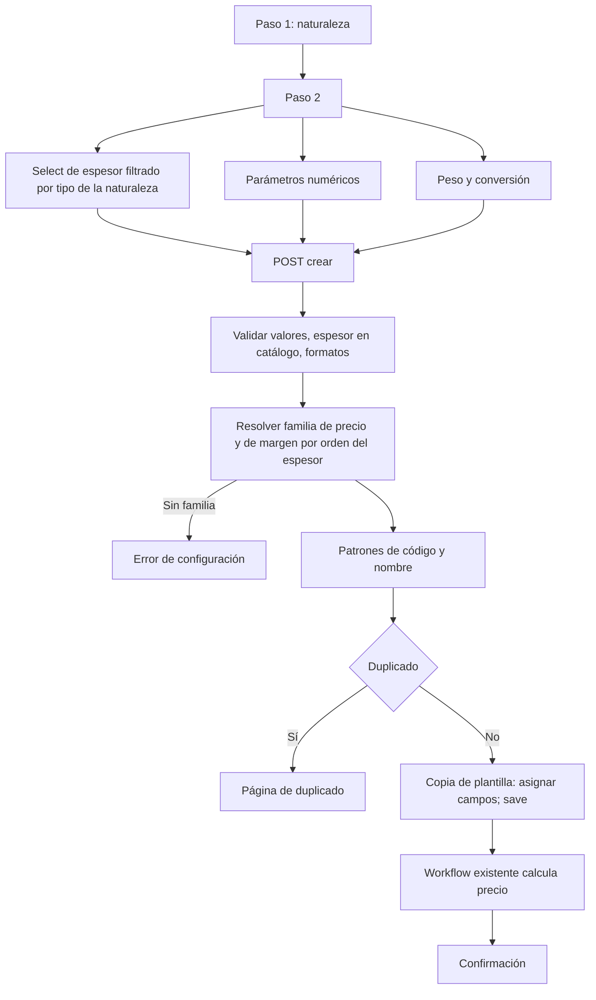
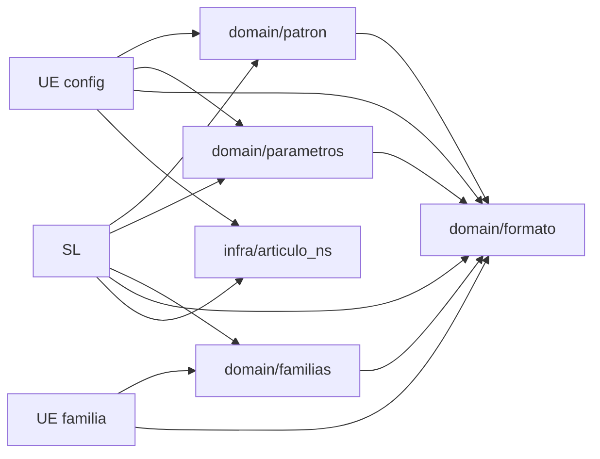

# Plan: Creador de artículos por naturaleza de producto — v3 (iteración B)

Contexto: la iteración A (plan v2, prompt v2 y formatos D-13/D-14) se probó con éxito en sandbox el 2026-11-17.
Esta versión detalla la solución completa: espesor por catálogo, familias de precio y margen por rango de espesor, peso, conversión de unidad y descripciones.
Versión previa: `planes/2026-11-12_creador-articulos-naturaleza_plan_v2.md`.

## 0. Control
| Campo | Valor |
|---|---|
| Fecha | 2026-11-17 |
| Versión | v3 |
| Estado | Borrador |
| Solicitante | Desarrollo SADS (para cliente final Almetal) |
| Entidades afectadas | Las subsidiarias de la plantilla de cada naturaleza; los registros de configuración y de espesores no son por subsidiaria |

Historial de cambios:
- v1 y v2 (2026-11-12/13): iteración A; ver plan v2.
- Formatos D-13 a D-15 (2026-11-14): `centesimas3`, `fraccion16`, lados enteros (commit `abf1563`).
- v3 (2026-11-17): requerimientos R3-01 a R3-06 del usuario; registro de espesores; sublista de familias por rango; peso y conversión capturados; descripciones = código.

Requerimientos del usuario (2026-11-17):
| ID | Requerimiento |
|---|---|
| R3-01 | `itemid` se copia en `purchasedescription` y `salesdescription`, como regla general. |
| R3-02 | El peso se captura en todas las naturalezas; se guarda en el campo existente `custitem_drt_ci_precio_teorico` y se iguala en `weight`. No se crea un campo de peso por naturaleza. |
| R3-03 | El espesor deja de ser captura libre: se elige de un catálogo cuyos valores dependen de la naturaleza (fracciones de pulgada, calibres, milímetros o cédulas). |
| R3-04 | Familia de precio y familia de margen se asignan por rango de espesor, descrito en el registro de configuración; si no hay relación, una sola familia para todas las medidas. |
| R3-05 | `custitem_alm_articulo_conversionunidad` se captura a mano en esta etapa; es el origen de la cadena de precios, que ya resuelven campos fórmula y un workflow. |
| R3-06 | El resto de los campos se copia del artículo plantilla. |

## 1. Objetivo
Problema: el artículo creado en iteración A conserva precios, familias y conversión de la plantilla; el espesor es un número libre que no cubre calibres ni cédulas.
Resultado: el artículo nuevo queda con espesor de catálogo, familias correctas, conversión propia, peso y descripciones; la cadena existente de fórmulas y workflow calcula su precio.
Métricas:
- 100% de artículos creados con familia de precio y de margen según la relación de su naturaleza.
- 100% de artículos con `custitem_alm_articulo_conversionunidad` > 0, peso > 0 y descripciones iguales al código.
- 0 artículos con espesor fuera del catálogo de su naturaleza.
- Precio base del artículo nuevo igual al que produce la cadena existente para un artículo capturado a mano con los mismos datos (P3-12).

## 2. Alcance
Incluye:
- Registro personalizado nuevo de espesores y lista de tipos de espesor.
- Campo de artículo nuevo para el espesor (SELECT al registro de espesores), compartido por todas las naturalezas.
- Registro hijo de familias por rango de espesor, visible como sublista del registro de configuración.
- Campo nuevo en la configuración: tipo de espesor de la naturaleza.
- Cambios al Suitelet: select de espesor, captura de conversión, peso a dos campos, descripciones, familias.
- Formatos de marcador nuevos para el espesor: `codigo` y `texto`.
- Validaciones nuevas en el UE de configuración y UE nuevo sobre el registro de familias.
- Pruebas Jest y documentación.

No incluye:
- Cálculo automático de `custitem_alm_articulo_conversionunidad` desde `customrecord_pfp_famprecios` (etapa posterior, DA3-06).
- Cálculo automático del peso.
- Cambios a los campos fórmula ni al workflow de precios.
- Migración de artículos existentes al catálogo de espesores.
- Formularios nativos por naturaleza.

## 3. Situación actual
| Objeto | Hecho verificado (repo, commit `10aa845`) |
|---|---|
| Suitelet `SADS_SL_crear_articulo_nat.js` | Paso 1 naturaleza; paso 2 un campo FLOAT/INTEGER por ID del JSON + peso; copia la plantilla; escribe naturaleza, parámetros, `weight`, `itemid`, `displayname`, `vendorname`, vacía `upccode`/`mpn`; `isinactive` según `custscript_sads_sl_art_activo`. |
| Parámetros soportados | Solo campos `float` e `integer` (`parametros.TIPOS_SOPORTADOS`); un SELECT se rechaza como error de configuración. |
| Patrones | `{id}`, `{id:centesimas3}`, `{id:fraccion16}` (RN-17). |
| Configuración de placas (cuenta, id 1) | JSON `["custitem_sads_nat_pla_lado_a","custitem_sads_nat_pla_lado_b","custitem_sads_nat_pla_espesor"]`; plantilla 10928; patrones con formatos. Prueba exitosa 2026-11-17. |
| Campos de placa | `custitem_sads_nat_pla_espesor`, `_lado_a`, `_lado_b`: FLOAT, sin `minvalue`, solo artículos de inventario. |
| Lista de naturalezas | Placas de Acero, Perfiles Tubulares Cuadrados, Perfiles Tubulares Redondos. |
| UE de configuración | `recordtype` confirmado como `[scriptid=customrecord_sads_naturaleza_productos]` (cierra S-07). |
| Cadena de precios | Descrita por el usuario: precio de cotización de la familia × `custitem_alm_articulo_conversionunidad` → campos fórmula → workflow guarda el precio final y lo mapea al Precio Base. No hay XML en el repo (supuesto S3-05). |

Hallazgos pendientes de la revisión del 2026-11-14 (fuera de este plan, se listan para no perderlos):
| ID | Hallazgo |
|---|---|
| H3-01 | Lados de placa FLOAT sin `minvalue` 2 (contradice D-15 y RN-04). |
| H3-02 | Audiencia de CS y UE de artículo reducida de 3 a 2 subsidiarias en `10aa845`. |
| H3-03 | `customrole_sads_naturaleza_config_exec` con permisos de más (`LIST_ITEM`, `ADMI_CUSTITEMFIELD`, `LIST_OTHER_ADDRESS` FULL). |

## 4. Arquitectura de la solución
| Componente | Tipo | ID propuesto | Disparador | Responsabilidad |
|---|---|---|---|---|
| SL creador de artículos | Suitelet 2.1 (modificado) | `customscript_sads_sl_crear_articulo_nat` | Usuario | Captura, validación, familias y creación |
| UE de configuración | UserEvent 2.1 (modificado) | `customscript_sads_ue_naturaleza_config` | `beforeSubmit` del registro de configuración | RN-12 a RN-17 y RN3-08 |
| UE de familias | UserEvent 2.1 (nuevo) | `customscript_sads_ue_nat_familia` | `beforeSubmit` CREATE/EDIT/XEDIT del registro de familias | Rangos válidos y sin traslape (RN3-05, RN3-06) |
| Dominio patrones | Módulo sin `N/` (modificado) | `domain/SADS_naturaleza_patron.js` | SL y UE | Formatos `codigo` y `texto` para el espesor |
| Dominio parámetros | Módulo sin `N/` (modificado) | `domain/SADS_naturaleza_parametros.js` | SL y UE | Parámetro de espesor por catálogo; conversión |
| Dominio familias | Módulo sin `N/` (nuevo) | `domain/SADS_naturaleza_familias.js` | SL y UE de familias | Validar rangos y resolver la familia de un espesor |
| Adaptador artículos | Módulo con `N/search` (sin cambio) | `infra/SADS_naturaleza_articulo_ns.js` | SL y UE | Tipo de registro de un artículo |
| Workflow de precios | Existente, sin cambio | Supuesto S3-05 | Al guardar el artículo | Precio final y Precio Base |

Justificación:
- Registro de espesores frente a lista personalizada: cada espesor necesita texto para el nombre, segmento para el código y un valor de orden para los rangos; una lista solo guarda texto y abreviatura.
- Registro hijo de familias frente a JSON: los usuarios técnicos eligen espesores y familias de selects, sin capturar IDs a mano; NetSuite lo muestra como sublista de la configuración.
- UE sobre el registro hijo frente a validar en el UE de configuración: las líneas de un registro hijo se guardan como registros propios; el UE de configuración no ve las líneas en su `beforeSubmit` (supuesto S3-07).
- Un solo campo de espesor de artículo frente a uno por naturaleza: mismo criterio que R3-02 para el peso; permite consultas y reportes por espesor en todas las naturalezas.



### 4.1 Nivel de arquitectura
Nivel 1, sin cambio.
Suben el nivel: nuevas reglas puras (rangos, resolución de familia) verificables con Jest y compartidas por SL y UE de familias.
Lo bajan: una sola fuente de datos; sin integraciones; volumen bajo.

### 4.2 Capas, casos de uso y puertos
| Caso de uso | Intención | Entrada | Salida | Reglas |
|---|---|---|---|---|
| Crear artículo de naturaleza | Alta de una medida con precio correcto | Configuración, parámetros, espesor, peso, conversión | Artículo creado, duplicado o errores | RN-01 a RN-17, RN3-01 a RN3-04, RN3-07, RN3-09 a RN3-12 |
| Validar configuración | Impedir configuraciones inválidas | Registro de configuración | Guardado o error | RN-12 a RN-17, RN3-08 |
| Validar familia por rango | Impedir rangos inválidos o traslapados | Registro de familia | Guardado o error | RN3-05, RN3-06 |
Sin puertos formales (nivel 1).

### 4.3 Patrones de diseño
No aplica: la variación por naturaleza es de datos (catálogo, rangos, patrones), no de comportamiento.

### 4.4 Estructura de archivos por capa
```
src/FileCabinet/SuiteScripts/SADS_Naturaleza_Productos/
├── SADS_SL_crear_articulo_nat.js        (modificado)
├── SADS_UE_naturaleza_config.js         (modificado)
├── SADS_UE_nat_familia.js               (nuevo)
├── infra/SADS_naturaleza_articulo_ns.js (sin cambio)
└── domain/
    ├── SADS_naturaleza_config_formato.js (sin cambio)
    ├── SADS_naturaleza_patron.js         (modificado)
    ├── SADS_naturaleza_parametros.js     (modificado)
    └── SADS_naturaleza_familias.js       (nuevo)
src/Objects/
├── customlist_sads_tipo_espesor.xml              (nuevo)
├── customrecord_sads_espesor.xml                 (nuevo)
├── customrecord_sads_nat_familia.xml             (nuevo)
├── custitem_sads_nat_espesor.xml                 (nuevo)
├── customrecord_sads_naturaleza_productos.xml    (modificado: tipo de espesor)
├── customscript_sads_ue_nat_familia.xml          (nuevo)
└── customscript_sads_sl_crear_articulo_nat.xml   (sin cambio de parámetros)
```


## 5. Modelo de datos
### 5.1 Registros y campos existentes
| Registro | Campo | ID interno | Tipo | Uso | Verificado/Supuesto |
|---|---|---|---|---|---|
| Artículo | Código | `itemid` | Texto | Patrón de código; origen de las descripciones | Verificado (iteración A) |
| Artículo | Descripción de compra | `purchasedescription` | Texto largo | = `itemid` (R3-01) | Supuesto S3-01 |
| Artículo | Descripción de venta | `salesdescription` | Texto largo | = `itemid` (R3-01) | Supuesto S3-01 |
| Artículo | Peso teórico | `custitem_drt_ci_precio_teorico` | Supuesto decimal | Peso capturado (R3-02) | Supuesto S3-02: el nombre dice "precio teórico" |
| Artículo | Peso | `weight` | Float | = peso capturado | Verificado (iteración A) |
| Artículo | Conversión unidad compra a base | `custitem_alm_articulo_conversionunidad` | Supuesto decimal | Captura manual > 0 (R3-05) | Supuesto S3-03 |
| Artículo | Familia de precio | `<ID_CAMPO_FAMILIA_PRECIO>` | Supuesto SELECT a `customrecord_pfp_famprecios` | Según rango (R3-04) | **Desconocido; DA3-01 bloqueante** |
| Artículo | Familia de margen | `<ID_CAMPO_FAMILIA_MARGEN>` | Supuesto SELECT | Según rango (R3-04) | **Desconocido; DA3-01 bloqueante** |
| Familia de precios | — | `customrecord_pfp_famprecios` | Registro personalizado | Destino del SELECT de familia de precio | Dato del usuario; no verificado en cuenta |
| Familia de margen | — | `<ID_REGISTRO_FAMILIA_MARGEN>` | Registro o lista | Destino del SELECT de familia de margen | **Desconocido; DA3-01** |
| Artículo | Espesor de placa actual | `custitem_sads_nat_pla_espesor` | FLOAT | Se retira de la configuración de placas | Verificado (repo) |

### 5.2 Objetos nuevos
Lista de tipos de espesor `customlist_sads_tipo_espesor`:
| Valor | Ejemplo de espesores |
|---|---|
| Fracción de pulgada | 3/16", 1/2", 1 1/2" |
| Calibre | Cal 10, Cal 11, Cal 12 |
| Milímetros | 10 mm, 20 mm, 30 mm |
| Cédula | Ced. 30, Ced. 40, Ced. 50 |

Registro de espesores `customrecord_sads_espesor` ("SADS - Espesor"; `includename` T; acceso por permiso de registro):
| Campo | ID propuesto | Tipo | Obligatorio | Regla |
|---|---|---|---|---|
| Nombre | `name` | Texto | Sí | Texto que se muestra en el select del Suitelet, por ejemplo `1/2"`, `Cal 10`. |
| Tipo de espesor | `custrecord_sads_esp_tipo` | SELECT a `customlist_sads_tipo_espesor` | Sí | Agrupa el catálogo por naturaleza (RN3-01). |
| Texto para nombre | `custrecord_sads_esp_texto` | Texto (≤ 30) | Sí | Lo que escribe `{id:texto}` en el patrón de nombre, por ejemplo `1/2''`, `CAL 10`, `10 MM`, `CED 40`. |
| Segmento para código | `custrecord_sads_esp_codigo` | Texto (≤ 10), solo `A-Z0-9` | Sí | Lo que escribe `{id:codigo}` en el patrón de código, por ejemplo `050`, `C10`, `010`, `C40`. Único por tipo (RN3-03). |
| Orden | `custrecord_sads_esp_orden` | Decimal > 0 | Sí | Orden ascendente de grosor real; define los rangos de familias. Único por tipo (RN3-03). |
| Inactivo | `isinactive` | Casilla | — | Un espesor inactivo no se ofrece en el Suitelet. |

Criterio del orden: grosor equivalente en una unidad común por tipo. Fracciones: pulgadas decimales (1/2" = 0.5). Milímetros: el número (10). Calibres: grosor nominal en mm (Cal 10 = 3.42; supuesto S3-04, el calibre sube cuando el grosor baja). Cédulas: número de cédula.

Ejemplo de espesores de placas (tipo Fracción de pulgada):
| Nombre | Texto | Código | Orden |
|---|---|---|---|
| 3/16" | 3/16'' | 018 | 0.1875 |
| 1/4" | 1/4'' | 025 | 0.25 |
| 1/2" | 1/2'' | 050 | 0.5 |
| 5/8" | 5/8'' | 062 | 0.625 |
| 3/4" | 3/4'' | 075 | 0.75 |
| 1 1/2" | 1 1/2'' | 150 | 1.5 |

Campo de artículo `custitem_sads_nat_espesor` ("SADS Espesor"): SELECT a `customrecord_sads_espesor`; no obligatorio en el campo (lo exige el UE existente si está en el JSON); aplica a los tipos de artículo de las plantillas (inventario como mínimo); subpestaña principal.

Campo nuevo en la configuración `custrecord_sads_naturaleza_tipo_esp`: SELECT a `customlist_sads_tipo_espesor`; obligatorio si el JSON incluye `custitem_sads_nat_espesor` (RN3-08).

Registro hijo de familias `customrecord_sads_nat_familia` ("SADS - Familia por Espesor"), sublista del registro de configuración:
| Campo | ID propuesto | Tipo | Obligatorio | Regla |
|---|---|---|---|---|
| Configuración | `custrecord_sads_natfam_config` | SELECT a configuración, `isparent` T | Sí | Padre de la sublista. |
| Espesor desde | `custrecord_sads_natfam_desde` | SELECT a `customrecord_sads_espesor` | No | Vacío junto con "hasta" = familia única (RN3-05). |
| Espesor hasta | `custrecord_sads_natfam_hasta` | SELECT a `customrecord_sads_espesor` | No | Orden de "desde" ≤ orden de "hasta"; mismo tipo que la naturaleza. |
| Familia de precio | `custrecord_sads_natfam_precio` | SELECT a `customrecord_pfp_famprecios` | Sí | Se escribe en `<ID_CAMPO_FAMILIA_PRECIO>`. |
| Familia de margen | `custrecord_sads_natfam_margen` | SELECT a `<ID_REGISTRO_FAMILIA_MARGEN>` | Sí | Se escribe en `<ID_CAMPO_FAMILIA_MARGEN>`. |

Ejemplo de placas:
| Desde | Hasta | Familia de precio | Familia de margen |
|---|---|---|---|
| 3/16" | 5/8" | FAM68 | `<margen 1>` |
| 3/4" | 1 1/2" | FAM069 | `<margen 2>` |

Longitudes de scriptid ≤ 40: todas las propuestas cumplen (máxima `custrecord_sads_naturaleza_tipo_esp`, 36).

Ejemplo de configuración de placas en v3:
| Campo | Valor |
|---|---|
| JSON | `["custitem_sads_nat_pla_lado_a","custitem_sads_nat_pla_lado_b","custitem_sads_nat_espesor"]` |
| Tipo de espesor | Fracción de pulgada |
| Patrón de código | `PLA36{custitem_sads_nat_espesor:codigo}{custitem_sads_nat_pla_lado_a}{custitem_sads_nat_pla_lado_b}` |
| Patrón de nombre | `Placa Acero TA36 {custitem_sads_nat_espesor:texto} {custitem_sads_nat_pla_lado_a}'x{custitem_sads_nat_pla_lado_b}'` |
| Resultado con 1/2", 6, 20 | Código `PLA36050620`; nombre `Placa Acero TA36 1/2'' 6'x20'`; descripciones `PLA36050620` |

## 6. Lógica por componente
### 6.1 Suitelet (cambios sobre iteración A)
Preparación común:
1. Leer además `custrecord_sads_naturaleza_tipo_esp`.
2. `describirParametros`: un campo SELECT cuyo destino es `customrecord_sads_espesor` es parámetro de tipo `espesor` (S3-06: detectar por ID `custitem_sads_nat_espesor`, constante con nombre).
3. Si hay parámetro `espesor`: C-3 trae el catálogo del tipo de la naturaleza; catálogo vacío = error de configuración.
4. C-4 trae las líneas de familias de la configuración.

Paso 2:
1. Parámetro `espesor`: SELECT obligatorio con opción vacía y las filas de C-3 ordenadas por orden; texto = `name`.
2. Parámetros numéricos: sin cambio.
3. Campo `custpage_peso` (FLOAT, obligatorio): etiqueta "Peso (<unidad>)" como hoy.
4. Campo nuevo `custpage_conversion` (FLOAT, obligatorio): etiqueta "Conversión unidad de compra a base".

Creación:
1. Validar numéricos, peso y conversión (> 0, misma regla PT-04) y que el espesor elegido esté en C-3 (RN3-02).
2. `familias.resolver({lineas: C-4, ordenEspesor})` (RN3-04). Sin resultado o más de uno: error de configuración "No hay familia de precios para el espesor <nombre> en esta naturaleza."
3. Patrones: `{id:codigo}` y `{id:texto}` toman `custrecord_sads_esp_codigo` y `custrecord_sads_esp_texto` del espesor elegido (RN3-09).
4. Duplicado C-2: el criterio del espesor compara su ID interno (entero).
5. Asignar sobre la copia, además de iteración A:
   | Campo | Valor | Regla |
   |---|---|---|
   | `custitem_sads_nat_espesor` | ID del espesor | RN3-02 |
   | `custitem_drt_ci_precio_teorico` | Peso | RN3-10 |
   | `weight` | Peso | RN3-10 |
   | `custitem_alm_articulo_conversionunidad` | Conversión | RN3-11 |
   | `<ID_CAMPO_FAMILIA_PRECIO>` | Familia de precio de la línea | RN3-04 |
   | `<ID_CAMPO_FAMILIA_MARGEN>` | Familia de margen de la línea | RN3-04 |
   | `purchasedescription`, `salesdescription` | Código generado | RN3-12 |
6. `save`; el workflow existente calcula el precio (S3-05).
7. Confirmación: agrega espesor, familia de precio y conversión en campos INLINE.

Funciones nuevas o modificadas:
| Función | Entradas | Salida | Responsabilidad |
|---|---|---|---|
| `cargarEspesores(tipoId)` | ID del tipo | `{id, nombre, texto, codigo, orden}[]` | C-3 |
| `cargarFamilias(configuracionId)` | ID de configuración | `{desdeOrden, hastaOrden, familiaPrecioId, familiaMargenId}[]` | C-4 |
| `familias.resolver({lineas, orden})` (dominio) | Líneas planas, orden del espesor | Línea o error de dominio | RN3-04 a RN3-06 |
| `familias.validarLinea({linea, hermanas})` (dominio) | Línea y demás líneas de la misma configuración | `{valido, errores}` | RN3-05, RN3-06 |
| `patron.aplicar({patron, valores, textos})` (dominio, modificado) | `textos: {id: {codigo, texto}}` | Texto | RN3-09 |
| `parametros.validarValores` (dominio, modificado) | Agrega conversión y espesor permitido | `{valido, errores, valores, peso, conversion}` | RN3-02, RN3-11 |

Consultas nuevas:
| ID | Tabla | Campos | Filtros | Orden | Volumen |
|---|---|---|---|---|---|
| C-3 | `customrecord_sads_espesor` | id, name, texto, código, orden | `isinactive = 'F'`; tipo = `?` | orden | Decenas |
| C-4 | `customrecord_sads_nat_familia` con join a espesores desde/hasta | orden desde, orden hasta, familia de precio, familia de margen | `isinactive = 'F'`; configuración = `?` | orden desde | 1 a 5 |

### 6.2 UE de configuración (cambios)
1. RN3-08: si el JSON incluye `custitem_sads_nat_espesor`, el tipo de espesor es obligatorio.
2. RN3-09: los formatos `codigo` y `texto` solo se permiten en el marcador del campo de espesor; `centesimas3` y `fraccion16` solo en campos numéricos.
3. Familias: no se validan aquí (S3-07); las valida el UE de familias.

### 6.3 UE de familias `SADS_UE_nat_familia.js` (nuevo)
`beforeSubmit` CREATE, EDIT y XEDIT del registro de familias:
1. Leer la línea (en XEDIT, campos no enviados desde `oldRecord`) y las demás líneas activas de la misma configuración (consulta C-5, igual a C-4 excluyendo el propio ID).
2. Leer tipo y orden de "desde" y "hasta" con la misma consulta.
3. `familias.validarLinea`: RN3-05 y RN3-06.
4. Error: `error.create` `FAMILIA_NATURALEZA_INVALIDA`, `notifyOff` T.

### 6.4 Reglas de negocio nuevas
| ID | Regla |
|---|---|
| RN3-01 | El catálogo de espesores de una naturaleza son los espesores activos del tipo de espesor de su configuración. |
| RN3-02 | El espesor del artículo se elige del catálogo de su naturaleza; un ID fuera del catálogo se rechaza. |
| RN3-03 | En un mismo tipo, código y orden de espesor son únicos. |
| RN3-04 | La familia de precio y la de margen del artículo son las de la única línea cuyo rango contiene el orden del espesor (inclusivo en ambos extremos). |
| RN3-05 | Una línea sin "desde" ni "hasta" es familia única y debe ser la única línea activa de la configuración; "desde" y "hasta" van juntos o ninguno. |
| RN3-06 | Los rangos de una configuración no se traslapan; "desde" ≤ "hasta" por orden; ambos del tipo de espesor de la naturaleza. |
| RN3-07 | Si la naturaleza no usa espesor, se exige una sola línea de familia única. |
| RN3-08 | Si el JSON incluye el campo de espesor, la configuración debe tener tipo de espesor. |
| RN3-09 | `{id:codigo}` y `{id:texto}` escriben el segmento de código y el texto del espesor elegido; solo aplican al campo de espesor. |
| RN3-10 | El peso capturado se escribe en `custitem_drt_ci_precio_teorico` y en `weight`. |
| RN3-11 | La conversión de unidad de compra a base es obligatoria y mayor que 0; se escribe en `custitem_alm_articulo_conversionunidad`. |
| RN3-12 | `purchasedescription` y `salesdescription` = código generado (`itemid`). |
| RN3-13 | Ningún otro campo se escribe; el resto viene de la plantilla (R3-06). |

Unidades: el script no convierte unidades; peso en la unidad de la plantilla; conversión en las unidades que define la familia de precios.

## 7. Gobernanza y rendimiento
| Componente | Operación | Unidades | Total estimado | Límite |
|---|---|---|---|---|
| SL paso 2 | iteración A (31) + C-3 + C-4 | 31 + 10 + 10 | ~51 | 1,000 |
| SL creación | paso 2 + C-2 + `save` (incluye workflow) | 51 + 10 + 20 | ~81 (workflow: supuesto S3-05) | 1,000 |
| UE familias | C-5 | 10 | ~10 | 1,000 |
Sin estrategia de exceso.

## 8. Manejo de errores y bitácora
Sin cambio respecto del plan v2; se agregan mensajes de dominio para familia no encontrada, espesor fuera de catálogo y conversión inválida.
`log.audit` de alta agrega espesor, familia de precio y conversión.

## 9. Seguridad y permisos
| Rol | Permiso adicional | Motivo |
|---|---|---|
| Audiencia del Suitelet | `LIST_CUSTRECORDENTRY` VIEW (ya existente) cubre espesores y familias | C-3 y C-4 |
| Usuarios técnicos | CREATE sobre espesores y familias | Mantener catálogo y relación |
`customrecord_pfp_famprecios` y el registro de familias de margen: la audiencia necesita VIEW para que los selects muestren valores (supuesto S3-08).

## 10. Consideraciones fiscales
| Obligación | Fundamento | Efecto |
|---|---|---|
| `PesoEnKg` por mercancía en Carta Porte | Guía de llenado del Complemento Carta Porte, nodo Mercancia | Si la localización toma el peso de `weight` o de `custitem_drt_ci_precio_teorico`, un peso erróneo pasa al complemento (supuesto S-12 a validar con fiscal). |
| Descripción del concepto en CFDI | Anexo 20, nodo Concepto, atributo Descripcion | Si la localización usa `salesdescription`, el CFDI mostrará el código (`PLA36050620`) y no el nombre. Supuesto a validar con fiscal y ventas (R3-04). |

## 11. Riesgos
| ID | Enunciado | Fundamento | Consecuencia | Mitigación |
|---|---|---|---|---|
| R3-01 | El workflow de precios podría no dispararse cuando el artículo lo crea un script. | Los workflows filtran por contexto de ejecución y tipo de evento (supuesto S3-05). | Artículo creado con el precio de la plantilla. | P3-12; revisar contexto del workflow antes del despliegue. |
| R3-02 | `custitem_drt_ci_precio_teorico` se llama "precio teórico" pero guardará peso. | R3-02 del usuario. | Si otro proceso lo usa como precio, se mezclan conceptos. | Confirmar uso del campo (DA3-02). |
| R3-03 | Configuraciones sin familias o con rangos que no cubren un espesor del catálogo. | RN3-04. | El Suitelet rechaza la creación para ese espesor. | Mensaje claro; P3-08; los técnicos cubren todo el catálogo. |
| R3-04 | Descripción de venta = código. | R3-01 del usuario. | Cotizaciones y CFDI muestran el código en lugar del nombre legible. | Validar con ventas y fiscal (DA3-03). |
| R3-05 | Conversión capturada a mano. | R3-05. | Precio erróneo si se captura mal; se propaga por toda la cadena. | Validación > 0; confirmación muestra el valor; cálculo automático posterior (DA3-06). |
| R3-06 | Artículos de placa creados en iteración A usan `custitem_sads_nat_pla_espesor` (FLOAT). | Cambio de modelo. | La búsqueda de duplicados v3 compara el nuevo campo y no detecta esos artículos. | Inactivar o migrar los artículos de prueba antes de liberar v3. |
| R3-07 | Orden de calibres mal capturado. | El calibre es inverso al grosor (S3-04). | Rangos de familia invertidos. | Orden = grosor en mm; P3-07. |

## 12. Plan de pruebas
| Caso | RN | Capa | Datos | Resultado esperado | Tipo |
|---|---|---|---|---|---|
| P3-01 | RN3-04 | Dominio familias | Orden 0.5 con rangos [0.1875–0.625] y [0.75–1.5] | Primera línea | Feliz |
| P3-02 | RN3-04 | Dominio familias | Orden 0.625 y 0.75 (extremos) | Línea 1 y línea 2 | Borde |
| P3-03 | RN3-04 | Dominio familias | Orden 2.0 fuera de rangos | Error de dominio | Error |
| P3-04 | RN3-05 | Dominio familias | Línea sin rango + otra línea | Inválido | Error |
| P3-05 | RN3-06 | Dominio familias | Rangos traslapados [0.25–0.5] y [0.5–0.75] | Inválido | Error |
| P3-06 | RN3-05 | Dominio familias | Una sola línea sin rango | Aplica a cualquier orden | Feliz |
| P3-07 | RN3-06 | Dominio familias | "desde" con orden mayor que "hasta" | Inválido | Error |
| P3-08 | RN3-02 | SL | Espesor fuera de C-3 | Paso 2 con error; no guarda | Error |
| P3-09 | RN3-09 | Dominio patrón | `{custitem_sads_nat_espesor:codigo}` con 1/2" | `050` | Feliz |
| P3-10 | RN3-10 a RN3-12 | SL | Alta válida | `setValue` de peso en dos campos, conversión, familias, descripciones = código | Feliz |
| P3-11 | RN3-11 | SL | Conversión vacía, 0, negativa | Paso 2 con error | Error |
| P3-12 | R3-01 | Sandbox | Alta de placa 1/2" × 6 × 20 | Precio base igual al de un artículo equivalente capturado a mano | Feliz |
| P3-13 | RN3-08 | UE config | JSON con espesor sin tipo | Rechazo | Error |
| P3-14 | RN3-06 | UE familias | Línea traslapada | Rechazo `FAMILIA_NATURALEZA_INVALIDA` | Error |
| P3-15 | RN3-12 | Sandbox | Cotización con el artículo nuevo | Descripción mostrada = código | Feliz |
Las pruebas de iteración A siguen vigentes; las que usan `fraccion16`/`centesimas3` se conservan.

## 13. Despliegue
Sandbox `Almetal_SB`:
1. `npm test` en verde; `project:deploy`.
2. Técnicos: capturar espesores de placas (tipo Fracción de pulgada) y familias de la configuración de placas.
3. Actualizar la configuración de placas: JSON con `custitem_sads_nat_espesor`, tipo de espesor y patrones con `:codigo`/`:texto`.
4. Revisar contexto de ejecución del workflow de precios (R3-01).
5. Inactivar o borrar artículos de prueba de iteración A (R3-06).
6. Ejecutar P3-12 y P3-15.
7. Decidir `custscript_sads_sl_art_activo` = T cuando P3-12 pase (DA3-05).
Producción: después de sandbox; re-aplicar audiencia; mismos datos de catálogo y familias (los IDs de familias difieren entre cuentas).
Reversión: configuración de placas con el JSON y patrones de iteración A; inactivar el UE de familias.

## 14. Decisiones abiertas
| ID | Pregunta | Opciones | Bloqueante |
|---|---|---|---|
| DA3-01 | IDs de los campos de artículo de familia de precio y de margen, y registro destino de la familia de margen. | Dato del usuario | Sí |
| DA3-02 | ¿`custitem_drt_ci_precio_teorico` guarda peso (kg) y no un precio? ¿Lo usa otro proceso? | Confirmar | Sí |
| DA3-03 | ¿La descripción de venta debe ser el código o el nombre? | Código (R3-01, default) / nombre | No |
| DA3-04 | ¿El catálogo de espesores se filtra solo por tipo, o una naturaleza puede limitar valores del tipo (por ejemplo, placas sin 1/16")? | Solo tipo (default) / tipo + inactivar por naturaleza | No |
| DA3-05 | ¿Desde qué momento los artículos se crean activos? | Tras P3-12 (default) | No |
| DA3-06 | Cálculo automático de la conversión desde la unidad de cotización de `customrecord_pfp_famprecios` (largo o peso de la pieza). | Plan posterior | No |
| DA3-07 | Hallazgos H3-01 a H3-03 (lados FLOAT, subsidiarias, rol). | Corregir junto con v3 / aparte | No |

## 15. Supuestos y fuentes
1. S3-01: `purchasedescription` y `salesdescription` existen en `inventoryitem` y aceptan el código.
2. S3-02: `custitem_drt_ci_precio_teorico` es decimal y guarda peso.
3. S3-03: `custitem_alm_articulo_conversionunidad` es decimal.
4. S3-04: orden de calibres por grosor nominal en mm.
5. S3-05: el workflow de precios se ejecuta en la creación desde Suitelet (contexto y evento).
6. S3-06: el parámetro de espesor se identifica por el ID `custitem_sads_nat_espesor`.
7. S3-07: el UE de configuración no ve las líneas del registro hijo en su `beforeSubmit`.
8. S3-08: la audiencia necesita VIEW sobre familias de precio y margen.
Supuestos de plan v2 (S-01 a S-16) siguen vigentes; S-07 cerrado con `[scriptid=…]`.
Fuentes: requerimientos del usuario del 2026-11-14 y 2026-11-17; repo commit `10aa845`; prueba en sandbox del 2026-11-17 reportada por el usuario. Conector "Netsuite Dev" no disponible: ningún ID nuevo se verificó en la cuenta.
