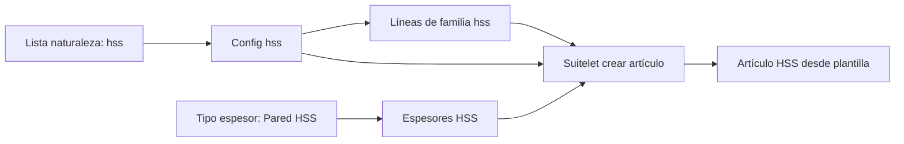

# Plan: Naturaleza Perfiles Estructurales Huecos (HSS) — v1

## 0. Control
| Campo | Valor |
|---|---|
| Fecha | 2026-11-26 |
| Versión | v1 |
| Estado | Borrador; patrones y familias bloqueados hasta recibir el listado de artículos actuales |
| Solicitante | Costeos, Almetal |
| Entidades afectadas | Supuesto: mismas subsidiarias que las seis naturalezas vigentes |

Historial: v1 (2026-11-26) estructura, objetos y decisiones abiertas, sin listado de artículos.

## 1. Objetivo
Dar de alta la naturaleza HSS (secciones cuadrada y rectangular, espesor en fracción de pulgada).
Resultado: el Suitelet `SADS_SL_crear_articulo_nat.js` crea artículos HSS con código, nombre, familia de precio, familia de margen y precio base sin captura manual.
Métrica: el 100 % de las filas del listado actual reproduce su código y familia con la configuración (prueba Jest tipo `SADS_naturaleza_lne.test.js`).

## 2. Alcance
| Incluye | No incluye |
|---|---|
| Valor de lista, instancia de configuración, tipo y catálogo de espesores, líneas de familia, campos de artículo si se decide no reutilizar los de PTR | Código nuevo de dominio, salvo que el listado exija un formato de patrón nuevo (AD-05) |
| Prueba Jest de reproducción contra el listado | Migración o renombrado de artículos HSS existentes |
| Actualización de README (1.1, 2.1) y guía funcional | HSS redondo |
| | Alta de familias de corte en `customlist_familias_de_corte` (D-28) |

## 3. Situación actual (verificado en el repositorio)
| Hecho | Fuente |
|---|---|
| Una naturaleza es configuración, no código (AD-02). | README |
| Seis naturalezas: pla36, ptrc, mpptrc, ptrr, mpptrr, lne. | `src/Objects/Config/customrecord_sads_naturaleza_productos.xml` |
| `tipo_esp` filtra el catálogo; el valor `val_sads_tesp_fraccion` hoy contiene espesores de placa 3/16" a 2" (incluye 1", 2"; no incluye 1/8"). | `customrecord_sads_espesor.xml`, `customlist_sads_tipo_espesor.xml` |
| No hay lógica atada a valores de tipo de espesor; agregar un tipo nuevo es solo datos. | grep en `src/FileCabinet` |
| El mapa de medidas `customrecord_sads_mapa_medidas_ptrr` es global (sin campo de naturaleza). | XML del registro |
| Formatos de patrón: `centesimas3` (0.01–9.99), `fraccion16`, `entero1`, `entero2`, `decimal2`, `codigo`, `texto`. | `domain/SADS_naturaleza_patron.js:27` |
| Campos PTR (`custitem_sads_nat_ptr_lado`, `_lado_b`, `_largo`) aplican a inventario y ya los comparten cuatro naturalezas. | `src/Objects/Naturalezas/` |
| CS y UE de obligatorios ya tienen deployment para todos los tipos de artículo; `deploy.xml` ya incluye `Objects/Naturalezas/*`. | `src/Objects/Scripts/`, `src/deploy.xml` |
| Conector Netsuite Dev no disponible en la sesión; ningún ID interno de la cuenta está verificado. | Sesión |

## 4. Arquitectura de la solución
| Componente | Tipo | ID propuesto | Responsabilidad |
|---|---|---|---|
| Valor de naturaleza | Valor de lista | `customlist_sads_naturaleza_productos.val_sads_natlist_hss` | Identificar HSS |
| Configuración | Instancia de registro | `val_sads_nat_config_record_hss` | Parámetros, plantilla, patrones, tipo de espesor, campo de medida |
| Tipo de espesor | Valor de lista | `customlist_sads_tipo_espesor.val_sads_tesp_hss` ("Pared de HSS") | Aislar el catálogo HSS del de placas |
| Espesores | Instancias | `val_sads_esp_hss_<codigo>` | Texto, código y orden por pared |
| Familias | Instancias | `val_sads_espesor_config_hss_<n>` | Rango espesor × medida → familia de precio y margen |
| Prueba | Jest | `__tests__/SADS_naturaleza_hss.test.js` | Reproducir código y familia del listado |

Justificación: sin script nuevo; los cinco scripts existentes leen la configuración (AD-02). Una sola naturaleza para cuadrado y rectangular (decisión del usuario): cuadrado se captura con lado A = lado B.

### 4.1 Nivel de arquitectura
Nivel 0 (solo configuración). Se sube a nivel del dominio existente únicamente si DA-03 exige un formato de patrón nuevo; en ese caso el cambio vive en `domain/SADS_naturaleza_patron.js` con su prueba.

### 4.2 / 4.3 / 4.4
No aplica: no hay casos de uso, puertos ni archivos nuevos.

## 5. Modelo de datos
### 5.1 Existentes reutilizados
| Registro | Campo | Uso | Estado |
|---|---|---|---|
| Artículo | `custitem_sads_nat_espesor` | Espesor del catálogo | Verificado en repo |
| Artículo | `custitem_sads_nat_ptr_lado`, `_lado_b`, `_largo` | Lado A, lado B, largo (si DA-01 = reutilizar) | Verificado en repo |
| Config | Todos los `custrecord_sads_naturaleza_*` | Ver 5.2 | Verificado en repo |

### 5.2 Valores de la instancia `val_sads_nat_config_record_hss` (supuestos)
| Campo | Valor propuesto | Estado |
|---|---|---|
| `config` | `[lado, lado_b, largo, custitem_sads_nat_espesor]` | Supuesto (DA-01) |
| `plantilla` | ID interno de un HSS existente | Pendiente (DA-02) |
| `patron_cod` | `HSS{lado:centesimas3}{lado_b:centesimas3}{espesor:codigo}` | Supuesto (DA-03) |
| `patron_nom` | `HSS {lado:fraccion16}" x {lado_b:fraccion16}" x {espesor:texto} a {largo:decimal2}m` | Supuesto (DA-03) |
| `tipo_esp` | `val_sads_tesp_hss` | Supuesto (DA-04) |
| `campo_med` | lado A | Supuesto (DA-05) |
| `mapa_med` | F | Recomendado: el mapa es global y mezclaría medidas de PTR |
| `valor_unid` | `[largo]` | Supuesto, igual que PTR |
| `fam_corte` | Vacío | Pendiente (DA-06) |

Espesores HSS (supuesto hasta el listado): 1/8", 3/16", 1/4", 5/16", 3/8", 1/2". Nombre `3/16" - HSS` para no chocar con placas, como se hizo con LNE. Código y orden con la convención de placas (`018`, `.18`), a confirmar contra los códigos actuales.

## 6. Lógica por componente
Sin lógica nueva. Reglas que la configuración debe cumplir:
| RN | Regla |
|---|---|
| RN-HSS-01 | Todo HSS del listado reproduce su código con `patron_cod`. |
| RN-HSS-02 | Todo HSS del listado reproduce su nombre con `patron_nom`, salvo diferencias de formato documentadas. |
| RN-HSS-03 | Cada combinación espesor × medida del listado cae en exactamente una línea de familia y recibe la familia actual. |
| RN-HSS-04 | Lado A ≥ lado B; cuadrado cuando son iguales. Supuesto: validación por captura, no por código. |
| RN-HSS-05 | Las familias DRT usadas por HSS están declaradas en `manifest.xml` y en `SADS_objetos_portables.test.js`. |

## 7. Gobernanza
Sin cambio: mismo flujo y consumo del Suitelet vigente.

## 8. Errores y bitácora
Sin cambio; el UE `SADS_UE_naturaleza_config.js` y `SADS_UE_nat_familia.js` validan la captura.

## 9. Seguridad
Sin cambio de roles; se usa `customrole_sads_naturaleza_config_exec`.

## 10. Fiscal
No aplica: no toca CFDI, Carta Porte, retenciones ni nómina. La clave SAT de producto se hereda de la plantilla (supuesto a validar).

## 11. Riesgos
| ID | Enunciado | Fundamento | Consecuencia | Mitigación |
|---|---|---|---|---|
| R-01 | `centesimas3` admite solo 0.01–9.99. | `SADS_naturaleza_patron.js:82` | HSS de 10" o más no genera código. | Confirmar rango en el listado; si excede, formato nuevo (DA-03). |
| R-02 | Familias se resuelven con un solo campo de medida. | Diseño de `campo_med` | Dos rectangulares con igual lado A y distinta familia no se distinguen. | Validar con el listado; si ocurre, usar lado B o perímetro (requiere código). |
| R-03 | Reutilizar `val_sads_tesp_fraccion` mostraría espesores de placa en HSS. | Catálogo actual 3/16"–2" | Captura de espesores inexistentes. | Tipo nuevo `val_sads_tesp_hss`. |
| R-04 | IDs internos (plantilla, familias) difieren entre sandbox y producción. | README 7.1 | Configuración rota en un ambiente. | Verificar por scriptid en ambas cuentas antes del deploy. |
| R-05 | `fam_corte` vacío impide crear (RN6-02). | README 7.1 | El Suitelet rechaza HSS. | Definir familias de corte (DA-06) o descargar la configuración de la cuenta antes del deploy. |

## 12. Plan de pruebas
| Caso | RN | Capa | Entrada | Esperado | Tipo |
|---|---|---|---|---|---|
| P-01 | 01 | Dominio (Jest) | Cada fila del listado | Código igual al actual | Feliz |
| P-02 | 02 | Dominio | Cada fila | Nombre igual o diferencia documentada | Feliz |
| P-03 | 03 | Dominio | Cada fila | Familia de precio y margen iguales | Feliz |
| P-04 | 03 | Dominio | Espesor fuera de rangos | Sin familia; error de captura | Borde |
| P-05 | 05 | Dominio | Manifiesto | Familias HSS declaradas y portables | Feliz |
| P-06 | — | Sandbox | Crear HSS 4"x2" 1/4" 6.10 m (supuesto) | Artículo con código, familia y precio | Integración |

## 13. Despliegue
Sandbox `Almetal_SB` → producción. Orden: lista y tipo de espesor → espesores → configuración → familias. Reversión: inactivar la instancia de configuración.

## 14. Decisiones abiertas
| ID | Pregunta | Opciones | Bloqueante |
|---|---|---|---|
| DA-01 | ¿Reutilizar campos `custitem_sads_nat_ptr_*` o crear `custitem_sads_nat_hss_*`? | Reutilizar (menos objetos) / Nuevos (búsquedas separadas) | No |
| DA-02 | ¿Qué artículo es la plantilla? | ID interno del listado | Sí |
| DA-03 | ¿Formato real de código y nombre de los HSS actuales? | Del listado | Sí |
| DA-04 | ¿Qué espesores y códigos de pared existen? | Del listado | Sí |
| DA-05 | ¿Qué medida determina la familia? | Lado A / lado B / ambos | Sí |
| DA-06 | ¿Familias de corte de HSS? | Valores de `customlist_familias_de_corte` | No |

## 15. Supuestos y fuentes
Supuestos: 1) misma estructura multi-subsidiaria que las naturalezas vigentes; 2) plantilla de tipo inventario; 3) largo en metros con `decimal2`; 4) espesores listados en 5.2.
Fuentes: README.md, `customrecord_sads_naturaleza_productos.xml`, `customrecord_sads_espesor.xml`, `customlist_sads_tipo_espesor.xml`, `customrecord_sads_mapa_medidas_ptrr.xml`, `domain/SADS_naturaleza_patron.js`, `planes/2026-11-19_lamina-negra_plan_v1.md`, deployments en `src/Objects/Scripts/`.

## Verificación
Plan: revisar que cada RN tenga caso en sección 12 y que toda decisión bloqueante dependa del listado. Implementación posterior: `npm test` en verde con `SADS_naturaleza_hss.test.js` y prueba P-06 en sandbox.
