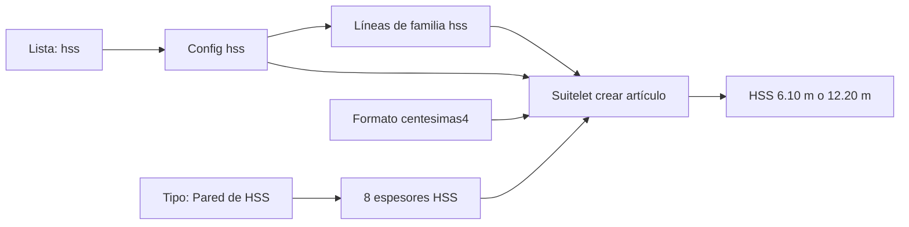

# Plan: Naturaleza Perfiles Estructurales Huecos (HSS) — v4

## 0. Control
| Campo | Valor |
|---|---|
| Fecha | 2026-11-26 |
| Versión | v4 |
| Estado | En revisión; sin decisiones bloqueantes |
| Solicitante | Costeos, Almetal |
| Entidades afectadas | Supuesto: mismas subsidiarias que las naturalezas vigentes |

Historial de cambios:
- v1 (2026-11-26): estructura y decisiones abiertas sin listado.
- v2 (2026-11-26): análisis del listado de 72 artículos HSS (búsqueda guardada 4978); patrones definidos; formato nuevo `centesimas4`; tipo de espesor nuevo; hallazgos de datos.
- v3 (2026-11-26): familias FAM 025 / FAM 026 y margen HSS con scriptids del usuario; E31E (10671) fuera de la naturaleza; creación de 6.10 m en el Suitelet; corrección de 6 artículos por CSV.
- v4 (2026-11-27): DA-06 cerrada; validación lado A ≥ lado B con el mecanismo existente `PARES_DE_LADOS` (D-18) del Suitelet.

## 1. Objetivo
Problema: HSS se vendía en pieza de 12.20 m y 6.10 m con la misma clave (`...1220`). Se requiere una clave por largo.
Resultado: el Suitelet `SADS_SL_crear_articulo_nat.js` crea artículos HSS de cualquier largo con código, nombre, familias, precio base y datos de corte.
Métrica: la configuración reproduce código, nombre y familia de 71 de 71 artículos en alcance (72 menos 10671) una vez corregidas las 6 anomalías de la sección 3.2; la prueba Jest lo verifica.

## 2. Alcance
| Incluye | No incluye |
|---|---|
| Valor de lista `hss`, tipo de espesor "Pared de HSS", 8 espesores, instancia de configuración, líneas de familia | HSS redondo; 10671 (`5/16"E`, E31E) queda como artículo manual |
| Formato de patrón nuevo `centesimas4` en el dominio (AD-05) | Creación masiva: las ~70 piezas de 6.10 m se crean una por una en el Suitelet (DA-08) |
| Prueba Jest de reproducción contra el listado | Alta de valores en `customlist_familias_de_corte` (D-28); se usan los existentes |
| CSV para completar naturaleza y parámetros de 71 artículos y corregir 10717, 41233, 10722, 10679, 10725, 10826 | Cambios a fórmulas de precio de la cuenta |
| README (1.1, 2.1) y guía funcional | |

## 3. Situación actual
### 3.1 Repositorio (verificado)
| Hecho | Fuente |
|---|---|
| Una naturaleza es configuración (AD-02). | README |
| `entero2` escribe 1–99 con dos dígitos (4 → `04`). | `domain/SADS_naturaleza_patron.js:21` |
| `decimal2` escribe 2 decimales (12.2 → `12.20`). | `domain/SADS_naturaleza_patron.js:22` |
| `centesimas3` admite 0.01–9.99 en 3 dígitos; 12.20 m no cabe. | `domain/SADS_naturaleza_patron.js:46` |
| No existe un formato que escriba 12.20 → `1220` y 6.10 → `0610`. | `FORMATOS` en el mismo archivo |
| El tipo "Pared de PTR" ya tiene E12, E18, E25, E31, E37, E50 con texto `1/4''` (dos apóstrofos); no tiene E62 ni E75. | `customrecord_sads_espesor.xml` |
| El duplicado se busca por `custitem_sads_naturaleza_producto` y los valores de los parámetros, no por código. | `SADS_SL_crear_articulo_nat.js:144` |
| La familia de corte se elige en el paso 2 entre las marcadas en la naturaleza; sin familias no crea (RN6-02). | README 2.2 |
| Valor de unidades = producto de `valor_unid`; PTR usa el largo. | README 2.2 |

### 3.2 Listado de artículos HSS (72 filas, verificado con script)
| Dato | Valor |
|---|---|
| Artículos | 71 de 12.20 m y 1 de 6.10 m (41233, HSS 16"x16"x1/2") |
| Secciones | 21: 4x4, 5x5, 6x4, 6x6, 8x3, 8x4, 8x6, 8x8, 10x4, 10x6, 10x10, 12x6, 12x8, 12x12, 14x6, 14x10, 14x14, 16x8, 16x12, 16x16, 18x18 |
| Lados | Enteros de 3 a 18; lado A ≥ lado B en las 72 filas |
| Espesores | E12 (1), E18 (9), E25 (13), E31 (15), E31E (1), E37 (15), E50 (13), E62 (4), E75 (1) |
| Valor de unidad | Igual al largo en las 72 filas |
| Familia de corte | Una por sección y espesor, con texto `HSS 4"x4"x1/4"`; el 6.10 m comparte la del 12.20 m |
| Familias de precio y margen | No vienen en el listado |

Resultado de aplicar los patrones de 5.2 a las 72 filas:
| ID interno | Actual | Generado | Tipo |
|---|---|---|---|
| 10717 | `HSS1616E0501220` | `HSS1616E501220` | Código con `E050` |
| 41233 | `HSS1616E0500610` | `HSS1616E500610` | Código con `E050` |
| 10722 | `HSS 6"x4"x3/8'' a 12.20m` | `HSS 6"x4"x3/8" a 12.20m` | Apóstrofos dobles |
| 10679 | `HSS 12"x8"x1/4'' a 12.20m` | `HSS 12"x8"x1/4" a 12.20m` | Apóstrofos dobles |
| 10725 | `HSS 6"x 6"x1/4" a 12.20m` | `HSS 6"x6"x1/4" a 12.20m` | Espacio |
| 10826 | `HSS 14"x10x5/16" a 12.20m` | `HSS 14"x10"x5/16" a 12.20m` | Falta `"` |

Códigos: 70 de 72 coinciden. Nombres: 68 de 72 coinciden.
10671 (`HSS1006E31E1220`, `5/16"E`) queda fuera de la naturaleza (DA-07).

## 4. Arquitectura de la solución
| Componente | Tipo | ID propuesto | Responsabilidad |
|---|---|---|---|
| Valor de naturaleza | Valor de lista | `customlist_sads_naturaleza_productos.val_sads_natlist_hss` ("Perfiles Estructurales Huecos (HSS)") | Identificar HSS |
| Tipo de espesor | Valor de lista | `customlist_sads_tipo_espesor.val_sads_tesp_hss` ("Pared de HSS") | Aislar el catálogo HSS |
| Espesores | 8 instancias | `val_sads_esp_hss_e12` … `val_sads_esp_hss_e75` | Texto, código y orden |
| Configuración | Instancia | `val_sads_nat_config_record_hss` | Parámetros, plantilla, patrones |
| Familias | Instancias | `val_sads_espesor_config_hss_<n>` | Rango espesor × lado A → familia de precio y margen |
| Formato `centesimas4` | Cambio de dominio | `domain/SADS_naturaleza_patron.js` | Escribir el largo en el código |
| Prueba | Jest | `__tests__/SADS_naturaleza_hss.test.js` | Reproducir código, nombre y familia |

Justificación: sin script nuevo; los cinco scripts leen la configuración. El único cambio de código es un formato, que AD-05 prevé.
Tipo de espesor nuevo en lugar de reutilizar "Pared de PTR": el texto de PTR (`1/4''`) no reproduce los nombres HSS (`1/4"`), y agregar E62/E75 a PTR los ofrecería en cuatro naturalezas de PTR.

### 4.1 Nivel de arquitectura
Nivel 0 para la naturaleza (configuración).
El formato `centesimas4` extiende un módulo de dominio existente sin `N/` (nivel 1 ya vigente en el proyecto). No se crean capas ni puertos.

### 4.2 Casos de uso y puertos
No aplica: se reutiliza el caso de uso "crear artículo por naturaleza".

### 4.3 Patrones de diseño
No aplica: el formato se agrega a la tabla de formateadores existente (`FORMATEADORES`), que ya funciona como Strategy.

### 4.4 Archivos afectados
| Archivo | Cambio |
|---|---|
| `src/FileCabinet/.../domain/SADS_naturaleza_patron.js` | Formato `centesimas4` |
| `src/Objects/Config/customlist_sads_naturaleza_productos.xml` | Valor `hss` |
| `src/Objects/Config/customlist_sads_tipo_espesor.xml` | Valor `hss` |
| `src/Objects/Config/customrecord_sads_espesor.xml` | 8 instancias |
| `src/Objects/Config/customrecord_sads_naturaleza_productos.xml` | Instancia `hss` |
| `src/Objects/Config/customrecord_sads_nat_familia.xml` | 2 líneas de familia (5.5) |
| `src/manifest.xml` | 3 dependencias DRT nuevas (5.5) |
| `__tests__/SADS_naturaleza_patron.test.js`, `__tests__/SADS_naturaleza_hss.test.js`, `__tests__/SADS_objetos_portables.test.js` | Pruebas |

## 5. Modelo de datos
### 5.1 Campos existentes reutilizados
| Registro | Campo | Uso | Estado |
|---|---|---|---|
| Artículo | `custitem_sads_nat_ptr_lado` | Lado A (pulgadas) | Verificado en repo (DA-01) |
| Artículo | `custitem_sads_nat_ptr_lado_b` | Lado B (pulgadas) | Verificado en repo (DA-01) |
| Artículo | `custitem_sads_nat_ptr_largo` | Largo (metros) | Verificado en repo (DA-01) |
| Artículo | `custitem_sads_nat_espesor` | Espesor del catálogo | Verificado en repo |
| Artículo | `custitem_famili_de_corte_item`, `custitem_value_per_units`, `custitemalm_articulo_espesor`, `custitem_alm_corte` | Datos de corte | Verificado en README |

### 5.2 Configuración `val_sads_nat_config_record_hss`
| Campo | Valor | Estado |
|---|---|---|
| `lista` | `val_sads_natlist_hss` | Propuesto |
| `config` | `["custitem_sads_nat_ptr_lado","custitem_sads_nat_ptr_lado_b","custitem_sads_nat_ptr_largo","custitem_sads_nat_espesor"]` | Propuesto |
| `plantilla` | 41233 | Supuesto (DA-02): único HSS de 6.10 m |
| `patron_cod` | `HSS{custitem_sads_nat_ptr_lado:entero2}{custitem_sads_nat_ptr_lado_b:entero2}{custitem_sads_nat_espesor:codigo}{custitem_sads_nat_ptr_largo:centesimas4}` | Verificado contra 70/72 filas |
| `patron_nom` | `HSS {custitem_sads_nat_ptr_lado}"x{custitem_sads_nat_ptr_lado_b}"x{custitem_sads_nat_espesor:texto} a {custitem_sads_nat_ptr_largo:decimal2}m` | Verificado contra 68/72 filas |
| `tipo_esp` | `val_sads_tesp_hss` | Propuesto |
| `campo_med` | `custitem_sads_nat_ptr_lado` | Definido (5.5) |
| `mapa_med` | F | Lados enteros capturados; el mapa es de PTR |
| `valor_unid` | `["custitem_sads_nat_ptr_largo"]` | Verificado: valor de unidad = largo en 72/72 |
| `fam_corte` | Las familias `HSS <a>"x<b>"x<esp>"` de los 71 artículos en alcance (70 valores distintos; 41233 comparte con 10717) | Supuesto: existen en `customlist_familias_de_corte`; se marcan en la cuenta (README §8) |

### 5.3 Espesores "Pared de HSS"
| scriptid | Código | Texto | Nombre | Orden |
|---|---|---|---|---|
| `val_sads_esp_hss_e12` | E12 | `1/8"` | `1/8" - HSS` | .125 |
| `val_sads_esp_hss_e18` | E18 | `3/16"` | `3/16" - HSS` | .1875 |
| `val_sads_esp_hss_e25` | E25 | `1/4"` | `1/4" - HSS` | .25 |
| `val_sads_esp_hss_e31` | E31 | `5/16"` | `5/16" - HSS` | .3125 |
| `val_sads_esp_hss_e37` | E37 | `3/8"` | `3/8" - HSS` | .375 |
| `val_sads_esp_hss_e50` | E50 | `1/2"` | `1/2" - HSS` | .5 |
| `val_sads_esp_hss_e62` | E62 | `5/8"` | `5/8" - HSS` | .625 |
| `val_sads_esp_hss_e75` | E75 | `3/4"` | `3/4" - HSS` | .75 |
Orden igual al de los E-códigos de PTR (fracción exacta en decimal).
E31E excluido (DA-07).

### 5.4 Formato nuevo `centesimas4`
| Atributo | Regla |
|---|---|
| Entrada | Número de 0.01 a 99.99 con máximo 2 decimales |
| Salida | Centésimas enteras con 4 dígitos y ceros a la izquierda: 12.2 → `1220`; 6.1 → `0610`; 3 → `0300` |
| Fuera de formato | Más de 2 decimales, ≤ 0 o > 99.99 → null; el Suitelet muestra el error de captura existente |
| Mensaje | `<etiqueta>: capture un número de 0.01 a 99.99 con máximo 2 decimales.` |
| Diferencia con `centesimas3` | `centesimas3` trunca; `centesimas4` rechaza decimales sobrantes para no generar claves ambiguas |
Se registra como decisión D-nueva en el README y en el comentario de `FORMATOS`.

### 5.5 Líneas de familia
Sin rango de espesor; rango de lado A inclusivo (`domain/SADS_naturaleza_familias.js:61`).
| scriptid | Medida desde | Medida hasta | Familia de precio | Familia de margen |
|---|---|---|---|---|
| `val_sads_espesor_config_hss_1` | 1 | 10 | FAM 025 - PTR HSS HASTA 10" `customrecord_pfp_famprecios.val_26690_5490848_sb1_301` | HSS `customrecord_pfp_fammargenes_.val_5420301_5490848_458` |
| `val_sads_espesor_config_hss_2` | 12 | 99 | FAM 026 - PTR HSS 12" EN ADELANTE `customrecord_pfp_famprecios.val_26691_5490848_sb1_988` | HSS `customrecord_pfp_fammargenes_.val_5420301_5490848_458` |

Lado A de 11" no tiene familia: `resolver` lanza SIN_FAMILIA y el Suitelet no crea.
La familia no depende del largo: aplica igual a 6.10 m y 12.20 m.
Los 3 scriptids se agregan como dependencias en `src/manifest.xml` y en la lista de `__tests__/SADS_objetos_portables.test.js`, igual que las familias DRT existentes.
Hecho declarado por el usuario: los 3 registros existen en sandbox y producción con el mismo scriptid.

## 6. Lógica por componente
| RN | Regla |
|---|---|
| RN-HSS-01 | El código es `HSS` + lado A (2 dígitos) + lado B (2 dígitos) + código de espesor + largo en centésimas (4 dígitos). |
| RN-HSS-02 | El nombre es `HSS <a>"x<b>"x<espesor> a <largo con 2 decimales>m`. |
| RN-HSS-03 | Lado A ≤ 10 → FAM 025; lado A ≥ 12 → FAM 026; margen HSS en ambos; sin dependencia del espesor ni del largo. |
| RN-HSS-04 | Lado A ≥ lado B; cuadrado cuando son iguales. El Suitelet rechaza en el paso 2 un lado B mayor que el lado A, con el par `{ menor: custitem_sads_nat_ptr_lado_b, mayor: custitem_sads_nat_ptr_lado }` en `PARES_DE_LADOS` (D-18). PTRR y MPPTRR también usan esos campos; no les afecta porque el mapa llena ambos lados antes de validar (`SADS_SL_crear_articulo_nat.js:1096`) y sus 24 filas cumplen mayor ≥ menor. |
| RN-HSS-05 | Valor de unidades = largo. |
| RN-HSS-06 | El largo admite máximo 2 decimales (formato `centesimas4`). |
| RN-HSS-07 | Las familias DRT usadas por HSS están en `manifest.xml` y en `SADS_objetos_portables.test.js`. |

## 7. Gobernanza
Sin cambio: el formato es cálculo en memoria.

## 8. Errores y bitácora
Sin cambio. `SADS_UE_naturaleza_config.js` valida el patrón al guardar con el mismo módulo de dominio; reconoce `centesimas4` en cuanto el formato exista en `FORMATOS`.

## 9. Seguridad
Sin cambio de roles.

## 10. Fiscal
No aplica directamente. La clave de producto SAT y la unidad se heredan de la plantilla 41233. Supuesto a validar: misma clave SAT para 6.10 m y 12.20 m.

## 11. Riesgos
| ID | Enunciado | Fundamento | Consecuencia | Mitigación |
|---|---|---|---|---|
| R-01 | Los 72 HSS existentes no tienen naturaleza ni parámetros capturados (supuesto: los campos `custitem_sads_*` son posteriores a su alta). | Búsqueda de duplicados por naturaleza + parámetros, `SADS_SL_crear_articulo_nat.js:144` | El Suitelet no detecta que 16"x16"x1/2" a 6.10 m ya existe (41233) y crea un duplicado. | CSV de actualización de los 72 artículos con naturaleza HSS, lados, largo y espesor antes de usar el Suitelet. |
| R-02 | Al asignar naturaleza HSS a los 72 artículos, los parámetros se vuelven obligatorios en CS y UE. | `SADS_CS/UE_item_dynamic_mandatory.js` | Una edición posterior sin parámetros se rechaza. | Cargar los cuatro parámetros en el mismo CSV. |
| R-03 | Códigos con `E050` (10717, 41233). | Sección 3.2 | Clave distinta a la que generaría el Suitelet; búsquedas por patrón inconsistentes. | Corregir `displayname` y `vendorname` en el mismo CSV. Validar antes referencias externas a esas claves. |
| R-05 | Familia de corte se elige a mano entre ~71 opciones. | README 2.2, RN6-02 | Elegir una familia que no corresponde a la sección. | Instrucción operativa; validación automática fuera de alcance. |
| R-06 | IDs internos (plantilla 41233, familias) difieren entre sandbox y producción. | README 7.1 | Configuración rota en un ambiente. | Verificar en ambas cuentas antes del deploy. |
| R-08 | Lado A de 11" sin familia. | Rangos 1–10 y 12–99 (5.5) | El Suitelet rechaza un HSS de 11". | Agregar una línea si llega a venderse esa medida. |
| R-09 | 10671 queda fuera de la naturaleza. | DA-07 | Capturar 10"x6" E31 genera `HSS1006E31…`, distinto de `HSS1006E31E1220`; no hay protección de duplicado entre ambos. | Instrucción operativa. |
| R-07 | Redeploy de la configuración sin descargarla borra familias de corte capturadas en UI. | README hallazgo RN6-05 | Suitelet no crea HSS. | Incluir `fam_corte` en el XML o descargar antes del deploy. |

## 12. Plan de pruebas
| Caso | RN | Capa | Entrada | Esperado | Tipo |
|---|---|---|---|---|---|
| P-01 | 06 | Dominio | 12.2, 6.1, 3, 99.99 con `centesimas4` | `1220`, `0610`, `0300`, `9999` | Feliz |
| P-02 | 06 | Dominio | 0, -1, 100, 6.125 | null | Error |
| P-03 | 01 | Dominio | 72 filas del listado (corregidas) | Código igual | Feliz |
| P-04 | 02 | Dominio | 72 filas (corregidas) | Nombre igual | Feliz |
| P-05 | 01 | Dominio | 16, 16, E50, 6.1 | `HSS1616E500610` | Feliz |
| P-06 | 03 | Dominio | Lado A 4, 10, 12, 18 | FAM 025, FAM 025, FAM 026, FAM 026; margen HSS | Feliz |
| P-07 | 03 | Dominio | Lado A 11 | Sin familia (SIN_FAMILIA) | Borde |
| P-08 | 07 | Dominio | `manifest.xml` | Familias HSS declaradas y portables | Feliz |
| P-09 | — | Dominio | Patrón HSS en `SADS_UE_naturaleza_config` | Patrón válido | Feliz |
| P-10 | — | Sandbox | 8"x4" E25 6.10 m | `HSS0804E250610`, `HSS 8"x4"x1/4" a 6.10m`, valor unidad 6.1, familia correcta | Integración |
| P-12 | 04 | Entry point (Jest) | HSS lado A 4, lado B 6 | Repite paso 2 con el mensaje de orden de lados; sin duplicado ni guardado | Error |
| P-13 | 04 | Entry point (Jest) | PTRR con medida del mapa | Sin cambio de comportamiento | Feliz |
| P-11 | R-01 | Sandbox | Crear 16"x16" E50 6.10 m tras el CSV | Rechazo por duplicado (41233) | Error |

## 13. Despliegue
| Paso | Acción |
|---|---|
| 1 | Sandbox: deploy de formato, listas, espesores, configuración y familias. |
| 2 | Sandbox: CSV de actualización de los 71 HSS en alcance (naturaleza, parámetros, códigos y nombres corregidos). |
| 3 | Sandbox: P-10 y P-11. |
| 4 | Producción: descargar configuración vigente, repetir pasos 1 y 2. |
| Reversión | Inactivar `val_sads_nat_config_record_hss`; el formato nuevo no afecta a otras naturalezas. |

## 14. Decisiones abiertas
| ID | Pregunta | Opciones | Recomendación | Bloqueante |
|---|---|---|---|---|
| DA-01 | Campos de lados y largo | Reutilizar `custitem_sads_nat_ptr_*` / crear `custitem_sads_nat_hss_*` | Reutilizar | No |
| DA-02 | Plantilla | 41233 (6.10 m) / un 12.20 m | 41233 | No |

Cerradas en v3:
| ID | Resolución |
|---|---|
| DA-05 | FAM 025 (lado A ≤ 10), FAM 026 (lado A ≥ 12), margen HSS (5.5) |
| DA-07 | E31E y 10671 fuera de la naturaleza |
| DA-08 | Suitelet, una por una |
| DA-09 | Corregir 10717, 41233, 10722, 10679, 10725, 10826 |
| DA-06 | Validar lado A ≥ lado B con `PARES_DE_LADOS` (v4, petición del usuario) |

## 15. Supuestos y fuentes
Supuestos:
1. Los 72 HSS no tienen capturados naturaleza ni parámetros.
2. Las familias de corte del listado existen como valores de `customlist_familias_de_corte`.
3. La plantilla 41233 es artículo de inventario.
4. La clave SAT y la unidad son las mismas para 6.10 m y 12.20 m.
5. No hay largos con más de 2 decimales.

Fuentes: búsqueda guardada de artículos 4978 (72 filas, 2026-11-26), verificada con script contra los patrones; respuestas del usuario del 2026-11-26 (familias, scriptids, E31E, modo de creación, correcciones); `domain/SADS_naturaleza_patron.js`; `SADS_SL_crear_articulo_nat.js`; `customrecord_sads_espesor.xml`; `customrecord_sads_naturaleza_productos.xml`; README.
Límite: ningún ID interno verificado en la cuenta (conector Netsuite Dev no disponible).
