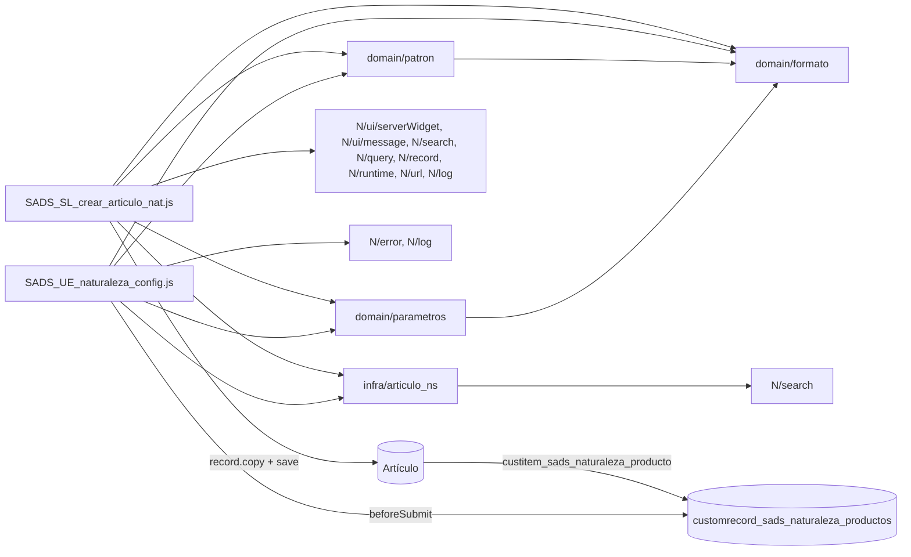
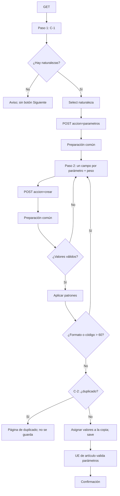

# Creador de artículos por naturaleza de producto

| Dato | Valor |
|---|---|
| Fecha de generación | 2026-11-13 (formatos: 2026-11-14; iteración B: 2026-11-18) |
| Iteración | B: espesor por catálogo, familias de precio y margen por rango, peso, conversión y descripciones; artículos inactivos hasta pasar P3-12 |
| Suitelet | `customscript_sads_sl_crear_articulo_nat` / `customdeploy_sads_sl_crear_articulo_nat` |
| User Events | `customscript_sads_ue_naturaleza_config` / `customdeploy_sads_ue_naturaleza_config`; `customscript_sads_ue_nat_familia` / `customdeploy_sads_ue_nat_familia` |
| Plataforma | SuiteScript 2.1, `@NModuleScope SameAccount` |
| Proyecto SDF | Account Customization "Naturaleza de Productos" (`src/manifest.xml`) |
| Diseño de origen | Iteración A: `planes/2026-11-12_creador-articulos-naturaleza_plan_v2.md` y `..._prompt_v2.md`. Iteración B: `planes/2026-11-17_creador-articulos-naturaleza_plan_v5.md` y `..._prompt_v3.md` |
| Método | Implementación y pruebas Jest sin cuenta NetSuite; los supuestos S-01 a S-16 y S3-01 a S3-11 siguen abiertos hasta probar en `Almetal_SB` |

## Contenido
1. [Resumen](#1-resumen)
2. [Arquitectura](#2-arquitectura)
3. [Flujo del Suitelet](#3-flujo-del-suitelet)
4. [Guía para usuarios técnicos](#4-guía-para-usuarios-técnicos)
4B. [Iteración B: espesores, familias, peso y conversión](#4b-iteración-b-espesores-familias-peso-y-conversión)
5. [Campos del formulario](#5-campos-del-formulario)
6. [Consultas SuiteQL](#6-consultas-suiteql)
7. [User Event de configuración](#7-user-event-de-configuración)
8. [Reglas de negocio](#8-reglas-de-negocio)
9. [Deployments, rol y permisos](#9-deployments-rol-y-permisos)
10. [Seguridad](#10-seguridad)
11. [Consideraciones fiscales](#11-consideraciones-fiscales)
12. [Despliegue](#12-despliegue)
13. [Supuestos](#13-supuestos)
14. [Riesgos](#14-riesgos)
15. [Troubleshooting y bitácora](#15-troubleshooting-y-bitácora)
16. [Pruebas](#16-pruebas)
17. [Desviaciones respecto del diseño](#17-desviaciones-respecto-del-diseño)
18. [Fuentes](#18-fuentes)

## 1. Resumen
Un usuario con permiso elige una naturaleza de producto, captura sus parámetros (placas: ancho, espesor, largo) y el peso.
El Suitelet copia el artículo plantilla de la naturaleza y crea el artículo nuevo.
El código (`itemid`) y el nombre (`displayname`) se generan con los patrones de la configuración.
El código de proveedor (`vendorname`) recibe el nombre generado; UPC y MPN quedan vacíos.
Iteración B: el espesor se elige de un catálogo; la familia de precio y la de margen se asignan por rango de espesor; peso y conversión se capturan; las descripciones de compra y venta reciben el nombre.
La cadena existente de campos fórmula y workflow calcula el precio a partir de la familia y la conversión (supuesto S3-05).
El artículo se crea inactivo hasta que P3-12 confirme el precio en sandbox (DA3-05).
Un User Event sobre el registro de configuración y otro sobre las familias por espesor impiden guardar configuraciones inválidas.

| Componente | Archivo | Tipo | Responsabilidad |
|---|---|---|---|
| Suitelet | `SADS_SL_crear_articulo_nat.js` | Suitelet 2.1 | Paso 1, paso 2, creación, duplicado y confirmación |
| UE de configuración | `SADS_UE_naturaleza_config.js` | UserEventScript 2.1 | `beforeSubmit` CREATE, EDIT y XEDIT; RN-12 a RN-17, RN3-08, RN3-09 |
| UE de familias | `SADS_UE_nat_familia.js` | UserEventScript 2.1 | `beforeSubmit` CREATE, EDIT y XEDIT del registro de familias; RN3-05 a RN3-07 |
| Familias | `domain/SADS_naturaleza_familias.js` | Módulo AMD sin `N/` | Validar rangos y resolver la familia de un espesor |
| Formato | `domain/SADS_naturaleza_config_formato.js` | Módulo AMD sin `N/` (existente) | Contrato del JSON y errores de dominio |
| Patrones | `domain/SADS_naturaleza_patron.js` | Módulo AMD sin `N/` | Extraer, validar y aplicar marcadores `{id}` |
| Parámetros | `domain/SADS_naturaleza_parametros.js` | Módulo AMD sin `N/` | IDs seguros, definición, valores capturados y criterios de duplicado |
| Adaptador | `infra/SADS_naturaleza_articulo_ns.js` | Módulo AMD con `N/search` | Tipo de registro de un artículo por ID interno |
| CS y UE de artículo | `SADS_CS_item_dynamic_mandatory.js`, `SADS_UE_item_dynamic_mandatory.js` | Existentes, sin cambios | Obligatoriedad de los parámetros en UI y servidor |

## 2. Arquitectura
Nivel 1: reglas puras en `domain/`; los entry points conservan el acceso a `N/` en funciones locales con nombre.
Solo cruzan hacia `domain/` objetos planos.
`infra/` solo importa `N/search`.



Estructura de archivos:
```
src/FileCabinet/SuiteScripts/SADS_Naturaleza_Productos/
├── SADS_CS_item_dynamic_mandatory.js
├── SADS_UE_item_dynamic_mandatory.js
├── SADS_SL_crear_articulo_nat.js
├── SADS_SL_crear_articulo_nat.md
├── SADS_UE_naturaleza_config.js
├── testt.js
├── infra/
│   └── SADS_naturaleza_articulo_ns.js
└── domain/
    ├── SADS_naturaleza_config_formato.js
    ├── SADS_naturaleza_patron.js
    └── SADS_naturaleza_parametros.js
```

## 3. Flujo del Suitelet



Despacho en `onRequest`:
| Solicitud | Resultado |
|---|---|
| GET | Paso 1 |
| POST con `custpage_accion` = `parametros` | Paso 2 |
| POST con `custpage_accion` = `crear` | Creación |
| POST con otra acción | Paso 1 |

Preparación común (paso 2 y creación, RN-11):
1. Recalcular C-1; `custpage_configuracion` debe cumplir `^[1-9][0-9]*$` y estar en C-1. Si no: paso 1 con "La naturaleza seleccionada no es válida o ya no está disponible."
2. `search.lookupFields` del JSON, la plantilla y los patrones; `formato.parsearConfiguracion`; `parametros.validarIds`.
3. Sin plantilla numérica o sin algún patrón: error de configuración incompleta.
4. `resolverTipoRegistroArticulo(plantilla)`; null: "El artículo plantilla de esta naturaleza no existe."
5. `record.copy` en modo estándar (`isDynamic: false`), una sola vez por solicitud (PT-02).
6. `describirParametros` con `getField` de la copia; `parametros.validarDefinicion` (RN-03, R-12).

Creación:
1. Leer `custpage_par_0` … `custpage_par_{n-1}` y `custpage_peso`; `parametros.validarValores`. Error: paso 2 con errores y valores previos.
2. `patron.validarFormatos` de ambos patrones: un valor que no cabe en el formato de su marcador regresa al paso 2 con mensaje (RN-17).
3. `patron.aplicar` del patrón de código y del de nombre. Código de más de 60 caracteres: paso 2 con mensaje.
4. `parametros.armarCriteriosDuplicado`; columnas verificadas contra el JSON; C-2. Con fila: página de duplicado y `log.audit`.
5. Sobre la copia: naturaleza, parámetros, `weight`, `itemid`, `displayname`, `vendorname` = nombre, `upccode` y `mpn` vacíos, `isinactive` = negación de `custscript_sads_sl_art_activo`.
6. `save({ ignoreMandatoryFields: false })`; `log.audit`; confirmación con código, nombre, estado y enlaces.

Gobernanza estimada (límite 1,000 unidades; costos de `record.copy` y `save`: supuesto S-05):
| Solicitud | Operaciones | Unidades |
|---|---|---|
| Paso 1 | C-1 | ~10 |
| Paso 2 | C-1 + `lookupFields` + búsqueda de tipo + `record.copy` | ~31 |
| Creación | Paso 2 + C-2 + `save` | ~61 |
| Duplicado | Paso 2 + C-2 + búsqueda de tipo | ~51 |
| UE de configuración | Búsqueda de tipo de la plantilla | ~10 |

## 4. Guía para usuarios técnicos
Los usuarios técnicos preparan cada naturaleza en la cuenta; el Suitelet no crea campos ni configuraciones.

1. Crear los campos `custitem` de los parámetros (por ejemplo ancho, largo y espesor de placa).
   Tipo Decimal o Entero; otro tipo es error de configuración (RN-03).
   Largo y ancho como Entero (D-15) y con `minvalue` 2 para imponer el mínimo de 2 pies (RN-04, supuesto S-08); espesor como Decimal.
   Aplicar los campos al tipo de artículo de la plantilla; un campo que no existe en la copia es error (R-12).
2. Elegir el artículo plantilla: un artículo existente cuya configuración contable, fiscal, de subsidiarias y de unidades sea correcta para la naturaleza (R-01).
3. En el registro "SADS - Naturaleza de Productos" capturar:
   | Campo | Contenido |
   |---|---|
   | Configuración de Campos Obligatorios | Arreglo JSON de IDs de los parámetros; solo minúsculas, dígitos y guion bajo (RN-13) |
   | Artículo Plantilla (ID interno) | ID interno numérico del artículo plantilla (D-12, RN-16) |
   | Patrón de Código | Texto con marcadores `{id}` o `{id:formato}` de los IDs del JSON |
   | Patrón de Nombre | Texto con marcadores `{id}` o `{id:formato}` de los IDs del JSON |
4. Requieren `LIST_ITEM` VIEW: el UE de configuración busca la plantilla con el rol del usuario técnico.
5. Recomendación: incluir todos los parámetros en el patrón de código para que la unicidad de `itemid` respalde la detección de duplicados (R-03).

### Cómo escribir un patrón
| Regla | Detalle |
|---|---|
| Marcador sin formato | `{id}`: escribe el valor en decimal, sin ceros a la derecha ni punto final (RN-07): 2.50 → `2.5`; 4 → `4`; 0.125 → `0.125`. |
| Marcador con formato | `{id:formato}` con un formato de la tabla siguiente (RN-17). |
| ID del marcador | Uno de los IDs del JSON, escrito igual: minúsculas, sin espacios (RN-15). |
| Texto fijo | Todo lo que está fuera de llaves se copia tal cual: letras, números, espacios, guiones, `x`, `'`, `"`, `/`. |
| Llaves | Solo para marcadores: no se admite `{}`, `{:formato}`, `{id:}`, una `{` sin cerrar ni una `}` suelta. |
| Resultado | Se recortan espacios al inicio y al final; el código no puede pasar de 60 caracteres (S-14). |

Formatos de marcador (RN-17):
| Formato | Regla | Ejemplos | El paso 2 rechaza |
|---|---|---|---|
| `centesimas3` | Centésimas de pulgada truncadas, 3 dígitos con ceros a la izquierda (D-13) | 0.5 → `050`; 0.375 → `037`; 0.1875 → `018`; 1.25 → `125` | Menos de 0.01 o 10 o más |
| `fraccion16` | Fracción de pulgada reducida, hasta dieciseisavos (D-14) | 0.5 → `1/2`; 0.1875 → `3/16`; 1 → `1`; 1.25 → `1 1/4` | Un valor que no es múltiplo de 1/16 |

Con espesores múltiplos de 1/16, `centesimas3` da un código distinto para cada uno (1/16 → `006` … 15/16 → `093`; 1 → `100`).

Ejemplo real de placa TA36 (IDs de campo ficticios):
| Campo | Valor |
|---|---|
| Configuración | `["custitem_pl_ancho","custitem_pl_espesor","custitem_pl_largo"]` |
| Patrón de código | `PLA36{custitem_pl_espesor:centesimas3}{custitem_pl_ancho}{custitem_pl_largo}` |
| Patrón de nombre | `Placa Acero TA36 {custitem_pl_espesor:fraccion16}'' {custitem_pl_ancho}'x{custitem_pl_largo}'` |
| Resultado con espesor 0.5, ancho 6, largo 20 | Código `PLA36050620`; nombre `Placa Acero TA36 1/2'' 6'x20'` |
| Resultado con espesor 0.375, ancho 4, largo 10 | Código `PLA36037410`; nombre `Placa Acero TA36 3/8'' 4'x10'` |

En el código los lados van pegados sin separador: capture siempre el ancho como el lado menor (R-15).

Unidades: largo y ancho en pies; espesor en pulgadas; el script no convierte unidades.
Sin plantilla, la configuración sigue funcionando para el CS y el UE de artículo, pero no aparece en el paso 1 (R-09).

## 4B. Iteración B: espesores, familias, peso y conversión
### Objetos nuevos
| Objeto | ID | Uso |
|---|---|---|
| Lista | `customlist_sads_tipo_espesor` | Fracción de pulgada, Calibre, Milímetros, Cédula |
| Registro | `customrecord_sads_espesor` ("SADS - Espesor") | Catálogo de espesores |
| Campo de artículo | `custitem_sads_nat_espesor` | SELECT al catálogo; compartido por todas las naturalezas |
| Campo de configuración | `custrecord_sads_naturaleza_tipo_esp` | Tipo de espesor de la naturaleza |
| Registro hijo | `customrecord_sads_nat_familia` ("SADS - Familia por Espesor") | Sublista de la configuración: familias por rango |
| User Event | `customscript_sads_ue_nat_familia` | Valida cada línea de familia |

Campos del espesor:
| Campo | ID | Regla |
|---|---|---|
| Nombre | `name` | Texto del select en el Suitelet, por ejemplo `1/2"`. |
| Tipo de Espesor | `custrecord_sads_esp_tipo` | Las naturalezas del mismo tipo ven los mismos espesores (RN3-01, DA3-04). |
| Texto para Nombre | `custrecord_sads_esp_texto` | Lo escribe `{id:texto}`, por ejemplo `1/2''`. |
| Segmento para Código | `custrecord_sads_esp_codigo` | Lo escribe `{id:codigo}`, por ejemplo `050`. Único por tipo (RN3-03). |
| Orden (grosor) | `custrecord_sads_esp_orden` | Grosor equivalente; define los rangos. Fracciones: pulgadas decimales. Milímetros: el número. Calibres: grosor en mm (S3-04). Cédulas: número. |

Familias por rango (sublista de la configuración):
| Campo | ID | Regla |
|---|---|---|
| Espesor Desde | `custrecord_sads_natfam_desde` | Inclusivo; vacío junto con Hasta = familia única (RN3-05). |
| Espesor Hasta | `custrecord_sads_natfam_hasta` | Inclusivo; Desde ≤ Hasta; del tipo de la naturaleza (RN3-06). |
| Familia de Precio | `custrecord_sads_natfam_precio` | Se escribe en `custitem_pfp_famprecios_`. |
| Familia de Margen | `custrecord_sads_natfam_margen` | Se escribe en `custitem_pfp_fammargenes_`. |

### Configuración de placas
1. Capturar los espesores de placa con tipo "Fracción de pulgada":
   | Nombre | Texto | Código | Orden |
   |---|---|---|---|
   | 3/16" | 3/16'' | 018 | 0.1875 |
   | 1/2" | 1/2'' | 050 | 0.5 |
   | 5/8" | 5/8'' | 062 | 0.625 |
   | 3/4" | 3/4'' | 075 | 0.75 |
   | 1 1/2" | 1 1/2'' | 150 | 1.5 |
2. En la configuración de placas:
   | Campo | Valor |
   |---|---|
   | JSON | `["custitem_sads_nat_pla_lado_a","custitem_sads_nat_pla_lado_b","custitem_sads_nat_espesor"]` |
   | Tipo de Espesor | Fracción de pulgada |
   | Patrón de Código | `PLA36{custitem_sads_nat_espesor:codigo}{custitem_sads_nat_pla_lado_a}{custitem_sads_nat_pla_lado_b}` |
   | Patrón de Nombre | `Placa Acero TA36 {custitem_sads_nat_espesor:texto} {custitem_sads_nat_pla_lado_a}'x{custitem_sads_nat_pla_lado_b}'` |
3. En la sublista de familias: 3/16" a 5/8" → FAM68; 3/4" a 1 1/2" → FAM069, cada una con su familia de margen.
4. Resultado con 1/2", 6, 20: código `PLA36050620`; nombre, descripción de compra y de venta `Placa Acero TA36 1/2'' 6'x20'`; familia FAM68.

Una naturaleza sin espesor no lleva el campo en el JSON ni tipo de espesor, y tiene una sola línea de familia sin rango (RN3-07).
El marcador del espesor solo admite `:codigo` o `:texto`; `centesimas3` y `fraccion16` siguen disponibles para parámetros numéricos (RN3-09).
El campo anterior `custitem_sads_nat_pla_espesor` (decimal) deja de usarse en la configuración de placas (R3-06).

### Lo que escribe el Suitelet además de iteración A
| Campo del artículo | Valor | Regla |
|---|---|---|
| `custitem_sads_nat_espesor` | Espesor elegido | RN3-02 |
| `weight` y `custitem_drt_ci_precio_teorico` | Peso capturado (kg; el segundo es informativo) | RN3-10 |
| `custitem_alm_articulo_conversionunidad` | Conversión capturada, > 0 | RN3-11 |
| `custitem_pfp_famprecios_` y `custitem_pfp_fammargenes_` | Familias de la línea del rango | RN3-04 |
| `purchasedescription` y `salesdescription` | Nombre generado | RN3-12 |

Nuevos campos del formulario: el espesor es un SELECT obligatorio en `custpage_par_<n>`; `custpage_conversion` (FLOAT, obligatorio); la confirmación agrega `custpage_espesor_texto`, `custpage_familia_texto` y `custpage_conversion_texto`.

### Consultas nuevas
| ID | Tabla | Filtros | Uso |
|---|---|---|---|
| C-3 | `customrecord_sads_espesor` | Activos; tipo = `?`; orden por `custrecord_sads_esp_orden` | Catálogo del paso 2 |
| C-4 | `customrecord_sads_nat_familia` con dos LEFT JOIN a espesores | Activas; configuración = `?` | Resolver familia (Suitelet) |
| C-5 | Configuración padre y líneas hermanas activas (excluye la propia) | Configuración = `?`; `id <> ?` | UE de familias |
| C-6 | `customrecord_sads_espesor` | `id IN (?, ?)` | Orden y tipo de Desde y Hasta (UE de familias) |
Supuesto S3-11: columnas SuiteQL con el mismo nombre que su scriptid.
Gobernanza: paso 2 ~51 unidades; creación ~81 más el workflow; UE de familias ~30; límite 1,000.

## 5. Campos del formulario
| ID | Tipo | Paso | Uso |
|---|---|---|---|
| `custpage_configuracion` | SELECT obligatorio (paso 1) / TEXT HIDDEN (paso 2) | 1 y 2 | ID del registro de configuración |
| `custpage_accion` | TEXT HIDDEN | 1 y 2 | `parametros` / `crear` |
| `custpage_naturaleza_texto` | TEXT INLINE | 2 | Nombre de la configuración |
| `custpage_par_<n>` | FLOAT o INTEGER obligatorio | 2 | Valor del parámetro en la posición `n` del JSON |
| `custpage_peso` | FLOAT obligatorio | 2 | Peso; etiqueta "Peso (<unidad>)" |
| `custpage_codigo`, `custpage_nombre`, `custpage_estado` | TEXT INLINE | Confirmación y duplicado | Datos del artículo (el duplicado no muestra nombre) |
| `custpage_enlace_inicio` | INLINEHTML | 2, confirmación, duplicado, error | "Regresar" o "Crear otro" |
| `custpage_enlace_articulo` | INLINEHTML | Confirmación y duplicado | "Ver artículo" con `url.resolveRecord` |

Los campos de parámetro usan el índice del JSON, no el ID del `custitem`.
Etiqueta del peso (PT-11): `getText` de `weightunit`; si falla o viene vacío, mapa `UNIDADES_PESO_RESPALDO` (1 = lb, 2 = oz, 3 = kg, 4 = g; S-16); si tampoco, "Peso (unidad de la plantilla)".

## 6. Consultas SuiteQL
Ejecutadas con `query.runSuiteQL`; todo valor variable va como parámetro `?`.

### C-1. Configuraciones con plantilla (`SQL_CONFIGURACIONES`)
```sql
SELECT cfg.id AS id, cfg.name AS nombre
FROM customrecord_sads_naturaleza_productos cfg
WHERE cfg.isinactive = 'F'
  AND cfg.custrecord_sads_naturaleza_plantilla IS NOT NULL
ORDER BY cfg.name
```
Volumen esperado: decenas de filas. Supuesto S-01.

### C-2. Duplicado (armada en `buscarDuplicado`)
```sql
SELECT art.id AS id, art.itemid AS codigo, art.isinactive AS inactivo
FROM item art
WHERE art.custitem_sads_naturaleza_producto = ?
AND art.<id del parámetro 1> = ?
AND art.<id del parámetro n> = ?
ORDER BY art.id
```
Parámetros: ID de configuración y los valores en el orden del JSON.
Sin filtro de inactivos (RN-08).
Cada columna se usa solo si cumple `^[a-z0-9_]+$` y pertenece al JSON recalculado (R-04).
Supuesto S-02: las columnas `custitem_*` existen en la tabla `item`.

## 7. User Event de configuración
`beforeSubmit` en CREATE, EDIT y XEDIT; otros tipos terminan sin hacer nada.
En XEDIT, un campo enviado (`newRecord.getFields()`) se lee de `newRecord`; si no, de `oldRecord` (PT-07).

| Orden | Regla | Comportamiento |
|---|---|---|
| 1 | RN-12 | `formato.parsearConfiguracion`; si falla, solo ese mensaje |
| 2 | RN-13 | `parametros.validarIds`; un ID inseguro se cita por su posición |
| 3 | RN-16 | Con plantilla: `^[1-9][0-9]*$` y artículo existente según el adaptador |
| 4 | RN-14 | Con plantilla: ambos patrones obligatorios |
| 5 | RN-15, RN-17 | Con plantilla: `patron.validar` de cada patrón contra los IDs del JSON y los formatos |
| — | Sin plantilla | Los patrones se permiten sin validar |

Con errores: `error.create` con `name` `CONFIGURACION_NATURALEZA_INVALIDA`, mensaje "La configuración no es válida: " más los errores unidos por "; ", `notifyOff` true; sin `log.error`.
Error inesperado: `log.error` con detalle y se relanza el error original.

## 8. Reglas de negocio
| ID | Regla |
|---|---|
| RN-01 | El paso 1 ofrece solo registros de configuración activos con plantilla asignada. |
| RN-02 | Los parámetros de una naturaleza son los IDs del JSON de su configuración, en el orden del JSON. |
| RN-03 | Cada parámetro es obligatorio y su campo debe ser decimal o entero; otro tipo es error de configuración. |
| RN-04 | Cada valor de parámetro es un número finito mayor que 0, con punto decimal; no se aceptan comas ni texto. El mínimo de 2 pies de largo y ancho lo impone el `minvalue` del `custitem` (supuesto S-08). |
| RN-05 | El peso es obligatorio, numérico y mayor que 0; la unidad de peso se copia de la plantilla. |
| RN-06 | Código = patrón de código con cada `{id}` sustituido por el valor del parámetro; nombre = patrón de nombre igual. Se recorta el resultado; vacío es error. |
| RN-07 | Formato numérico en patrones sin formato de marcador: sin ceros a la derecha ni punto final (2.50 → 2.5; 4.0 → 4); punto decimal. |
| RN-08 | Si existe un artículo, activo o inactivo, con la misma naturaleza y valores iguales en todos los parámetros, no se crea y se muestra el existente. |
| RN-09 | El artículo nuevo es copia de la plantilla; el script solo escribe naturaleza, parámetros, peso, código, nombre, código de proveedor (= nombre), estado inactivo y (iteración B) precios, y deja vacíos UPC y MPN. |
| RN-10 | Con `custscript_sads_sl_art_activo` = F el artículo se crea inactivo; con T, activo. |
| RN-11 | Naturaleza, configuración, parámetros y plantilla se recalculan en cada POST; del formulario solo se toman el ID de configuración (entero validado contra C-1) y los valores capturados. |
| RN-12 | El JSON de configuración cumple el contrato de `formato.parsearConfiguracion`. |
| RN-13 | Cada ID del JSON cumple `^[a-z0-9_]+$`. |
| RN-14 | Si la configuración tiene plantilla, los dos patrones son obligatorios. |
| RN-15 | Cada marcador de un patrón es un ID del JSON; llaves sin cerrar o vacías son error. |
| RN-16 | Si la configuración tiene plantilla, su valor es un entero positivo que corresponde a un artículo existente. |
| RN-17 | Un marcador `{id:formato}` usa un formato de `FORMATOS` (`centesimas3`, `fraccion16`, `codigo`, `texto`); el UE rechaza otro formato y el Suitelet rechaza en el paso 2 un valor que no cabe en su formato (D-13, D-14). |
| RN3-01 | El catálogo de espesores de una naturaleza son los espesores activos del tipo de espesor de su configuración; naturalezas del mismo tipo ven los mismos espesores. |
| RN3-02 | El espesor del artículo se elige del catálogo de su naturaleza; un ID fuera del catálogo se rechaza. |
| RN3-03 | En un mismo tipo, código y orden de espesor son únicos (responsabilidad de los técnicos). |
| RN3-04 | Familia de precio y de margen del artículo = las de la única línea cuyo rango contiene el orden del espesor (inclusivo). |
| RN3-05 | Una línea sin Desde ni Hasta es familia única y debe ser la única línea activa; Desde y Hasta van juntos o ninguno. |
| RN3-06 | Rangos sin traslape; Desde ≤ Hasta por orden; ambos del tipo de espesor de la naturaleza. |
| RN3-07 | Si la naturaleza no usa espesor, se exige una sola línea de familia única. |
| RN3-08 | Si el JSON incluye `custitem_sads_nat_espesor`, la configuración requiere tipo de espesor. |
| RN3-09 | `{id:codigo}` y `{id:texto}` escriben el código y el texto del espesor elegido; solo aplican al campo de espesor, y el campo de espesor solo admite esos formatos. |
| RN3-10 | El peso capturado (kg) se escribe en `custitem_drt_ci_precio_teorico` (informativo) y en `weight`. |
| RN3-11 | La conversión de unidad de compra a base es obligatoria y > 0; se escribe en `custitem_alm_articulo_conversionunidad`. |
| RN3-12 | `purchasedescription` y `salesdescription` = nombre generado. |
| RN3-13 | Ningún otro campo se escribe; el resto viene de la plantilla. |

## 9. Deployments, rol y permisos
Suitelet (`customscript_sads_sl_crear_articulo_nat.xml`):
| Atributo | Valor |
|---|---|
| `status` / `isdeployed` | RELEASED / T |
| `isonline` | F |
| `runasrole` | Sin valor: corre con el rol del usuario |
| `allroles` / `allemployees` / `audslctrole` | F / F / vacío; la audiencia se define en la UI |
| `loglevel` | AUDIT |
| `title` | SADS - Crear Artículo por Naturaleza |
| `custscript_sads_sl_art_activo` | CHECKBOX, default F, "Crear artículos activos" |

User Event (`customscript_sads_ue_naturaleza_config.xml`):
| Atributo | Valor |
|---|---|
| `recordtype` | `[customrecord_sads_naturaleza_productos]` (supuesto S-07) |
| `status` / `isdeployed` | RELEASED / T |
| `allroles` / `allemployees` | T / T |
| `audsubsidiary` | Vacío: el registro de configuración no es por subsidiaria |
| `runasrole` | Sin valor: corre con el rol del usuario técnico |
| `executioncontext` | Igual al de los deployments de `customscript_sads_ue_item_dynamic_mandat.xml` |
| `loglevel` | AUDIT |

Permisos:
| Rol | Uso | Permisos mínimos | Estado |
|---|---|---|---|
| Roles de la audiencia del Suitelet | Ejecutan el Suitelet con su propio rol | `LIST_ITEM` CREATE; `LIST_CUSTRECORDENTRY` VIEW | Niveles supuestos |
| Usuarios técnicos | Crean configuraciones y campos `custitem` | `LIST_CUSTRECORDENTRY` CREATE o superior; `LIST_ITEM` VIEW (RN-16) | Supuesto |
| `customrole_sads_naturaleza_config_exec` | `runasrole` de los 6 deployments del UE de artículo | `LIST_CUSTRECORDENTRY` VIEW | Reducido; se quitaron `ADMI_CUSTITEMFIELD` y `LIST_ITEM` |

Sin `runasrole` en el Suitelet: un usuario sin permiso de crear artículos no crea aunque esté en la audiencia (P-19).
`REPO_ANALYTICS` solo si `N/query` da error de permisos en sandbox.
Las system notes del artículo registran al usuario real.

Patrón de URL:
```
/app/site/hosting/scriptlet.nl?script={ID interno del script}&deploy={ID interno del deployment}
```
Los IDs internos difieren entre sandbox y producción; la URL se copia del deployment en la UI.

## 10. Seguridad
| Control | Implementación |
|---|---|
| Entrada no confiable | ID de configuración entero validado contra C-1; valores numéricos con `^\d+(\.\d+)?$`; el resto se recalcula en cada POST (RN-11). |
| SQL | C-1 constante; C-2 con columnas validadas (`^[a-z0-9_]+$` y pertenencia al JSON) y valores como `?` (R-04). |
| Patrones | Sustitución literal con `split`/`join`; sin `eval`, `Function` ni expresiones regulares construidas con texto del patrón. |
| Escape de HTML | Título y mensaje de `addPageInitMessage`, etiquetas de parámetros y unidad de peso se escapan. INLINEHTML solo con URL resuelta por NetSuite (escapada) y texto fijo. |
| Errores | Todo error capturado va a `log.error`. La página muestra el mensaje solo si es error de dominio; cualquier otro muestra "No fue posible completar la operación. Contacte al administrador." Si también falla la URL del Suitelet, la página sale sin enlace. |
| Mensajes de validación | Un ID de campo se cita solo si cumple `^[a-z0-9_]+$`. |
| `isonline` | F: exige sesión de NetSuite. |
| Datos confidenciales | No aplica: no se manejan RFC, cuentas bancarias ni nómina. |

## 11. Consideraciones fiscales
| Obligación | Fundamento | Efecto en el diseño |
|---|---|---|
| Cada concepto del CFDI lleva `ClaveProdServ` y `ClaveUnidad` de los catálogos del SAT | Anexo 20, Guía de llenado del CFDI 4.0, nodo Concepto | El artículo nuevo hereda esas claves de la plantilla (R-01). |
| Cada mercancía del Complemento Carta Porte lleva `PesoEnKg` | Guía de llenado del Complemento Carta Porte, nodo Mercancia | Si la localización toma `weight` del artículo, un peso erróneo pasa al complemento (R-06, S-12). |
El diseño no afirma cumplimiento; solo copia la configuración fiscal de la plantilla.

## 12. Despliegue
Iteración A (sandbox `Almetal_SB`):
1. `npm install` y `npm test` en verde; `suitecloud.config.js` repite las pruebas antes de `project:deploy`.
2. `project:deploy`: registro de configuración modificado, rol reducido, Suitelet y UE nuevos con sus deployments, `custscript_sads_sl_art_activo` = F.
3. En la cuenta: inactivar el script `customscript_sads_sl_naturaleza_config` y su deployment `customdeploy_sads_sl_naturaleza_config`; borrar o inactivar el campo `custrecord_sads_naturaleza_tipo_art` y la lista `customlist_sads_tipos_articulo` (S-10, R-08).
4. Usuarios técnicos: crear los `custitem` de parámetros de placa (largo y ancho con `minvalue` 2), elegir el artículo plantilla y capturar JSON, ID interno y patrones (sección 4).
5. Configurar la audiencia del Suitelet (roles con `LIST_ITEM` CREATE y `LIST_CUSTRECORDENTRY` VIEW).
6. Ejecutar P-14, P-15, P-19, P-20 y P-21; confirmar S-01 a S-16 (S-06 retirado).

Iteración B (sandbox `Almetal_SB`):
1. `npm test` en verde; `project:deploy` (lista de tipos, registro de espesores, campo `custitem_sads_nat_espesor`, registro de familias, campo de tipo en la configuración, UE de familias).
2. Si `project:validate` rechaza las referencias a `customrecord_pfp_famprecios` o `customrecord_pfp_fammargenes_`, importarlos al proyecto (`object:import`) antes de desplegar.
3. Técnicos: capturar espesores y familias de placas; actualizar la configuración de placas (sección 4B).
4. Revisar que el workflow de precios se ejecute en la creación desde script (R3-01).
5. Inactivar o borrar los artículos de prueba de iteración A (R3-06).
6. Ejecutar P3-12 y P3-15; con P3-12 aprobado, cambiar `custscript_sads_sl_art_activo` a T en el deployment (sin código).
Producción: después de sandbox; re-aplicar la audiencia después de cada despliegue (R-10); capturar espesores y familias (los IDs internos difieren entre cuentas).
Reversión: configuración de placas con JSON y patrones de iteración A; inactivar `customdeploy_sads_ue_nat_familia`; deployment del Suitelet a inactivo; los artículos creados se inactivan a mano.

## 13. Supuestos
| ID | Supuesto | Cómo se confirma |
|---|---|---|
| S-01 | Columnas SuiteQL `id`, `name`, `isinactive` y `custrecord_sads_naturaleza_plantilla` del registro de configuración. | Paso 1 en sandbox |
| S-02 | Columnas `custitem_*` disponibles en la tabla `item` de SuiteQL. | Creación y duplicado en sandbox |
| S-03 | `getField` de la copia expone etiqueta y tipo; valores `float` e `integer` de `Field.type`. | Paso 2 en sandbox |
| S-04 | IDs `itemid`, `displayname`, `weight`, `weightunit`, `isinactive` válidos en `inventoryitem`. | P-14 |
| S-05 | Costos de gobernanza de `record.copy` y `save` del artículo. | Execution Log |
| S-06 | Retirado (D-12: la plantilla es un ID interno). | — |
| S-07 | `recordtype` del deployment del UE como `[customrecord_sads_naturaleza_productos]`. | `project:validate` |
| S-08 | `minvalue` del `custitem` se aplica en `save` desde script. | P-15 |
| S-09 | NetSuite rechaza un `itemid` repetido. | Prueba manual |
| S-10 | SDF no borra campos ni listas retirados del proyecto. | Paso 3 de despliegue |
| S-11 | `record.copy` funciona con una plantilla inactiva. | Prueba manual |
| S-12 | La localización usa `weight` del artículo para Carta Porte. | Validar con fiscal |
| S-13 | `result.recordType` de una búsqueda de ITEM devuelve el tipo de registro programable (por ejemplo, `inventoryitem`). | Paso 2 en sandbox |
| S-14 | Longitud máxima de `itemid` de 60 caracteres. | Prueba manual |
| S-15 | `vendorname` existe como campo de cuerpo; con la función de múltiples proveedores el código vive en la sublista de proveedores. | P-14 |
| S-16 | Mapa de respaldo de `weightunit`: 1 = lb, 2 = oz, 3 = kg, 4 = g. | Paso 2 en sandbox |
| S3-01 | `purchasedescription` y `salesdescription` existen en `inventoryitem` y aceptan el nombre generado. | P3-15 |
| S3-02 | `custitem_drt_ci_precio_teorico` es decimal. | P3-12 |
| S3-03 | `custitem_alm_articulo_conversionunidad` es decimal. | P3-12 |
| S3-04 | Orden de calibres = grosor nominal en mm. | Captura de catálogo |
| S3-05 | El workflow de precios se ejecuta en la creación desde Suitelet. | P3-12 |
| S3-06 | El parámetro de catálogo se identifica por el ID `custitem_sads_nat_espesor`. | Paso 2 en sandbox |
| S3-07 | El UE de configuración no ve las líneas del registro hijo. | Captura de familias |
| S3-08 | La audiencia del Suitelet tiene VIEW sobre familias de precio y de margen. | Creación en sandbox |
| S3-09 | El UE del registro hijo se ejecuta al guardar líneas desde la sublista del padre. | Captura de familias con traslape |
| S3-10 | `allowinlineediting` T permite editar las líneas desde la sublista del padre. | Captura de familias |
| S3-11 | Columnas SuiteQL de los registros nuevos con nombre igual a su scriptid. | Paso 2 en sandbox |

## 14. Riesgos
| ID | Enunciado | Consecuencia | Mitigación |
|---|---|---|---|
| R-01 | El artículo nuevo hereda las claves SAT de la plantilla (`ClaveProdServ`, `ClaveUnidad`; Anexo 20 CFDI 4.0). | Una clave errónea se replica en cada artículo y en los CFDI que lo facturen. | Revisión fiscal de cada plantilla; P-14. |
| R-02 | En iteración A el artículo conserva los precios de la plantilla. | Venta a precio de otra medida. | Crear inactivo (RN-10); no liberar a producción antes de B. |
| R-03 | Dos usuarios crean la misma medida a la vez, o C-2 no detecta un duplicado al comparar decimales por igualdad. | Duplicado si el código difiere. | Patrón de código con todos los parámetros; unicidad de `itemid` (S-09). |
| R-04 | Los nombres de columna de C-2 vienen del JSON capturado a mano. | Inyección SuiteQL. | RN-13 en el UE y validación repetida en el Suitelet. |
| R-05 | El espesor aparece como decimal (0.25 y no 1/4"). | Nombre poco familiar para ventas. | Cambio aislado en `patron.formatearNumero`. |
| R-06 | Peso capturado a mano. | Peso erróneo en el artículo y, si aplica, en Carta Porte (S-12). | Validación > 0; cálculo automático posterior. |
| R-07 | El mínimo de 2 pies depende de `minvalue` del `custitem` (S-08). | Medidas menores a 2 pies si no se aplica. | P-15; si falla, mínimos en la configuración en plan v3. |
| R-08 | El campo retirado `custrecord_sads_naturaleza_tipo_art` sigue en la cuenta como obligatorio (S-10). | Usuarios técnicos obligados a capturarlo. | Paso 3 de despliegue. |
| R-09 | Registros de configuración existentes sin plantilla. | No aparecen en el paso 1; CS/UE siguen funcionando. | Comportamiento esperado. |
| R-10 | `project:deploy` vacía la audiencia del Suitelet. | Usuarios sin acceso. | Re-aplicar audiencia. |
| R-11 | La plantilla puede ser de un tipo cuyo deployment del UE de artículo está en TESTING. | El UE no valida para otros usuarios. | El Suitelet valida RN-03 a RN-05 antes de guardar. |
| R-12 | Un parámetro no aplica al tipo de la plantilla. | El campo no existe en la copia. | Error de configuración con el ID del campo (P-12). |
| R-13 | La copia hereda datos de proveedor de la plantilla (UPC, MPN, código de proveedor). | Códigos que no corresponden al artículo procesado. | `vendorname` = nombre; `upccode` y `mpn` vacíos (RN-09); P-14. |
| R-14 | El ID de la plantilla se captura a mano (D-12). | Un ID de otro artículo existente pasa RN-16 y se copia el artículo equivocado. | P-14; los técnicos verifican el ID al capturarlo. |
| R-15 | En el código TA36 los lados van pegados sin separador (D-15): `2'x12'` y `21'x2'` producen `212`. | Dos medidas distintas con el mismo código; `save` falla por `itemid` repetido (S-09) y el usuario ve el mensaje genérico. | Capturar siempre el ancho como el lado menor; C-2 compara valores, no códigos. |
| R3-01 | El workflow de precios podría no ejecutarse cuando el artículo lo crea un script. | Artículo con el precio de la plantilla. | P3-12; revisar contexto del workflow; artículos inactivos hasta pasar P3-12. |
| R3-03 | Rangos que no cubren un espesor del catálogo. | El Suitelet rechaza ese espesor. | Mensaje claro; los técnicos cubren todo el catálogo. |
| R3-05 | Conversión capturada a mano. | Precio erróneo propagado por la cadena. | Validación > 0; la confirmación muestra el valor; cálculo automático posterior (DA3-06). |
| R3-06 | Artículos de placa de iteración A usan `custitem_sads_nat_pla_espesor`. | La búsqueda de duplicados no los detecta. | Inactivar o migrar antes de liberar. |
| R3-07 | Orden de calibres mal capturado. | Rangos invertidos. | Orden = grosor en mm. |
| R3-08 | El peso se rotula con la unidad de la plantilla, pero `custitem_drt_ci_precio_teorico` es en kg. | Con una plantilla en otra unidad, el peso informativo queda en otra unidad. | Plantillas con unidad de peso kg. |

## 15. Troubleshooting y bitácora
| Síntoma | Causa probable | Solución |
|---|---|---|
| Los usuarios no pueden abrir el Suitelet después de un despliegue. | `project:deploy` dejó la audiencia vacía (R-10). | Re-aplicar la audiencia del deployment en la UI. |
| Paso 1: "No hay naturalezas con artículo plantilla configurado." | Ninguna configuración activa tiene plantilla (R-09). | Capturar el ID interno de la plantilla en la configuración. |
| Paso 1: "La naturaleza seleccionada no es válida o ya no está disponible." | La configuración se inactivó o perdió la plantilla entre pasos; o el valor enviado no es un ID válido. | Elegir de nuevo. |
| Página genérica al abrir el paso 1. | C-1 falló: columna inexistente (S-01) o permiso de `N/query`. | Revisar el log "error inesperado"; agregar `REPO_ANALYTICS` solo si el error es de permisos. |
| "La configuración de esta naturaleza está incompleta…" | Falta un patrón o la plantilla no es numérica. | Completar la configuración; el UE debió impedirlo si se guardó antes de desplegarlo. |
| "El artículo plantilla de esta naturaleza no existe." | El ID capturado no corresponde a un artículo (R-14) o la búsqueda no devuelve `recordType` (S-13). | Corregir el ID; si el artículo existe, revisar S-13. |
| "El campo … no existe en el artículo plantilla." | El `custitem` no aplica al tipo de la plantilla (R-12). | Aplicar el campo al tipo de artículo o cambiar la plantilla. |
| "El campo … no es decimal ni entero." | El `custitem` es de otro tipo (RN-03) o el valor de `Field.type` difiere (S-03). | Cambiar el tipo del campo; si es decimal, revisar S-03 y `TIPOS_SOPORTADOS`. |
| Etiqueta "Peso (unidad de la plantilla)". | `getText` sin texto y valor de `weightunit` fuera del mapa (S-16). | Ajustar `UNIDADES_PESO_RESPALDO` con los IDs reales de la cuenta. |
| "El código generado excede 60 caracteres…" | Patrón de código largo (S-14). | Acortar el patrón de código. |
| Paso 2: "<Campo>: el valor no corresponde a una fracción de 1/16 de pulgada." | El patrón usa `fraccion16` y el valor no es múltiplo de 1/16 (D-14). | Capturar el espesor exacto en decimal: 1/4 = 0.25; 3/8 = 0.375; 3/16 = 0.1875. |
| Paso 2: "<Campo>: el valor no cabe en 3 dígitos de centésimas…" | El patrón usa `centesimas3` y el valor es menor que 0.01 o de 10 o más (D-13). | Revisar la captura. |
| `CONFIGURACION_NATURALEZA_INVALIDA`: "El formato … no existe." | Formato mal escrito en un marcador (RN-17). | Usar `centesimas3` o `fraccion16`, en minúsculas. |
| Página de error: "El valor del marcador {…} no cabe en el formato …". | Defensa de `patron.aplicar`; no debería ocurrir porque el paso 2 lo valida antes. | Revisar el log "error de dominio". |
| Página de duplicado con un artículo que no es igual. | C-2 compara igualdad de valores; no compara otros campos. | Revisar los parámetros del artículo existente. |
| Página genérica al crear. | `save` rechazó: `minvalue` (P-15), `itemid` repetido (S-09), `MISSING_DYNAMIC_MANDATORY_FIELDS` o permiso. | Revisar el log "error inesperado" del deployment del Suitelet. |
| `CONFIGURACION_NATURALEZA_INVALIDA` al guardar una configuración. | Violación de RN-12 a RN-17 (sección 7). | Corregir los campos citados en el mensaje. |
| "El artículo plantilla N no existe." con un ID correcto. | El usuario técnico no tiene `LIST_ITEM` VIEW. | Otorgar el permiso. |
| `project:validate` rechaza `recordtype` del UE. | S-07 no se cumple. | Cambiar a `[scriptid=customrecord_sads_naturaleza_productos]` y volver a validar. |

Bitácora:
| Script | Nivel | Título | Cuándo |
|---|---|---|---|
| Suitelet | AUDIT | Crear artículo por naturaleza: artículo creado | Alta: ID, código, configuración y estado |
| Suitelet | AUDIT | Crear artículo por naturaleza: duplicado | Duplicado: configuración, ID y código del existente |
| Suitelet | ERROR | Crear artículo por naturaleza: error de dominio | Error de dominio capturado en `onRequest` |
| Suitelet | ERROR | Crear artículo por naturaleza: error inesperado | Consulta, `record.copy`, `save` u otro |
| UE de configuración | ERROR | Validación de configuración de naturaleza: error inesperado | Error no previsto; se relanza |
| UE de familias | ERROR | Validación de familia por espesor: error inesperado | Error no previsto; se relanza |

Mensajes de iteración B:
| Mensaje | Causa | Solución |
|---|---|---|
| "La naturaleza usa espesor pero no tiene tipo de espesor." | JSON con `custitem_sads_nat_espesor` sin Tipo de Espesor. | Capturar el tipo en la configuración (RN3-08). |
| "No hay espesores activos para el tipo de esta naturaleza." | Catálogo vacío o inactivo. | Capturar espesores del tipo. |
| "La naturaleza no tiene familias de precio configuradas." | Sublista de familias vacía. | Capturar al menos una línea. |
| "No hay una familia de precios única para este espesor en la naturaleza." | Ningún rango contiene el espesor, o hay traslape, o una familia única junto con rangos. | Revisar la sublista de familias (RN3-04 a RN3-07). |
| Paso 2: "Espesor: elija un valor de la lista." | Espesor vacío o fuera del catálogo. | Elegir de la lista. |
| Paso 2: "Conversión unidad de compra a base: capture…" | Conversión vacía o ≤ 0. | Capturar la conversión. |
| `FAMILIA_NATURALEZA_INVALIDA` | Línea de familia con rango incompleto, invertido, de otro tipo o traslapado. | Corregir los campos citados. |
| `CONFIGURACION_NATURALEZA_INVALIDA`: "…es un catálogo y requiere el formato codigo o texto." | Marcador del espesor sin formato. | Usar `{custitem_sads_nat_espesor:codigo}` o `:texto`. |

Ver los logs: Customization > Scripting > Script Deployments > deployment > pestaña Execution Log; filtrar por Error o Audit.

## 16. Pruebas
Comando: `npm test` (no requiere cuenta NetSuite).
Resultado del 2026-11-18: 9 suites aprobadas de 9; 487 pruebas aprobadas de 487.

| Suite | Pruebas | Alcance |
|---|---|---|
| `SADS_naturaleza_patron.test.js` | 123 | P-01 a P-04; formatos `centesimas3`, `fraccion16`, `codigo`, `texto` (P3-09, P3-16); regla de dependencia |
| `SADS_naturaleza_parametros.test.js` | 77 | P-05 a P-08; catálogo y conversión (P3-08, P3-11); regla de dependencia |
| `SADS_naturaleza_familias.test.js` | 29 | P3-01 a P3-07; regla de dependencia |
| `SADS_naturaleza_articulo_ns.test.js` | 7 | Adaptador con y sin resultado |
| `SADS_SL_crear_articulo_nat.test.js` | 85 | P-09 a P-13, P-16, P-22; P3-08, P3-10, P3-11, P3-17, P3-18; estructura del entry point |
| `SADS_UE_naturaleza_config.test.js` | 43 | P-17, P-18; RN-17; P3-13, P3-16; errores inesperados |
| `SADS_UE_nat_familia.test.js` | 12 | P3-14, P3-19; RN3-07; errores inesperados |
| `SADS_naturaleza_config_formato.test.js` | 109 | Contrato del JSON (sin cambios) |
| `sample-test.js` | 2 | Plantilla de SuiteCloud |

Casos automatizados:
| Caso | Resultado |
|---|---|
| P-01 | Código `PL-0.25-4X2` y nombre `PLACA A36 0.25 IN 4 X 2 FT` |
| P-02 | 2.50 → `2.5`; 4.0 → `4`; 0.125 → `0.125` |
| P-03 | `{custitem_x`, `{}` y marcador fuera del JSON: `PATRON_INVALIDO` / `valido` false |
| P-04 | Patrón de solo espacios: `PATRON_INVALIDO` |
| P-05 | Solo `custitem_a` es seguro |
| P-06 | Solo `"4"` y `"4.5"` son válidos |
| P-07 | Peso vacío, 0 y negativo rechazados |
| P-08 | Criterios en orden del JSON |
| P-09 | Paso 1 con aviso, sin select ni botón |
| P-10 | Paso 1 con error; sin `lookupFields` ni `record.copy` |
| P-11 | Página de duplicado; `save` y `setValue` no llamados |
| P-12 | Página de error de configuración con el ID del campo |
| P-13 | Valores asignados, `vendorname` = nombre, UPC y MPN vacíos, `isinactive` T, `save` llamado, confirmación |
| P-16 | Mensaje genérico; texto crudo ausente; `log.error` llamado |
| P-17 | Rechazo en los seis casos inválidos; sin error en el válido |
| P-18 | XEDIT valida contra el JSON y la plantilla de `oldRecord` |
| P-22 | Unidad del mapa de respaldo o etiqueta genérica |

Pruebas en sandbox (las ejecuta el equipo):
| Caso | Entrada | Resultado esperado |
|---|---|---|
| P-14 | Alta de una placa | Cuentas, impuestos, claves SAT, subsidiarias y unidades iguales a la plantilla; `vendorname` = nombre; UPC y MPN vacíos |
| P-15 | Largo 1.5 con `minvalue` 2 en el campo | `save` rechaza; mensaje genérico; confirma S-08 |
| P-19 | Usuario en audiencia sin `LIST_ITEM` CREATE | No crea; mensaje genérico |
| P-20 | Re-despliegue | Audiencia vacía; se re-aplica |
| P-21 | Artículo creado abierto en la UI | El CS marca los parámetros como obligatorios |

`suitecloud project:validate` no se ejecutó: el entorno de desarrollo no tiene cuenta configurada. S-07 queda abierto.

## 17. Desviaciones respecto del diseño
| Punto | Decisión | Motivo |
|---|---|---|
| P-11 del plan v2 dice "`record.copy` de creación no llamado"; el prompt v2 dice "`save` no llamado". | Se sigue el prompt. | PT-02: la copia ocurre en la preparación común. |
| Enlace "Ver artículo" del duplicado cuando el adaptador devuelve null. | Se omite el enlace. | `url.resolveRecord` exige tipo de registro. |
| `audsubsidiary` del deployment del UE. | Vacío. | No especificado; el registro de configuración no es por subsidiaria. |
| Campos INLINE de código, nombre y estado. | IDs `custpage_codigo`, `custpage_nombre`, `custpage_estado`. | El diseño no los nombra. |
| Mensajes del UE por patrón. | Prefijo "Patrón de código:" o "Patrón de nombre:". | Indica qué campo corregir. |

Cambios posteriores al prompt v2 (decisiones del usuario del 2026-11-14):
| ID | Decisión | Efecto |
|---|---|---|
| D-13 | Espesor en el código: centésimas de pulgada, 3 dígitos, truncado. | Formato `centesimas3`; cierra DA-05 para el código. |
| D-14 | Espesor en el nombre: fracción de pulgada hasta 1/16. | Formato `fraccion16`; cierra DA-05 para el nombre. |
| D-15 | Ancho y largo en pies enteros. | Los `custitem` de lados se crean como Entero; cierra DA-04. Sin cambio de código. |

Desviaciones de la iteración B respecto del prompt v3:
| Punto | Decisión | Motivo |
|---|---|---|
| `parametros.validarValores` con `conversionCruda` omitida (undefined). | No evalúa la conversión y devuelve `conversion` null. | Compatibilidad con las pruebas existentes; el Suitelet siempre envía texto (vacío si falta), así que la conversión siempre se valida al crear. |
| Línea plana de familias. | Agrega `desdeId` y `hastaId`. | Distinguir "sin espesor" de "espesor sin orden" en `esUnica`. |
| Mensajes de dominio con punto y coma. | Se usan dos puntos. | Los errores se unen con "; " en el mensaje del UE. |
| Lista de formatos en el mensaje de formato desconocido. | Incluye `codigo` y `texto`. | Son formatos válidos de RN3-09. |

Hallazgo fuera de alcance: `validarIds` no rechaza IDs repetidos en el JSON (no lo exige RN-13). Con un ID repetido el paso 2 muestra dos campos para el mismo `custitem` y prevalece el último valor.

## 18. Fuentes
Plan v2, prompt v2, plan v5 y prompt v3 del creador de artículos; Object XML y código del repositorio; pruebas Jest del 2026-11-18.
