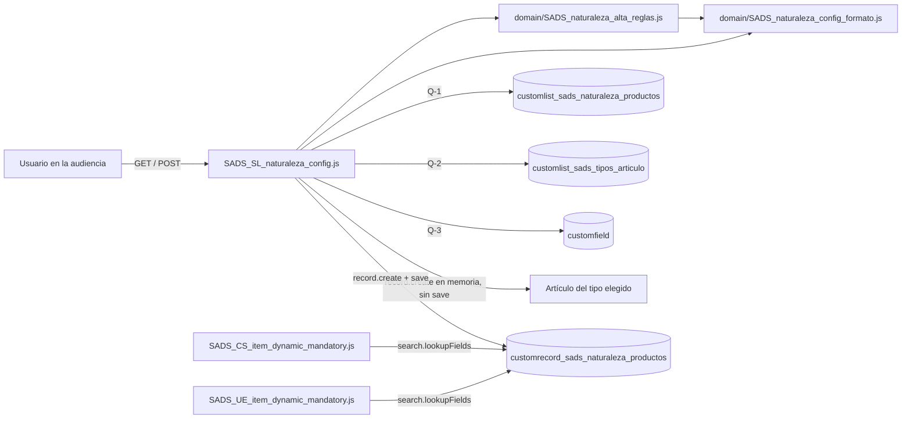
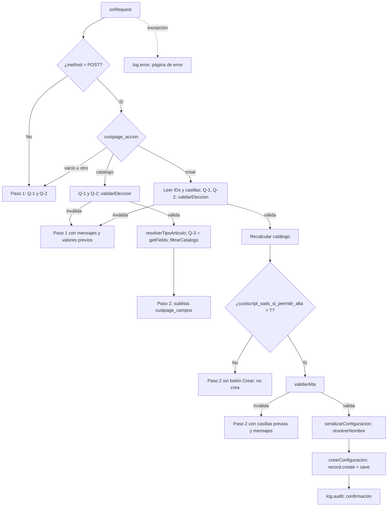

# Suitelet de alta de configuración de Naturaleza de Productos

| Dato | Valor |
|---|---|
| Fecha de generación | 2026-10-12 |
| Script | `customscript_sads_sl_naturaleza_config` |
| Deployment | `customdeploy_sads_sl_naturaleza_config` |
| Archivo | `SADS_SL_naturaleza_config.js` |
| Plataforma | SuiteScript 2.1, `@NScriptType Suitelet`, `@NModuleScope SameAccount` |
| Proyecto SDF | Account Customization "Naturaleza de Productos" (`src/manifest.xml`) |
| Diseño de origen | `planes/2026-10-12_sl-naturaleza-config_plan_v4.md` y `planes/2026-10-12_sl-naturaleza-config_prompt_v3.md` |
| Método | Análisis estático del código y de los Object XML del repositorio; resultados citados de Jest y de `project:validate` |

## Contenido
1. [Resumen ejecutivo](#1-resumen-ejecutivo)
2. [Arquitectura](#2-arquitectura)
3. [Módulos y estructura de archivos](#3-módulos-y-estructura-de-archivos)
4. [Entry point y flujo](#4-entry-point-y-flujo)
5. [Consultas SuiteQL](#5-consultas-suiteql)
6. [Contrato del JSON](#6-contrato-del-json)
7. [Reglas de negocio](#7-reglas-de-negocio)
8. [Deployment y URL](#8-deployment-y-url)
9. [Rol y permisos](#9-rol-y-permisos)
10. [Seguridad](#10-seguridad)
11. [Despliegue](#11-despliegue)
12. [Supuestos a validar en sandbox](#12-supuestos-a-validar-en-sandbox)
13. [Riesgos](#13-riesgos)
14. [Hallazgos sobre objetos existentes](#14-hallazgos-sobre-objetos-existentes)
15. [Troubleshooting](#15-troubleshooting)
16. [Pruebas y validación](#16-pruebas-y-validación)
17. [Tipos de artículo](#17-tipos-de-artículo)
18. [Fuentes](#18-fuentes)

## 1. Resumen ejecutivo

El Suitelet crea registros de `customrecord_sads_naturaleza_productos` sin que el usuario capture JSON.
El usuario elige una naturaleza disponible y un tipo de artículo.
Después marca los campos personalizados de artículo que serán obligatorios para esa naturaleza.
El script genera el texto de `custrecord_sads_naturaleza_config` con el formato que leen `SADS_CS_item_dynamic_mandatory.js` y `SADS_UE_item_dynamic_mandatory.js`.
Solo crea registros; no edita ni carga registros existentes (RN-14).

### Funciones clave
| Función | Qué hace |
|---|---|
| Naturalezas sin duplicar | Solo ofrece naturalezas activas que no tienen registro de configuración, activo o inactivo (RN-01). |
| Catálogo por tipo | Ofrece solo campos `custitem` activos que existen en un artículo del tipo elegido, creado en memoria y nunca guardado (estrategia E2). |
| JSON generado | Serializa la selección como arreglo ordenado, sin duplicados ni espacios, y lo verifica antes de guardar. |
| Recalculo en cada POST | Naturalezas, tipos y catálogo se vuelven a consultar; del formulario solo se usan IDs, que se validan. |
| Vista previa controlada | El parámetro `custscript_sads_sl_permitir_alta` separa la vista previa (F) de la creación (T). |
| Ejecución con rol mínimo | Corre con `customrole_sads_naturaleza_config_exec` como `runasrole`; nunca con Administrador. |

### Valor para el negocio
| Problema de la captura manual | Efecto del Suitelet |
|---|---|
| JSON mal formado desactiva en silencio la validación del CS y del UE | El texto se genera y se verifica con `esConfiguracionValida` antes de guardar. |
| Dos registros para la misma naturaleza | La naturaleza ya configurada no aparece y se rechaza si aparece entre pasos. |
| Campos que no aplican al tipo de artículo bloquean el guardado en el UE | Solo se ofrecen campos presentes en el tipo elegido. |

Metas del plan v4, no medidas: 100% de registros creados pasan `JSON.parse` + `Array.isArray` del CS y del UE; 0 duplicados creados desde el Suitelet; 0 campos fuera del tipo elegido.

## 2. Arquitectura

Arquitectura de nivel 1: un entry point con acceso a `N/` y dos módulos de dominio puros.
Ningún módulo de `domain/` importa `N/*`; la prueba "regla de dependencia" de cada suite lo verifica.



```
┌──────────────────────────────────────────────────────────────────────┐
│ Deployment customdeploy_sads_sl_naturaleza_config                    │
│ runasrole = customrole_sads_naturaleza_config_exec, isonline = F     │
├──────────────────────────────────────────────────────────────────────┤
│   ┌──────────────────────────────────────────────────────────────┐   │
│   │ SADS_SL_naturaleza_config.js (onRequest)                     │   │
│   │ N/ui/serverWidget, N/ui/message, N/query, N/record,          │   │
│   │ N/runtime, N/url, N/log                                      │   │
│   └───────────────┬───────────────────────────┬──────────────────┘   │
│                   │                           │                      │
│                   ▼                           ▼                      │
│   ┌───────────────────────────┐   ┌──────────────────────────────┐   │
│   │ domain/                   │──▶│ domain/                      │   │
│   │ SADS_naturaleza_alta_     │   │ SADS_naturaleza_config_      │   │
│   │ reglas.js                 │   │ formato.js                   │   │
│   │ tipos, catálogo,          │   │ contrato JSON y errores      │   │
│   │ validaciones, nombre      │   │ de dominio                   │   │
│   └───────────────────────────┘   └──────────────────────────────┘   │
└───────────────┬──────────────────────────────────────────────────────┘
                │ escribe
                ▼
┌──────────────────────────────────────────────────────────────────────┐
│ customrecord_sads_naturaleza_productos                               │
│ name, custrecord_sads_naturaleza_lista,                              │
│ custrecord_sads_naturaleza_tipo_art,                                 │
│ custrecord_sads_naturaleza_config                                    │
└───────────────▲──────────────────────────────────▲───────────────────┘
                │ lee (rol del usuario)            │ lee (rol del proyecto)
   ┌────────────┴────────────┐        ┌────────────┴────────────┐
   │ CS: pageInit,           │        │ UE: beforeSubmit        │
   │ fieldChanged, saveRecord│        │ CREATE y EDIT           │
   └─────────────────────────┘        └─────────────────────────┘
```

## 3. Módulos y estructura de archivos

| Módulo | Archivo | Propósito |
|---|---|---|
| Suitelet de alta | `SADS_SL_naturaleza_config.js` | Despacho GET/POST, consultas SuiteQL, artículo en memoria, alta del registro y formularios. |
| Formato de configuración | `domain/SADS_naturaleza_config_formato.js` | Dueño del contrato JSON. Exporta `ERRORES`, `crearErrorDeDominio`, `esErrorDeDominio`, `serializarConfiguracion`, `parsearConfiguracion` y `esConfiguracionValida`. |
| Reglas de alta | `domain/SADS_naturaleza_alta_reglas.js` | Exporta `TIPOS_ARTICULO`, `crearComparadorEtiquetas`, `resolverTipoArticulo`, `filtrarCatalogo`, `validarEleccion`, `validarAlta` y `resolverNombre`. |

Objetos SDF de esta entrega:
| Objeto | Tipo | Archivo |
|---|---|---|
| Suitelet, deployment y parámetro | `suitelet` | src/Objects/customscript_sads_sl_naturaleza_config.xml |
| Rol de ejecución | `role` | src/Objects/customrole_sads_naturaleza_config_exec.xml |
| Lista de 6 tipos base de artículo | `customlist` | src/Objects/customlist_sads_tipos_articulo.xml |
| Registro de configuración (modificado: `includename` = T y campo `custrecord_sads_naturaleza_tipo_art`) | `customrecordtype` | src/Objects/customrecord_sads_naturaleza_productos.xml |

```
src/
├── FileCabinet/
│   └── SuiteScripts/
│       └── SADS_Naturaleza_Productos/
│           ├── SADS_SL_naturaleza_config.js        # Suitelet 2.1 (entry point)
│           ├── SADS_SL_naturaleza_config.md        # Este documento
│           ├── SADS_CS_item_dynamic_mandatory.js   # Client Script (solo lectura)
│           ├── SADS_UE_item_dynamic_mandatory.js   # User Event (solo lectura)
│           └── domain/
│               ├── SADS_naturaleza_config_formato.js  # Contrato JSON
│               └── SADS_naturaleza_alta_reglas.js     # Reglas de alta
└── Objects/
    ├── customscript_sads_sl_naturaleza_config.xml  # Suitelet + deployment + parámetro
    ├── customrole_sads_naturaleza_config_exec.xml  # Rol del proyecto
    ├── customlist_sads_tipos_articulo.xml          # Lista de tipos
    └── customrecord_sads_naturaleza_productos.xml  # Registro de configuración
__tests__/
├── SADS_SL_naturaleza_config.test.js       # Entry point con jest.mock de N/
├── SADS_naturaleza_config_formato.test.js  # Contrato JSON
└── SADS_naturaleza_alta_reglas.test.js     # Reglas y sincronía de este .md
```

## 4. Entry point y flujo

| Entry point | Función | Disparador | Propósito |
|---|---|---|---|
| onRequest | `onRequest(context)` | GET o POST al deployment | Despacha por método y por `custpage_accion`; captura todo error. |

Objetos de contexto usados:
| Objeto | Uso |
|---|---|
| `context.request.method` | `POST` despacha por acción; cualquier otro método muestra el paso 1. |
| `context.request.parameters` | Lee `custpage_accion`, `custpage_naturaleza` y `custpage_tipo_art`. |
| `context.request.getLineCount` / `getSublistValue` | Lee las líneas de `custpage_campos` con `custpage_sel` = T y su `custpage_id`. |
| `context.response.writePage` | Escribe el formulario del paso, la confirmación o la página de error. |



### Paso 1 (GET, o POST con acción vacía o desconocida)
1. `cargarOpcionesDeAlta` ejecuta Q-1 y Q-2.
2. Si no hay naturalezas, muestra "Todas las naturalezas ya tienen configuración." sin selectores ni botón.
3. Si no hay tipos activos, muestra "No hay tipos de artículo activos." sin selectores ni botón.
4. Si hay opciones, agrega `custpage_naturaleza` y `custpage_tipo_art` (SELECT obligatorios con opción vacía inicial).
5. Agrega `custpage_accion` = `catalogo` (oculto) y el botón "Siguiente".

### Paso 2 (POST con `custpage_accion` = `catalogo`)
1. Recalcula Q-1 y Q-2 y aplica `validarEleccion`; si falla, regresa al paso 1 con mensajes y valores previos.
2. `resolverTipoArticulo` traduce el `scriptid` del tipo a tipo de registro.
3. `obtenerCamposAplicables` cruza Q-3 con `getFields()` de `record.create({ type, isDynamic: true })`; el artículo nunca se guarda.
4. `filtrarCatalogo` excluye `custitem_sads_naturaleza_producto`, quita duplicados y ordena.
5. Muestra naturaleza y tipo en `custpage_naturaleza_texto` y `custpage_tipo_art_texto` (solo lectura); sus IDs viajan en `custpage_naturaleza` y `custpage_tipo_art` (ocultos).
6. `custpage_accion` = `crear`; enlace "Regresar" (`custpage_enlace_inicio`) al paso 1.
7. Con el parámetro en F, muestra el aviso "Creación deshabilitada" en todo paso 2.
8. Con catálogo vacío, muestra "No hay campos personalizados activos para este tipo de artículo." sin sublista ni botón.
9. Con catálogo, agrega la sublista `custpage_campos` (LIST, botones de marcar y desmarcar todo) con columnas `custpage_sel`, `custpage_etiqueta` y `custpage_id`.
10. El botón "Crear configuración" aparece solo con el parámetro en T y catálogo no vacío.

Orden del catálogo: alfabético español por etiqueta, sin distinguir mayúsculas ni acentos, con la ñ entre la n y la o; empate por ID con comparación por código.
Se usa `Intl.Collator('es', { sensitivity: 'base' })` si ordena como español; si no, un respaldo determinista que produce el mismo orden en las pruebas.
Los SELECT del paso 1 conservan el orden de `ORDER BY` de Q-1 y Q-2.

Si `record.create` del tipo falla, se registra `log.error` con el tipo de registro y la página muestra el mensaje genérico; no se arma un catálogo parcial (R-17).

### Creación (POST con `custpage_accion` = `crear`)
1. Lee `custpage_naturaleza`, `custpage_tipo_art` y los `custpage_id` de las líneas con `custpage_sel` = T.
2. Recalcula Q-1, Q-2 y el catálogo del tipo.
3. Si `validarEleccion` falla, regresa al paso 1.
4. Si el parámetro está en F, regresa al paso 2 con las casillas enviadas y no crea nada.
5. Si `validarAlta` falla, regresa al paso 2 con las casillas previas y los mensajes.
6. `serializarConfiguracion` genera el JSON; `resolverNombre` toma el texto de la naturaleza de Q-1.
7. `crearConfiguracion` asigna `name`, `custrecord_sads_naturaleza_lista`, `custrecord_sads_naturaleza_tipo_art` y `custrecord_sads_naturaleza_config`, y guarda con `ignoreMandatoryFields: false`.
8. `log.audit` registra ID, nombre, tipo de artículo y número de campos.

### Confirmación
Muestra `custpage_nombre_creado`, `custpage_tipo_creado` y `custpage_configuracion_creada` (texto largo de solo lectura).
El enlace "Ver registro" (`custpage_enlace_registro`) aparece solo si `usuarioPuedeVerRegistro()` devuelve true.
El enlace "Crear otra" (`custpage_enlace_inicio`) regresa al paso 1.

### Campos de formulario
| ID | Tipo | Paso | Uso |
|---|---|---|---|
| `custpage_naturaleza` | SELECT / oculto | 1 / 2 | ID de la naturaleza. |
| `custpage_tipo_art` | SELECT / oculto | 1 / 2 | ID del valor de la lista de tipos. |
| `custpage_accion` | Oculto | 1 y 2 | `catalogo` o `crear`. |
| `custpage_naturaleza_texto` | TEXT, solo lectura | 2 | Texto de la naturaleza. |
| `custpage_tipo_art_texto` | TEXT, solo lectura | 2 | Texto del tipo. |
| `custpage_campos` | Sublista LIST | 2 | Catálogo con casillas. |
| `custpage_sel` | CHECKBOX, ENTRY | 2 | Campo obligatorio marcado. |
| `custpage_etiqueta` | TEXT | 2 | Etiqueta del campo. |
| `custpage_id` | TEXT | 2 | ID del campo. |
| `custpage_enlace_inicio` | INLINEHTML | 2, confirmación, error | Enlace al paso 1. |
| `custpage_nombre_creado` | TEXT, solo lectura | Confirmación | Nombre guardado. |
| `custpage_tipo_creado` | TEXT, solo lectura | Confirmación | Tipo guardado. |
| `custpage_configuracion_creada` | LONGTEXT, solo lectura | Confirmación | JSON guardado. |
| `custpage_enlace_registro` | INLINEHTML | Confirmación | Enlace al registro creado. |

### Gobernanza
Límite del Suitelet: 1,000 unidades por solicitud.
Estimado del plan (supuesto): paso 1 ~20, paso 2 ~35 y creación ~41 unidades.
No se agregó caché ni optimización (decisión del plan).

## 5. Consultas SuiteQL

Las tres consultas se ejecutan con `query.runSuiteQL({ query, params }).asMappedResults()`.
Los nombres de tabla y columna vienen de constantes del archivo; ninguna consulta concatena entrada del usuario.
Todo `scriptid` leído se normaliza a minúsculas antes de comparar.
No hay literales sensibles que redactar.

### Q-1. Naturalezas disponibles (`SQL_NATURALEZAS_DISPONIBLES`)

```sql
SELECT lista.id AS id, lista.name AS nombre
FROM customlist_sads_naturaleza_productos lista
WHERE lista.isinactive = 'F'
  AND NOT EXISTS (
      SELECT 1
      FROM customrecord_sads_naturaleza_productos cfg
      WHERE cfg.custrecord_sads_naturaleza_lista = lista.id
  )
ORDER BY lista.name
```

Propósito: lista las naturalezas activas que todavía no tienen registro de configuración (RN-01).
El anti-join no filtra `isinactive` del registro: un registro inactivo también ocupa la naturaleza.
Se ejecuta en todos los pasos; en la creación es la fuente del nombre (RN-12) y del rechazo de duplicados (RN-02).
Parámetros: ninguno.

| Tabla clave | Contenido |
|---|---|
| customlist_sads_naturaleza_productos | Valores de la lista de naturalezas. |
| customrecord_sads_naturaleza_productos | Registros de configuración ya creados. |

### Q-2. Tipos de artículo activos (`SQL_TIPOS_ARTICULO`)

```sql
SELECT tipo.id AS id, tipo.name AS nombre, tipo.scriptid AS scriptid
FROM customlist_sads_tipos_articulo tipo
WHERE tipo.isinactive = 'F'
ORDER BY tipo.name
```

Propósito: lista los tipos de artículo activos con su `scriptid`, que `TIPOS_ARTICULO` traduce a tipo de registro (RN-09, RN-10).
Parámetros: ninguno.

Tabla clave: `customlist_sads_tipos_articulo`, con 6 tipos base (sección 17).

### Q-3. Campos personalizados de artículo (`SQL_CAMPOS_ARTICULO`)

```sql
SELECT cf.scriptid AS scriptid, cf.name AS etiqueta
FROM customfield cf
WHERE cf.isinactive = 'F'
  AND cf.fieldtype = ?
  AND LOWER(cf.scriptid) LIKE ?
ORDER BY cf.name
```

Propósito: lista los campos personalizados de artículo activos (RN-03).
El resultado se cruza con `getFields()` del artículo en memoria para conservar solo los aplicables al tipo (RN-04).
Parámetros: `FIELDTYPE_CAMPO_ARTICULO` = `'ITEM'` y `PATRON_SCRIPTID_CAMPO_ARTICULO` = `'custitem%'`; ambos son supuestos.

Tabla clave: `customfield`, con las definiciones de campos personalizados.

Prueba fuera del Suitelet: las herramientas SuiteQL de interfaz no enlazan `?`; responden "Cantidad de parámetros no válida".
Usar esta versión con los parámetros sustituidos por literales:

```sql
SELECT cf.scriptid AS scriptid, cf.name AS etiqueta
FROM customfield cf
WHERE cf.isinactive = 'F'
  AND cf.fieldtype = 'ITEM'
  AND LOWER(cf.scriptid) LIKE 'custitem%'
ORDER BY cf.name
```

La herramienta corre con el rol del usuario que la abre, no con `customrole_sads_naturaleza_config_exec`; confirma columnas y valores, no permisos.

## 6. Contrato del JSON

`custrecord_sads_naturaleza_config` guarda texto JSON que al parsear da un arreglo no vacío de cadenas.
Cada cadena es un ID de campo de artículo.

| Regla | Detalle |
|---|---|
| Normalización | `validarAlta` pasa los IDs a minúsculas y quita vacíos y duplicados. |
| Recorte | `serializarConfiguracion` recorta espacios y descarta vacíos, `null` y `undefined`. |
| Duplicados | Se eliminan. |
| Orden | Ascendente por código de carácter. |
| Espacios | Ninguno; `JSON.stringify` sin sangría. |
| Vacío | Un arreglo vacío lanza `CONFIGURACION_INVALIDA` y no se crea el registro. |
| Verificación | El texto generado debe pasar `esConfiguracionValida` antes de guardarse. |

Ejemplo con IDs ficticios.
Casillas marcadas: `custitem_ejemplo_peso`, `CUSTITEM_EJEMPLO_CALIBRE`, `custitem_ejemplo_peso`.
Texto guardado:

```json
["custitem_ejemplo_calibre","custitem_ejemplo_peso"]
```

Registro resultante, también ficticio:
| Campo | Valor |
|---|---|
| `name` | Naturaleza de ejemplo |
| `custrecord_sads_naturaleza_lista` | ID interno de "Naturaleza de ejemplo" |
| `custrecord_sads_naturaleza_tipo_art` | ID interno del valor "Kit" |
| `custrecord_sads_naturaleza_config` | `["custitem_ejemplo_calibre","custitem_ejemplo_peso"]` |

Errores de dominio (`ERRORES` en `SADS_naturaleza_config_formato.js`):
| Nombre | Origen |
|---|---|
| `CONFIGURACION_INVALIDA` | `parsearConfiguracion` o `serializarConfiguracion`. |
| `TIPO_ARTICULO_DESCONOCIDO` | `resolverTipoArticulo` con un `scriptid` fuera del mapa. |
| `NATURALEZA_NO_DISPONIBLE` | `resolverNombre` con una naturaleza fuera de Q-1. |

`parsearConfiguracion` rechaza texto que no es JSON, un objeto, un arreglo vacío y un arreglo con elementos que no son cadenas con contenido.
El CS y el UE no usan todavía este módulo; siguen con su propio `JSON.parse` y `Array.isArray`.

## 7. Reglas de negocio
| ID | Regla | Dónde se aplica |
|---|---|---|
| RN-01 | Solo se ofrecen naturalezas activas sin registro de configuración, activo o inactivo. | Q-1 |
| RN-02 | Si al crear ya existe registro para la naturaleza, se rechaza. | Q-1 recalculada y `validarAlta` |
| RN-03 | El catálogo contiene solo campos personalizados de artículo activos. | Q-3 |
| RN-04 | El catálogo contiene solo campos aplicables al tipo de registro elegido. | `obtenerCamposAplicables` (E2) |
| RN-05 | Se excluye `custitem_sads_naturaleza_producto`. | `filtrarCatalogo` |
| RN-06 | Debe marcarse al menos un campo. | `validarAlta` |
| RN-07 | JSON = arreglo de cadenas, sin duplicados, orden ascendente por ID, sin espacios. | `serializarConfiguracion` |
| RN-08 | La naturaleza enviada es entera y pertenece a las disponibles recalculadas. | `validarEleccion` |
| RN-09 | El tipo enviado es entero, está activo y su `scriptid` existe en el mapa. | `validarEleccion` |
| RN-10 | Cada valor de la lista de tipos se resuelve a un tipo de registro por `scriptid`. | `resolverTipoArticulo` |
| RN-11 | El tipo de artículo se guarda en `custrecord_sads_naturaleza_tipo_art`. | `crearConfiguracion` |
| RN-12 | `name` = texto de la naturaleza tomado de Q-1 recalculada. | `resolverNombre` |
| RN-13 | Todo ID enviado existe en el catálogo recalculado del tipo. | `validarAlta` |
| RN-14 | Solo creación; no se reciben ni cargan IDs de registros de configuración. | Entry point |

Un ID interno es válido solo si `String(id).trim()` cumple `^[1-9][0-9]*$`.

## 8. Deployment y URL

| Script | Deployment | Tipo | Disparador |
|---|---|---|---|
| `customscript_sads_sl_naturaleza_config` | `customdeploy_sads_sl_naturaleza_config` | Suitelet | URL del deployment, con sesión de NetSuite |

Atributos del deployment en `customscript_sads_sl_naturaleza_config.xml`:
| Atributo | Valor |
|---|---|
| `status` | RELEASED |
| `isdeployed` | T |
| `isonline` | F |
| `runasrole` | `[scriptid=customrole_sads_naturaleza_config_exec]` |
| `allroles` / `allemployees` | F / F |
| `audslctrole` | Vacío; la audiencia se define en la UI |
| `loglevel` | AUDIT |
| `title` | SADS - Alta de Configuración de Naturaleza |
| `custscript_sads_sl_permitir_alta` | F |

Parámetro de script:
| ID | Tipo | Default | Etiqueta | Efecto |
|---|---|---|---|---|
| `custscript_sads_sl_permitir_alta` | CHECKBOX | F | Permitir creación | F: vista previa sin botón Crear (iteración A). T: creación habilitada (iteración B). |

### Patrón de URL

```
/app/site/hosting/scriptlet.nl?script={ID interno del script}&deploy={ID interno del deployment}
```

Los IDs internos difieren entre sandbox y producción; la URL se copia del registro del deployment en la UI.
El código obtiene su propia URL con `url.resolveScript` usando `runtime.getCurrentScript().id` y `deploymentId`.
El Suitelet no lee parámetros de URL: GET siempre muestra el paso 1.
Los datos viajan por POST en los campos `custpage_*` del formulario.
Con `isonline` = F no existe URL externa; el usuario necesita sesión y estar en la audiencia.

## 9. Rol y permisos

`customrole_sads_naturaleza_config_exec` ("SADS - Ejecución Config Naturaleza", centro BASIC) es el rol del proyecto.
Lo usan como `runasrole` el deployment del Suitelet y los 6 deployments del UE (decisión cerrada del plan v4).
No se asigna a usuarios.

| permkey | permlevel | Motivo |
|---|---|---|
| `LIST_CUSTRECORDENTRY` | CREATE | Crear y leer el registro de configuración (`accesstype` CUSTRECORDENTRYPERM). También cubre el `lookupFields` del UE. |
| `ADMI_CUSTITEMFIELD` | VIEW | Q-3 sobre `customfield` (necesidad supuesta). |
| `LIST_ITEM` | VIEW | `record.create` del artículo en memoria (nivel supuesto). |

No se otorgan otros permisos; Administrador está prohibido como rol de ejecución.
El CS corre con el rol del usuario y no admite `runasrole`.
Sin VIEW sobre el registro, el CS no marca obligatorios en pantalla; el UE sí valida al guardar (R-09).

## 10. Seguridad
| Control | Implementación |
|---|---|
| Rol de ejecución | `customrole_sads_naturaleza_config_exec`, con los tres permisos de la sección 9. |
| `isonline` | F. El Suitelet exige sesión de NetSuite. |
| Audiencia | `allroles` F, `allemployees` F y `audslctrole` vacío. El cliente la define en la UI. |
| Entrada no confiable | IDs enteros validados contra las listas recalculadas. El catálogo se recalcula en cada POST. |
| SQL | Solo constantes del archivo y parámetros `?`. |
| Errores | Todo error capturado va a `log.error` con nombre, mensaje y stack. La página muestra el mensaje solo si es error de dominio; cualquier otro muestra "No fue posible completar la operación. Contacte al administrador." Si dentro del `catch` también falla la resolución de la URL del Suitelet, la página se muestra sin enlace "Regresar" y ambos errores quedan en `log.error`; ningún error sale crudo. |
| Escape de HTML | Título y mensaje de `addPageInitMessage` se escapan (`&`, `<`, `>`, `"`, `'`). Los INLINEHTML solo contienen la URL de `url.resolveScript` o `url.resolveRecord`, escapada, y texto fijo. |
| Datos de NetSuite en pantalla | Nombres de naturaleza y tipo se muestran en campos TEXT o LONGTEXT INLINE. Las etiquetas de campo van en la columna TEXT de la sublista LIST, que NetSuite pinta como HTML; por eso se escapan con `escaparHtml` (quien personaliza campos de artículo puede editar una etiqueta). Verificación visual en P-14: si una etiqueta con `&` se ve como `&amp;`, NetSuite ya escapaba esa columna y el escape sobra. |
| Mensajes de validación | Solo citan un ID de campo si cumple `^[a-z0-9_]+$`; no citan IDs internos enviados. |
| Enlace al registro | Solo si `usuarioPuedeVerRegistro()` es true (R-07). Si la consulta de permiso lanza, devuelve false. |

## 11. Despliegue

Requisito: `npm test` en verde.
El hook `beforeExecuting` de `suitecloud.config.js` ejecuta Jest antes de `project:deploy`.

`src/deploy.xml` incluye `~/Objects/*` y `~/FileCabinet/*`.
Un `project:deploy` envía todos los objetos del proyecto, incluidos `customscript_sads_cs_item_dynamic_mandat` y `customscript_sads_ue_item_dynamic_mandat`.
Esos dos objetos sobrescriben en la cuenta los deployments del CS y del UE con lo que diga su XML.
`src/manifest.xml` exige CUSTOMRECORDS, SUBSIDIARIES y SERVERSIDESCRIPTING; CRM y las demás funciones son opcionales.
Supuesto: en un solo despliegue SDF resuelve las referencias `[scriptid=...]` entre objetos del mismo proyecto.

### Iteración A (sandbox `Almetal_SB`, vista previa)
| Paso | Acción |
|---|---|
| 1 | `npm test` en verde. |
| 2 | Desplegar en orden: `customlist_sads_tipos_articulo` → `customrecord_sads_naturaleza_productos` → `customrole_sads_naturaleza_config_exec` → `customscript_sads_sl_naturaleza_config`. En el mismo despliegue van el CS y el UE con sus 5 deployments nuevos en TESTING y el manifiesto con SUBSIDIARIES obligatoria. |
| 3 | Confirmar `custscript_sads_sl_permitir_alta` = F en el deployment. Antes de abrir el Suitelet, ejecutar Q-1, Q-2 y Q-3 de la sección 5 en una herramienta SuiteQL de la sandbox (por ejemplo, `N/query` en el depurador de scripts) para confirmar columnas, `scriptid` y `fieldtype` (supuestos 1 a 3); ni Jest ni `project:validate` los comprueban. |
| 4 | Configurar la audiencia del deployment en la UI. Repetirlo después de cada `project:deploy` (R-10). |
| 5 | Ejecutar P-14 empezando por Otro cargo (`val_sads_ta_otro`, R-17). Si `record.create` de `otherchargeitem` falla: inactivar `val_sads_ta_otro` en la lista; retirar `customdeploy_cs_item_othchg_mndry_flds` del CS y `customdeploy_ue_item_othchg_mndry_flds` del UE (quitar sus bloques `<scriptdeployment>` del XML e inactivarlos en la cuenta; supuesto: `project:deploy` no borra un deployment que ya existe en la cuenta); registrarlo. |
| 6 | Continuar P-14 con los demás tipos. Incluir en el catálogo de No inventariable o Servicio un campo `custitem` limitado a un subtipo (Venta, Reventa o Compra) y registrar si aparece (R-19). Si falta un campo requerido, la reintroducción de subtipos es un cambio aparte. |
| 7 | Confirmar que el UE, que corre con `customrole_sads_naturaleza_config_exec`, sigue validando artículos inventariables (`customdeploy_ue_item_invprt_mndry_flds`, RELEASED): guardar un Inventariable con una naturaleza configurada y un campo exigido vacío debe fallar con `MISSING_DYNAMIC_MANDATORY_FIELDS`. Si el guardado pasa, revisar en la bitácora del UE el registro "Error procesando validación UE": el `catch` del UE solo registra y no relanza, así que un permiso faltante del rol desactiva la validación en silencio. Reversión en la tabla de Reversión. |
| 8 | Ejecutar P-20: editar un artículo de cada tipo nuevo con el dueño del script y con otro usuario; los deployments en TESTING solo deben actuar para el dueño (R-20). El dueño es el campo Propietario del registro de script (Personalización > Scripting > Scripts); supuesto: tras `project:deploy` es el usuario autenticado en la CLI. |
| 9 | Validar los supuestos de la sección 12. Corregir en las constantes con nombre, no en las reglas. |

### Iteración B (sandbox, creación)
| Paso | Acción |
|---|---|
| 10 | Poner `custscript_sads_sl_permitir_alta` = T. Si el cambio se hace por XML y `project:deploy`, re-aplicar la audiencia. |
| 11 | Capturar a mano Nombre y Tipo de Artículo en cada registro de configuración existente (R-11). |
| 12 | Ejecutar P-15 a P-18. |
| 13 | Liberar (RELEASED) los deployments nuevos del CS y del UE tipo por tipo, solo cuando todas las naturalezas en uso para ese tipo tengan configuración propia de ese tipo (R-12). El cambio de `<status>` se hace también en el XML del CS y del UE; si solo se hace en la UI, el siguiente `project:deploy` lo regresa a TESTING. Registrar la fecha de liberación de cada tipo (R-20). |

Deployments del CS y del UE por tipo:
| Tipo | Deployment CS | Deployment UE | Estado en el XML |
|---|---|---|---|
| Inventariable | `customdeploy_item_invprt_mandatory_flds` | `customdeploy_ue_item_invprt_mndry_flds` | RELEASED |
| No inventariable | `customdeploy_cs_item_noninv_mndry_flds` | `customdeploy_ue_item_noninv_mndry_flds` | TESTING |
| Otro cargo | `customdeploy_cs_item_othchg_mndry_flds` | `customdeploy_ue_item_othchg_mndry_flds` | TESTING |
| Servicio | `customdeploy_cs_item_serv_mndry_flds` | `customdeploy_ue_item_serv_mndry_flds` | TESTING |
| Kit | `customdeploy_cs_item_kit_mndry_flds` | `customdeploy_ue_item_kit_mndry_flds` | TESTING |
| Grupo de artículos | `customdeploy_cs_item_group_mndry_flds` | `customdeploy_ue_item_group_mndry_flds` | TESTING |

R-12: CS y UE no comparan el tipo del artículo con `custrecord_sads_naturaleza_tipo_art`.
Al liberar un deployment, todo artículo de ese tipo queda sujeto a la configuración de su naturaleza, aunque se haya configurado para otro tipo.
Consecuencia: el UE marca como faltante todo campo vacío o inexistente en ese tipo y bloquea el guardado (`SADS_UE_item_dynamic_mandatory.js`).

### Producción
Mismo orden que en sandbox: iteración A, validación y luego iteración B.
Antes de desplegar, revisar la sección 14.

### Audiencia después de cada `project:deploy` (R-10)
El XML del deployment trae `audslctrole` vacío, `allroles` F y `allemployees` F.
Cada `project:deploy` deja la audiencia vacía y el Suitelet queda sin acceso para usuarios.
Después de cada despliegue se re-aplica la audiencia en la UI.

### Registros existentes (R-11)
`custrecord_sads_naturaleza_tipo_art` es obligatorio y `includename` pasa a T.
Los registros creados antes no tienen Nombre ni Tipo de Artículo.
Supuesto: la UI exigirá ambos al editarlos.
Se capturan a mano en la iteración B.
El CS y el UE solo leen `custrecord_sads_naturaleza_config`, así que estos campos vacíos no afectan la validación de artículos.

### Reversión
| Acción | Efecto |
|---|---|
| Deployment `customdeploy_sads_sl_naturaleza_config` a estado no liberado o inactivo | El Suitelet deja de estar disponible. |
| Parámetro `custscript_sads_sl_permitir_alta` = F | Regresa a vista previa sin creación. |
| Campos nuevos del registro | Se pueden dejar; no afectan al CS ni al UE. |
| Deployment nuevo del CS o del UE ya liberado que bloquea guardados (R-12) | Regresarlo a TESTING o inactivarlo, en la UI y en el XML, hasta configurar las naturalezas de ese tipo. |
| Registros creados por el Suitelet | Siguen el mismo contrato que los capturados a mano; no requieren reversión. |
| El UE con `customrole_sads_naturaleza_config_exec` deja de validar Inventariables (paso 7) | Otorgar al rol el permiso faltante, o restaurar en el XML del UE el `runasrole` anterior y volver a desplegar; decisión del usuario. |

## 12. Supuestos a validar en sandbox
1. Columnas de Q-1: `id`, `name` e `isinactive` de `customlist_sads_naturaleza_productos`, y `custrecord_sads_naturaleza_lista` de `customrecord_sads_naturaleza_productos` en SuiteQL.
2. Columnas de Q-2: `id`, `name`, `isinactive` y `scriptid` de `customlist_sads_tipos_articulo` (R-15). Si `scriptid` no existe en SuiteQL, la alternativa del plan es guardar la clave en `abbreviation` del valor.
3. Columnas de Q-3: tabla `customfield` con `scriptid`, `name`, `isinactive` y `fieldtype`; valor `FIELDTYPE_CAMPO_ARTICULO` = `'ITEM'` y patrón `PATRON_SCRIPTID_CAMPO_ARTICULO` = `'custitem%'`.
4. Tipos de registro supuestos: `inventoryitem`, `noninventoryitem` y `serviceitem` aceptados por `record.create`. Si uno falla, se corrige en `TIPOS_ARTICULO`, no en las reglas.
5. Otro cargo (R-17): la referencia de Oracle marca `otherchargeitem` como no programable desde servidor. `record.create` puede fallar; en ese caso se aplica el paso 5 de la iteración A.
6. `getFields()` de un artículo creado en memoria incluye los `custitem` aplicables a su tipo y excluye los no aplicables (E2). Con tipos base, refleja el subtipo que NetSuite asigna por omisión (R-19).
7. Nivel de `LIST_ITEM`: VIEW podría no bastar para `record.create` en memoria. Si falla, subir a CREATE y registrarlo.
8. Necesidad de `ADMI_CUSTITEMFIELD` VIEW para consultar `customfield`. Si `N/query` da error de permisos, evaluar `REPO_ANALYTICS` según el plan.
9. XML del rol y referencia `[scriptid=customrole_sads_naturaleza_config_exec]` en `runasrole`: `project:validate` los aceptó el 2026-10-12; falta confirmarlo en `project:deploy`.
10. `runasrole` funciona sin asignar el rol a usuarios.
11. `usuarioPuedeVerRegistro()` bajo `runasrole`: `runtime.getCurrentUser().getPermission` puede reflejar el rol de ejecución y no el del usuario. En ese caso el enlace "Ver registro" aparecería para todos (P-17).
12. La sublista LIST envía `custpage_id` en el POST. La columna es TEXT normal sin `updateDisplayType`; si no viaja, `validarAlta` rechaza toda selección.
13. Estado TESTING: el deployment solo se ejecuta para el dueño del script (R-20, P-20).
14. Valores de `recordtype` NONINVENTORYITEM, OTHERCHARGEITEM, SERVICEITEM, KITITEM e ITEMGROUP: `project:validate` los aceptó; falta confirmar que cada uno cubre todos los subtipos.
15. El rol del proyecto basta para el `lookupFields` del UE (`LIST_CUSTRECORDENTRY` CREATE incluye VIEW).
16. Costos de gobernanza de `record.create` y `save` usados en el estimado.

## 13. Riesgos
| ID | Enunciado | Fundamento | Consecuencia |
|---|---|---|---|
| R-03 | Se pueden crear duplicados por formulario nativo, CSV u otros scripts. | Fuera de alcance (decisión del usuario). | Dos configuraciones para una naturaleza. |
| R-04 | Dos envíos simultáneos para la misma naturaleza. | Sin bloqueo transaccional. | Duplicado; volumen bajo, aceptado. |
| R-07 | El enlace de confirmación puede fallar sin permisos propios. | `runasrole` no aplica a la navegación del usuario. | Error de permisos al abrir el registro; mitigado con `usuarioPuedeVerRegistro`. |
| R-09 | Los roles que editan artículos requieren VIEW sobre el registro para la ayuda en pantalla. | El CS corre con el rol del usuario. | Sin VIEW, el CS no marca obligatorios; el UE sí valida al guardar. |
| R-10 | `project:deploy` vacía la audiencia del Suitelet. | SDF aplica el XML del deployment. | Usuarios sin acceso hasta re-aplicarla. |
| R-11 | Registros existentes sin Nombre ni Tipo. | Campos nuevos; Tipo obligatorio. | La UI exige capturarlos al editar. |
| R-12 | Al liberar un deployment nuevo, todo artículo de ese tipo queda sujeto a su naturaleza aunque esté configurada para otro tipo. | CS y UE no comparan el tipo; el UE marca faltante todo campo vacío o inexistente. | Bloqueo del guardado de servicios, kits, grupos u otros. |
| R-15 | `scriptid` de valores de lista podría no existir en SuiteQL. | Supuesto de columnas. | No se resuelve el tipo; ningún tipo pasa `validarEleccion`. |
| R-16 | Renombrar un valor de la lista no actualiza `name`. | `name` se copia al crear. | Nombre desactualizado; aceptado. |
| R-17 | Otro cargo podría no ser programable desde servidor. | Referencia de Oracle: `otherchargeitem` no programable desde servidor. | Sin catálogo de Otro cargo; deployments OTHERCHARGEITEM a retirar. |
| R-18 | Artículos con lote o serie no tienen opción propia. | Inventariable solo como `inventoryitem`. | Sin catálogo ni validación para esos artículos hasta agregar valor, mapa y deployments. |
| R-19 | El catálogo de un tipo base refleja el subtipo por omisión del artículo en memoria. | Sin subtipos (plan v4); un campo puede limitarse por `itemsubtype`. | Campos exclusivos de otro subtipo podrían no aparecer. |
| R-20 | Los deployments en TESTING solo corren para el dueño del script. | Semántica del estado TESTING (supuesto). | Usuarios operativos sin validación en esos tipos hasta liberarlos. |

## 14. Hallazgos sobre objetos existentes
Estado de `customscript_sads_cs_item_dynamic_mandat.xml` y `customscript_sads_ue_item_dynamic_mandat.xml` a la fecha de generación; no se modificaron.

| Objeto | Hallazgo | Consecuencia |
|---|---|---|
| UE `customscript_sads_ue_item_dynamic_mandat` | Sus 6 deployments usan `runasrole` = `[scriptid=customrole_sads_naturaleza_config_exec]`, el rol del proyecto (decisión cerrada del plan v4). | Un cambio de permisos del rol aplica a la vez al Suitelet y al UE. Se confirma en el paso 7 de la iteración A. |
| UE y CS | Deployments sobre INVENTORYITEM (RELEASED) y NONINVENTORYITEM, OTHERCHARGEITEM, SERVICEITEM, KITITEM e ITEMGROUP (TESTING). | Supuesto: en TESTING el script solo corre para su dueño (R-20, P-20). Las configuraciones de tipos distintos de Inventariable no se aplican a otros usuarios hasta liberar esos deployments (paso 13, R-12). |
| UE y CS | `executioncontext` lista todos los contextos y `allroles` = T. | Sin efecto sobre el Suitelet. `project:validate` advierte que `allroles` = T solo selecciona roles internos. |
| UE y CS | `audsubsidiary` contiene IDs internos de subsidiaria explícitos. | Supuesto: los IDs internos pueden diferir entre sandbox y producción. Revisar antes de desplegar a producción. |
| UE y CS | Una nueva importación puede traer `[ACCOUNT_SPECIFIC_VALUE]` en `audsubsidiary` u otro elemento. | `project:validate` y `project:deploy` fallan con la opción por defecto. Usar `--accountspecificvalues WARNING` o limpiar esos valores. |
| UE | El script recorre el arreglo dos veces (`SADS_UE_item_dynamic_mandatory.js`, `beforeSubmit`). | Un campo faltante aparece repetido en el mensaje de `MISSING_DYNAMIC_MANDATORY_FIELDS`; fuera de alcance. |
| UE | Dato no verificable en el archivo actual: la importación inicial del UE usaba `runasrole` ADMINISTRATOR. | La guía de seguridad prohíbe ADMINISTRATOR como rol de ejecución. El XML actual ya no lo usa; confirmar que la cuenta tampoco. |
| `deploy.xml` | Incluye todo `~/Objects/*`. | Un `project:deploy` del Suitelet también despliega el CS y el UE. |

## 15. Troubleshooting

| Síntoma | Causa | Solución |
|---|---|---|
| Los usuarios no pueden abrir el Suitelet después de un despliegue. | `project:deploy` dejó la audiencia vacía (R-10). | Re-aplicar la audiencia del deployment en la UI. |
| Paso 1 muestra "Todas las naturalezas ya tienen configuración." | Toda naturaleza activa ya tiene registro, activo o inactivo (RN-01). | Agregar el valor a `customlist_sads_naturaleza_productos` o ajustar el registro existente en la UI nativa; el Suitelet no edita. |
| Paso 1 muestra "No hay tipos de artículo activos." | Todos los valores de `customlist_sads_tipos_articulo` están inactivos o Q-2 no devuelve filas. | Reactivar los valores; revisar el supuesto 2. |
| Paso 1 muestra "El tipo de artículo seleccionado no tiene un tipo de registro configurado." | El `scriptid` del valor no está en `TIPOS_ARTICULO` o Q-2 no devuelve `scriptid` (R-15). | Alinear el `scriptid` del valor con el mapa; si falta la columna, aplicar la alternativa del supuesto 2. |
| Paso 1 muestra "La naturaleza seleccionada no está disponible o ya tiene configuración." | Otro usuario u otra vía creó la configuración entre pasos (R-03, R-04). | Revisar el registro existente; elegir otra naturaleza. |
| Página "No fue posible continuar" con el mensaje genérico al abrir el paso 1. | Falla de Q-1 o Q-2: columna inexistente o permiso faltante. | Revisar el log "Alta de configuración: error inesperado"; validar los supuestos 1, 2 y 8. |
| Página genérica al pasar al paso 2 de un tipo. | `record.create` del tipo falló (R-17 o nivel de `LIST_ITEM`). | Revisar el log "Alta de configuración: no se pudo crear en memoria el tipo de artículo"; aplicar el paso 5 de la iteración A o subir `LIST_ITEM` a CREATE (supuesto 7). |
| Paso 2 muestra "No hay campos personalizados activos para este tipo de artículo." | Q-3 sin filas (valor de `fieldtype` o patrón incorrecto, o permiso) o `getFields()` no incluye los campos. | Validar los supuestos 3, 6 y 8; corregir las constantes `FIELDTYPE_CAMPO_ARTICULO` o `PATRON_SCRIPTID_CAMPO_ARTICULO`. |
| Paso 2 sin botón "Crear configuración" y con aviso "Creación deshabilitada". | `custscript_sads_sl_permitir_alta` = F. | Poner el parámetro en T (iteración B). |
| Al crear, todos los campos marcados se rechazan como fuera del catálogo. | `custpage_id` no viaja en el POST (supuesto 12). | Confirmar el supuesto 12 en sandbox y ajustar la columna. |
| Página genérica al crear. | `save` falló: campo obligatorio vacío o permiso insuficiente del rol. | Revisar el log "Alta de configuración: error inesperado"; confirmar `LIST_CUSTRECORDENTRY` CREATE en el rol. |
| "Ver registro" aparece pero da error de permisos. | `getPermission` refleja el rol de ejecución (supuesto 11, R-07). | Registrar el resultado de P-17; otorgar VIEW al rol del usuario o ajustar `usuarioPuedeVerRegistro`. |
| Artículos de No inventariable, Otro cargo, Servicio, Kit o Grupo no exigen campos a usuarios operativos. | Sus deployments están en TESTING (R-20). | Liberar por tipo según el paso 13. |
| Guardado bloqueado con `MISSING_DYNAMIC_MANDATORY_FIELDS` en un tipo recién liberado. | La naturaleza exige campos que ese tipo no tiene (R-12). | Regresar el deployment a TESTING en la UI y en el XML; crear la configuración del tipo. |
| El CS no marca obligatorios en pantalla, pero el UE sí bloquea. | El rol del usuario no tiene VIEW sobre el registro (R-09). | Otorgar `LIST_CUSTRECORDENTRY` VIEW a los roles que editan artículos. |
| Un campo de casilla configurado como obligatorio nunca bloquea el guardado. | `getValue` de una casilla devuelve `false`, que CS y UE no consideran vacío. | Comportamiento esperado: no configurar casillas. El catálogo no las excluye porque el tipo de campo en SuiteQL no está verificado. |
| `project:validate` o `project:deploy` falla por `[ACCOUNT_SPECIFIC_VALUE]`. | Valor específico de cuenta en un XML importado. | Limpiar el valor o usar `--accountspecificvalues WARNING`. |

### Bitácora del Suitelet
| Nivel | Título | Cuándo |
|---|---|---|
| AUDIT | Alta de configuración de naturaleza | Alta exitosa: ID, nombre, tipo de artículo y número de campos. |
| ERROR | Alta de configuración: no se pudo crear en memoria el tipo de artículo | Falla de `record.create` del tipo; incluye el tipo de registro. |
| ERROR | Alta de configuración: error de dominio | Error de dominio capturado en `onRequest`. |
| ERROR | Alta de configuración: error inesperado | Cualquier otro error: consulta, `save` u otro. |

### Ver los logs
1. Ir a Customization > Scripting > Script Deployments.
2. Abrir el deployment `customdeploy_sads_sl_naturaleza_config`.
3. Abrir la pestaña Execution Log.
4. Filtrar por tipo Error o Audit.

El `loglevel` del deployment es AUDIT: se ven AUDIT y ERROR, no DEBUG.
Para el UE, usar el deployment del tipo de artículo, por ejemplo `customdeploy_ue_item_invprt_mndry_flds`.
El UE registra AUDIT por cada campo evaluado y ERROR si falla la lectura o el parseo.

## 16. Pruebas y validación

### Resultados citados (2026-10-12)
| Verificación | Resultado |
|---|---|
| `npx jest` | 4 suites aprobadas de 4; 300 pruebas aprobadas de 300; 0 fallidas. |
| `SADS_naturaleza_alta_reglas.test.js` | 153 pruebas, incluida la sincronía de este documento con `TIPOS_ARTICULO` y con los XML del CS y del UE. |
| `SADS_naturaleza_config_formato.test.js` | 109 pruebas. |
| `SADS_SL_naturaleza_config.test.js` | 36 pruebas con `jest.mock` de `N/`. |
| `sample-test.js` | 2 pruebas de la plantilla de SuiteCloud. |
| `suitecloud project:validate` contra `Almetal_SB` (18:39:49 GMT-7) | SUCCESS; 0 errores; 2 advertencias de `allroles` = T en los XML del CS y del UE. Los 8 objetos del proyecto pasaron. Sin despliegue. |

Ejecución local: `npm test` (Jest 30 con `@oracle/suitecloud-unit-testing`); no requiere cuenta NetSuite.

Casos automatizados:
| Caso | Capa | Entrada | Resultado esperado |
|---|---|---|---|
| P-01 | Formato | `["upccode","custitem_b","custitem_b"]` | `'["custitem_b","upccode"]'` |
| P-02 | Formato | `"[a,b]"`, `"{}"`, `"[1]"`, `""`, `"[]"` | `esConfiguracionValida` = false; `parsearConfiguracion` lanza `CONFIGURACION_INVALIDA` |
| P-03 | Formato | `[]` y `["  "]` | `serializarConfiguracion` lanza `CONFIGURACION_INVALIDA` |
| P-04 | Reglas | Los 6 `scriptid`, también en mayúsculas; `val_inexistente` y los 9 antiguos con subtipo, como `val_sads_ta_noinv_venta` | Tipo resuelto; error `TIPO_ARTICULO_DESCONOCIDO` |
| P-05 | Reglas | Catálogo con `custitem_sads_naturaleza_producto` y duplicados | Excluido; sin duplicados; orden alfabético español |
| P-06 | Reglas | Selección vacía | `valido` false con "Marque al menos un campo." |
| P-07 | Reglas | ID fuera del catálogo | `valido` false con mensaje que cita el ID |
| P-08 | Reglas | Naturaleza no disponible, `"abc"`, `"-1"` | `valido` false |
| P-09 | Reglas | Tipo inexistente, no entero o con `scriptid` fuera del mapa | `valido` false |
| P-10 | Reglas | Naturaleza id 1 con nombre "Placas de Acero" | `"Placas de Acero"` |
| P-11 | Entry point | `runSuiteQL` lanza error | Mensaje genérico; `log.error` llamado |
| P-12 | Entry point | `accion=crear` con validación fallida | Paso 2 con casillas previas marcadas y mensaje |
| P-13 | Entry point | `save` lanza error | Mensaje genérico; el texto del error no aparece en la página |
| P-19 | Entry point | `custscript_sads_sl_permitir_alta` = F | Paso 2 sin botón Crear; `accion=crear` no crea registro |

Pruebas en sandbox (las ejecuta el equipo):
| Caso | Iteración | Entrada | Resultado esperado |
|---|---|---|---|
| P-14 | A | Catálogo de cada tipo, primero Otro cargo; incluir un campo limitado por subtipo | Catálogo coherente con el tipo; cierra R-15, R-17 y R-19 |
| P-20 | A | Deployments nuevos en TESTING; artículo de cada tipo editado por el dueño y por otro usuario | Valida solo para el dueño; cierra R-20 |
| P-15 | B | Naturaleza que ya tiene configuración | No aparece en el paso 1 |
| P-16 | B | Alta completa; artículo de ese tipo con esa naturaleza | CS y UE exigen los campos configurados |
| P-17 | B | Usuario en la audiencia sin permisos sobre registros | Crea correctamente; sin enlace "Ver registro" |
| P-18 | B | Re-despliegue con `project:deploy` | Audiencia vacía; se re-aplica en la UI |

## 17. Tipos de artículo

### Valores de `customlist_sads_tipos_articulo`
| scriptid | Texto | Tipo de registro | Estado |
|---|---|---|---|
| `val_sads_ta_inv` | Inventariable | `inventoryitem` | Supuesto; no está en la referencia de Oracle |
| `val_sads_ta_noinv` | No inventariable | `noninventoryitem` | Supuesto (R-19) |
| `val_sads_ta_otro` | Otro cargo | `otherchargeitem` | Referencia Oracle (R-17, R-19) |
| `val_sads_ta_serv` | Servicio | `serviceitem` | Supuesto (R-19) |
| `val_sads_ta_kit` | Kit | `kititem` | Referencia Oracle |
| `val_sads_ta_grupo` | Grupo de artículos | `itemgroup` | Referencia Oracle |

El mapa vive en `TIPOS_ARTICULO` de `SADS_naturaleza_alta_reglas.js` y se indexa por `scriptid` en minúsculas.
No se usa el ID interno del valor porque cambia entre sandbox y producción.
Los subtipos Venta, Reventa y Compra no se modelan (plan v4): se usa el tipo base, igual que los deployments del CS y del UE.
R-19: el catálogo de un tipo base refleja el subtipo que NetSuite asigna por omisión al crear el artículo en memoria; un campo limitado a otro subtipo podría no aparecer.
Los artículos con lote o serie no tienen opción propia (R-18); agregarlos requiere un valor nuevo en la lista, en el mapa y deployments.
La lista tiene `isordered` = T; los SELECT del paso 1 usan el orden de Q-2 (`ORDER BY tipo.name`).

## 18. Fuentes
Código y Object XML de esta entrega; Object XML del CS y del UE (solo lectura); `src/manifest.xml`; `src/deploy.xml`; `suitecloud.config.js`; `project.json`; plan v4 y prompt v3 en `planes/`.
Resultados citados: `npx jest` y `suitecloud project:validate` del 2026-10-12.
La validación de cuenta confirma que los Object XML son aceptables; no confirma el comportamiento en ejecución.
Lo marcado como supuesto se confirma en sandbox.

## 19. Resultados de Pruebas contra DEPLOY
Resultados de las 3 consultas SuiteQL de la sección 5:
Las consultas 1 y 2 fueron exitos y la 3 fallo con el error: Cantidad de parámetros no válida. Previsto: 2. Proporcionado: 0. Se uso la herramienta SuiteQL Querys de Tim Dietrich. 
Actualizado: La consultra 3 fue editada para poder ser usada dentro de la herramienta de Tim Dietrich. Nuevamente dio error: Error inesperado de SuiteScript, en el deployment el log de error arrojado es el siguiente:
### Log de ejecucion de la Query desde el Suitelet de la Herramienta SuiteQL Query Tool de Tim
|Tipo | Titulo | Fecha | Tiempo | Usuario | Detalles|
|---|---|---|---|---|---|
| Error | Query Execution Error |13/10/2026 |	5:25 AM | SISTEMAS ALMETAL	| {"type":"error.SuiteScriptError","name":"UNEXPECTED_ERROR","message":"Error inesperado de SuiteScript","id":"69d45a62-09f5-49d8-bc26-db82bcb57154-2d323032362e31302e3133","stack":["Error\n at executeQuery (/SuiteScripts/SuiteQL Query Tool - Tim Dietrich/suiteql-query-tool.v2026.1.suitelet.js:590:37)\n at queryExecute (/SuiteScripts/SuiteQL Query Tool - Tim Dietrich/suiteql-query-tool.v2026.1.suitelet.js:514:31)\n at handlePostRequest (/SuiteScripts/SuiteQL Query Tool - Tim Dietrich/suiteql-query-tool.v2026.1.suitelet.js:540:9)\n at Object.onRequest (/SuiteScripts/SuiteQL Query Tool - Tim Dietrich/suiteql-query-tool.v2026.1.suitelet.js:177:17)"],"cause":{"type":"internal error","code":"UNEXPECTED_ERROR","details":"Error inesperado de SuiteScript","userEvent":null,"stackTrace":["Error\n at executeQuery (/SuiteScripts/SuiteQL Query Tool - Tim Dietrich/suiteql-query-tool.v2026.1.suitelet.js:590:37)\n at queryExecute (/SuiteScripts/SuiteQL Query Tool - Tim Dietrich/suiteql-query-tool.v2026.1.suitelet.js:514:31)\n at handlePostRequest (/SuiteScripts/SuiteQL Query Tool - Tim Dietrich/suiteql-query-tool.v2026.1.suitelet.js:540:9)\n at Object.onRequest (/SuiteScripts/SuiteQL Query Tool - Tim Dietrich/suiteql-query-tool.v2026.1.suitelet.js:177:17)"],"notifyOff":false},"notifyOff":false,"userFacing":true}|

Todas las pruebas para el deploy fueron aporbadas y no genero ningun error nuevo,solo los esperados: 

Issues by file:
1. ~/Objects/customscript_sads_cs_item_dynamic_mandat.xml (0 error(s), 1 warning(s))
  - WARNING: Setting the <allroles> field to 'T' only selects all internal roles. Use the <audslctrole> field to includeexternal roles in the audience.

2. ~/Objects/customscript_sads_ue_item_dynamic_mandat.xml (0 error(s), 1 warning(s))
  - WARNING: Setting the <allroles> field to 'T' only selects all internal roles. Use the <audslctrole> field to includeexternal roles in the audience.

El suitelet Valida correctamente si Existen familias sin asignar. Lo comprobe abriendo el formulario contando con que solamente existia una Naturaleza en la lista y ya tenia una configuracion, al crear mas Naturalezas en la Lista sin un Registro de configuracion se mostraron las opciones de agregar y el campo de seleccion de tipo de articulo.

Para la prueba seleccione un nuevo elemento de la lista de Naturalezas y el tipo Inventariable.

Al darle al boton siguiente envia un error: No fue posible continuar
No fue posible completar la operación. Contacte al administrador.
El el log del deploy del suitelet el resultado fue:

### Log de ejecucion de nuestro suitelet
|Tipo | Titulo | Fecha | Tiempo | Usuario | Detalles|
|---|---|---|---|---|---|
| Error | Alta de configuración: error inesperado	| 13/10/2026 | 5:22 AM | SISTEMAS ALMETAL	| SSS_SEARCH_ERROR_OCCURRED: Se produjo un error de búsqueda: Record 'customfield' was not found. Error at ejecutarConsulta (/SuiteScripts/SADS_Naturaleza_Productos/SADS_SL_naturaleza_config.js:155:57) at obtenerCamposAplicables (/SuiteScripts/SADS_Naturaleza_Productos/SADS_SL_naturaleza_config.js:196:27) at obtenerCatalogo (/SuiteScripts/SADS_Naturaleza_Productos/SADS_SL_naturaleza_config.js:484:49) at atenderCatalogo (/SuiteScripts/SADS_Naturaleza_Productos/SADS_SL_naturaleza_config.js:507:23) at atenderSolicitud (/SuiteScripts/SADS_Naturaleza_Productos/SADS_SL_naturaleza_config.js:572:50) at Object.onRequest (/SuiteScripts/SADS_Naturaleza_Productos/SADS_SL_naturaleza_config.js:608:40)|
